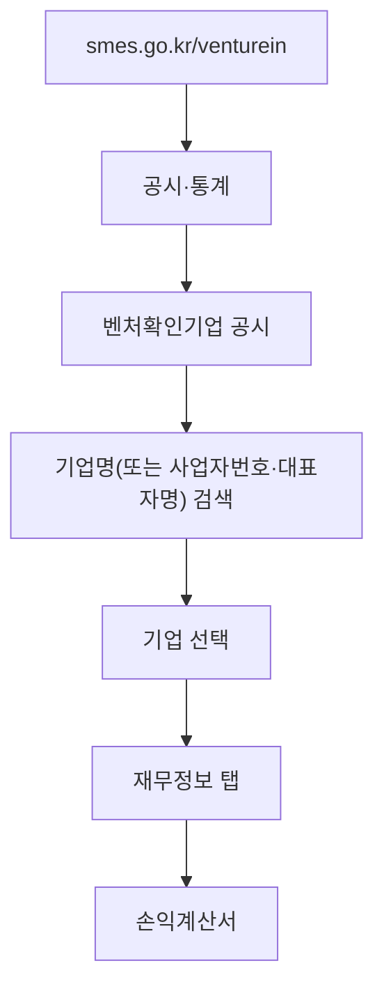

> SNS에서 돈 짧은 글(스타트업 리더를 만나면 그 회사 재무제표를 찾아본다는 내용)을 바탕으로, 공시 기준을 확인해 재구성한 노트다. 읽는 법은 아웃스탠딩의 스타트업 실적 분석 기사(「[영업이익률이 높은 주요 스타트업 20곳](https://outstanding.kr/profit20260724)」, 「[재무제표에 뜬 경고등 셋](https://outstanding.kr/2025myrealtrip20260612)」, 「[흑자 전환한 주요 스타트업 23곳](https://outstanding.kr/2025turnaround20260707)」 등, 2026)을 바탕으로 더했다.

## 왜 보는가

회사의 말과 숫자는 다를 수 있다. 행사·발표·채용 브랜딩이 활발해도 **매출이 비용을 따라가지 못하면 회사는 투자금으로 버티는 중**이다. 이직 제안을 받았을 때, 협업·외주 상대를 고를 때, 스톡옵션의 가치를 따질 때 재무제표가 가장 싼 확인 수단이다.

## 어디서 보나

| 경로 | 대상 | 볼 수 있는 것 |
| --- | --- | --- |
| [DART 전자공시](https://dart.fss.or.kr/) | 상장사, 그리고 **외부감사 대상** 비상장 회사 | 사업보고서(상장사), 감사보고서(재무상태표·손익계산서·주석) |
| [벤처인 「벤처확인기업 공시」](https://www.smes.go.kr/venturein/pbntc/searchVntrCmp) | 벤처기업확인을 받은 회사 | 일반정보, 재무정보(재무상태표·손익계산서), 투자 정보, 확인서 정보 |

### 외부감사 대상 기준

「직원 100명이 넘으면 DART에 나온다」는 말은 절반만 맞다. 종업원 수는 기준 중 하나일 뿐이다. 비상장 주식회사는 **직전 사업연도 말 기준으로 아래 넷 중 둘 이상**이면 외부감사 대상이 되고, 감사보고서가 DART에 올라온다. 자산총액이나 매출액이 500억 원 이상이면 다른 기준과 상관없이 대상이다.

| 기준 | 금액·인원 |
| --- | --- |
| 자산총액 | 120억 원 이상 |
| 부채총액 | 70억 원 이상 |
| 매출액 | 100억 원 이상 |
| 종업원 | 100명 이상 |

정확한 조문은 「주식회사 등의 외부감사에 관한 법률 시행령」을 [국가법령정보센터](https://www.law.go.kr/)에서 확인한다. 초기 스타트업은 대부분 이 기준에 못 미치므로 DART보다 벤처인 공시에서 찾을 확률이 높다.

### 벤처인에서 찾는 순서

## 무엇을 보나

| 항목 | 확인할 것 |
| --- | --- |
| 매출 구성 (수익원) | 회사가 **무엇으로 돈을 버는가**. 같은 업종이라도 주력 수익원이 다르면 성장 동력과 위험이 다르다. 예를 들어 증권사는 리테일 위탁매매 수수료, 부동산·IB, ETF·자산운용 가운데 어디가 강한지가 규모보다 중요하다. 감사보고서 주석이나 사업보고서의 매출 구성을 본다 |
| 매출액 추이 | 2~3년 사이 늘고 있는가. 매출이 거의 없다면 아직 제품-시장 적합성 전 단계다 |
| 영업이익(손실) | 손실 폭이 매출 성장보다 빨리 커지는가 |
| 영업이익률 | 매출과 영업이익은 반대로 움직이기도 한다(매출 급증·이익 급락). 하나만 보면 과대·과소평가하므로 **영업이익 ÷ 매출**로 비즈니스 모델의 체력을 본다 |
| 거래액 대비 매출 | 플랫폼은 거래액(GMV)이 커도 매출은 수수료만큼이다. 거래액 대비 매출 비율이 몇 %인지 본다. 직접 판매·예약으로 바꾸면 이용 요금 전체가 매출로 잡혀(총액 인식) 매출이 갑자기 커 보일 수 있다 |
| 비용 증가 속도 | 매출 증가분보다 지급수수료·광고비 증가분이 더 큰가 |
| 이익의 출처 | 영업손실을 이자수익·외환차익 같은 영업외수익이 메워 순이익이 난 것은 아닌가 |
| 현금성 자산 vs 연간 손실 | 남은 현금 ÷ 연간 손실 ≈ 버틸 수 있는 기간(런웨이). 1년 안팎이면 다음 투자 유치가 급하다 |
| 자본총계 | 음수면 자본잠식. 누적 손실이 투자금을 넘어섰다는 뜻이다 |
| 감사의견 (DART) | 「적정」이 아니면, 또는 계속기업 불확실성 문단이 있으면 위험 신호 |
| 부채성 항목 | 상환전환우선주(RCPS), 진행 중인 소송, 고객에게 돌려줄 미정산금. 현금이 많아 보여도 이 돈이 섞여 있을 수 있다 |

## 손익과 현금은 다르다

**통장 잔고는 이익이 아니다.** 현금주의는 돈이 실제로 오간 때 손익을 잡고, 발생주의는 거래가 발생한 때(매출 실현, 비용 발생) 잡는다. 재무제표는 발생주의다. 미수금·선수금·외상 매입이 있으면 잔고와 이익이 어긋난다. 현금흐름 관리는 현금 기준으로, 수익성 판단은 발생 기준으로 함께 본다.

| 어긋남 | 흔한 원인 | 읽는 법 |
| --- | --- | --- |
| 영업이익 흑자, 당기순손실 큼 | 금융비용, 영업외 손실, **영업권 손상차손**(과거에 인수한 회사의 가치가 떨어져 생기는 영업외 손실) | 본업은 괜찮은데 과거 인수·차입의 대가를 치르는 중일 수 있다. 영업이익과 순이익을 따로 본다 |
| 흑자인데 영업활동현금흐름 마이너스 | 매출채권·재고 증가 | 장부상 이익이 아직 현금으로 들어오지 않았다. 계속되면 위험 신호 |
| 현금은 늘었는데 본업이 약함 | 고객에게 줄 미정산금, 선수금 | 남의 돈을 잠시 들고 있는 것일 수 있다 |

사업 구조상 적자가 길어지는 경우도 있다. 공공(B2G) 사업은 초기 레퍼런스를 얻으려 낮은 마진에 수주해 수년간 적자를 내기 쉽고, 클라우드 사업은 GPU 같은 인프라 선투자가 커서 적자가 길다.

### 정산 구조가 만드는 위험

오픈마켓·중개 플랫폼은 판매대금을 먼저 받아 두었다가 입점업체에 **나중에 정산**한다. 자금 경쟁에서 밀려 무너지면 입점업체가 정산금을 못 받는 사고가 반복된다. 입점하거나 입사할 때는 **정산 주기와 재무 체력**을 함께 본다.

## 흑자·적자 전환 읽기

| 구분 | 유형 | 내용 |
| --- | --- | --- |
| 흑자전환 | 성장형 | 매출이 비용 증가를 앞지른다 |
| 흑자전환 | 비용구조 개선형 | 저마진 상품 축소, 광고·판관비·물류 효율화 |
| 흑자전환 | 자산 축적형 | 기술·인프라·제작 역량처럼 쌓아 둔 자산이 뒤늦게 실적으로 이어진다 |
| 적자전환 | 비용 추월 | 매출이 늘어도 원가·수수료·인건비가 더 빨리 는다 |
| 적자전환 | 사업 무게 변화 | 가벼운 중개에서 재고·인력이 드는 운영 사업으로 옮겨 갔다 |
| 적자전환 | 일회성 착시 | 전년 흑자가 일회성 이익 덕분이었다 |

## 부풀린 매출을 의심할 신호

- **외부감사가 시작된 해에 매출이 급감**했다(예: 100억 원대에서 1억 원 미만으로). 이전 매출이 부풀려졌을 수 있다.
- 감사보고서 주석에 **「계속기업으로서의 존속능력에 유의적 의문」**이 있다.
- 급여 총액이 매출보다 크다.
- 알려진 서비스 규모(MAU, 고객 수)에 비해 매출이 비현실적이다.
- 상장 직후라면 청약 경쟁률이 아니라 손익과 현금흐름을 본다. 경쟁률이 높아도 상장 첫날 공모가 아래로 떨어지는 일이 있다.

## 공시 전에 가늠하기

| 무엇을 | 방법 | 주의 |
| --- | --- | --- |
| 올해 실적 | 스타트업 실적은 대개 이듬해 2분기에야 공시된다. 그 전에는 **올해 거래액, 앱·웹 방문자 수, 전년 매출**을 함께 보고 셋 다 오르면 매출이 늘었을 가능성이 높다고 본다 | 추정일 뿐이다. 혁신의숲 같은 스타트업 데이터 서비스를 쓴다 |
| 기업가치 | 감사보고서의 **가장 최근 투자 단가 × 발행주식 수** | 마지막 투자 시점의 평가라 지금 가치보다 높거나 낮을 수 있다. 흐름을 보는 참고값이다 |
| 인원과 입퇴사 | 국민연금 가입자 기반 데이터 | 초단기 근로자, 프리랜서·특수고용직, 외국인처럼 의무 가입이 아닌 인력은 빠진다. 입사자가 많다고 청신호, 퇴사자가 많다고 적신호도 아니다. 고용 증가율은 이미 큰 회사일수록 낮게 나와 초기 회사가 상위에 오르기 쉽다 |

## 한계

- 공시는 **직전 연도까지의 숫자**다. 최근 대규모 투자 유치나 급성장은 반영되지 않는다. 투자 소식은 뉴스·투자 데이터 서비스로 보완한다.
- 적자 자체는 나쁜 신호가 아니다. 투자 단계 스타트업은 계획된 적자를 낸다. 봐야 할 것은 **적자의 방향과 남은 현금**이다.
- 벤처인 공시는 벤처기업확인을 받은 회사만 있고, 확인 기간이 끝나면 최신 정보가 없을 수 있다.

## 정리

- 외부감사 대상(네 기준 중 둘 이상, 또는 자산·매출 500억 이상)이면 DART, 벤처기업이면 벤처인에서 재무제표를 본다.
- 매출 추이, 영업이익률, 영업손실의 방향, 현금 대비 손실(런웨이), 자본잠식 여부를 본다.
- 이익의 출처(영업외수익), 손익과 현금흐름의 어긋남, 정산 구조와 부채성 항목을 함께 본다.
- 숫자는 과거이고 적자는 맥락이 있다. 면접에서 런웨이와 다음 투자 계획을 직접 묻는 것으로 보완한다.

관련 노트: [[interview-attitude|면접 잘 보는 법]], [[decision-making|의사결정 체크리스트]], [[investor-ir-deck|투자자가 보는 IR 자료]], [[stock-options|스톡옵션]]
