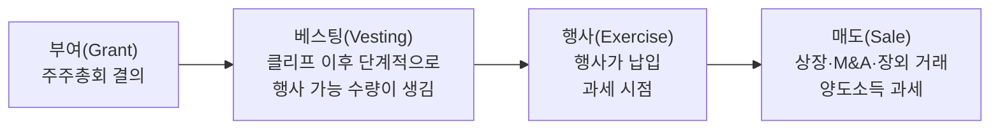

> 「[개발자가 알아야 할 스톡옵션의 모든 것](https://evan-moon.github.io/2021/12/04/what-is-stock-options/)」을 바탕으로 한국 제도 기준으로 재구성한 노트다. 세율·비과세 한도 같은 수치는 해마다 바뀌므로 넣지 않았다. 계약 전에 회사와 세무 전문가, 국세청 안내로 확인한다. 미국 스타트업의 지분 보상은 「[The Open Guide to Equity Compensation](https://github.com/jlevy/og-equity-compensation)」과 Carta의 「[Equity 101: Stock Option Basics](https://blog.carta.com/equity-101-stock-option-basics/)」를 바탕으로, 베스팅 일정 유형은 Tech Interview Handbook의 「[Understanding compensation](https://www.techinterviewhandbook.org/understanding-compensation/)」을 바탕으로 더했다. 성장 여지와 정책 두 축으로 오퍼를 평가하는 틀은 SNS에서 돌던 ESOP 오퍼 평가 글을 요약·재구성했다.

## 스톡옵션이란

**스톡옵션(주식매수선택권)**은 회사 주식을 **미리 정한 가격(행사가)**으로 살 수 있는 **권리**다. 주식 자체가 아니다. 주가가 행사가보다 오르면 권리를 행사해 차익을 얻고, 그렇지 않으면 행사하지 않으면 된다.

```text
세전 차익 = (행사 시점 주가 − 행사가) × 행사 주식 수
```

## 단계별 구조



| 단계 | 핵심 | 확인할 것 |
| --- | --- | --- |
| **부여** | 주주총회 승인을 거쳐 특정인에게 준다. 입사일과 부여일이 다를 수 있다 | 부여일, 수량, 행사가, 계약서 |
| **행사가** | 원칙은 액면가와 시가 중 높은 값. 벤처기업 특례로 시가보다 낮게 정하기도 한다 | 행사가가 시가보다 낮으면 그 차이도 과세 대상이 될 수 있다 |
| **베스팅** | 행사할 수 없던 옵션이 행사 가능 상태로 바뀌는 과정 | 베스팅 일정(예: 2년 뒤 50%, 이후 해마다 25%) |
| **클리프** | 처음으로 행사 가능 수량이 생기는 시점. 상법상 부여 결의일로부터 **2년 이상 재직**해야 행사할 수 있다 | 클리프 전에 퇴사하면 대개 전부 소멸한다 |
| **행사** | 권리를 실제로 쓴다 | 행사 기간, 퇴사 후 행사 가능 여부 |
| **매도** | 비상장 주식은 팔 곳이 제한된다 | 우선매수권, 상장·M&A 전 매도 제한 |

## 행사 방식

| 방식 | 받는 것 | 필요한 현금 |
| --- | --- | --- |
| 신주 발행형 | 새로 발행한 주식 | 행사가 × 수량을 납입 |
| 자기주식 교부형 | 회사가 가진 주식 | 행사가 × 수량을 납입 |
| 차액 정산형 | 시가와 행사가의 차액(현금 또는 주식) | 없음 |

## 세금 구조

세금은 **행사할 때**와 **팔 때** 두 번 생긴다.

| 시점 | 과세 | 특징 |
| --- | --- | --- |
| 재직 중 행사 | 행사 차익이 **근로소득** | 그해 다른 소득과 합산되어 누진세율. 한 해에 몰아서 행사하면 세율 구간이 크게 오른다 |
| 퇴사 후 행사 | 행사 차익이 **기타소득** | 원천징수 후 종합소득 신고 대상이 될 수 있다 |
| 매도 | 행사 후 오른 만큼 **양도소득** | 비상장 주식은 기업 규모에 따라 세율이 다르다 |
| 벤처기업 특례 | 일정 한도 비과세, 분할 납부, 과세 이연 | 요건과 한도가 자주 바뀐다. 회사가 특례 대상인지 먼저 확인한다 |

## 판단할 때

스톡옵션으로 실제로 돈을 벌려면 두 가지가 동시에 맞아야 한다. **회사 가치가 커져야 하고**, 커진 가치가 직원에게 돌아오도록 **정책이 직원에게 우호적**이어야 한다. 회사가 크게 성장하고 유동화 기회가 여러 번 있었는데도 직원은 정책 때문에 돈을 못 번 경우가 흔하다.

### 1. 성장 여지: 투자자처럼 진입 가치를 본다

옵션은 **입사 시점의 가치 평가**를 기준으로 부여된다. 그래서 받는 주식의 액면 금액보다 앞으로 몇 배가 될 수 있는지가 중요하다.

- **부여 금액이 아니라 기대 배수를 비교한다.** 가치 1,000억 원 회사의 7,500만 원어치 옵션이 10배 클 여지가 있다면, 가치 2조 원 회사의 2억 원어치 옵션보다 나은 오퍼일 수 있다. 1억 달러 회사가 10배 되는 것이 50억 달러 회사가 10배 되는 것보다 훨씬 흔하다.
- **고평가 라운드 직후는 불리하다.** 거품 낀 라운드 직후 입사하면 그 가치가 기준이 되어 옵션이 오를 여지가 줄어든다.
- **사업 모델과 성장 가능성을 따진다.** 시드~시리즈 B 단계일수록 중요하다. 내부 자료는 얻기 어려우니 공개 자료 조사와 면접의 역질문(매출 성장, 런웨이, 핵심 지표)으로 판단한다([[interview-attitude#회사를 면접하는 질문|회사를 면접하는 질문]], [[company-financial-check|회사 재무 확인하기]]).
- **회사 단계에 따라 불확실성이 다르다.** 초기 스타트업일수록 기대 배수도 크지만 0이 될 확률도 크다.

### 2. 정책: 성장이 내 몫이 되는가

| 항목 | 우호적 | 위험 신호 |
| --- | --- | --- |
| 베스팅 일정 | 해마다 25%씩 균등 | 뒤로 몰린 일정(사이닝 보너스 같은 보상 없이). 성과 연동 베스팅(성과가 나쁘면 해고는 경영진의 몫이지 베스팅 조건이 아니다) |
| 퇴사 시 | 베스팅된 옵션은 그대로 유지 | 퇴사하면 베스팅분까지 소멸하거나 회사가 싸게 되사는 조항 |
| 인수·매각 시 | 미베스팅분 **가속 베스팅** | 인수되면 미베스팅분이 사라짐 |
| 소통 방식 | 계약서·지분 관리 포털 등 **서면** | 「나중에 챙겨 주겠다」는 구두 약속 |
| 행사가 | 낮을수록 차익이 크다 | 최근 라운드 가격에 가까운 높은 행사가 |
| 행사 기간 | 베스팅분은 퇴사 후에도 길게(이상적으로는 무기한) 행사 가능 | 짧은 행사 기간: 팔 수도 없는 주식의 평가 차익에 세금을 미리 내야 해 사실상 포기하게 된다 |

행사가를 시가보다 낮게 주면 나라마다 세금이나 법적 제약이 붙는다(미국은 409A, 한국은 벤처기업 특례). 「낮은 행사가」는 그 범위 안에서 판단한다.

### 3. 계산과 계획

- **실질 가치로 계산한다.** 세전 차익이 아니라 행사 대금, 행사 시 세금, 매도 시 세금을 뺀 금액을 본다.
- **현금 흐름을 계획한다.** 주식을 팔기 전에 행사 대금과 세금을 먼저 내야 할 수 있다. 행사 기간이 짧으면 이 부담이 퇴사 시점에 몰린다.
- **클리프는 재직 의무 기간이다.** 연봉 협상에서 스톡옵션을 현금과 맞바꿀 때 이 기간을 함께 따진다.
- **유동성을 따진다.** 상장이나 인수가 없으면 차익을 현금으로 바꿀 방법이 거의 없다.
- **퇴사 조건을 읽는다.** 미베스팅분 소멸, 베스팅분 행사 기한은 회사마다 다르다.

RSU(양도제한조건부주식)는 권리가 아니라 조건이 충족되면 **주식 자체**를 받는다는 점이 다르다. 행사가 납입이 없고 받는 시점의 주가가 과세 기준이 된다.

## 미국 스타트업의 지분 보상

미국 회사의 오퍼를 받으면 구조는 같지만 용어와 함정이 다르다.

| 개념 | 내용 |
| --- | --- |
| 일반 일정 | **4년 베스팅, 1년 클리프**가 표준이다. 1년을 채우면 25%가 한 번에 베스팅되고 이후 매달(또는 분기마다) 나눠 베스팅된다. 4,800주를 받았다면 1년째에 1,200주, 이후 3년간 매달 100주다. 클리프는 한 달 일하고 주식을 사서 떠나는 것을 막는다 |
| 일정 유형 | 같은 4년 총액도 해마다 받는 몫이 다르다. **균등형**은 해마다 25%다(Meta는 클리프 없이 분기마다 나눠 준다). **뒤로 몰린 일정(back-loaded)**은 Amazon의 5/15/40/40처럼 앞 2년이 적어, 그 공백을 사이닝 보너스로 메운다. **앞으로 몰린 일정(front-loaded)**은 Google이 여러 차례 바꿔 온 38/32/20/10 같은 형태다. **1년 단위 부여**는 Lyft·Stripe처럼 첫해 몫만 주고 이후는 평가에 따라 해마다 새로 주는 방식이라, 추가 부여 정책을 확인해야 한다. 회사가 일정을 자주 바꾸므로 오퍼 문서의 일정이 기준이다 |
| ISO와 NSO | 둘 다 스톡옵션이고 **세금 시점**이 다르다. NSO는 행사할 때 차익(시가 − 행사가)이 근로소득으로 과세되고 팔 때 다시 과세된다. ISO는 행사 후 1년, 부여 후 2년을 보유하면 팔 때만 양도소득으로 과세될 수 있다. ISO는 직원에게만 줄 수 있고, 어느 쪽을 줄지는 대개 회사가 정한다 |
| 409A 평가와 FMV | 거래가 없는 비상장 주식의 공정 시장 가치(FMV)를 정하는 외부 평가다. 행사가와 세금 계산의 기준이 된다. 투자 라운드의 우선주 가격보다 보통 낮다 |
| AMT 함정 | ISO는 행사 시점에 일반 소득세는 없어도, 행사가와 409A 가치의 차이가 **대체 최저세(AMT)** 계산에 들어간다. 주식을 팔 수 없는 상태에서 큰 세금 청구서를 받을 수 있다. 닷컴 버블 때 이것으로 파산한 사례가 있다 |
| 조기 행사와 83(b) 선택 | 회사가 허용하면 베스팅 전에 미리 행사(early exercise)할 수 있다. 이때 30일 안에 IRS에 **83(b) 선택**을 직접 신고하면, 나중에 베스팅될 때가 아니라 지금(가치가 낮을 때) 기준으로 과세된다. 주가가 오르지 않거나 베스팅 전에 떠나면 낸 세금은 돌려받지 못한다 |
| 퇴사 후 행사 기간(PTEP) | 퇴사하면 베스팅이 멈추고, 베스팅된 옵션도 **보통 90일** 안에 행사하지 않으면 사라진다. 행사 대금과 세금을 한꺼번에 마련해야 해서 일찍 들어와 회사를 키운 사람이 떠날 때 지분을 잃기 쉽다. ISO를 NSO로 바꿔 행사 기간을 5~10년으로 늘린 회사(Pinterest, Coinbase, Quora 등)도 있지만 90일이 여전히 기본이다. 회사는 퇴사할 때 이 기한을 알려 줄 의무가 없다 |
| RSU | 상장사·대형 비상장사의 기본 보상이다. 베스팅되는 날 가치로 **자동 과세**되어 과세 시점을 고를 수 없다. 비상장 스타트업은 직원이 낼 세금 현금이 없어 RSU 대신 옵션을 주거나, 상장 같은 두 번째 조건이 충족돼야 지급하는 이중 조건(double trigger)을 붙인다 |

오퍼를 받으면 다음을 묻는다. 답하는 태도 자체가 회사의 투명성을 보여 준다.

- **지분율**: 이 주식 수는 몇 %인가? 분모가 발행 주식 수인가, 완전 희석(fully diluted) 기준인가? 전환될 SAFE·전환사채가 얼마나 있나?
- **가치**: 직전 라운드 가치 평가와 최근 409A 가치는? 보통주가 가치를 가지려면 매각가가 얼마를 넘어야 하나(우선주의 청산 우선권 총액)?
- **옵션**: 조기 행사가 되나? 퇴사 후 행사 기간을 늘려 주나?
- **베스팅**: 모두 같은 일정인가? 인수되면 베스팅이 가속되나? 추가 부여 정책이 있나? 베스팅된 주식을 회사가 되살 권리가 있나?

협상에서 지분을 어떻게 다루는지는 [[job-offer-negotiation|연봉 협상]]에 있다.

## 정리

- 스톡옵션은 주식이 아니라 행사가로 살 권리다.
- 부여·베스팅·행사·매도 단계마다 조건과 비용이 있다.
- 세금은 행사와 매도 두 번, 행사 차익은 근로소득으로 합산된다.
- 오퍼는 진입 가치 대비 성장 여지와 직원 친화적 정책 두 축으로 본다. 부여 금액끼리 비교하지 않는다.
- 숫자는 세후·현금 흐름·유동성까지 넣어 계산한다.
- 미국 오퍼는 지분율의 분모, 청산 우선권, 퇴사 후 행사 기간, ISO의 AMT를 먼저 확인한다.

관련 노트: [[company-financial-check|회사 재무 상태 확인하기]], [[us-hiring-process|미국 채용 절차]]
