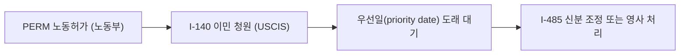

> 시애틀의 개발자 Hojune Yoo의 「[미국 개발자가 알려주는 미국으로 가는 가장 현실적인 방법](https://velog.io/@diogenes0803/미국-개발자가-알려주는-미국으로-가는-가장-현실적인-방법)」(2022.06)을 바탕으로, 비자 제도는 USCIS 발표와 이민법 자료로 2026년 기준으로 고쳐 재구성한 노트다. 해외에서 지원하는 요령은 Relocate.me의 「[Landing a (tech) job abroad: 7 simple tips](https://relocate.me/blog/job-relocation/landing-a-tech-job-abroad-7-simple-tips/)」로 보강했다.

## 왜 비자가 먼저인가

한국 개발자의 미국 취업을 막는 것은 대개 영어·실력·경력이 아니라 **일할 수 있는 법적 자격(work authorization)**이다. 회사는 비자 스폰서가 필요한 해외 지원자를 채용 초기에 거른다. 미국 채용 시스템의 Knockout 질문에 「비자 스폰서십이 필요한가」가 거의 빠지지 않는 이유다([[us-hiring-process|미국 개발자 채용 프로세스와 ATS]]).

미국에서 일할 수 있는 방법은 세 갈래다.

| 경로 | 내용 |
| --- | --- |
| 시민권·영주권 | 제약이 없다. 미국 시민과 결혼해 영주권을 받는 경우가 여기에 든다 |
| 사내 전근 (L-1) | 다국적 회사의 해외 지사에서 **최근 3년 중 1년 이상** 연속 근무한 직원을 미국 지사로 옮긴다. 추첨이 없다 |
| 취업 비자 (H-1B 등) | 미국 회사가 스폰서가 되어 신청한다. 일반 개발자에게 가장 흔한 길이지만 추첨이 있다 |

## H-1B의 구조

H-1B는 학사 이상 학위(또는 동등 경력)가 필요한 전문직 비자다. 2년제 학위만으로는 대개 자격이 안 된다.

| 항목 | 내용 |
| --- | --- |
| 연간 쿼터 | 일반 65,000건 + 미국 석사 이상 학위자 20,000건 |
| 신청자 | 쿼터의 몇 배다. 그래서 등록자 중에서 추첨한다 |
| 일정 | 3월에 등록·추첨, 4월부터 청원서 제출, **10월 1일부터 근무**. 지금 뽑아도 반년 뒤에야 일할 수 있어 해외 지원자를 꺼리는 이유가 된다 |
| 추첨 방식 (FY2027부터) | 순수 무작위에서 **임금 가중 추첨**으로 바뀌었다. 제시 임금이 노동부 기준 임금 Level I~IV 중 어디에 드는지에 따라 1~4번 추첨권을 받는다. 연봉이 높은 오퍼일수록 당첨 확률이 높다 |
| 석사 추가 쿼터 | 미국 기관의 석사 이상 학위자는 일반 추첨에서 떨어져도 20,000건 추첨에 한 번 더 들어간다 |

- 과거에는 연봉·학력과 무관한 순수 추첨이라 당첨률이 30% 안팎이었다. 2026년 2월 시행된 규칙으로 신입(Level I) 오퍼는 오히려 불리해졌다.
- 2025년 9월 대통령 포고문으로 미국 밖에서 새로 신청하는 H-1B에 10만 달러 지급 요건이 생겼다. 2026년 6월 매사추세츠 연방지방법원이 시행 지침을 무효화했고 7월 제1순회항소법원이 정부의 집행 정지 요청을 기각해 징수가 멈췄다. 다만 정부의 본안 항소가 진행 중이고, D.C. 연방지방법원은 반대로 요건을 유지하는 판결을 내렸으며(항소심 계류), 2026년 9월 포고문은 요건을 2027년 9월까지 연장했다([Ellis 정리](https://www.ellis.com/resources/h1b-100k-fee-extended-2027)). 2026년 9월 30일에는 캘리포니아 북부 연방지방법원도 원래 포고문과 연장 포고문 모두에 대해 집행을 막는 예비적 금지명령을 내려([Fragomen 정리](https://www.fragomen.com/insights/united-states-california-federal-court-issues-preliminary-injunction-against-the-dollar100000-h-1b-fee.html)), 2026년 11월 기준 포고문에 따른 10만 달러는 징수되지 않는다. 상태가 계속 바뀌므로 신청 시점에 [USCIS H-1B FAQ](https://www.uscis.gov/newsroom/alerts/h-1b-faq)에서 상태를 확인해야 한다.
- 실제로 H-1B를 받는 사람의 다수는 **이미 미국에서 OPT로 일하고 있는 미국 졸업생**이다. 회사는 이미 함께 일해 본 사람의 비자를 신청한다.

## 연고 없는 한국 개발자의 현실적인 경로

| 경로 | 흐름 | 위험 |
| --- | --- | --- |
| 미국 학위 → OPT → H-1B | 미국 대학에서 컴퓨터 관련 학위를 받으면 F-1 학생은 OPT로 1년, STEM 전공은 24개월 연장까지 **최대 3년** 일할 수 있다. 그동안 H-1B 추첨을 여러 번 시도한다 | 3년 안에 당첨되지 못하면 돌아가야 한다. 학비·생활비가 크다 |
| 캐나다 지사 → L-1 전근 | 캐나다는 취업 이민이 상대적으로 쉽다. 미국 회사의 캐나다 지사에서 1년 이상 일한 뒤 미국 지사로 옮긴다 | 전근은 회사·팀의 승인이 필요하다. 1년 이상 걸린다 |
| 결혼 등으로 영주권 | 시민권자 배우자는 영주권을 받을 수 있다 | 취업 전략이라 부르기 어렵다 |

캐나다 경로는 해외 채용을 활발히 하고 미국 본사와 가까운 캐나다 지사(예: 밴쿠버)를 노리는 것이 일반적이다.

온라인 석사는 비자를 주지 않는다. 다만 미국 기관의 석사 학위라 H-1B 석사 추가 쿼터 대상이 될 수 있다.

## 영주권 경로

비자는 회사에 묶인 신분이라 그동안은 이직과 구직이 모두 제약을 받는다. 영주권(green card)이 목표라면 **가장 확실한 경로를 일찍 정하는 것**이 중요하다. 어느 경로든 서류 접수부터 카드까지 수년이 걸린다.

### 취업 영주권의 단계

- **PERM**은 「이 자리에 채용할 수 있는 미국인 노동자가 없다」를 회사가 구인 절차로 증명하는 단계다. 같은 직군에서 감원한 회사는 이 증명이 어려워 PERM 진행을 멈추기도 한다. 그래서 레이오프가 잦은 시기에는 회사 규모보다 **실제로 PERM을 진행하고 있는지**를 확인한다.
- 회사마다 「입사 후 일정 기간 근무한 뒤 진행」 같은 사내 정책이 있다. 오퍼 단계에서 시작 시점과 비용 부담 주체를 물어 둔다.

| 범주 | 대상 | PERM |
| --- | --- | --- |
| EB-2 | 석사 이상, 또는 학사 + 해당 분야 5년 이상 경력 | 필요 |
| EB-2 NIW (국가 이익 면제) | 하는 일이 미국의 국가 이익에 상당한 가치가 있음을 본인이 입증. 고용주 없이 본인이 청원한다 | 면제 |
| EB-3 | 학사 학위가 필요한 전문직, 2년 이상 경력의 숙련직 | 필요 |
| EB-1C | 다국적 기업의 관리자·임원. 해외 지사에서 최근 3년 중 1년 이상 관리직으로 일한 뒤 미국 지사로 옮긴 경우 | 면제 |

- 한국 회사의 미국 법인으로 L-1(관리자는 L-1A)을 받아 옮긴 뒤 EB-1C나 PERM으로 영주권을 받는 경로가 많이 쓰인다. 다만 연봉 수준이 미국 테크 기업보다 낮은 경우가 많다.
- NIW는 논문·특허·수상 같은 근거로 입증하지만 심사가 엄격해 승인을 장담하기 어렵다. 학위를 더 따는 것이 오히려 직무 범위를 좁혀 취업을 어렵게 할 수도 있다.

### 가족 초청

영주권자의 가족은 가족 초청 범주로 신청한다.

| 범주 | 대상 |
| --- | --- |
| F2A | 영주권자의 배우자, 21세 미만 미혼 자녀 |
| F2B | 영주권자의 21세 이상 미혼 자녀 |

대기 기간은 국무부가 매달 내는 [Visa Bulletin](https://travel.state.gov/content/travel/en/legal/visa-law0/visa-bulletin.html)의 우선일로 정해진다. 범주, 출생 국가, 미국 안에서 신분 조정을 하는지 해외 영사관에서 처리하는지에 따라 몇 년씩 차이가 나므로 계획은 보수적으로 잡는다.

## 출장과 단기 파견: B-1과 ESTA로 할 수 있는 일

취업 비자 없이 미국에 들어가 일하는 흔한 경우가 출장이다. 단기 상용 비자인 **B-1**과 비자 면제 프로그램의 전자여행허가 **ESTA**는 「일하러 가는」 신분이 아니다. ESTA로 입국하면 B-1과 같은 범위의 활동을 최대 90일 동안 할 수 있을 뿐이다.

| 구분 | 내용 |
| --- | --- |
| 허용되는 활동 | 회의·상담, 계약 협상, 컨퍼런스·전시회 참석 같은 상용 활동 |
| 장비 설치·수리 | 미국 밖 회사에서 구매한 장비를 **설치, 서비스, 수리**하거나 미국 작업자에게 그 방법을 교육하는 것은 허용된다. 조건은 판매 계약서에 판매자가 그 서비스나 교육을 제공하도록 명시돼 있고, 파견되는 사람이 그 계약 이행에 꼭 필요한 고유 지식을 갖추고 있으며, 미국에서 보수를 받지 않는 것이다 |
| 허용되지 않는 활동 | 미국 고용주를 위해 일하거나 미국에서 보수를 받는 것, 건물·시설을 짓는 **건설·시공 작업 자체** (건설 작업자를 감독하거나 교육하는 일은 예외) |

- 체류 자격이 허용하지 않는 일을 하면 불법 취업으로 단속, 구금, 추방될 수 있고 이후 입국에도 불이익이 남는다. 회사가 관행으로 보냈더라도 **불이익은 개인이 진다.**
- 출장·파견 전에 실제로 할 일이 무엇인지, 장비 매매 계약서에 설치·교육 조항이 있는지, 보수를 어디서 받는지를 확인하고 이를 보여 주는 회사 서류를 가지고 간다.
- 현지에서 실제 노동을 하는 장기 파견은 L-1 같은 취업 가능한 비자가 필요하다.
- 허용 범위는 국무부의 [B-1 안내](https://travel.state.gov/content/travel/en/us-visas/business/b-1-fact-sheet.html)와 외교업무편람 [9 FAM 402.2-5](https://fam.state.gov/fam/09FAM/09FAM040202.html)가 기준이고, 입국 심사는 세관국경보호청(CBP)이 따로 판단한다.

## 지금 할 수 있는 준비

| 할 일 | 방법 |
| --- | --- |
| LinkedIn 프로필 | 영어권에서 일할 의향과 미국 취업 관심을 드러낸다. 미국 리크루터는 LinkedIn으로 먼저 연락한다. 일상 회화 수준이면 충분하고, 문법 실수는 크게 문제 되지 않는다 |
| 재미 한인 개발자 커뮤니티 | 지역별 한인 IT 전문가 모임이 멘토링·모의 면접·행사를 연다. 온라인 행사는 한국에서도 참여할 수 있다 |
| 리크루터·헤드헌터 연결 | 지금 열린 자리가 없어도 연락해 둔다. 연결이 나중의 기회가 된다([[resume-writing#리크루터에게 먼저 보내는 메일\|리크루터에게 보내는 영문 이메일]]) |
| 해외에서 지원하는 요령 | 레주메 첫머리를 「비자 스폰서가 필요하다」로 시작하지 않는다. 리크루터는 레주메 하나를 평균 7초 남짓 훑으며 첫 몇 문장과 굵은 글씨만 보므로 기술과 성과를 먼저 보여 주고 비자는 뒤에 적는다. 그 지역에 머물 날짜를 알리면(여행과 면접을 묶기) 현장 면접 기회가 는다. LinkedIn 위치를 옮겨 갈 지역으로 바꾸면 그 지역 리크루터 검색에 걸린다. 처음부터 해외 채용을 하는 회사가 모인 이주 전문 채용 보드를 쓴다 |
| 코딩 인터뷰 | 경력이 길어도 면접은 알고리즘 문제로 본다. 백준·프로그래머스로 기초를 다지고 LeetCode를 **영어로 설명하며** 푼다 |

## 정리

- 미국 취업의 첫 관문은 실력이 아니라 비자다.
- H-1B는 추첨이고, 2026년부터 연봉이 높을수록 유리한 가중 추첨이다. 해외 신규 신청 수수료는 소송 중이라 그때그때 확인한다.
- 연고가 없다면 미국 학위 → OPT → H-1B, 또는 캐나다 지사 → L-1이 현실적이다.
- 영주권은 PERM → I-140 → 신분 조정 순서로 수년이 걸린다. PERM을 실제로 진행하는 회사인지, EB-1C·NIW처럼 PERM이 면제되는 길이 있는지 일찍 확인한다.
- 출장용 B-1과 ESTA는 일하는 신분이 아니다. 실제 업무가 허용 범위 안인지 가기 전에 확인한다.
- 어느 길이든 실력이 기본이다. 코딩 인터뷰와 LinkedIn을 지금부터 준비한다.

관련 노트: [[us-hiring-process|미국 개발자 채용 프로세스와 ATS]], [[australia-skilled-migration|한국 개발자가 호주에서 일하는 경로: 기술이민 세 갈래]], [[resume-writing|합격하는 영문 레주메 작성법]], [[working-holiday|워킹홀리데이]]
