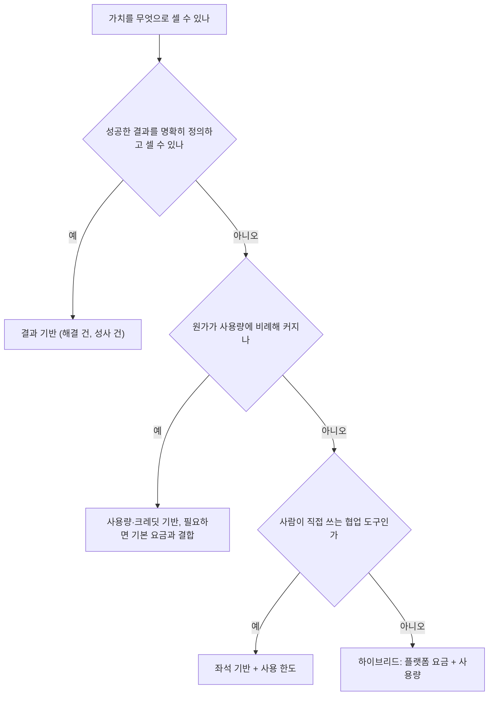

> 미라클레터의 「사스포칼립스의 본질: AI는 SW를 죽일까, 진화시킬까」(2026.02)와 팩플의 「챗GPT는 1000만원 청구했다 “쓴 만큼 내라” AI발 요금 폭탄」(2026.08)을 바탕으로, 가격 사례는 Stripe의 [Intercom Fin 사례](https://stripe.com/customers/fin-ai), Salesforce의 [Agentforce 가격 발표](https://www.salesforce.com/news/press-releases/2025/05/15/agentforce-flexible-pricing-news/), 총이익률은 Bessemer의 「[The State of AI 2025](https://www.bvp.com/atlas/the-state-of-ai-2025)」로 확인해 재구성한 노트다.

## 사스포칼립스: 좌석 모델의 위기

**사스포칼립스(SaaSpocalypse)**는 SaaS와 아포칼립스를 합친 말로, AI 에이전트가 기존 소프트웨어 사업을 무너뜨릴 수 있다는 우려를 가리킨다. 2026년 2월 초 Anthropic이 Claude Cowork용 법률 플러그인을 내놓은 뒤 리걸테크·정보 서비스·애플리케이션 소프트웨어 주가가 한꺼번에 급락하면서 널리 쓰였다.

논리는 두 갈래다.

| 우려 | 내용 |
| --- | --- |
| **좌석이 줄어든다** | SaaS 매출은 대부분 사용자 수(seat)에 비례한다. 에이전트가 사람 열 명의 일을 하면 고객은 같은 소프트웨어를 계속 쓰면서도 좌석을 줄인다. **제품이 더 많은 일을 할수록 매출이 줄어드는 역설**이다 |
| **사지 않고 만든다** | 바이브 코딩으로 사내 도구를 직접 만드는 비용이 낮아지면 「왜 사야 하지? 만들면 되는데」라는 질문이 나온다. 구매·계약·커스터마이징에 몇 주씩 걸리는 표준 SaaS가 불리해진다 |

반론도 있다. 에이전트도 결국 기록 시스템, 권한, 감사 추적, 업무 흐름을 갖춘 소프트웨어 위에서 일하고, 기존 SaaS 회사도 에이전트를 자기 제품에 넣는다. 확실한 것은 **사용자 수에 매출을 묶는 가격 구조가 가치와 어긋나기 시작했다**는 점이다. 무엇이 쉽게 대체되지 않는지는 [[data-moat|데이터 해자의 조건]]에 있다.

## 가격 모델 비교

| 모델 | 과금 단위 | 맞는 경우 | 위험 |
| --- | --- | --- | --- |
| **좌석 기반(seat-based)** | 사용자 1명당 월·연 정액 | 사람이 직접 쓰는 협업 도구 | 에이전트가 일을 대신할수록 매출이 줄어든다. 헤비 유저의 추론 비용을 정액이 감당하지 못한다 |
| **사용량 기반(usage-based)** | 토큰, API 호출, 작업 수, 크레딧 | 사용량이 원가(추론 비용)와 비례하는 제품 | 고객이 비용을 예측하기 어렵다. 청구서 충격으로 사용을 스스로 줄인다 |
| **결과 기반(outcome-based)** | 해결한 상담, 성사된 건 등 측정 가능한 결과 | 성공을 명확히 정의하고 셀 수 있는 업무 | 「결과」 정의를 두고 분쟁이 생긴다. 실패해도 들어간 추론 비용은 공급자가 떠안는다 |
| **하이브리드** | 기본 좌석·플랫폼 요금 + 사용량 | 사람과 에이전트가 함께 쓰는 제품 | 구조가 복잡해 설명·영업이 어렵다 |
| **무제한 정액(엔터프라이즈 계약)** | 기업 단위 정액 | 큰 고객의 예산 예측성을 우선할 때 | 사용량이 예상을 넘으면 공급자의 마진이 무너진다 |

### 사례

| 회사 | 방식 | 내용 |
| --- | --- | --- |
| Intercom Fin | 결과 기반 | AI 상담 에이전트가 **해결 1건당 0.99달러**. 고객이 답이 해결됐다고 확인하거나, 마지막 답 뒤에 추가 도움을 요청하지 않으면 해결로 센다. 좌석 과금은 Fin이 일을 많이 할수록 상담원 좌석이 줄어 가치와 반대로 움직였고, 대화당 과금은 가치를 반영하지 못했다 |
| Salesforce Agentforce | 대화당 → 행동당 크레딧 | 대화당 2달러로 시작해, 에이전트의 행동(action) 하나에 20크레딧(0.10달러)을 쓰는 Flex Credits를 더했다. 결과가 아니라 에이전트가 수행한 단계를 센다 |
| Anthropic Claude Enterprise | 좌석 + 사용량 | 좌석 요금에 사용량 한도를 묶어 주던 방식에서, 좌석 요금과 별도로 사용량을 청구하는 방식으로 바꾸고 기존 고객은 갱신 때 옮겨 갔다 |

## 추론 비용과 총이익률

```text
총이익률 = (매출 - 매출원가) / 매출
AI 제품의 매출원가 = 호스팅 + 요청마다 드는 추론(모델 API·GPU) 비용 + 사람 검수 비용
```

- 전통 SaaS는 사용자 한 명을 더 받아도 추가 원가가 거의 없어 총이익률이 높다. AI 제품은 **요청 하나하나에 원가가 붙는다.**
- 빠르게 크는 AI 회사의 총이익률은 낮다. Bessemer는 1년 만에 매출이 폭발적으로 는 「슈퍼노바」형 AI 회사의 평균 총이익률을 약 25%, SaaS에 가까운 「슈팅 스타」형을 약 60%로 봤다. 분포를 얻으려고 이익을 잠시 포기하는 경우가 많다.
- **파워 유저 문제**: 정액제에서 소수의 헤비 유저가 평균의 수십 배를 쓰면 그 고객은 적자다. 정액 요금에 사용 한도를 붙이거나, 한도를 넘는 부분을 사용량으로 받는 이유다.
- 모델 단가는 내려가지만, 에이전트는 한 작업에 더 많은 단계와 토큰을 쓰므로 작업당 비용이 함께 내려간다는 보장은 없다.

## 크레딧 설계

**크레딧**은 토큰·호출·작업처럼 원가가 다른 단위를 하나의 구매 단위로 묶은 것이다.

| 장점 | 주의 |
| --- | --- |
| 모델·기능마다 다른 원가를 크레딧 소모량으로 흡수한다 | 고객은 「크레딧 1개가 무슨 일을 하나」를 알기 어렵다. 소모표를 공개한다 |
| 선불로 팔아 현금흐름과 예산 예측성을 얻는다 | 소진 속도가 들쭉날쭉하면 고객이 불신한다. 사용량 알림과 상한을 둔다 |
| 새 기능을 가격표 개편 없이 크레딧 소모로 붙인다 | 미사용 크레딧의 이월·소멸 규칙을 분명히 한다 |

결과 기반 가격도 계절성과 새 제품의 불확실성 때문에 고객에게 지출이 들쭉날쭉하게 느껴질 수 있다. Intercom은 좌석 예산을 해결 건으로 옮겨 쓰게 하고, 1년 동안 나눠 쓰는 연간 묶음을 더해 이 문제를 풀었다.

## 고객 쪽: 쓴 만큼 내는 시대의 비용 관리

기업용 AI가 정액제에서 종량제로 옮겨 가면서 고객 쪽 과제는 **토큰 효율**이 됐다.

| 방법 | 내용 |
| --- | --- |
| 모델 라우팅 | 어려운 추론은 고성능 모델에, 요약·분류 같은 가벼운 일은 작은 모델에 보낸다. 무조건 토큰을 쏟던 방식(토큰맥싱)에서 작업 난도에 맞춰 모델을 고르는 방식(모델맥싱)으로 옮겨 간다 |
| 자료 구조화 | 에이전트가 필요한 부분만 읽도록 자료를 미리 정리해, 헤매며 버리는 토큰을 줄인다 |
| 하네스·스킬 | 규칙·도구·환경을 설계하고, 반복 지시는 스킬로 고정한다([[harness-engineering\|프롬프트에서 하네스로]]) |
| 지출 한도와 알림 | 팀·사용자별 상한을 두고 사용량을 모니터링한다. 한도를 풀자마자 며칠 만에 큰 청구서가 나오는 일이 흔하다 |

## 모델을 고르는 기준



- **가격 단위는 고객이 느끼는 가치와 같은 방향으로 움직여야 한다.** 제품이 일을 더 할수록 매출이 줄어드는 단위는 바꾼다.
- 고객이 예산을 짤 수 있어야 한다. 사용량 과금에는 예측 도구(사용량 대시보드, 상한, 연간 묶음)를 함께 준다.
- 원가 구조를 먼저 안다. 고객당 추론 비용 분포를 보고, 파워 유저가 적자를 내지 않는 한도를 둔다.
- 처음부터 완벽한 가격은 없다. 빠르게 바꿀 수 있는 과금 인프라를 갖추고 반복한다.

## 정리

- 사스포칼립스 우려의 핵심은 에이전트가 일할수록 좌석 매출이 줄어드는 역설이다.
- 가격 모델은 좌석, 사용량, 결과, 하이브리드, 무제한 정액이 있고, 단위가 가치·원가와 같은 방향인지가 기준이다.
- AI 제품은 요청마다 추론 원가가 붙어 총이익률이 낮고, 정액제에서는 파워 유저가 적자를 만든다.
- 크레딧은 원가가 다른 단위를 묶지만 소모표와 상한을 공개해야 신뢰를 얻는다.
- 고객 쪽에서는 모델 라우팅, 자료 구조화, 지출 한도로 토큰 비용을 관리한다.

관련 노트: [[data-moat|데이터 해자의 조건]], [[strategy-frameworks|경영 전략 프레임]], [[investor-ir-deck|투자자가 보는 IR 자료]], [[project-pricing|웹 프로젝트 가격 책정]], [[pmf-erosion|PMF는 왜 조용히 사라지나]], [[harness-engineering|프롬프트에서 하네스로]]
