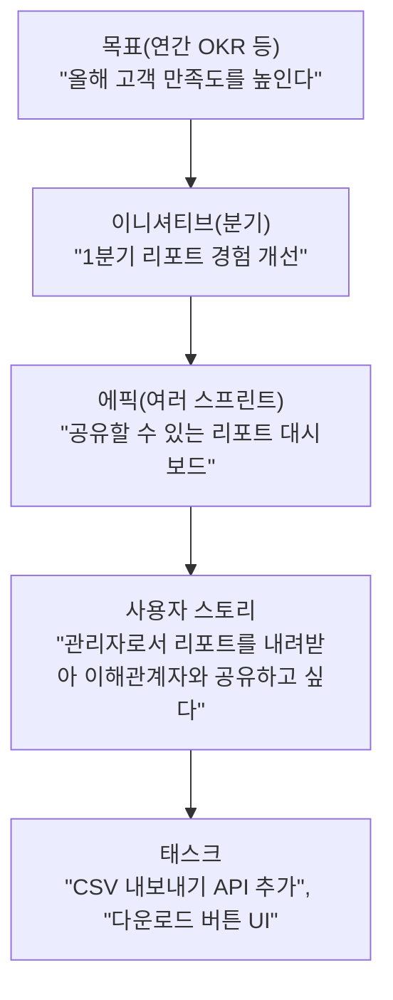

> Asana의 「[애자일 프로젝트 관리 리소스](https://asana.com/ko/resources/agile)」 아티클들을 바탕으로 재구성한 노트다. 시간 추정의 곱하기 경험칙은 Alexey Migutsky의 발표 자료 「[Software Engineering 101](https://slides.com/mr-mig/se101)」을 바탕으로 더했다.

## 일의 계층

큰 목표는 그대로 일할 수 없다. 위에서 아래로 쪼개면서 **각 단위가 왜 중요한지를 위 단위와 연결**해 둔다.



| 단위 | 크기 | 특징 |
| --- | --- | --- |
| 에픽(Epic) | 여러 스프린트, 대략 1~4개월 | 측정할 수 있는 결과와 끝나는 조건을 정해 둔다. 한 스프린트에 들어가지 않는다 |
| 사용자 스토리(User Story) | 한 스프린트 안에 끝남 | 사용자 관점의 가치 단위. 제품 백로그 항목이 된다 |
| 태스크(Task) | 몇 시간~하루 | 개발자가 스토리를 끝내려고 나눈 기술 작업. 스프린트 백로그에 붙는다 |

스크럼 가이드는 백로그 항목의 형식을 정하지 않는다. 에픽·스토리는 가장 흔한 관행일 뿐이다. 스크럼의 틀은 [[scrum-framework|스크럼: 책임·이벤트·산출물]]에 있다.

## 사용자 스토리

```text
[역할]로서, [이점]을 얻기 위해 [목표]를 원한다.
As a [role], I want [goal], so that [benefit].
```

역할은 누구를 위해 만드는지, 목표는 무엇을 하려는지, 이점은 왜 가치 있는지다. **이점이 빠지면 기능 명세가 된다.** "왜"가 있어야 개발자가 더 나은 구현을 제안할 수 있다.

### 3C

| C | 뜻 |
| --- | --- |
| 카드(Card) | 스토리를 한두 줄로 적은 것. 명세가 아니라 **대화를 시작하기 위한 메모**다 |
| 대화(Conversation) | PO·사용자·개발자가 세부와 해결책을 함께 다듬는 논의. 스토리의 본체다 |
| 확인(Confirmation) | 무엇이 되면 끝인지에 대한 합의. 인수 기준으로 적는다 |

### INVEST: 좋은 스토리의 조건

| 글자 | 조건 | 어기면 |
| --- | --- | --- |
| **I**ndependent | 다른 스토리와 독립적이다 | 순서가 묶여 우선순위를 바꿀 수 없다 |
| **N**egotiable | 세부는 협상 가능하다 | 스토리가 계약서가 되고 대화가 사라진다 |
| **V**aluable | 사용자에게 가치를 준다 | "DB 테이블 만들기"처럼 기술 계층으로 쪼갠 조각이 된다 |
| **E**stimable | 크기를 추정할 수 있다 | 모르는 게 많으면 먼저 조사용 스파이크를 만든다 |
| **S**mall | 한 스프린트 안에 끝난다 | 에픽이므로 더 쪼갠다 |
| **T**estable | 테스트로 확인할 수 있다 | "빠르게", "편하게" 같은 말은 측정 가능한 기준으로 바꾼다 |

**스토리는 계층(DB → API → UI)이 아니라 사용자 흐름을 따라 세로로 자른다.** 얇아도 끝에서 끝까지 동작하는 조각이어야 가치가 있고 테스트할 수 있다.

### 인수 기준

인수 기준(acceptance criteria)은 이 스토리 하나가 끝났는지 판단하는 조건이다. 팀 전체의 품질 기준인 완료의 정의(DoD)와 함께 충족해야 완료다. Given-When-Then으로 쓰면 그대로 테스트 케이스와 태스크가 된다. 그 방법은 [[bdd-sdd-task-design|BDD·SDD로 태스크 나누기]]에 있다.

## 백로그 다듬기

제품 백로그에는 새 기능(스토리)만이 아니라 **버그, [[technical-debt|기술 부채]], 지식 습득(스파이크·프로토타입·개념 증명)**이 함께 들어간다. 좋은 백로그는 흔히 DEEP으로 요약한다.

| 조건 | 뜻 |
| --- | --- |
| 적절히 상세함(Detailed appropriately) | 위쪽 항목은 바로 고를 만큼 구체적이고, 아래쪽은 거칠어도 된다 |
| 추정됨(Estimated) | 위쪽 항목에는 크기가 붙어 있다 |
| 계속 변함(Emergent) | 새로 알게 될 때마다 추가·삭제·수정된다 |
| 순서가 있음(Prioritized) | 가치·위험·의존성·비용을 따져 한 줄로 정렬한다 |

## 추정: 스토리 포인트와 플래닝 포커

**스토리 포인트(story point)**는 시간이 아니라 **상대 크기**다. 작업량·복잡도·불확실성을 합쳐 "기준 스토리보다 두 배쯤 크다"처럼 매긴다. 사람마다 속도가 달라도 상대 크기에는 합의하기 쉽다는 것이 시간 대신 쓰는 이유다.

플래닝 포커(planning poker)는 이 크기를 팀이 함께 정하는 방법이다. 랜드 연구소의 와이드밴드 델파이(Wideband Delphi) 기법을 바탕으로 2002년 제임스 그레닝(James Grenning)이 만들었고, 마이크 콘(Mike Cohn)의 『Agile Estimating and Planning』(2005)으로 널리 퍼졌다.

```text
1. PO가 스토리를 읽고, 개발자가 질문해 범위를 맞춘다
2. 각자 카드를 고른다 (0, 1, 2, 3, 5, 8, 13, 20, 40, 100, ?)
3. 동시에 뒤집는다. 먼저 말한 숫자에 끌려가는 앵커링을 막는다
4. 값이 갈리면 가장 높은 사람과 가장 낮은 사람이 이유를 설명한다
5. 다시 뒤집는다. 비슷해질 때까지 반복한다
```

- 숫자가 피보나치처럼 벌어지는 것은 **클수록 불확실하다**는 뜻이다. 13을 넘으면 정밀하게 맞추지 말고 쪼갠다.
- 가장 큰 가치는 숫자가 아니라 **4번의 대화**다. 높게 부른 사람은 남이 못 본 위험을, 낮게 부른 사람은 더 쉬운 방법을 알고 있는 경우가 많다.

### 시간으로 추정해야 할 때: 구현 시간에 곱하기

외주 견적이나 출시일처럼 시간 추정이 필요할 때는 **사람이 그나마 추정할 수 있는 것이 구현 시간뿐이고, 그것도 낙관적**이라는 점에서 출발한다.

| 작업의 단계 | 몫 |
| --- | --- |
| 구현 | 30% |
| 테스트 | 30% |
| 로깅·지표 | 10% |
| 설계·리팩터링 | 30% |

구현이 전체의 3분의 1이므로 **현실적인 태스크 추정 ≈ 구현 추정 × 3**이다. 곱하는 수는 경험에 따라 다르다. 태스크 하나는 2주를 넘지 않게 쪼갠다.

프로젝트는 에픽 → 스토리 → 태스크로 나눠 태스크마다 낙관적으로 추정하고, 모르는 부분에는 **시간 상자를 둔 조사(spike)** 를 넣고, 위험을 더한다. 스토리 하나가 4주를 넘으면 추정하지 말고 먼저 조사한다. 경험칙으로 **현실 일정 ≈ 낙관 경로 × 3.14 + 2주**다. 더해야 할 위험은 버스 팩터(한 사람만 아는 지식), 병가, 휴가·공휴일, 실수, 설계 오류다.

## 속도와 진척 차트

### 속도(Velocity)

속도는 **한 스프린트에 완료의 정의까지 끝낸 스토리 포인트의 합**이다. 반쯤 한 항목은 0점이다. 보통 최근 3~4개 스프린트 평균으로 다음 스프린트에 얼마나 담을지 정한다.

| 쓸 곳 | 쓰면 안 되는 곳 |
| --- | --- |
| 다음 스프린트에 담을 양 정하기 | 팀 성과 평가, 목표치로 걸기 |
| "이 속도면 언제쯤 끝나겠다"는 예측 | 팀끼리 비교 (포인트 기준이 팀마다 다르다) |
| 갑자기 떨어지면 장애물 신호로 읽기 | 개인 생산성 측정 |

**속도는 설명 지표다.** 올리라고 요구하는 순간 포인트가 부풀고(측정이 목표가 되면 측정이 망가진다는 굿하트의 법칙), 품질이 깎인다. 팀 구성, 스프린트 길이, 완료의 정의가 바뀌면 속도도 다시 재야 한다.

### 번다운과 번업

| 차트 | Y축 | 보이는 것 | 놓치는 것 |
| --- | --- | --- | --- |
| **번다운(burndown)** | 남은 일 | 이상선(시작점에서 0까지 직선)과 실제선의 차이로 일정보다 앞서는지 뒤처지는지 | 범위가 늘었는지 일을 덜 했는지 구분되지 않는다 |
| **번업(burnup)** | 끝낸 일 + 전체 범위 선 | 진척과 **범위 변화**를 따로 본다 | 하루하루의 미세한 진척은 덜 두드러진다 |

스프린트 안에서는 번다운이, 여러 스프린트에 걸친 릴리스나 에픽에는 범위 변화가 보이는 번업이 잘 맞는다. 실제선이 며칠씩 평평하다가 마지막 날 뚝 떨어지면, 항목이 너무 커서 끝까지 완료가 안 되는 것이다.

## 한계

- 추정은 틀린다. 추정의 목적은 정확한 날짜가 아니라 **크기에 대한 공유된 이해**와 대략의 계획이다. 일정을 미리 약속하기보다 만들어 보며 측정하자는 관점은 [[agile-sprint|애자일과 스프린트]]에 있다.
- 포인트 추정 자체를 생략하고 항목을 비슷한 크기로 쪼갠 뒤 **개수(처리량)**로 예측하는 팀도 있다. 흐름 지표는 [[kanban-lean-flow|칸반과 린]]에서 다룬다.
- 스토리 포인트를 시간으로 환산하기 시작하면 상대 추정의 장점이 사라진다.

## 정리

- 목표 → 에픽 → 스토리 → 태스크로 쪼개되, 각 단위가 위의 "왜"에 연결되게 한다.
- 스토리는 3C로 대화하고, INVEST로 점검하고, 인수 기준으로 끝을 정한다. 계층이 아니라 사용자 흐름으로 세로로 자른다.
- 스토리 포인트는 상대 크기이고, 플래닝 포커의 가치는 숫자보다 의견이 갈릴 때의 대화다.
- 속도·번다운·번업은 계획을 돕는 설명 지표다. 성과 목표로 쓰면 망가진다.

관련 노트: [[scrum-framework|스크럼: 책임·이벤트·산출물]], [[agile-sprint|애자일과 스프린트]], [[bdd-sdd-task-design|BDD·SDD로 태스크 나누기]], [[kanban-lean-flow|칸반과 린: 흐름과 낭비]], [[technical-debt|기술 부채]], [[jira|Jira: 이슈 구성, JQL, 워크플로]], [[github-issue-workflow|GitHub 이슈·프로젝트로 진행 상황 관리하기]]
