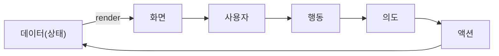

> 테오(teo)의 「[BDD? SDD? 팀 프로젝트 다같이 개발설계하는 방법](https://velog.io/@teo/behavior-driven-development-schema-driven-development)」(2022.07)과 「[figma를 이용한 더 나은 기획-디자이너-QA-개발 협업 방법](https://velog.io/@teo/카카오워크-캘린더팀에서-사용한-figma를-이용한-기획-디자이너-QA-개발-방법)」(2021.11), 「[if(kakao) after talk 후기](https://velog.io/@teo/ifkakao-after-talk-후기-요즘-웹-프론트는-디자니어와-CSS-협업-어떻게-해요)」(2021.11)를 요약·재구성한 노트다. 엄밀한 BDD·SDD 방법론이 아니라 그 개념을 태스크 설계에 빌려 쓴 실무 방식이다.

## 왜 공유 아티팩트가 필요한가

여러 직군이 함께 일하면 각자 알고 싶은 것이 다르다.

| 직군 | 알고 싶은 것 |
| --- | --- |
| 고객·PM | 진척도와 일정 |
| 개발자 | 무엇을 만들어야 하는지 |
| QA | 어떻게, 어디까지 테스트해야 하는지 |

기준 없이 "알아서 해 주세요"로 시작하면 회의 대부분이 진척 확인과 일 분배에 쓰인다. 개발자가 가장 두려워하는 질문 "어디까지 했어요? 언제까지 돼요?"도 여기서 나온다. 맥락이 없으면 개발자의 "70%"는 개발자만 이해한다.

그래서 **모두가 같은 것을 보는 양식**이 필요하다. 기준은 네 가지다.

- 실제 개발에 도움이 되어야 하고 숙제가 되면 안 된다.
- 했다/안 했다를 판가름할 수 있는 태스크여야 한다.
- 그러려면 테스트할 수 있어야 한다.
- 태스크 크기가 대체로 비슷해야 한다.

## 기존 기획서의 문제

| 문제 | 결과 |
| --- | --- |
| 기획서와 디자인 문서가 따로 있다 | 기획서 속 화면은 와이어프레임에 머물고 최신 디자인이 반영되지 않는다. 문구가 바뀌면 어느 쪽이 최종인지 묻게 된다 |
| 명세만 있고 무엇을 개발할지는 흐리다 | 개발자는 기획서를 한 번 더 "개발 언어"로 번역해야 한다. 그래서 프론트엔드 개발자는 대개 기획서보다 디자인 문서를 보고 개발한다 |
| 사용자 동작의 순서 기술이 제각각이다 | 해석이 사람마다 달라진다 |
| 태스크 단위로 나뉘어 있지 않다 | 어디까지 진행됐는지 소통하기 어렵다 |

### 병목을 다 같이 돕는다

제약 이론(TOC)에 따르면 **협업의 속도는 평균이 아니라 가장 느린 공정에 맞춰진다.** IT 협업에서 병목은 대개 개발이다. 남는 시간에 다음 기획을 앞서 하면 기획과 개발이 점점 멀어진다. 대신 코딩 외의 일, 즉 이름 짓기·설계·QA 케이스·태스크·일정 관리를 비개발 직군이 함께 맡으면 전체가 빨라진다. 기획서를 개발하기 좋은 형태로 만드는 것이 그 첫걸음이다.

## 프론트엔드 프로그램의 두 흐름



프로그램은 이 순환이다. 정의할 것은 **데이터**와 **사용자 행동** 두 가지이고, 각각에 맞는 방법이 있다.

| 방법 | 중심 | 산출물 |
| --- | --- | --- |
| BDD (Behavior Driven Development) | 사용자 행동 | given-when-then 태스크 |
| SDD (Schema Driven Development) | 데이터 구조 | 이름 붙은 스키마 (TS interface 등) |

## BDD: 행동으로 태스크 만들기

기획서와 디자인은 원래 사용자 중심으로 쓰여 있어 행동부터 정리하기 쉽다. 이 작업은 개발 지식이 필요 없으니 기획·디자인·QA가 함께 모여서 하면 맥락 공유까지 된다.

1. **when**: 한 화면에서 사용자가 할 수 있는 동작을 모두 찾는다. 대부분 클릭·터치이고, 키 입력·스와이프·우클릭 등이 특수한 경우다.
2. **then**: 그 동작의 예상 결과를 적는다. 가능한 한 촘촘하게, **데이터가 바뀌는 단위**로 쪼갠다.
3. **given**: 같은 동작인데 결과가 달라지는 조건을 찾는다.

```text
given  일정 생성 버튼이 활성화된 상태에서
when   '일정 생성' 버튼을 클릭하면
then   → 일정 정보를 서버에 저장한다
       → 생성 창을 닫는다
       → 새 일정을 화면에 보여 준다
       → 해당 일정을 선택 상태로 만든다
```

**then 하나가 태스크 하나다.** 완료된 then 개수 / 전체 then 개수가 곧 진척률이 된다. 그러려면 then 크기가 비슷해야 하는데, 크기는 "몇 개의 데이터가 바뀌고 몇 개의 API를 쓰는가"로 가늠한다. 상위 목적은 `As a … I want … So that …` 형식의 스토리로 묶는다.

## SDD: 데이터에 이름 붙이기

SDD는 개발 전에 공통 스키마를 먼저 정하는 방식이다. 백엔드와 API 인터페이스만 먼저 맞추고 각자 개발하는 것과 같은 발상이다. 프론트엔드는 화면 데이터가 유연해서 생략되기 쉽지만, 여럿이 일할 때는 **눈에 보이는 것들의 이름과 구조만이라도** 먼저 정하는 편이 낫다.

1. 화면에서 변하는 모든 것을 찾는다. 변하지 않으면 디자인 요소이고, 변하면 데이터다.
2. 모두에게 이름을 붙인다.
3. 구조가 같은 것끼리 묶는다. (`name`, `email`이 모여 `user`)
4. 비즈니스 도메인 데이터와 화면 표시용 데이터를 나눈다.

이름 짓기는 개발자에게 가장 어려운 일 중 하나지만 개발 지식 없이도 할 수 있다. 비개발 직군이 개발을 돕는 좋은 방법이다.

### 서로 검증하기

then은 결국 스키마의 값 변화로 표현되어야 한다. **then을 스키마 변화로 쓸 수 없다면** 문장이 모호하거나, 스키마에 데이터가 빠졌다는 신호다.

```ts
// when: + 버튼을 클릭하면 / then: 숫자가 1 늘어난다
const inc = (state: { count: number }) => ({ ...state, count: state.count + 1 })
```

## Figma로 기획과 디자인을 한곳에

기획서를 Figma로 옮겨 디자인과 한 파일에 두면 최신 화면과 기획이 갈라지지 않는다.

| 장치 | 효과 |
| --- | --- |
| 기획서 왼쪽에 실제 디자인 컴포넌트 배치 | 초반에는 와이어프레임, 디자인이 나오면 교체한다. 개발자가 두 문서를 오가지 않는다 |
| 스토리·태스크 단위로 given-when-then 작성 | 개발 범위 산정과 QA 케이스가 같은 문서에서 나온다 |
| 태스크마다 신호등 표시 | 개발자가 매일 진척을 표시하면 PM은 일정을 예측하고, QA는 테스트 시작 시점을 안다. 미구현 기능에 대한 버그 리포트가 사라진다 |
| QA가 기획 단계에서 테스트 케이스를 미리 작성 | 구현 결과가 나오면 맞춰 보완한다. 개발자는 기획서 대신 테스트 케이스를 보고 개발할 수 있다 |
| Idea Pot | 누구나 의견을 적어 두는 공간. 당장 채택되지 않아도 대립 없이 담당자에게 서서히 영향을 준다 |

기획자에게는 일이 늘어난 것 같지만, 행동 단위로 쪼개다 보면 분량이 가늠되고 놓친 케이스가 줄어든다. 기획서를 **프로젝트 관리 도구이자 산출물**로 보면 들일 만한 시간이다. 같은 이유로 디자인 전달 도구를 따로 두지 않고 Figma 하나로 소통하면 문서가 하나로 모인다.

## 적용할 때

given-when-then을 나누는 정답은 없다. 다음이 되면 충분하다.

- 빠진 기획 요소를 찾아 확정한다.
- 개발 분량을 가늠한다.
- 태스크를 나누고 진척을 확인한다.
- 개발자가 아닌 사람도 테스트할 수 있다.

## 정리

- 여러 직군이 같은 문서를 보게 하려면 **테스트 가능한 태스크** 형태가 필요하다.
- 행동은 BDD(when → then → given 순으로 찾기), 데이터는 SDD(찾고, 이름 짓고, 묶기)로 정리한다.
- then 하나가 태스크 하나이고, then은 데이터 변화로 표현되어야 한다.
- 병목인 개발을 비개발 직군이 코딩 외 일로 도우면 협업 전체가 빨라진다.

관련 노트: [[tdd|프론트엔드에서의 TDD]], [[agile-sprint|애자일과 스프린트]], [[jira|Jira: 이슈 구성, JQL, 워크플로]], [[project-process|새 서비스 개발 프로젝트 진행 순서]], [[use-case-diagram|유스케이스 다이어그램]]
