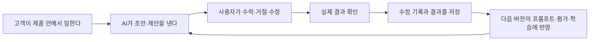

> GeekNews Weekly의 「데이터를 모으고 있는데 왜 해자가 되지 않을까」(2026.07)와 거기서 소개한 NFX의 「[AI 래퍼는 끝났다: 초기 스타트업을 위한 수직화 전략](https://www.nfx.com/post/ai-wrapper-dead-verticalization-startups)」(2026.07) 등을 바탕으로, a16z의 「[The Empty Promise of Data Moats](https://a16z.com/the-empty-promise-of-data-moats/)」(2019.05)로 원리를 보강해 재구성한 노트다.

## 해자란

**해자(moat)**는 경쟁자가 같은 제품을 만들어도 고객을 빼앗기 어렵게 하는 지속적인 우위다. 전통적인 해자는 네트워크 효과, 전환 비용, 규모의 경제, 브랜드, 규제·독점 자원이다([[strategy-frameworks|경영 전략 프레임]]의 「진입 장벽」).

AI 제품에서는 **모델이 해자가 아니다.** 새 모델이 나오면 많은 팀이 설정 파일의 모델 이름 한 줄을 바꾸고 반나절 만에 배포한다. 누구나 같은 모델을 같은 날 쓰므로, 어떤 모델을 먼저 붙였다는 사실은 오래 남는 자산이 아니다. 그래서 남은 후보로 데이터가 꼽히지만, 데이터도 대부분은 해자가 되지 못한다.

## 데이터가 대개 해자가 되지 않는 이유

### 1. 네트워크 효과가 아니라 규모 효과다

**네트워크 효과**는 참여자가 서로 직접 상호작용해 한 명이 늘 때마다 다른 모두의 가치가 커지는 것이다(전화망, 메신저). 데이터가 많아진다고 이런 효과가 저절로 생기지는 않는다. 흔히 「데이터 네트워크 효과」라 부르는 것은 대부분 **데이터 규모 효과**다. 시청자가 많을수록 추천이 나아지고, 나아진 추천이 시청자를 더 부르는 구조(넷플릭스 추천)는 사용자끼리 상호작용하지 않는다.

### 2. 쌓일수록 한계 가치는 줄고 비용은 오른다

전통적인 규모의 경제는 클수록 단가가 내려간다. 데이터는 반대로 움직이기 쉽다.

| 현상 | 설명 |
| --- | --- |
| 한계 가치 감소 | 새 데이터는 이미 가진 데이터와 겹치는 부분이 많아 추가로 배우는 것이 적다 |
| 획득 비용 상승 | 흔한 경우는 이미 다 모았고, 남은 것은 드물고 비싼 예외(long tail)다 |
| 점근선 | 데이터를 늘려도 성능이 어느 수준에서 평평해진다. 고객 상담 챗봇 사례에서 질문 의도 커버리지가 약 40%에서 더 오르지 않았다 |
| 신선도 | 도로, 가격, 취향이 바뀌면 데이터가 낡는다. 계속 새로 모아야 같은 가치를 유지한다 |
| 상품화 | 경쟁자도 같은 종류의 데이터를 모으면 우위가 사라진다. 데이터가 원자재(commodity)가 된다 |

### 3. 데이터가 제품으로 돌아오지 않는다

기술적으로 뛰어난 데이터 팀도 실패한다. 파이프라인은 잘 돌고 대시보드도 정확한데, 그것이 실제 의사결정과 제품 변경으로 이어지지 않는다. **데이터가 제품으로 되돌아오지 않는 일방통행이면 저장 비용만 늘어난다.** 분기에 한 번 사람이 열어 보는 대시보드는 루프가 아니다.

## 해자가 되는 조건

| 조건 | 왜 복제가 어렵나 | 예 |
| --- | --- | --- |
| **독점·희소한 원천** | 경쟁자가 같은 데이터를 살 수도, 크롤링할 수도 없다 | 한 공급자에게만 데이터를 주는 기관, 규제로 접근이 제한된 데이터 |
| **결과에 연결된 피드백 루프** | 사용자가 AI 결과를 수락·거절·수정한 기록과 그 뒤의 실제 결과가 다음 버전을 개선한다. 루프의 속도와 누적이 경쟁력이다 | 수정한 초안, 반려된 제안, 결과가 확인된 판단 |
| **업무 흐름 안에서만 생기는 데이터** | 제품이 고객의 일을 시작부터 검토·수정·최종 결정까지 품어야 생긴다. 크롤링으로 모을 수 없다 | 사건마다 쌓이는 법률 데이터, 회사별 코드베이스 지식 그래프 |
| **지속 수집과 기록 시스템** | 대량의 데이터를 상시 모으고 정제하는 일은 세션 단위로 돌고 끝나는 에이전트가 대신하기에 비싸다 | 수천만 건의 팟캐스트 전사·분석 데이터셋 |
| **큐레이션 노하우와 신뢰** | 공개 데이터라도 정제·표준화에 드는 비용과, 믿고 맡길 수 있는 보관자라는 평판은 쉽게 따라 하기 어렵다 | 정제된 업계 데이터셋 |

**서비스에도 오답 노트가 필요하다.** 사용자가 고친 기록을 로그 잡음이 아니라 일급 데이터로 저장하고, 그것이 다음 버전에 들어가는 경로를 만든다. 모델 자체보다 제품 안 데이터로 사후 학습하는 루프가 경쟁력이 생기는 곳이라는 관점은 [[ai-platform-shift|AI 플랫폼 전환과 일의 재편]]에 있다.

## 래퍼와 수직화: 업무 흐름이 해자다

**래퍼(wrapper)**는 파운데이션 모델 위에 한 가지 작업용 화면만 얹은 제품이다. 고유 데이터, 업무 흐름, 유통이 없다. 모델이 좋아지고 모델 회사가 직접 응용 제품을 내면서 래퍼의 가정(모델은 지금 수준에 머문다)이 깨졌다.

살아남는 방향은 **수직화**다. AI를 기능으로 팔지 않고, 특정 산업의 일 하나를 처음부터 끝까지 대신 해 주는 서비스로 판다.

| 접근 | 내용 |
| --- | --- |
| 도구 대신 결과를 판다 | 개발 도구를 파는 대신 AI로 개발 자체를 납품한다. 회사별 코드베이스 지식 그래프가 쌓인다 |
| 업무 자체를 다시 짠다 | 기존 업무에 소프트웨어를 덧대지 않고, 자동화를 전제로 심사·운영을 새로 설계한다 |
| 기록 시스템에서 행동 시스템으로 | 흩어진 행정 업무를 모은 데이터베이스(system of record)에서 출발해 그 위에서 결정과 실행(system of action)까지 맡는다 |

여기서 데이터는 단독으로 해자가 아니다. **업무 흐름, 도메인 지식, 쌓이는 데이터, 복잡한 산업에 파는 능력이 결합**될 때 해자가 된다.

## 더 가치 있어지는 데이터

인터넷에 공개된 문서는 이미 모델이 다 읽었다. 앞으로 더 귀한 것은 **전문가가 실제 업무에서 어떤 절차와 기준으로 판단했는지를 담은 흔적**이다. 이런 데이터는 크롤링으로 모을 수 없고, 그 일을 하는 자리에 제품이 함께 있어야 생긴다. 전문가의 작업을 모델 개선용 데이터·평가셋으로 바꾸는 시장을 **태스크 이코노미(task economy)**라 부른다.

## 자가 진단 질문

| 질문 | 「아니오」라면 |
| --- | --- |
| 사용자가 AI 결과를 어떻게 고쳤는지 저장하고 있는가 | 가장 가치 있는 신호를 버리고 있다 |
| 그 기록이 다음 버전에 반영되는 경로가 있는가 | 데이터는 쌓이지만 루프가 없다 |
| 루프가 제품이 바뀌는 속도만큼 빨리 도는가 | 월 1회 재학습으로 주 단위로 바뀌는 제품을 못 따라간다 |
| 우리 데이터 전부를 경쟁사가 갖게 되면 같은 수준의 제품을 만들 수 있는가 | 「예」라면 데이터 자체는 해자가 아니다 |
| 데이터를 더 모으면 제품이 눈에 띄게 좋아지는가 | 알고리즘·제품 설계가 데이터 양보다 중요한 영역이다 |

## 한계와 주의

- 해자는 데이터만으로 생기지 않는다. 장기 방어력은 차별화된 기술의 패키징, 수직화, GTM 실행, 인재에서 함께 나온다.
- 초기에는 해자를 기다리지 말고 최소한의 데이터셋을 빨리 만든다(크롤링, 가치와 데이터 교환, 전이 학습, 합성 데이터).
- 사람이 만든 데이터도 영원한 해자는 아니다. 모델이 만든 데이터로 학습하는 비중이 늘고 있어, 결정적인 피드백 루프가 있는 영역일수록 사람 데이터의 우위가 약해질 수 있다.

## 정리

- 모델은 모두가 같은 날 쓰는 부품이라 해자가 아니다.
- 데이터의 「네트워크 효과」는 대개 규모 효과다. 한계 가치는 줄고, 획득 비용은 오르고, 데이터는 낡는다.
- 해자가 되는 것은 독점 원천, 결과에 연결된 피드백 루프, 업무 흐름 안에서만 생기는 데이터다.
- 수정 기록을 일급 데이터로 저장하고 다음 버전에 반영하는 경로를 만든다.
- **데이터 자체가 아니라, 데이터를 만들고 제품을 다시 좋게 만드는 루프가 해자다.**

관련 노트: [[ai-platform-shift|AI 플랫폼 전환과 일의 재편]], [[strategy-frameworks|경영 전략 프레임]], [[product-analytics|프로덕트 데이터 분석]], [[pmf-erosion|PMF는 왜 조용히 사라지나]], [[ai-era-saas-pricing|AI 시대 SaaS 가격 모델]]
