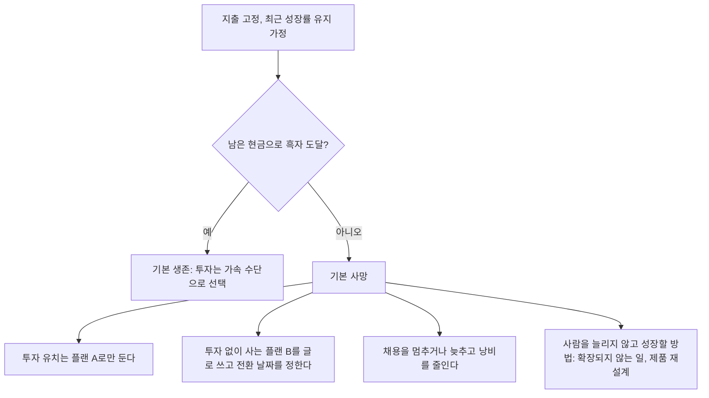

> 팩플의 「‘외부 투자 0원’으로 데스밸리 건넌 낙타 스타트업」(2026.04)을 바탕으로, 개념은 Paul Graham의 「[Default Alive or Default Dead?](https://paulgraham.com/aord.html)」(2015.10)와 Alex Lazarow의 「[Forget Unicorns, Startups Should Be Camels](https://www.entrepreneur.com/growing-a-business/forget-unicorns-startups-should-be-camels/347659)」로 확인해 재구성한 노트다.

## 기본 생존이란

**기본 생존(default alive)**은 다음 질문에 「예」라고 답할 수 있는 상태다.

> 지출이 지금 그대로이고 매출이 최근 몇 달의 성장률대로 계속 큰다면, 남은 돈으로 흑자에 닿는가?

닿으면 기본 생존, 닿지 못하면 **기본 사망(default dead)**이다. 「기본」이라는 말은 **아무것도 바꾸지 않았을 때의 결말**이라는 뜻이다. 기본 사망이 곧 망한다는 뜻은 아니다. 무언가(투자 유치, 비용 절감, 성장 가속)를 바꿔야 산다는 뜻이다.

창업자 상당수가 자기 회사가 어느 쪽인지 모른다. 초기에는 의미 없는 질문 같다가 회사가 자라면서 결정적인 질문이 되고, 「필요하면 투자를 더 받으면 된다」는 가정이 자주 틀리기 때문이다. Trevor Blackwell이 만든 계산기(growth.tlb.org)로 바로 확인할 수 있다.

## 계산에 필요한 숫자

```text
총 번레이트(gross burn) = 한 달에 나가는 현금 총액 (급여, 임대료, 서버, 마케팅 ...)
순 번레이트(net burn)   = 총 번레이트 - 한 달에 들어오는 현금(매출 수금)
런웨이(runway)         = 보유 현금 / 순 번레이트      (개월)
```

- **순 번레이트로 런웨이를 잰다.** 총 번레이트는 「매출이 끊기면 얼마나 버티나」를 볼 때 쓴다.
- 회계상 손실에는 감가상각처럼 현금이 나가지 않는 비용이 섞여 있다. 번레이트는 손익계산서가 아니라 현금흐름으로 구한다. 재무제표에서 읽는 법은 [[company-financial-check|비상장 회사 재무제표 찾아보기]]에 있다.
- 런웨이는 현재 상태의 정지 화면이다. 기본 생존 판정은 여기에 **매출 성장**을 넣어 앞으로 굴려 본다.

### 흑자 도달 계산

월 지출 E가 고정, 첫 달 매출 R, 월 매출 성장률 g라고 하면 흑자가 되는 달과 그때까지 쓰는 돈은 다음과 같다.

```text
흑자 도달 개월 수 n:  R × (1+g)^n ≥ E   →   n = log(E/R) / log(1+g) 를 올림
그때까지의 누적 적자 = n × E - R × ((1+g)^n - 1) / g
기본 생존 ⇔ 누적 적자 < 보유 현금
```

보유 현금 30억 원, 월 지출 3억 원, 첫 달 매출 1억 원인 회사로 비교하면 성장률 하나로 결말이 갈린다.

| 월 매출 성장률 | 흑자 도달 | 그때까지 누적 적자 | 판정 |
| --- | --- | --- | --- |
| 10% | 12개월 | 약 14.6억 원 | 기본 생존 (현금이 넉넉히 남는다) |
| 5% | 23개월 | 약 27.6억 원 | 기본 생존 (아슬아슬하다) |
| 4% | 29개월 | 약 34.0억 원 | **기본 사망** (흑자 전에 현금이 바닥난다) |

이 계산은 지출이 고정이라는 가정에 기대므로, **채용 계획을 넣으면 결과가 바로 바뀐다.** 반대로 성장률 몇 %포인트 차이가 생사를 가르므로 성장률 추정을 낙관적으로 잡지 않는다.

## 기본 사망일 때 일어나는 일

### 너무 빠른 채용

투자를 받은 스타트업을 죽이는 가장 큰 원인은 **너무 빠른 채용**이다. 성장이 더딜 때 사람을 늘려 성장을 사려 하지만, 진짜 문제는 대개 제품이 충분히 매력적이지 않다는 데 있다. 사람이 늘면 지출이 오르고, 조직이 커져 제품을 고치기는 더 어려워진다.

### 치명적 곤경(fatal pinch)

**기본 사망 + 느린 성장 + 고칠 시간이 부족함**이 겹친 상태다. 창업자는 이 상태로 가고 있다는 것을 모른 채 빠진다. 투자 시장이 식으면 「다음 라운드」라는 탈출구가 닫혀 갑자기 드러난다.

### 대응



- 투자 유치는 성공하면 좋지만 **유일한 계획이면 안 된다.** 투자를 못 받으면 언제 무엇을 자를지 미리 정해 두면, 그 날짜가 와도 당황하지 않는다.
- 돈이 급할수록 투자받기 어렵다는 역설은 [[venture-investment-terms|벤처투자의 논리와 투자계약 조항]]에 있다. 그래서 기본 생존 상태에서 투자를 받는 쪽이 협상력이 크다.

## 낙타형 스타트업

**낙타(camel)**는 유니콘(기업가치 10억 달러 이상 비상장사)에 빗댄 말로, 가뭄(투자 혹한기)에도 버티도록 설계한 스타트업이다. Alex Lazarow가 책 「Out-Innovate」(2020)에서 실리콘밸리식 「유니콘 먼저」 전략의 대안으로 제시했다.

| 축 | 유니콘형 | 낙타형 |
| --- | --- | --- |
| 목표 | 시장 선점을 위한 최대 성장 | 균형 잡힌 성장과 장기 생존 |
| 현금 | 큰 번레이트를 투자로 메운다 | 번레이트를 관리하고 현금흐름과 성장을 맞춘다 |
| 순서 | 먼저 키우고 수익 모델은 나중 | **유닛 이코노믹스를 먼저 맞추고** 키운다 |
| 투자 | 라운드마다 크게, 자주 받는다 | 필요할 때 받을지 스스로 고른다. 받지 않을 수도 있다 |
| 강한 환경 | 자본이 넘치는 호황 | 금리가 오르고 투자가 마른 시기 |

유닛 이코노믹스와 고정비·변동비를 숫자로 보여 주는 법은 [[investor-ir-deck|투자자가 보는 IR 자료]]에 있다.

### 부트스트래핑

**부트스트래핑(bootstrapping)**은 외부 투자 없이 매출로 회사를 키우는 것이다. 육아용품 브랜드, 알람 앱처럼 직접 쓰려고 만든 제품에서 출발해 몇 년간 흑자를 유지하거나, 창업 후 6년·10년이 지나서야 첫 투자를 받은 회사들이 국내 사례다.

| 얻는 것 | 치르는 것 |
| --- | --- |
| 지분을 나누지 않는다 | 성장이 느리다. 경쟁자가 자본으로 시장을 먼저 차지할 수 있다 |
| 투자자 눈치 없이 방향을 정한다. 엑시트 압박이 없다 | 큰 선투자가 필요한 사업(인프라, 하드웨어, 네트워크 효과 선점)은 어렵다 |
| 처음부터 돈을 버는 구조라 위기에 강하다 | 인재 영입에 스톡옵션·연봉 경쟁력이 약할 수 있다 |

AI로 개발비가 줄면서 작은 팀이 외부 투자 없이 수익을 내는 선택지가 넓어졌다. 다만 낙타형·부트스트래핑은 VC식 회수 시나리오와 멀어진다. 어느 쪽이 맞는지는 사업이 선점 효과에 얼마나 기대는지로 판단한다.

## 정리

- 기본 생존 질문: 지출 고정, 최근 성장률 유지 가정에서 남은 현금으로 흑자에 닿는가.
- 런웨이는 현금 ÷ 순 번레이트이고, 기본 생존 판정은 여기에 매출 성장을 넣어 굴려 본다. 성장률 몇 %포인트가 결말을 가른다.
- 기본 사망이면 투자 유치를 플랜 A로만 두고, 플랜 B와 전환 날짜를 정하고, 채용부터 멈춘다.
- 낙타형은 유닛 이코노믹스를 먼저 맞추고 번레이트를 관리해 혹한기를 버틴다. 부트스트래핑은 자율과 지분을 얻고 속도를 치른다.

관련 노트: [[company-financial-check|비상장 회사 재무제표 찾아보기]], [[venture-investment-terms|벤처투자의 논리와 투자계약 조항]], [[startup-engineering|초기 스타트업과 창업]], [[investor-ir-deck|투자자가 보는 IR 자료]], [[startup-exit-paths|스타트업 엑시트와 좀비 스타트업]], [[vc-fund-structure|VC 펀드의 구조]]
