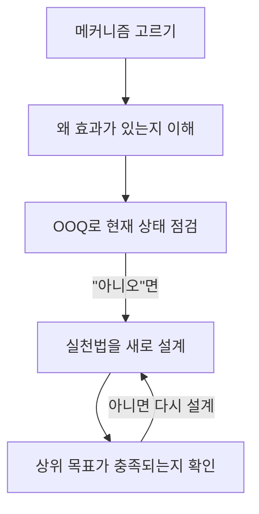

> 요즘IT의 「불확실성을 다루는 전략 EoA」 시리즈 중 「가장 효과적인 애자일 프레임워크 13가지」(2023.08)와 「토스에서 요즘 '애자일'하는 방법」(2023.08)을 바탕으로 재구성한 노트다.

## EoA란

EoA(Essence of Agility, 기민함의 맥)는 김창준(애자일 컨설팅)이 정리한 **애자일의 핵심 메커니즘 모음**이다. 「할 일 중 무엇이 가장 중요한가」, 「조직 개편 뒤 새 방향을 어떻게 잡나」처럼 정답이 없는 불확실한 문제에 어떤 전략이 효과적인지를 다룬다.

출발점은 **형식주의 비판**이다. 데일리 스크럼이나 페어 프로그래밍을 규칙대로 따르는 것 자체는 애자일이 아니다. 팀원이 홀수라 짝을 못 짓는다고 고민한다면 실천법을 목적으로 착각한 것이다. EoA는 실천법이 **왜 효과가 있는지(메커니즘)** 를 이해하고, 자기 맥락에 맞는 실천법을 **직접 설계**하게 한다.

| 구분 | 실천법 중심 | EoA |
| --- | --- | --- |
| 출발 | 검증된 방식(스크럼, 데일리 미팅)을 들여온다 | 지금 풀려는 불확실한 문제에서 시작한다 |
| 단위 | 의식·산출물 | 메커니즘 |
| 결과 | 조직마다 같은 모양 | 조직마다 다른 모양, 같은 원리 |

## 네 가지 상위 목표

메커니즘은 모두 다음 목표 중 하나 이상에 기여한다.

| 상위 목표 | 뜻 |
| --- | --- |
| 큰 손실 피하기 | 한 번의 실패가 치명상이 되지 않게 한다 |
| 계속 배우면서 나아가기 | 해 보면서 알게 된 것으로 방향을 고친다 |
| 핵심을 일찍, 적은 노력으로 성취하기 | 가장 가치 있는 것부터 작게 이룬다 |
| 유연하게 대처하기 | 상황이 바뀌어도 대응할 여지를 남긴다 |

## 메커니즘

EoA는 13가지 메커니즘으로 구성된다(2023년 4월 「생성적 순서」가 더해져 12가지에서 13가지가 됐다). 대표적인 것은 다음과 같다.

| 메커니즘 | 핵심 |
| --- | --- |
| 중복 허용하기(Redundancy) | 하나가 망가져도 일이 멈추지 않게 대안을 둔다. 한 사람에게만 의존하는 일을 없앤다 |
| 문제를 빠르게 감지하기 | 문제가 커지기 전에 일찍 드러나게 한다 |
| 비대칭성 확립하기(Asymmetry) | 잃을 것은 작고 얻을 것은 큰 선택을 고른다 |
| 피드백 받고 재조정하며 나아가기 | 짧은 주기로 결과를 확인하고 방향을 고친다 |
| 생성적 순서(Generative Sequence) | 앞 단계의 결과가 다음 단계를 낳도록 순서를 짠다 |

전체 목록과 설명은 원 자료(AC2 커뮤니티 정리)를 참고한다.

## 적용하는 방법

### 1. 결과 관찰 질문(OOQ)으로 점검하기

메커니즘마다 「이것이 작동하고 있다면 무엇이 보여야 하나」를 묻는 **결과 관찰 질문(OOQ, Outcome Observable Question)** 이 있다.



예를 들어 중복 허용하기의 OOQ는 「무언가 하나가 망가지면 대안이 있는가?」다. 답이 아니오라면 짝 작업이나 문서화 같은 실천법을 설계하고, 그 결과 큰 손실 피하기라는 목표가 달성되는지 다시 본다.

### 2. 병목 정의하기

문제를 적은 뒤 **병목(bottleneck)**, 즉 그 문제를 풀지 못하게 막는 장애물을 한 줄 더 적는다. 같은 문제라도 병목이 다르면 해법이 다르다.

| 문제 | 병목 | 끌어올 메커니즘 |
| --- | --- | --- |
| 조직 개편 뒤 새 방향 찾기 | 혼자 일해서 상의할 사람이 없다 | 중복 허용하기, 피드백 받기 |
| 조직 개편 뒤 새 방향 찾기 | 어떤 성공 지표를 써야 할지 모른다 | 문제를 빠르게 감지하기 |

병목은 EoA 원안에 없던 항목이지만 문제를 구체화하는 데 효과가 커서 실무 템플릿에 자주 들어간다.

### 3. 템플릿으로 함께 보기

스프레드시트 하나에 **열은 사람, 행은 메커니즘**을 둔다. 각자 자기 문제와 병목을 적고, 도움이 될 메커니즘 칸만 채운다. 남의 칸을 보고 이야기하면 혼자서는 떠올리지 못한 메커니즘을 발견한다.

```text
            | 사람 A        | 사람 B        | 사람 C
문제/병목     | ...           | ...           | ...
중복 허용하기  | 백업 담당 지정  |               |
비대칭성      |               | 작게 먼저 출시  |
...
```

팀이 매일 짧게 모여 이 템플릿을 채우고 → 문제와 병목이 충분히 구체적인지, 어떤 메커니즘이 맞을지 피드백하고 → 진행자를 매일 바꾸고 → 끝에 짧게 회고하는 방식으로 운영할 수 있다. 혼자 쓸 때도 「이 문제는 불확실하다」고 인식하는 것만으로 정답을 찾는 태도에서 정답 없이 대응하는 태도로 바뀐다.

## 조직에 퍼뜨리기

강의보다 **참여형 세션**이 전이(배운 것을 실제 일에 쓰는 것)가 잘 된다.

| 단계 | 내용 |
| --- | --- |
| 준비 | 참가자가 메커니즘 자료를 미리 읽고, 풀고 싶은 할 일 3개를 가져온다 |
| 시작 | 컨디션 체크인, 기대 적기, 주제에 대한 자신감 1~10점 |
| 본론 | 할 일 하나에 피드백 → 메커니즘 1~2개 짧게 설명 → 4명 소그룹에서 15분 적용 → 전체 질의응답 |
| 마무리 | 이번 주 행동 항목 정하기, 자신감 다시 매기기, 기대 충족 확인, 배운 점 기록 |
| 공유 | 행동 항목을 공개 채널에 남겨 다음 참가자가 참고하게 한다 |

- 진행자를 한 사람이 독점하지 않고, 진행하고 싶은 사람을 모집해 각자의 팀으로 퍼지게 한다.
- 퍼뜨리는 과정 자체도 작은 그룹에서 피드백을 받아 고쳐 가며 반복한다.

## 정리

- EoA는 실천법이 아니라 **메커니즘**을 배우고, 실천법은 맥락에 맞게 직접 설계하게 한다.
- 메커니즘은 큰 손실 피하기·배우며 나아가기·핵심을 일찍 이루기·유연하게 대처하기에 기여한다.
- OOQ로 메커니즘이 작동하는지 확인하고, 병목을 적어 문제를 구체화한다.
- 템플릿의 모양은 조직마다 달라도 된다. 원리가 같으면 된다.
- 목록을 읽는 것으로는 이해되지 않는다. 불확실성이 큰 실제 일에 적용해야 익는다.

관련 노트: [[agile-sprint|애자일과 스프린트]], [[scrum-framework|스크럼: 책임·이벤트·산출물]], [[pair-programming|페어 프로그래밍]], [[decision-making|의사결정 체크리스트]]
