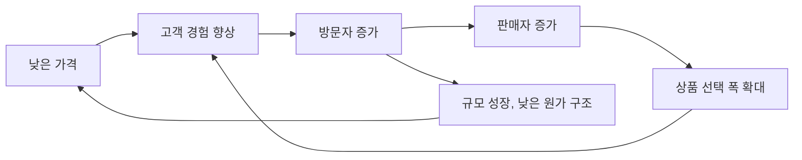

> Frederick Taylor의 『The Principles of Scientific Management』(1911), W. Edwards Deming의 『Out of the Crisis』(1982년 초판, 1986년 지금의 제목으로 개제), 교세라의 「[Amoeba Management](https://global.kyocera.com/inamori/management/amoeba/)」 공식 설명, Michael Gerber의 『The E-Myth』(1986)와 『The E-Myth Revisited』(1995), Jim Collins의 『Good to Great』(2001), 아마존의 [2017년 주주 서한](https://www.aboutamazon.com/news/company-news/2017-letter-to-shareholders)과 AWS의 「[Two-Pizza Teams](https://aws.amazon.com/executive-insights/content/amazon-two-pizza-team/)」 설명을 바탕으로 종합한 노트다.

## 한눈에 보기

| 이론 | 핵심 주장 | 원전 |
| --- | --- | --- |
| 과학적 관리법 | 일하는 방법은 감이 아니라 측정으로 정한다 | Taylor(1911) |
| 데밍의 14가지 원칙 | 품질 문제의 원인은 작업자가 아니라 시스템이다 | Deming(1982) |
| 아메바 경영 | 조직을 작은 채산 단위로 쪼개 모두가 경영에 참여한다 | 이나모리 가즈오, 교세라 |
| E-Myth | 사업 안에서 일하지 말고 사업 자체를 만든다 | Gerber(1986) |
| 아마존의 운영 장치 | 선순환, 작은 팀, 글로 쓰는 회의 | Collins(2001), 아마존 |

테일러에서 데밍으로 가는 흐름은 관점의 이동이다. 테일러는 **작업자의 동작**을 표준화했고, 데밍은 **작업자가 일하는 시스템**을 고치는 것이 관리자의 일이라고 봤다.

## 과학적 관리법

과학적 관리법(scientific management, 테일러리즘)은 숙련공의 경험과 감에 맡기던 작업 방법을 측정과 분석으로 정하자는 20세기 초의 관리 이론이다.

| 원칙 | 내용 |
| --- | --- |
| 1. 작업의 과학 | 작업의 각 요소마다 주먹구구를 대신할 과학적 방법을 만든다 |
| 2. 과학적 선발과 훈련 | 작업자가 알아서 일을 고르고 배우게 두지 않고, 회사가 뽑아 가르치고 키운다 |
| 3. 협력 | 정해진 방법대로 일이 되도록 관리자가 작업자와 협력한다 |
| 4. 일과 책임의 분담 | 계획과 방법 설계는 관리자가, 실행은 작업자가 맡는다 |

| 도구 | 내용 |
| --- | --- |
| 시간 연구, 동작 연구 | 스톱워치로 작업을 요소별로 재고 불필요한 동작을 없애 「가장 좋은 방법」을 정한다 |
| 과업과 성과급 | 표준 작업량을 정하고 보수를 산출량에 연결한다 |
| 기능식 직장 제도 | 한 명의 직장이 모든 것을 감독하지 않고 기능별 전문 감독자를 둔다 |

베들레헴 철강의 선철 운반 사례가 유명하다. 무거운 짐을 드는 일에서는 **언제 쉬는지**가 하루 작업량을 정한다는 것을 측정으로 찾아내고, 작업자가 정해진 간격으로 쉬게 해 하루 종일 일정한 속도로 일하게 했다.

| 평가 | 내용 |
| --- | --- |
| 유산 | 표준 작업, 작업 측정, 계획 기능의 분리는 이후 대량 생산과 산업 공학, 품질 관리의 바탕이 되었다. 린 생산도 이 계보 위에 있다. 다만 포드의 생산 방식은 테일러와 독립적으로 발전했다고 본다 |
| 비판 | 생각과 실행을 나눠 작업자의 숙련과 자율을 없애고(탈숙련) 사람을 생산의 도구로 다룬다. 측정 결과가 임금 인상 없이 작업 속도만 올리는 데 쓰이기도 했다 |
| 반발 | 1912년 미국 하원 위원회가 과도한 작업 속도와 스톱워치 측정을 문제 삼았고, 이후 의회가 정부 사업장에서 스톱워치 측정과 성과 보너스를 금지했다 |

방법의 일부만 떼어 도입하면 갈등과 파업으로 끝난다는 경고는 원전에도 있다.

## 데밍의 14가지 원칙

**품질 문제의 대부분은 작업자의 잘못이 아니라 시스템에서 나오고, 시스템은 경영진의 책임이다.** 14가지 원칙은 이 전제에서 나온 경영진의 의무 목록이다. 일본 제조업의 품질 혁신과 전사적 품질 관리(TQM)에 큰 영향을 주었다.

| 번호 | 원칙 |
| --- | --- |
| 1 | 제품과 서비스를 개선한다는 목적을 한결같이 유지한다 |
| 2 | 새로운 경영 철학을 받아들이고 경영진이 변화를 이끈다 |
| 3 | 대량 검사에 의존하지 않는다. 품질은 처음부터 제품 안에 만들어 넣는다 |
| 4 | 가격표만 보고 거래처를 정하지 않는다. 총비용을 최소화하고 공급자와 장기 관계를 맺는다 |
| 5 | 생산과 서비스의 시스템을 끊임없이 개선한다 |
| 6 | 현장 훈련을 제도로 만든다 |
| 7 | 리더십을 세운다. 감독의 목적은 사람과 기계가 일을 더 잘하게 돕는 것이다 |
| 8 | 두려움을 몰아낸다 |
| 9 | 부서 사이의 장벽을 허문다 |
| 10 | 작업자를 향한 구호, 훈계, 목표 수치를 없앤다 |
| 11 | 작업 할당량과 숫자에 의한 관리를 없애고 리더십으로 대신한다 |
| 12 | 일에 대한 자부심을 빼앗는 장애물을 없앤다. 연간 성과 등급 평가가 여기에 든다 |
| 13 | 교육과 자기 계발을 적극 장려한다 |
| 14 | 변혁을 모든 사람의 일로 만든다 |

- 3번의 뜻: 검사는 이미 만들어진 불량을 걸러 낼 뿐 품질을 높이지 않는다. 불량이 생기지 않는 공정을 만드는 쪽에 돈을 쓴다.
- 10~12번의 뜻: 시스템이 정한 결과를 개인에게 요구하면 사람은 숫자를 맞추려고 시스템을 왜곡한다. 구호와 할당량은 바꿀 권한이 없는 사람에게 책임을 떠넘긴다.
- 14가지 원칙은 뒤에 「심오한 지식 체계」(System of Profound Knowledge)로 묶인다: 시스템에 대한 이해, 변동에 대한 지식, 지식 이론, 심리에 대한 지식.

### PDSA 사이클

개선은 한 번의 큰 변화가 아니라 작은 실험의 반복이다. 계획(Plan), 실행(Do), 확인, 조치(Act)를 되풀이하는 이 사이클의 뿌리는 월터 슈하트(Walter Shewhart)의 1939년 저작이고, 데밍은 이를 「슈하트 사이클」이라 불렀다.

| 표기 | 세 번째 단계 | 강조점 |
| --- | --- | --- |
| PDCA | Check(점검) | 기준에 맞는지 확인한다. 일본에서 퍼진 표기다 |
| PDSA | Study(연구) | 결과를 예측과 비교해 무엇을 배웠는지 따진다. 데밍이 『The New Economics』(1993)에서 쓴 표기다 |

흔히 「데밍 사이클」이라 부르지만 PDCA라는 표기 자체는 데밍의 것이 아니다. 단계별 설명과 칸반·스크럼에서의 쓰임은 [[kanban-lean-flow|칸반과 린]]에 있다.

## 아메바 경영

아메바 경영은 교세라 창업자 이나모리 가즈오가 만든 경영 방식이다. 큰 조직을 **아메바**라 부르는 작은 독립 단위로 나누고, 단위마다 리더가 계획을 세워 실행한다.

| 요소 | 내용 |
| --- | --- |
| 독립 채산 | 아메바 하나하나가 회계 단위다. 아메바끼리 사내에서 사고팔기 때문에 단위마다 수입과 비용이 잡힌다 |
| 시장과의 직결 | 각 아메바가 자기 채산을 관리하므로 시장 변화에 빨리 반응한다 |
| 시간당 채산표 | 월 계획과 실적을 가계부처럼 누구나 읽을 수 있는 표로 관리한다 |
| 전원 참가 경영 | 구성원이 자기 단위의 경영에 스스로 참여한다. 리더를 일찍 키우는 효과가 있다 |
| 원칙 | 「매출은 최대로, 경비는 최소로」 |

「매출이 늘면 경비도 따라 는다」는 통념을 받아들이지 않는 것이 출발점이다. 단위가 작아 숫자가 자기 일과 직접 연결되어 보이므로, 매출을 늘리면서 경비를 그대로 두거나 줄일 방법을 현장에서 찾게 된다. 이처럼 내부 의사결정을 위해 부서별 실적을 파악하는 회계가 **관리 회계**이고, 외부 투자자와 채권자에게 보고하는 회계가 **재무 회계**다.

## E-Myth: 사업 위에서 일한다

E-Myth는 「기업가 신화」(Entrepreneurial Myth)의 줄임말이다. 작은 사업은 기업가가 시작한다는 통념과 달리, 대부분은 **자기 기술에 능한 기술자**(요리사, 개발자, 디자이너)가 「이 일을 잘하니 이 일을 하는 사업도 잘할 것」이라고 믿고 시작한다. 기술을 아는 것과 그 기술을 파는 사업을 아는 것은 다른 능력이다.

사업주 안에는 세 인격이 있다.

| 인격 | 시선 | 하는 일 |
| --- | --- | --- |
| 기업가(Entrepreneur) | 미래 | 방향과 비전을 그린다 |
| 관리자(Manager) | 과거 | 질서, 계획, 시스템을 만든다 |
| 기술자(Technician) | 현재 | 손으로 직접 일한다 |

기술자 출신 창업자는 기술자의 일만 한다. 그 결과 사업이 자신을 고용한 직장이 된다. **창업자가 빠지면 멈추는 사업은 사업이 아니라 직업이다.**

- **사업 안에서(in) 일하지 말고 사업 위에서(on) 일한다.** 제품은 사업이 파는 물건이 아니라 사업 자체다.
- **프랜차이즈 원형**: 가맹점을 5,000개 낼 것처럼 사업을 설계한다. 뛰어난 개인에게 기대지 않고, 평범한 숙련의 사람도 같은 결과를 내도록 업무를 절차와 시스템으로 문서화한다.
- 사람의 재량에 의존하는 부분이 줄수록 품질이 일정해지고, 창업자 없이도 굴러가며, 복제해 넓힐 수 있다.

## 아마존의 운영 장치

### 플라이휠

플라이휠 효과(flywheel effect)는 큰 도약이 한 번의 결정적 행동에서 나오지 않고, 무거운 바퀴를 한 방향으로 계속 밀어 쌓인 관성에서 나온다는 개념이다(『Good to Great』). 아마존은 이것을 자기 사업의 선순환으로 그렸다.

바퀴의 어느 한 곳을 밀어도 전체가 빨라진다. 성과가 났을 때 새 바퀴로 갈아타지 않고 이미 도는 바퀴를 더 밀고 넓히는 것이 원칙이다.

### 투 피자 팀

**피자 두 판으로 먹일 수 없을 만큼 큰 팀은 만들지 않는다.** 이상적으로 10명 미만이다.

- 팀 하나가 제품이나 서비스 하나와 그 고객을 맡고, 만들기부터 운영까지 수명 주기 전체를 책임진다. 필요한 개발, 테스트, 제품, 운영 역량을 팀 안에 둔다.
- 한 가지에만 집중한다(single-threaded). 수요가 늘면 팀을 키우지 않고 더 작은 팀으로 나눈다.
- 사람이 늘면 소통 경로가 급격히 늘고 한 사람의 기여가 줄어든다. 작은 팀은 조율 비용과 승인 단계를 줄인다.

### 6페이지 메모

아마존의 회의는 슬라이드를 쓰지 않는다. 대신 **서술형으로 쓴 6페이지 메모**를 준비하고, 회의를 시작하면 모두가 말없이 그 메모를 읽는다(「자습 시간」). 읽기가 끝난 뒤에 토론한다.

- 글머리표는 논리의 빈틈을 가려 주지만 문장으로 이어 쓴 글은 가려 주지 않는다. 쓰는 사람이 생각을 끝까지 하게 만드는 장치다.
- 함께 읽기 때문에 미리 읽고 온 사람과 안 읽은 사람의 차이가 없다.
- 좋은 메모는 하루 이틀에 나오지 않는다. 쓰고, 동료에게 보여 고치고, 며칠 묵혔다가 다시 고치는 데 일주일 이상 걸린다. 메모에는 개인 이름을 적지 않고 팀의 것으로 낸다.

회의 자료를 미리 문서로 공유하는 일반적인 방법은 [[effective-meetings|회의 잘하는 법]]에 있다.

## 정리

- 일하는 방법을 측정으로 정한다는 생각은 테일러에서 왔다. 생각과 실행을 가르면 숙련과 자율이 사라진다는 비판도 함께 왔다.
- 결과가 나쁘면 사람이 아니라 시스템을 고친다. 검사, 구호, 할당량은 시스템을 고치지 않는다.
- 조직 단위가 작을수록 숫자와 책임이 자기 일로 보인다(아메바, 투 피자 팀).
- 창업자의 손기술에 기대는 사업은 자라지 않는다. 절차와 시스템을 제품처럼 설계한다.
- 생각은 글로 끝까지 쓴 뒤에 회의에 올린다.

관련 노트: [[strategy-frameworks|경영 전략 프레임]], [[kanban-lean-flow|칸반과 린]], [[startup-engineering|초기 스타트업과 창업]], [[effective-meetings|회의 잘하는 법]], [[team-operating-models|팀 운영 모델]]
