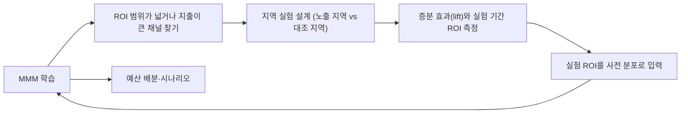

> Think with Google의 「[단순 측정을 넘어 예측까지, 마케팅 ROI를 극대화하는 Google Meridian 활용법](https://business.google.com/kr/think/measurement/google-meridian-maximise-roi/)」(2025.12)을 바탕으로, 모형 구조와 기능은 [Meridian 공식 문서](https://developers.google.com/meridian/docs/basics/about-the-project)로 확인해 재구성한 노트다.

## MMM이란

**마케팅 믹스 모델링(Marketing Mix Modeling, MMM)**은 매출 같은 핵심 지표(KPI)의 시계열을 채널별 마케팅 지출·노출과 통제 변수로 설명하는 통계 모형이다. 결과로 **채널마다 매출에 얼마나 기여했는지(증분), 채널 ROI, 지출을 늘릴 때 효과가 어떻게 줄어드는지(반응 곡선)**를 얻고, 이것으로 다음 예산을 나눈다.

- **집계 데이터만 쓴다.** 주 단위·지역 단위로 합친 숫자를 쓰므로 사용자 식별자나 쿠키가 필요 없다. 서드파티 쿠키와 기기 식별자가 줄어든 환경에서도 쓸 수 있는 프라이버시 보존형 측정이다.
- **오프라인까지 한 모형에 넣는다.** TV, 옥외 광고, 프로모션처럼 클릭이 남지 않는 채널도 디지털 채널과 같은 기준으로 비교한다.
- **질문이 전략 단위다.** 「이 광고를 누가 클릭했나」가 아니라 「다음 분기 예산을 채널별로 어떻게 나눌까」에 답한다.

## 측정 방법 비교

마케팅 효과를 재는 방법은 크게 셋이고, 서로 대체가 아니라 보완 관계다.

| 방법 | 데이터 | 답하는 질문 | 강점 | 약점 |
| --- | --- | --- | --- | --- |
| **라스트 클릭 어트리뷰션** | 사용자별 전환 경로의 마지막 접점 | 전환 직전에 무엇을 눌렀나 | 바로 볼 수 있고 캠페인 단위로 세밀하다 | 인과가 아니라 경로다. 검색·리타기팅처럼 전환 직전 채널을 과대평가하고, 브랜드·오프라인 채널은 0에 가깝게 잡힌다 |
| **멀티터치 어트리뷰션(MTA)** | 사용자별 전체 접점 | 접점마다 공을 얼마나 나눌까 | 여러 접점을 함께 본다 | 추적 가능한 디지털 접점만 보이고, 추적 제한으로 데이터가 계속 줄어든다 |
| **증분 실험(incrementality test)** | 노출군과 대조군(사용자 홀드아웃, 지역 실험) | 이 광고가 없었다면 전환이 얼마나 줄었을까 | 인과 효과를 가장 직접 잰다 | 한 번에 한두 채널, 한 기간만 잰다. 비용과 시간이 든다 |
| **MMM** | 주 단위 KPI, 채널별 지출·노출, 통제 변수 | 채널별 증분 기여와 ROI, 예산을 옮기면 어떻게 되나 | 모든 채널을 한 기준으로 비교하고 시나리오를 돌린다 | 관찰 데이터로 인과를 추정하므로 모형 가정에 의존한다. 캠페인·소재 단위로는 거칠다 |

**라스트 클릭으로는 전략 결정을 하기 어렵다.** 핀테크 앱 Akulaku는 모바일 측정 파트너의 라스트 클릭 데이터만으로는 채널 효과를 판단할 수 없어 MMM을 도입했고, 그 결과 GMV의 75%가 유료 미디어에서 나왔고 예산 배분만 바꿔도 GMV를 16% 늘릴 수 있다는 추정을 얻었다.

## 모형의 뼈대

MMM은 KPI를 「광고가 없어도 생겼을 기본 매출」과 「채널별 미디어 효과」, 「통제 변수 효과」의 합으로 본다.

```text
KPI(t) = 기본값 + Σ 채널별 [ β(c) · Hill( Adstock( 지출 또는 노출(c, t) ) ) ] + Σ γ(k) · 통제 변수(k, t) + 오차
```

### 이월 효과(Adstock)

광고 효과는 집행한 주에 끝나지 않고 다음 주, 그다음 주로 줄어들며 남는다. 이를 이전 효과의 일부를 더해 가는 식으로 표현한다.

```text
기하 감쇠:  A(t) = x(t) + λ · A(t-1)      (0 ≤ λ < 1, λ가 클수록 효과가 오래 남는다)
```

TV·브랜드 광고는 λ가 크고, 검색 광고처럼 의도가 뚜렷한 채널은 작게 나오는 경우가 많다. Meridian은 기하 감쇠와 이항(binomial) 감쇠를 지원한다.

### 포화(Saturation)

같은 채널에 돈을 계속 더 넣으면 추가로 얻는 효과가 줄어든다(수확 체감). 이를 S자 모양의 **Hill 함수**로 표현한다.

```text
Hill(x) = x^s / (x^s + K^s)       K: 효과가 최대치의 절반이 되는 지점, s: 곡선의 모양(가파름)
```

### ROI와 한계 ROI

```text
ROI(c)      = 채널 c가 만든 증분 매출 / 채널 c 지출
한계 ROI(c) = 채널 c 지출을 한 단위 더 늘렸을 때 추가로 생기는 증분 매출
```

**예산 배분은 평균 ROI가 아니라 한계 ROI로 한다.** 평균 ROI가 높은 채널도 이미 포화 구간이면 돈을 더 넣어도 남는 것이 적다. 한계 ROI가 높은 채널로 옮기다 보면 채널끼리 한계 ROI가 비슷해지는 지점이 최적에 가깝다. 이 계산이 MMM 도구의 예산 최적화(optimizer)·시나리오 기능이다.

### 통제 변수

미디어가 아닌데 매출을 움직이는 것을 모형에 넣지 않으면 그 효과가 광고 탓으로 잘못 잡힌다. 계절·공휴일, 가격·프로모션, 경쟁사 활동, 거시 경기, 유통 변화가 대표적이다. Meridian은 Google 검색어 볼륨(GQV)처럼 수요의 크기를 보여 주는 신호를 통제 변수로 넣을 수 있다. NoBroker 사례처럼 **KPI 정의 자체**도 모형 결과를 좌우한다. 거래 완료 대신 「집주인에게 연락한 사용자(리드)」를 KPI로 바꾸자 채널 영향이 더 잘 드러났다.

## 베이지안 MMM

전통적인 MMM은 회귀 계수를 점 하나로 추정한다. **베이지안 MMM**은 각 파라미터에 사전 분포(prior)를 주고 데이터로 갱신한 사후 분포(posterior)를 얻는다.

| 쓸모 | 설명 |
| --- | --- |
| 불확실성을 함께 낸다 | 「이 채널 ROI는 1.8」이 아니라 「1.2~2.5 사이일 가능성이 높다」처럼 범위로 보여 준다. 범위가 넓은 채널이 실험을 해 볼 후보다 |
| 짧고 거친 데이터를 버틴다 | 채널 지출이 함께 움직이는 다중공선성, 짧은 시계열처럼 MMM이 흔히 겪는 문제를 사전 지식으로 안정시킨다 |
| 실험 결과를 넣을 수 있다 | 증분 실험에서 얻은 ROI를 그 채널의 사전 분포로 넣는다. 이것이 **보정(calibration)**이다 |

## Google Meridian

**Meridian**은 Google이 만든 오픈소스 베이지안 MMM이다. GitHub에서 코드를 받아 무료로 쓰며, 2025년 1월 29일 모든 사용자에게 공개됐다. 같은 계열의 오픈소스로 Meta의 Robyn, PyMC 기반의 PyMC-Marketing이 있다.

| 기능 | 내용 |
| --- | --- |
| 지역 단위 계층 모형 | 국가 전체 대신 지역(geo)별 데이터를 써서 통계 정보량을 늘린다. 지역 단위 모형에는 인구(population) 변수가 필요하다 |
| ROI 사전 분포 | ROI 자체를 파라미터로 두어, 실험이나 업계 지식에서 얻은 ROI를 별도 변환 없이 사전 분포로 넣는다 |
| 도달·빈도(reach and frequency) | 노출 총량 대신 몇 명에게 몇 번 보였는지를 넣어, 브랜드 캠페인의 적정 빈도를 본다 |
| 예산 최적화·시나리오 플래너 | 수확 체감을 반영해 「이 채널을 20% 늘리면?」 같은 what-if를 계산한다 |
| Meridian GeoX·자동 보정 | 지역 실험을 설계·분석하고, 그 증분 결과를 MMM에 자동으로 보정해 넣는다. 어떤 채널에 실험이 필요한지도 제안한다 |

## 실험으로 보정하는 흐름

MMM은 관찰 데이터에서 인과를 추정하므로 틀릴 수 있다. 그래서 **불확실한 채널을 실험으로 검증하고, 그 결과를 다시 MMM에 넣는 루프**를 돈다.



- 실험이 여러 번이면 지출로 가중한 평균 ROI를 쓰고, 실험 기간에 맞춰 보정 기간을 지정한다. 표준오차가 크게 다른 실험은 그만큼 가중을 달리한다.
- 실험 한 번은 한 시점의 사진이다. 채널 효과는 소재·시장에 따라 바뀌므로 주기적으로 다시 잰다.

## 언제 쓰나

| 맞는 상황 | 맞지 않는 상황 |
| --- | --- |
| 유료 채널이 여러 개이고 오프라인·브랜드 채널이 섞여 있다 | 채널이 한두 개이고 예산이 작다. 실험 한두 번이 더 싸고 정확하다 |
| 라스트 클릭으로는 채널 기여를 설명할 수 없다 | 지출이 거의 변하지 않아 데이터에 변동이 없다. 변동이 없으면 효과를 분리할 수 없다 |
| 분기·연 단위 예산 배분과 증액 근거가 필요하다 | 소재·키워드·타기팅 단위의 일일 최적화가 목적이다. 플랫폼 내 지표와 A/B 테스트가 맞다 |
| 충분히 긴 주 단위 시계열이 있고, 지역별로 나눌 수 있다 | 출시 직후라 데이터가 몇 달치뿐이다 |

## 한계

- **관찰 데이터의 인과 추정이다.** 광고를 성수기에만 늘렸다면 계절 효과와 광고 효과가 섞인다. 통제 변수와 실험 보정이 없으면 결과를 그대로 믿지 않는다.
- **모형 선택에 결과가 흔들린다.** 감쇠 형태, 사전 분포, KPI 정의를 바꾸면 ROI가 달라진다. 가정을 문서로 남기고 민감도를 확인한다.
- **느리고 거칠다.** 주 단위 집계라 캠페인 단위의 빠른 판단에는 쓰지 않는다. 어트리뷰션과 실험을 함께 쓴다.
- **시나리오는 관측 범위 안에서만 믿는다.** 써 본 적 없는 수준까지 지출을 늘리는 예측은 곡선을 외삽한 값이다.

## 정리

- MMM은 집계 데이터로 채널별 증분 기여, ROI, 반응 곡선을 추정해 예산 배분에 답한다. 사용자 추적이 필요 없다.
- 핵심 구조는 기본값 + 이월 효과(adstock) + 포화(Hill) + 통제 변수다. 예산은 평균 ROI가 아니라 한계 ROI로 나눈다.
- 베이지안 MMM은 결과를 범위로 내고, 실험 결과를 사전 분포로 받아 보정한다.
- Google Meridian은 지역 계층 모형, ROI 사전 분포, 도달·빈도, 시나리오 플래너, GeoX 실험 보정을 갖춘 오픈소스 도구다.
- 어트리뷰션은 빠른 운영, 실험은 인과 검증, MMM은 전체 배분을 맡는다. 셋을 루프로 묶는다.

관련 노트: [[product-analytics|프로덕트 데이터 분석]], [[browser-tracking-protection|브라우저 추적 방지]], [[product-detail-page|상세페이지 9단계 구조]], [[strategy-frameworks|경영 전략 프레임]], [[pmf-erosion|PMF는 왜 조용히 사라지나]]
