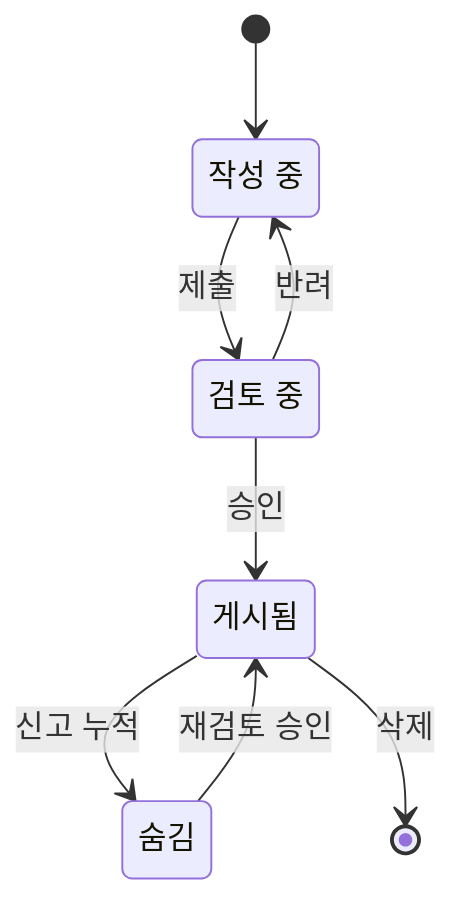

> 팁스터의 「‘기획 부채’를 해결하는 제품, 매니패스트 허재혁 대표」(2026.03)와 「AI와 함께 기획하는 사람들: 매니패스트편」(2026.05)에서 개념을 뽑고, 제품 부채와의 구분은 IdeaPlan의 「[Product Debt](https://www.ideaplan.io/glossary/product-debt)」로 보강해 재구성한 노트다. 특정 제품 소개는 덜어 냈다.

## 기획 부채란

**기획 부채(planning debt)**는 기획 단계에서 명확히 정의하거나 합의하지 않고 넘어간 사항이 개발·QA·운영 단계에서 문제로 터져 나오는 현상이다. 「나중에 정하자」, 「개발하면서 보자」로 미룬 결정 하나하나가 빚이다.

[[technical-debt|기술 부채]]의 비유가 그대로 맞는다.

| 금융 | 기획 |
| --- | --- |
| 원금 | 미뤄 둔 결정을 지금 내리고 문서에 반영하는 비용 |
| 이자 | 결정이 없어서 매번 드는 비용: 같은 질문, 해석이 갈린 구현, 다시 만드는 화면 |
| 복리 | 정의 없이 만든 기능 위에 다른 기능이 쌓여, 나중에 정하면 고칠 곳이 늘어난다 |

**늦게 발견할수록 비싸다.** 기획서의 한 줄로 끝날 결정이 디자인에서는 화면 몇 장, 개발에서는 API와 데이터 구조, 운영에서는 데이터 마이그레이션과 고객 대응이 된다.

## 세 가지 부채의 차이

| 부채 | 사는 곳 | 모습 | 갚는 법 |
| --- | --- | --- | --- |
| **기술 부채** | 코드·설계 | 중복, 테스트 없는 로직, 낡은 의존성 | 리팩터링, 테스트 |
| **제품 부채** | 사용자 경험 | 겹치는 기능, 서로 다른 상호작용 패턴, 헷갈리는 설정, 실제 업무와 어긋난 흐름. 코드가 깨끗해도 생긴다 | 사용률 낮은 기능 정리, 패턴 통일, 설정 대신 좋은 기본값 |
| **기획 부채** | 정의·합의 | 정하지 않은 예외, 문서마다 다른 규칙, 구두로만 남은 결정 | 정의하고, 기록하고, 한곳에 모은다 |

셋은 이어진다. 기획 부채는 개발 중에 임시방편 코드(기술 부채)와 화면마다 다른 규칙(제품 부채)으로 옮겨 간다.

## 어디서 생기나

| 발생원 | 모습 | 예 |
| --- | --- | --- |
| **누락** | 정상 흐름만 정의하고 예외·주변 상태를 빼먹는다 | 로그인 기능 자체가 빠진 채 출시, 빈 목록·로딩·오류·권한 없음 상태가 정의되지 않음 |
| **번역 문제** | 기획의 말이 개발에 필요한 명세로 풀리지 않는다 | 「홈 피드가 있어야 해요」에는 로그인 상태별로 피드가 어떻게 달라지는지, 이미지는 어떻게 올리는지, 좋아요는 어디에 저장하는지가 빠져 있다 |
| **흩어진 자료** | 회의록, 메신저, 기능 목록 엑셀, 피그마, 인터뷰 메모에 정보가 나뉘어 있다 | 팀원마다 같은 자료를 다르게 이해하고 같은 질문을 반복한다 |
| **구두 결정** | 회의에서 정했지만 어디에도 적지 않았다 | 담당자가 바뀌거나 시간이 지나면 「그때 그렇게 정했던가?」가 된다 |
| **문서 간 불일치** | 기획서를 고쳤는데 화면 설계나 정책 문서는 그대로다 | 개발자는 옛 문서를, QA는 새 문서를 기준으로 본다 |

## 증상

- 개발 막바지에 「이 경우는 어떻게 하죠?」라는 질문이 몰린다.
- QA 이슈 중 상당수가 버그가 아니라 「기획 확인 필요」다.
- 같은 질문이 사람만 바꿔 반복되고, 답이 사람마다 다르다.
- 비슷한 기능이 화면마다 다른 규칙으로 동작한다.
- 운영 중 고객 문의에 「정책이 뭐였지?」를 찾느라 시간이 든다.
- AI 코딩 도구로 만들었다가 빠진 기능과 구조 문제를 결과물을 본 뒤에야 발견해, 토큰과 시간을 들여 다시 만든다.

## 갚는 법

### 1. 단일 출처 스펙

결정은 **한곳(single source of truth)**에 모은다. 요구사항 정의서(PRD)에서 목표·대상 사용자·핵심 기능을 정하고, 이를 기능 명세로 계층화한다(기능 → 세부 기능 → 규칙·상태·예외). 흩어진 회의록과 메모는 출처로 링크하되, 기준은 스펙 하나다. 스펙이 바뀌면 화면 설계와 정책 문서도 같은 변경에서 고친다.

### 2. 결정 기록

중요한 결정은 이유와 함께 남긴다. 아키텍처 결정 기록(ADR)의 형식을 기획 결정에 그대로 쓸 수 있다.

| 항목 | 내용 |
| --- | --- |
| 맥락 | 왜 이 결정이 필요했나 |
| 결정 | 무엇으로 정했나 |
| 검토한 대안 | 무엇을 왜 버렸나 |
| 결과 | 이 결정으로 무엇이 쉬워지고 무엇이 어려워지나 |
| 상태 | 제안, 채택, 대체됨(무엇으로) |

진행 중에 작은 결정까지 매일 남기는 결정 로그는 [[project-process|새 서비스 개발 프로젝트 진행 순서]]의 「결정 로그 남기기」에 있다.

### 3. 정책 문서

화면 설명이 아니라 **규칙**을 따로 적는다. 권한(누가 무엇을 할 수 있나), 상태 전이(주문·회원·게시물이 어떤 상태를 거치나), 숫자 규칙(최대 글자 수, 만료 기간, 반올림), 예외 처리. 상태가 있는 대상은 상태 전이 표나 다이어그램으로 남긴다.

### 4. 용어집

같은 대상을 부서마다 다른 이름으로 부르면 번역 문제가 생긴다. 「회원」, 「사용자」, 「고객」이 같은지 다른지부터 정해 용어집에 둔다. 데이터 이름을 맞추는 방법은 [[bdd-sdd-task-design|BDD·SDD로 기획서를 태스크로 나누기]]의 「SDD」에 있다.

### 5. 누락 체크리스트

기능마다 정상 흐름 외에 확인할 상태를 체크리스트로 돌린다.

| 확인할 것 | 질문 |
| --- | --- |
| 빈 상태 | 데이터가 하나도 없을 때 무엇을 보여 주나 |
| 로딩·오류 | 느리거나 실패하면 어떻게 되나, 다시 시도할 수 있나 |
| 권한 | 로그인 전, 권한 없는 사용자에게는 어떻게 보이나 |
| 경계값 | 최대·최소, 0, 아주 긴 입력은 |
| 동시성·중복 | 두 번 누르거나 두 사람이 동시에 고치면 |
| 되돌리기 | 취소·삭제·환불은 가능한가, 기록은 남나 |

행동 단위로 「주어진 상황 · 행동 · 결과(given-when-then)」를 쓰면 누락이 잘 드러나고 그대로 태스크와 테스트가 된다([[bdd-sdd-task-design|BDD·SDD로 기획서를 태스크로 나누기]]).

### 6. 상환 순서

모든 미정 사항을 한 번에 정하지 않는다. 기술 부채처럼 **이자가 큰 곳부터** 갚는다. 곧 개발할 기능, 질문이 반복되는 영역, 결제·권한처럼 틀리면 비싼 규칙이 먼저다. 백로그에 「정책 정의」 항목으로 올려 기능과 같은 저울에서 우선순위를 정한다.

## AI 코딩 시대의 기획 부채

AI 코딩 도구로 비개발자도 제품을 만들 수 있게 되면서 기획 부채는 더 빨리, 더 크게 쌓인다.

- 사람 개발자는 모호한 요구를 받으면 되묻는다. 에이전트는 **빈칸을 그럴듯하게 채워 넣고** 진행한다. 정의하지 않은 결정이 코드 안에 조용히 박힌다.
- 결과물이 빨리 나오므로 빠진 것을 결과물을 본 뒤에야 발견하고, 다시 만드는 데 토큰과 시간을 쓴다.
- 그래서 에이전트에게 주는 스펙에 목표·비목표, 경계, 합격 기준을 먼저 적는다([[agent-spec-writing|AI 에이전트를 위한 스펙 작성법]]). 스펙을 에이전트가 직접 읽을 수 있는 형식(마크다운, 도구 연동)으로 두면 단일 출처가 사람과 에이전트 모두에게 기준이 된다.
- AI가 초안을 먼저 내고 질문을 던지게 하면 백지에서 시작하는 부담과 누락이 줄어든다. 다만 **결정은 사람이 내리고 기록한다.** AI가 채운 기본값을 결정으로 착각하지 않는다.

## 정리

- 기획 부채는 정의·합의하지 않은 결정이 뒤 단계에서 비용으로 터지는 것이다. 늦게 발견할수록 비싸다.
- 기술 부채는 코드에, 제품 부채는 사용자 경험에, 기획 부채는 정의되지 않은 결정에 산다. 기획 부채는 나머지 둘로 옮겨 간다.
- 발생원은 누락, 번역 문제, 흩어진 자료, 구두 결정, 문서 간 불일치다.
- 단일 출처 스펙, 결정 기록, 정책 문서, 용어집, 누락 체크리스트로 갚고, 이자가 큰 곳부터 정한다.
- 에이전트는 빈칸을 묻지 않고 채우므로, AI로 만들수록 스펙과 결정 기록이 더 중요해진다.

관련 노트: [[technical-debt|기술 부채]], [[project-process|새 서비스 개발 프로젝트 진행 순서]], [[bdd-sdd-task-design|BDD·SDD로 기획서를 태스크로 나누기]], [[software-documentation|소프트웨어 문서화]], [[agent-spec-writing|AI 에이전트를 위한 스펙 작성법]], [[backlog-and-estimation|백로그와 추정]]
