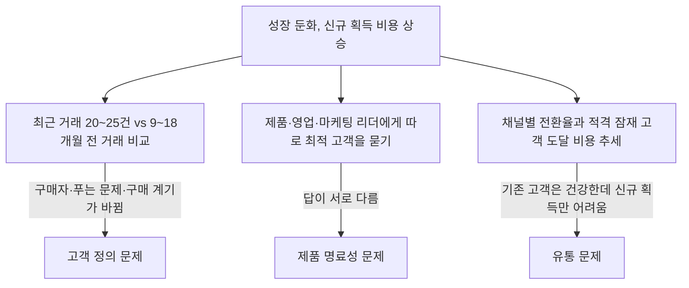

> GeekNews Weekly의 「지표가 좋아 보이는 회사가 성장을 멈추는 이유」(2026.08)와 거기서 소개한 Brent Harrison의 「[How Companies Quietly Lose Product-Market Fit Without Noticing](https://smokejumper.substack.com/p/how-companies-quietly-lose-product)」(2026.07), NFX의 「[The Upgraded Go-to-Market Playbook](https://www.nfx.com/post/upgraded-gtm-playbook)」(2026.07)을 바탕으로, Reforge의 「[Product Market Fit Collapse](https://www.reforge.com/blog/product-market-fit-collapse)」로 보강해 재구성한 노트다.

## PMF는 상태가 아니라 관계다

**제품-시장 적합성(Product-Market Fit, PMF)**은 세 가지가 함께 성립할 때다.

| 요소 | 뜻 |
| --- | --- |
| 가치 | 제품이 실제 문제를 풀어 고객에게 가치를 만든다 |
| 지불 | 고객이 돈(또는 그에 준하는 대가)을 낸다 |
| 반복 획득 | **비슷한 고객을 규모 있게 계속 데려올 경로**가 있다 |

회사들이 가장 가볍게 보는 것이 세 번째다. 기존 고객이 제품을 사랑하는 상태는 **제품-가치 적합성(Product-Value fit)**일 뿐이다. 겉으로는 PMF처럼 보이지만 같은 것이 아니다. PMF는 제품, 고객, 둘을 잇는 유통 경로 사이의 관계이므로 셋 중 하나만 바뀌어도 흔들린다.

## 지표가 좋은데 성장이 멈춘다

PMF가 사라질 때 기존 고객 지표는 오히려 좋아 보인다.

| 좋아 보이는 지표 | 가리는 것 |
| --- | --- |
| 순매출 유지율(NRR) 120% 이상, 기존 고객 사용량 증가 | 확장 매출이 신규 고객 풀이 줄어드는 것을 가린다 |
| 높은 NPS | 이미 좋아하는 고객(추천 고객)에게만 팔고 있으면 NPS는 당연히 높다 |
| 짧아진 영업 주기(기존 고객 확장 건) | 신규 고객 영업 주기는 길어지고 있다 |

그래서 **기존 고객 코호트와 신규 고객 획득 지표를 따로 본다.** 지표를 쪼개 보는 법은 [[product-analytics|프로덕트 데이터 분석]]의 「쪼개서 보기」에 있다.

## 세 가지 원인

| 원인 | 무슨 일이 일어나나 | 예 |
| --- | --- | --- |
| **핵심 고객군 소진** | 처음 맞았던 이상적 고객(ICP)을 대부분 이미 얻었다. 남은 잠재 고객은 문제를 덜 느껴 설득이 오래 걸린다 | 위치 기반 API가 빠르게 크는 앱 회사들을 거의 다 고객으로 만든 뒤 영업 주기가 길어짐 |
| **고객 요구 변화** | 플랫폼이나 기술이 바뀌어 고객이 제품을 고용하던 이유가 약해진다 | iOS·Android가 기본 위치 기능을 넣으며 프리미엄 API 시장이 좁아짐. AI 답변이 나오자 Chegg의 검색 유입·구독 루프가 무너짐 |
| **유통 경로 노후화** | 고객에게 닿던 채널이 포화되거나 비싸진다. 초기 고객 밖으로 닿는 획득 엔진을 만든 적이 없다 | SEO·PR·유료 광고가 붐비고 비싸져 같은 비용으로 얻는 고객이 줄어듦 |

AI처럼 큰 기술 전환은 **PMF의 문턱 자체를 올린다.** 고객 기대가 빠르게 높아지면 「충분히 좋던」 제품이 갑자기 낡아 보인다. 고객 관계를 직접 가졌는지, 사용 빈도, 작업 흐름을 소유했는지, 고유 데이터가 있는지, 성장 루프가 AI가 없앨 수 있는 유인에 기대는지가 이 위험을 가늠하는 질문이다.

## 실행 문제로 오진하는 이유

증상(영업 주기 연장, 전환율 하락, 이사회의 날카로운 질문)은 실행 문제처럼 보인다. 그래서 조직은 **넓히는 쪽**으로 반응한다. 파이프라인을 늘리고, 영업 인력을 뽑고, 기능을 더하고, 「얼추 맞는」 고객까지 범위를 넓힌다. 하나하나는 합리적이지만 원인을 건드리지 않아 몇 분기씩 증상만 치료하게 된다. 넓힐수록 누구를 위한 제품인지가 더 흐려진다.

이 표류는 세 가지 신호로 나타난다.

| 신호 | 모습 |
| --- | --- |
| ICP 표류 | 성사된 거래의 고객 프로필이 원래 이상적 고객과 느슨하게만 맞는다 |
| 제품 신호 약화 | 고객 피드백이 하나의 해결할 일(job to be done)로 모이지 않고 사방으로 흩어진다. 로드맵이 닻을 잃는데 출시는 계속된다 |
| 메시지 표류 | 가치 제안이 구체성을 잃는다. 피치마다 말은 되지만 처음만큼 날카로운 것이 없다 |

## 진단: 세 가지 점검

- **거래 점검**: 최근 성사된 거래마다 누가 샀는지, 어떤 문제를 풀었는지, 무엇이 구매 계기였는지 적고 9~18개월 전 거래와 비교한다. 무게 중심이 옮겨 갔으면 신호다.
- **내부 일관성**: 같은 질문에 부서마다 다른 고객을 말하면 제품 정의가 이미 갈라진 것이다.
- **채널 점검**: 전환율이 유지되는지, 적격 잠재 고객에게 닿는 비용이 오르는지 본다.

점검 하나로 결론 내지 않는다. 셋을 합쳐 고객 정의, 제품 명료성, 유통 중 어디가 문제인지 가린다.

## 처방: 넓히기 전에 선명하게

먼저 표류가 **우연인지 의도인지** 정하고, 경영진이 그 판단을 말로 합의한다. 합의가 없으면 로드맵·GTM·채용 논쟁이 끝나지 않는다.

| 상황 | 처방 |
| --- | --- |
| **우연한 표류** (원래 시장은 아직 남았다) | 원래 고객으로 다시 좁힌다. 가장자리 요청은 거절하고 로드맵을 핵심 해결할 일에 맞춘다. 좁히기는 후퇴가 아니라 전략적 선택이다 |
| **의도적 재조정** (원래 시장이 소진되거나 바뀌었다) | 다음 고객을 명시적으로 고른다. 누구인지, 제품을 무슨 일에 고용하는지, 왜 우리가 맞는지 적는다. 새 고객을 옛 고객의 변형쯤으로 다루면 같은 침식을 반복한다 |

재조정할 때 기존 조직은 지금 고객을 계속 돌보고, 별도의 작은 팀이 다음 제품·시장을 찾게 하는 방식이 있다. 다만 권한·자원·회사의 정체성을 두고 긴장이 생기므로 역할을 미리 정한다.

## GTM을 제품 전략으로 설계한다

PMF를 다시 맞추려면 제품만이 아니라 **고객이 제품을 발견하고, 경험하고, 퍼뜨리는 경로**도 다시 설계한다. 전통 채널이 붐비는 지금은 GTM(Go-To-Market)을 마케팅 부서의 일이 아니라 제품 안에 넣는다.

| 원칙 | 내용 | 예 |
| --- | --- | --- |
| 멀티플레이어 제품 | 고객 한 명을 네트워크의 노드로 보고, 공유 마찰을 낮추고, 결과물을 공유하기 좋게 만든다. 공격적인 초대 강요보다 소규모 협업에서 자연스럽게 퍼지게 한다 | Slack, DocuSign, Dropbox, Zoom |
| 셀프서비스 | 영업 승인 없이 써 보고 카드로 결제한다. 실험을 보상한다 | Cursor, Zoom |
| 프로슈머 먼저 | 지불 의사와 구매 권한이 있고 빠른 도구를 좋아하는 개인 전문가로 매출을 만든 뒤 기업 영업을 붙인다 | ElevenLabs |
| 커뮤니티 먼저, 영업은 나중 | 자체 커뮤니티를 새로 만들기보다 사용자가 이미 모인 Reddit·Discord·Slack·X에서 시작해 제품으로 끌어온다 | Cursor의 Reddit, Midjourney의 Discord, Clay의 Slack |
| 오픈소스 기반 | 커뮤니티가 제품을 키우고, 나중에 수익화한다 | Snyk: 유료 구매 기업의 70%가 이미 개인 기여자로 쓰고 있었다 |
| 진정성 있는 창업자 브랜드 | 공개적으로 만들고, 홍보 없이 쓸모 있는 업계 데이터를 나눈다 | - |

이 루프가 돌면 획득 비용이 채널 경매가가 아니라 제품 경험에 묶인다. 초기 시장에서 주류 시장으로 넘어갈 때의 간극은 [[strategy-frameworks|경영 전략 프레임]]의 「캐즘」에 있다.

## 정리

- PMF는 가치·지불·반복 획득의 관계다. 기존 고객의 만족만으로는 PMF가 아니다.
- NRR·NPS·사용량은 기존 고객 지표다. 신규 획득 지표를 따로 본다.
- 원인은 핵심 고객군 소진, 고객 요구 변화, 유통 경로 노후화 중 하나다. 실행 문제로 오진해 넓히면 더 흐려진다.
- 거래·내부 일관성·채널을 점검해 원인을 가리고, 우연한 표류면 좁히고 의도적 재조정이면 다음 고객을 명시한다.
- **PMF는 한 번 얻는 자격이 아니라 제품·고객·유통의 변화를 따라 계속 갱신하는 관계다.**

관련 노트: [[product-analytics|프로덕트 데이터 분석]], [[strategy-frameworks|경영 전략 프레임]], [[feature-factory|기능 공장]], [[startup-engineering|초기 스타트업과 창업]], [[data-moat|데이터 해자의 조건]], [[marketing-mix-modeling|마케팅 믹스 모델링(MMM)]]
