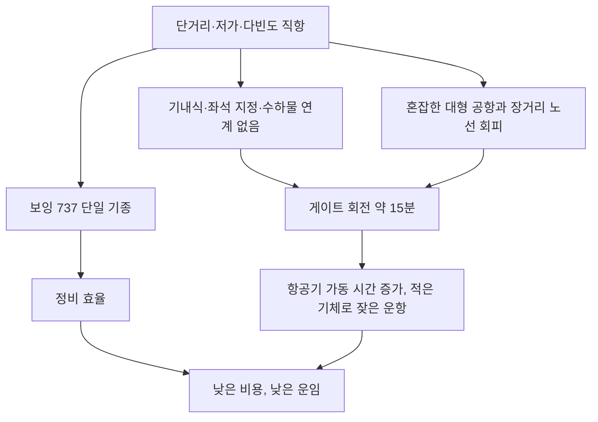

> Michael Porter의 「[What Is Strategy?](https://hbr.org/1996/11/what-is-strategy)」(Harvard Business Review, 1996)와 「[The Five Competitive Forces That Shape Strategy](https://hbr.org/2008/01/the-five-competitive-forces-that-shape-strategy)」(2008, 원 논문 1979), 김위찬(W. Chan Kim)과 르네 마보안(Renée Mauborgne)의 『Blue Ocean Strategy』(2005), Theodore Levitt의 「Marketing Myopia」(Harvard Business Review, 1960), Geoffrey Moore의 『Crossing the Chasm』(1991), Charles O'Reilly와 Michael Tushman의 「[The Ambidextrous Organization](https://hbr.org/2004/04/the-ambidextrous-organization)」(Harvard Business Review, 2004)을 바탕으로 종합한 노트다.

## 한눈에 보기

| 프레임 | 답하는 질문 | 원전 |
| --- | --- | --- |
| 운영 효율과 전략, 활동 정합성 | 경쟁 우위는 무엇으로 지속되나 | Porter(1996) |
| 다섯 가지 경쟁 요인 | 이 산업은 왜 이익이 나거나 나지 않나 | Porter(1979, 2008) |
| 네 가지 액션(ERRC) | 경쟁을 피해 새 수요를 어떻게 만드나 | Kim과 Mauborgne(2005) |
| Marketing Myopia | 우리는 무슨 사업을 하고 있나 | Levitt(1960) |
| 캐즘 | 초기 고객에서 주류 고객으로 왜 못 넘어가나 | Moore(1991) |
| 양손잡이 조직 | 기존 사업과 신사업을 어떻게 함께 하나 | O'Reilly와 Tushman(2004) |
| 고객 생애 가치 | 고객 한 명을 얻는 데 얼마까지 써도 되나 | 마케팅 지표 |

## 운영 효율은 전략이 아니다

| 구분 | 운영 효율(Operational effectiveness) | 전략(Strategy) |
| --- | --- | --- |
| 뜻 | 경쟁자와 **같은 활동을 더 잘한다** | 경쟁자와 **다른 활동을 하거나, 같은 활동을 다르게 한다** |
| 예 | 품질 관리, 벤치마킹, 아웃소싱, 자동화 | 누구에게 무엇을 제공하고 무엇을 제공하지 않을지 정한다 |
| 한계 | 좋은 방법은 금방 퍼진다. 모두가 같은 개선을 하면 서로 닮아 가고 이익은 고객과 공급자에게 넘어간다 | 선택에는 포기가 따른다 |

운영 효율은 필요하지만 충분하지 않다. 지속되는 우위는 **트레이드오프**에서 나온다. 한쪽을 더 하면 다른 쪽을 덜 하게 되는 선택을 했을 때, 경쟁자는 따라 하려면 자기 기존 방식을 버려야 한다. 그래서 **전략의 본질은 무엇을 하지 않을지 고르는 일**이다.

### 활동 정합성

경쟁 우위는 뛰어난 활동 하나가 아니라 **활동들이 서로 맞물린 전체**에서 나온다. 정합성(fit)에는 세 단계가 있다.

| 단계 | 내용 |
| --- | --- |
| 1차: 단순 일관성 | 각 활동이 전체 전략과 어긋나지 않는다 |
| 2차: 상호 강화 | 한 활동이 다른 활동의 비용을 낮추거나 가치를 높인다 |
| 3차: 노력의 최적화 | 활동 사이의 조율로 중복과 낭비를 없앤다 |

맞물린 활동이 많을수록 모방은 어려워진다. 활동 하나를 베낄 확률이 높아도 전체를 다 맞게 베낄 확률은 그 곱이라 급격히 낮아지기 때문이다.

1996년 논문이 든 대표 사례는 사우스웨스트항공이다. 「중소 도시와 대도시 보조 공항 사이를 짧게, 싸게, 자주 잇는다」는 위치에 모든 활동을 맞췄다.



정식 서비스 항공사가 이 가운데 하나(예: 기내식 폐지)만 따라 하면 얻는 것이 없다. 전체를 따라 하려면 허브 공항 중심의 기존 노선망을 버려야 한다. 이 사례는 1996년 당시의 활동 체계다. 사우스웨스트는 지금도 보잉 737 단일 기종을 운용하지만, 2025년 5월에 위탁 수하물 2개 무료 정책을 끝냈고 2026년 1월 27일부터 좌석 지정제로 바꿨다.

## 다섯 가지 경쟁 요인과 진입 장벽

산업의 수익성은 기존 경쟁자끼리의 다툼만이 아니라 다섯 가지 힘이 이익을 얼마나 가져가느냐로 정해진다: **기존 경쟁자 간 경쟁, 구매자의 교섭력, 공급자의 교섭력, 신규 진입자의 위협, 대체재의 위협**.

신규 진입의 위협은 진입 장벽의 높이와 기존 기업의 예상되는 보복으로 정해진다.

| 진입 장벽 | 내용 |
| --- | --- |
| 공급 측 규모의 경제 | 많이 만들수록 단위 원가가 낮아진다. 진입자는 큰 규모로 들어오거나 원가 열위를 감수해야 한다 |
| 수요 측 규모의 이점(네트워크 효과) | 쓰는 사람이 많을수록 구매자가 내려는 값이 올라간다 |
| 고객 전환 비용 | 공급자를 바꿀 때 고객이 치르는 비용(재교육, 데이터 이전, 공정 변경) |
| 자본 요건 | 설비, 재고, 초기 손실을 감당할 큰 돈이 필요하다 |
| 규모와 무관한 기존 기업의 우위 | 독점 기술, 좋은 입지, 쌓인 경험, 브랜드와 고객 충성도 |
| 유통 채널 접근의 불평등 | 채널이 한정되고 기존 기업이 선점했을수록 들어가기 어렵다 |
| 정부 정책 | 인허가, 특허, 규제 |

- 인접 업종의 기업은 기존 유통 채널과 브랜드를 그대로 쓸 수 있어 장벽이 낮고, 무관한 업종에서 오는 기업에게는 높다.
- **가격 결정력**은 값을 올려도 수요를 잃지 않는 힘이다. 구매자의 교섭력이 약하고, 대체재가 멀고, 진입 장벽이 높을 때 생긴다. 가격 결정력이 약한 산업에서 낮은 값으로 버티려면 값만 내리는 것이 아니라 **원가 구조 자체가 낮아야** 한다.

## 블루오션 전략: 네 가지 액션

| 구분 | 레드오션 | 블루오션 |
| --- | --- | --- |
| 시장 | 경계가 정해진 기존 시장 | 아직 경쟁이 없는 새 시장 공간 |
| 경쟁 | 경쟁자를 이긴다 | 경쟁을 무의미하게 만든다 |
| 수요 | 기존 수요를 나눠 갖는다 | 새 수요를 만들고 차지한다(지금은 사지 않는 비고객) |
| 가치와 비용 | 차별화와 저비용 중 하나를 고른다 | 둘을 동시에 추구한다(가치 혁신) |

차별화와 저비용을 함께 얻는 방법이 네 가지 액션 프레임워크다. 네 질문의 답을 한 표에 적은 것을 ERRC 그리드라 부른다.

| 액션 | 질문 | 효과 |
| --- | --- | --- |
| 제거(Eliminate) | 업계가 당연하게 여기는 요소 가운데 무엇을 없앨 것인가 | 비용 절감 |
| 감소(Reduce) | 무엇을 업계 표준보다 한참 낮출 것인가 | 비용 절감 |
| 증가(Raise) | 무엇을 업계 표준보다 한참 높일 것인가 | 구매자 가치 상승 |
| 창조(Create) | 업계가 한 번도 제공하지 않은 무엇을 새로 만들 것인가 | 구매자 가치 상승, 새 수요 |

- 제거와 감소가 먼저다. 업계의 많은 기능과 서비스는 고객이 원해서가 아니라 경쟁자가 하니까 따라 붙인 것이다. 이것을 덜어 내면 비용이 줄고, 그 여력으로 증가와 창조를 한다.
- 예: 태양의 서커스는 동물 쇼와 스타 곡예사를 없애고, 주제가 있는 줄거리와 세련된 공연 환경을 더해 서커스를 보지 않던 성인 관객을 끌어왔다.
- 블루오션도 모방자가 들어오면 붉어진다. 가치 곡선이 경쟁자와 겹치기 시작하면 다시 네 질문으로 돌아간다.

## Marketing Myopia: 무슨 사업을 하고 있나

성장이 멈춘 산업은 시장이 포화해서가 아니라 **경영진이 사업을 좁게 정의해서** 멈춘다. 철도 회사는 승객과 화물 운송 수요가 줄어서 쇠퇴한 것이 아니다. 수요는 늘었지만 자동차, 트럭, 항공이 가져갔다. 자신을 「운송 사업」이 아니라 「철도 사업」으로 정의했기 때문에 고객을 다른 수단에 내줬다. **사업은 제품이 아니라 고객의 필요로 정의한다.**

스스로를 속이는 순환을 만드는 네 가지 믿음이 있다.

| 믿음 | 실제 |
| --- | --- |
| 인구가 늘고 부유해지니 성장은 보장된다 | 시장이 저절로 커진다고 믿으면 시장을 넓힐 방법을 생각하지 않는다 |
| 우리 주력 제품을 대체할 경쟁 제품은 없다 | 대체재는 산업 밖에서 온다 |
| 대량 생산으로 단위 원가를 낮추면 된다 | 만든 것을 파는 데 몰두해, 고객이 원하는 것을 만드는 일을 잊는다 |
| 제품을 과학적으로 개선하고 원가를 줄이면 된다 | 기술과 제조에 몰두해 시장을 보지 않는다 |

한계도 있다. 지금 고객의 요구만 충실히 따르는 기업은 아직 고객이 원하지 않는 파괴적 기술을 놓친다(Clayton Christensen, 『The Innovator's Dilemma』, 1997). 고객의 필요로 사업을 정의하되 지금 고객의 말만 따르지는 않는다.

## 캐즘: 초기 시장과 주류 시장 사이

기술 제품의 구매자는 혁신가, 초기 수용자, 초기 다수, 후기 다수, 지각 수용자 순서로 움직인다(구간별 설명은 [[tech-stack-selection|기술 스택 고르기]]). 캐즘(chasm)은 **초기 수용자와 초기 다수 사이의 단절**이다.

| 구분 | 초기 수용자(선견자) | 초기 다수(실용주의자) |
| --- | --- | --- |
| 사는 이유 | 경쟁자보다 앞서는 큰 변화 | 지금 하는 일의 확실한 개선 |
| 위험 태도 | 미완성 제품을 감수한다 | 검증된 것만 산다 |
| 참고하는 사람 | 다른 산업의 선견자 | **같은 업계의 다른 실용주의자** |
| 요구하는 것 | 새 기능, 맞춤 개발 | 완성된 해법, 지원, 표준 |

실용주의자는 다른 실용주의자의 사용 사례를 보고 사는데, 초기 고객은 모두 선견자라서 참고할 사례가 없다. 그래서 초기 시장의 매출 급증을 전체 시장 수요로 읽고 확장하면 캐즘에 빠진다.

넘는 방법은 **한 번에 한 시장**이다.

- **교두보**: 절실한 문제를 가진 좁은 세분 시장 하나를 골라 그 시장의 1위가 된다. 한 업종의 한 문제를 끝까지 해결한다.
- **완전완비제품(whole product)**: 실용주의자가 사는 것은 핵심 제품이 아니라 문제가 풀린 상태다. 구매 이유를 충족하는 데 필요한 것을 모두 갖춘다.
- **볼링핀**: 첫 세분 시장에서 얻은 사례와 완전완비제품을 발판으로 인접 세분 시장을 차례로 넘어뜨린다.

완전완비제품은 네 겹으로 본다.

| 층 | 내용 |
| --- | --- |
| 핵심 제품(Generic) | 상자에 담겨 출하되는 것 |
| 기대 제품(Expected) | 고객이 샀을 때 당연히 들어 있다고 생각하는 최소 구성 |
| 보강 제품(Augmented) | 구매 목적을 최대한 이루도록 더한 것(교육, 연동, 컨설팅, 유지 보수) |
| 잠재 제품(Potential) | 보완 제품이 늘고 고객이 확장하면서 생길 성장 여지 |

## 양손잡이 조직: 활용과 탐색을 함께

기업은 기존 사업을 다듬어 효율을 높이는 **활용**(exploitation)과 새 사업을 찾는 **탐색**(exploration)을 함께 해야 한다. 둘은 필요한 것이 반대다.

| 구분 | 활용 | 탐색 |
| --- | --- | --- |
| 목표 | 비용, 이익, 점진 개선 | 성장, 새 시장, 돌파 혁신 |
| 지표 | 마진, 생산성 | 학습 속도, 마일스톤 |
| 문화 | 효율, 낮은 위험, 품질 | 실험, 속도, 위험 감수 |
| 실패의 뜻 | 줄여야 할 손실 | 싸게 얻은 학습 |

양손잡이 조직(ambidextrous organization)은 이 둘을 **구조적으로 분리된 조직**으로 두고 **최고 경영진 수준에서만 통합**한다.

- 신사업 조직은 자체 프로세스, 구조, 문화, 평가 기준을 가진다. 기존 사업의 KPI와 승인 절차를 신사업에 그대로 적용하면 탐색이 죽는다.
- 분리만 하면 신사업이 고립된다. 경영진이 두 조직을 함께 책임지고, 기존 사업의 자원(고객, 기술, 자금)을 신사업이 쓸 수 있게 잇는다.
- 실행 순서로 보면 탐색(작고 싼 실험), 검증(데이터로 반복), 확장(확신이 섰을 때의 큰 투자)이다. 탐색 단계의 실패는 학습이지만 검증 없이 확장한 뒤의 실패는 치명적이다.

## 고객 생애 가치(CLV)

고객 생애 가치(Customer Lifetime Value, LTV라고도 쓴다)는 한 고객과의 관계가 이어지는 동안 그 고객에게서 나올 **미래 순이익의 현재 가치**다.

기간마다 마진과 유지율이 일정하다고 놓은 단순 모형은 다음과 같다.

```text
CLV = 마진 × 유지율 ÷ (1 + 할인율 − 유지율)

예: 연 마진 10만 원, 유지율 80%, 할인율 10%
    100,000 × 0.8 ÷ (1 + 0.1 − 0.8) = 약 266,667원
```

| 쓰임 | 내용 |
| --- | --- |
| 획득 비용의 상한 | 고객 한 명을 데려오는 비용(CAC)이 CLV보다 작아야 한다([[product-analytics\|프로덕트 데이터 분석]]의 CAC < LTV) |
| 세분화 | 가치가 높은 고객군에 마케팅과 응대 자원을 더 쓴다 |
| 유지 투자 판단 | 유지율이 분모에 들어가므로 유지율을 조금 올려도 CLV가 크게 오른다. 위 예에서 유지율이 90%가 되면 45만 원이다 |

| 주의 | 내용 |
| --- | --- |
| 매출이 아니라 이익 | 매출이나 매출 총이익으로 계산하면 몇 배로 부풀려진다 |
| 할인 | 먼 미래의 현금을 할인하지 않으면 과대 추정된다 |
| 고정값이 아니다 | CLV는 모형의 출력이다. 유지율, 서비스 품질, 마케팅 효과가 바뀌면 함께 바뀐다 |

구독 모델의 수익성이 높은 이유가 이 식에 있다. 유지 기간과 고객당 단가를 함께 늘릴 수 있기 때문이다. 현금이 버티는 기간을 보는 번 레이트와 런웨이는 [[company-financial-check|비상장 회사 재무제표 찾아보기]]에 있다.

## 정리

- 남과 같은 것을 더 잘하는 것은 전략이 아니다. 무엇을 하지 않을지 고르고, 고른 활동끼리 맞물리게 한다.
- 산업의 이익은 다섯 가지 힘이 나눠 가진다. 진입 장벽이 낮으면 이익은 오래가지 않는다.
- 새 수요를 만들 때는 더하기 전에 뺀다(제거, 감소, 증가, 창조).
- 사업은 제품이 아니라 고객의 필요로 정의한다.
- 초기 고객의 열광은 주류 시장의 수요가 아니다. 좁은 시장 하나에서 완전한 해법으로 1위가 된 뒤 넓힌다.
- 기존 사업과 신사업은 다른 규칙으로 운영하고 경영진에서 잇는다.

관련 노트: [[management-theory-classics|경영 이론의 고전]], [[startup-engineering|초기 스타트업과 창업]], [[venture-investment-terms|벤처투자의 논리와 투자계약 조항]], [[product-analytics|프로덕트 데이터 분석]], [[tech-stack-selection|기술 스택 고르기]], [[feature-factory|기능 공장]]
