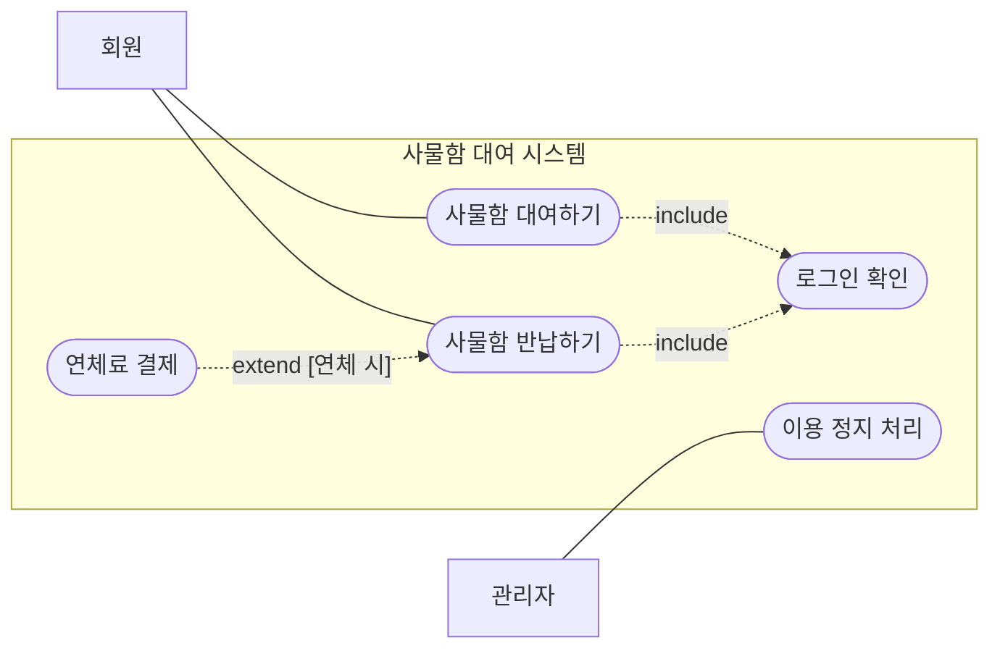

> 팔만코딩경(42Seoul 커뮤니티 위키)의 「UML 중 Use Case Diagram」을 바탕으로 재구성한 노트다.
> 「유스케이스 명세」 절은 고려사이버대학교 「소프트웨어 분석설계」(2023-2학기) 강의 내용으로 보강했다.

## UML과 유스케이스 다이어그램

UML(Unified Modeling Language, 통합 모델링 언어)은 소프트웨어의 구조와 동작을 그림으로 나타내는 표준 표기법이다. 1997년 OMG(Object Management Group)가 표준으로 채택했고, 현재 버전은 UML 2.5.1이다. 다이어그램 종류가 열 가지가 넘지만 **전부 익힐 필요는 없다.** 팀이 대화에 필요한 몇 가지만 쓰면 된다. 다이어그램 분류 전체는 [[software-engineering#UML|소프트웨어 설계와 공학]]에 있다.

유스케이스 다이어그램은 그중 **"누가 이 시스템으로 무엇을 하는가"** 를 그리는 행위 다이어그램이다. 내부 구현이나 순서가 아니라 **바깥에서 본 기능 목록과 사용자**만 보여 준다.

### 어디에 쓰나

| 용도 | 설명 |
| --- | --- |
| 범위 합의 | 시스템 경계 안에 무엇이 들어가고 무엇이 빠지는지 한눈에 보인다 |
| 요구사항 도출·검증 | 액터별로 빠진 기능이 없는지 점검한다 |
| 개발 계획 | 유스케이스 하나가 작업 단위·스프린트 항목의 출발점이 된다 |
| 테스트 설계 | 유스케이스마다 정상 흐름·예외 흐름이 테스트 케이스가 된다 |
| 문서화 | 사용자 매뉴얼의 목차 뼈대가 된다 |

혼자 하는 과제에서도 쓸모가 있다. 떠오르는 대로 코드부터 쓰다 길을 잃는 일을 줄이고, 시간이 지난 뒤 "이 프로그램이 뭘 하던 거였지"를 빠르게 되살린다.

## 구성 요소

| 요소 | 표기 | 의미 |
| --- | --- | --- |
| 액터(Actor) | 사람 모양 막대 그림 | 시스템 바깥에서 시스템과 상호작용하는 역할. 사람뿐 아니라 외부 시스템, 결제 대행사, 타이머도 될 수 있다 |
| 유스케이스(Use Case) | 타원 | 액터에게 의미 있는 결과를 주는 기능 하나. "동사 + 목적어"로 쓴다(예: 사물함 대여하기) |
| 시스템 경계 | 사각형 | 안쪽이 이번에 만드는 시스템이다. 액터는 반드시 바깥에 둔다 |

액터는 **사람이 아니라 역할**이다. 한 사람이 "회원"과 "관리자"를 겸하면 액터는 둘이다.

## 관계

| 관계 | 표기 | 의미 | 예 |
| --- | --- | --- | --- |
| 연관(Association) | 실선 | 액터와 유스케이스가 상호작용한다 | 회원 ─ 사물함 대여하기 |
| 일반화(Generalization) | 속이 빈 삼각형 화살표, 일반 쪽을 향함 | 상속 관계. 구체적인 것이 일반적인 것의 모든 관계를 물려받는다 | 카드 결제 ─▷ 결제하기 |
| 포함(`<<include>>`) | 점선 화살표, 기본 → 포함되는 쪽 | 기본 유스케이스가 실행될 때 **항상** 함께 실행된다. 여러 유스케이스의 공통 부분을 뽑을 때 쓴다 | 사물함 대여하기 ┄> 로그인 확인 |
| 확장(`<<extend>>`) | 점선 화살표, 확장 → 기본 쪽 | 특정 조건에서만 **선택적으로** 덧붙는다 | 연체료 결제 ┄> 사물함 반납하기 |

include와 extend는 화살표 방향이 반대라 헷갈린다. **"누가 누구를 알고 있나"** 로 기억한다. 기본 유스케이스는 자기가 포함하는 것을 알고(include), 확장 유스케이스는 자기가 끼어들 기본 유스케이스를 안다(extend).

## 작성 4단계

1. **액터 식별**: 시스템을 쓰는 모든 사용자 역할, 연동하는 외부 시스템, 정보를 주고받는 장치를 찾는다.
2. **유스케이스 식별**: 액터마다 시스템에 요구하는 서비스, 시스템과 주고받는 행위를 적는다.
3. **관계 정의**: 액터-액터(일반화), 액터-유스케이스(연관), 유스케이스-유스케이스(include·extend·일반화) 관계를 잇는다.
4. **구조화**: 두 개 이상의 유스케이스에 반복되는 부분은 별도 유스케이스로 뽑아 include로 묶고, 조건부로만 수행되는 부분은 extend로 떼어 낸다.

## 유스케이스 명세

다이어그램은 기능 목록일 뿐이라, 각 유스케이스가 어떻게 진행되는지는 **유스케이스 명세(Use Case Description)** 에 글로 쓴다. 예로 블로그의 「댓글 작성」을 쓴다.

| 항목 | 내용 |
| --- | --- |
| 유스케이스 | 댓글 작성 |
| 설명 | 회원이 글에 댓글을 남긴다 |
| 주 액터 / 보조 액터 | 회원 / 스팸 필터 서비스 |
| 사전 조건 | 회원이 로그인해 있고 글 상세 화면을 보고 있다 |
| 사후 조건 | 댓글이 저장되고 목록 맨 아래에 보인다 |

| 흐름 | 단계 |
| --- | --- |
| 정상 흐름 | 1. 회원이 댓글 입력창을 누른다. 2. 시스템이 입력창을 펼친다. 3. 회원이 내용을 입력한다. 4. 회원이 등록을 요청한다. 5. 시스템이 스팸 여부를 확인한다. 6. 시스템이 댓글을 저장한다. 7. 시스템이 갱신된 목록을 보여 준다. |
| 대안 흐름 | 3a.1 회원이 이미지를 첨부하면, 3a.1.1 시스템이 파일 선택 창을 띄우고, 3a.1.2 첨부 미리보기를 보여 준다. |
| 예외 흐름 | 4e.1 내용이 비어 있으면, 4e.1.1 시스템이 "내용을 입력하세요"를 보여 주고, 4e.1.2 입력창으로 돌아간다. |
| 시나리오 | S1: 1-2-3-4-5-6-7 / S2: 1-2-3-3a.1-3a.1.1-3a.1.2-4-5-6-7 / S3: 1-2-3-4-4e.1-4e.1.1-4e.1.2 |

번호 규칙이 쓸모 있다. `3a`는 "3단계에서 갈라지는 대안", `4e`는 "4단계에서 생기는 예외"라서, 흐름의 조합인 **시나리오가 곧 테스트 케이스 목록**이 된다([[software-testing#시나리오 테스팅|시나리오 테스팅]]). 명세의 명사·동사에서 클래스와 메서드를 뽑아 클래스·시퀀스 다이어그램으로 이어 가는 과정은 [[software-engineering#UML로 하는 객체지향 분석·설계|UML로 하는 객체지향 분석·설계]]에 있다.

## 흔한 실수

| 실수 | 고치는 법 |
| --- | --- |
| 유스케이스를 화면이나 함수 단위로 쪼갠다 ("버튼 클릭", "DB 저장") | 액터가 **목적을 이루는 단위**로 묶는다. 한 유스케이스 크기는 팀이 정하되 일관되게 유지한다 |
| 순서도처럼 유스케이스를 화살표로 잇는다 | 실행 순서는 시퀀스·활동 다이어그램의 몫이다. 유스케이스 다이어그램에는 흐름을 그리지 않는다 |
| include·extend를 남발한다 | 정말 공통이거나 정말 조건부일 때만 쓴다. 관계선이 많아지면 한눈에 보인다는 장점이 사라진다 |
| 다이어그램만 그리고 끝낸다 | 중요한 유스케이스는 **유스케이스 명세**(사전 조건, 기본 흐름, 대안·예외 흐름, 사후 조건)를 글로 함께 쓴다 |

## 도구

| 도구 | 특징 |
| --- | --- |
| draw.io(diagrams.net) | 무료, 브라우저에서 바로 그린다. UML 도형 세트 제공 |
| StarUML | 데스크톱 UML 전용 도구 |
| Mermaid·PlantUML | 텍스트로 다이어그램을 그려 저장소에 코드처럼 두고 버전 관리한다. PlantUML은 유스케이스 문법을 지원한다 |

## 정리

- 유스케이스 다이어그램은 "누가 무엇을 하는가"만 그린다. 구현과 순서는 그리지 않는다.
- 액터는 사람이 아니라 역할이고, 시스템 경계 바깥에 둔다.
- include는 항상 실행되는 공통 부분, extend는 조건부로 덧붙는 부분이다.
- 액터 → 유스케이스 → 관계 → 구조화 순서로 그리고, 중요한 것은 명세를 글로 덧붙인다. 흐름 번호를 체계적으로 붙이면 시나리오와 테스트 케이스가 함께 나온다.

관련 노트: [[bdd-sdd-task-design|BDD·SDD로 기획서를 태스크로 나누기]], [[project-process|새 서비스 개발 프로젝트 진행 순서]], [[software-engineering|소프트웨어 설계와 공학]], [[software-testing|소프트웨어 테스트]]
