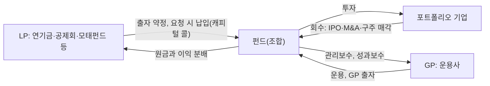

> 팩플의 「“선배, 아직 엑셀 써요?” 스타트업 VC에 90년대생이 온다」(2026.05)를 계기로, 펀드 구조와 보수 관행은 CRV의 「[Venture Capital Fund Structure: What Founders Should Know Before They Raise](https://www.crv.com/content/venture-capital-fund-structure)」와 Carta의 펀드 경제 데이터로 확인해 재구성한 노트다.

## VC 펀드란

VC 펀드는 여러 출자자의 돈을 모아 **정해진 수명 안에** 비상장 기업에 투자하고, 회수한 돈을 나눈 뒤 해산하는 조합(limited partnership)이다. 심사역은 운용사에 소속돼 투자를 검토하고 집행하는 사람이다.

| 역할 | 영어 | 국내 벤처투자조합 | 하는 일 |
| --- | --- | --- | --- |
| 출자자 | LP(Limited Partner) | 유한책임조합원 | 돈을 약정·납입한다. 책임은 출자액까지다. 연기금, 공제회, 금융기관, 기업, 모태펀드 |
| 운용사 | GP(General Partner) | 업무집행조합원 | 투자 결정과 운용을 맡고 무한책임을 진다. 자기 돈도 일부 넣어(GP 출자) LP와 같은 위험을 진다 |
| 포트폴리오 | - | 투자 기업 | 투자금을 받고 지분을 내준다 |



**모태펀드**는 펀드에 출자하는 펀드(fund of funds)다. 정부 재원을 모아 한국벤처투자가 운용하며, 민간 VC가 만드는 개별 펀드에 LP로 일부를 출자해 민간 자금을 끌어들이는 마중물 역할을 한다. 모태펀드 출자를 받은 펀드는 정해진 분야·단계에 투자할 의무를 지는 경우가 많다.

## 펀드의 경제: 관리보수와 성과보수

| 보수 | 기준 | 관행 | 쓰임 |
| --- | --- | --- | --- |
| **관리보수(management fee)** | 투자기간에는 약정 총액, 이후에는 투자잔액 등으로 기준을 바꾸는 경우가 많다 | 연 2% 안팎(중앙값 2%). 투자기간이 끝나면 요율이나 기준액을 낮춘다 | 인건비, 사무실, 실사 비용 등 운용사 운영비 |
| **성과보수(carried interest, 캐리)** | 펀드 이익 | 이익의 20%가 표준이다. 성과가 날 때만 받는다 | GP의 진짜 보상 |
| **기준수익률(hurdle)** | LP 원금에 붙는 최소 수익 | 사모펀드에는 흔하지만 미국 VC 펀드에는 드물다. 국내 벤처투자조합 표준규약은 내부수익률이 약정한 기준수익률을 넘은 뒤 조합원 총회 승인으로 성과보수를 주는 구조이고, 수치는 조합원끼리 정한다 | LP 보호 |

**분배 순서(워터폴)**도 약정한다. **유럽식(펀드 전체 기준)**은 LP가 약정 원금 전체를 돌려받은 뒤에야 GP가 성과보수를 받고, **미국식(딜 단위)**은 건별로 성과보수를 계산한다. 회수 수익을 재투자하는 **리사이클링**을 허용하면 관리보수로 빠진 만큼을 메울 수 있다.

### 계산 예시

약정 1,000억 원 펀드가 10년 동안 3,000억 원을 분배했다고 가정한다(유럽식, 기준수익률 없음).

```text
관리보수 상한 감각: 1,000억 × 2% × 10년 = 200억 (실제로는 투자기간 뒤 감액되어 더 적다)
  → 약정액 전부를 투자에 쓰지 못한다. 리사이클링이 없으면 투자 가능액은 800억 남짓

펀드 이익     = 3,000억 - 1,000억 = 2,000억
성과보수(20%) = 2,000억 × 20% = 400억 → GP
LP 분배       = 3,000억 - 400억 = 2,600억 (원금 대비 2.6배)
```

## 수명과 빈티지

| 단계 | 기간(미국 관행) | 하는 일 |
| --- | --- | --- |
| 결성 | - | LP 모집, 약정. 결성한 해가 그 펀드의 **빈티지(vintage)** |
| 투자기간 | 대략 1~5년 차 | 새 회사에 투자할 수 있는 기간 |
| 후속·회수기간 | 그 이후 | 남겨 둔 **리저브(reserve)**로 기존 투자사 후속 라운드에 들어가고 회수한다 |
| 연장 | 약정에 따라 1~2년 | 남은 지분을 팔거나 분배하고 해산한다 |

미국 VC 펀드의 수명은 보통 10년 이상이다. 국내 벤처펀드 만기는 보통 7~8년이라 창업에서 IPO까지 걸리는 기간보다 짧고, 이 간극이 만기 직전의 할인된 구주 매각과 IPO 압박으로 이어진다. 그래서 만기를 늘리는 컨티뉴에이션 펀드와 세컨더리 펀드가 해법으로 거론된다([[startup-exit-paths|스타트업 엑시트와 좀비 스타트업]]).

**빈티지가 중요한 이유**: 같은 해에 결성된 펀드는 같은 시장 환경(밸류에이션, 금리, 회수 시장)을 겪으므로 성과를 빈티지끼리 비교한다. 과열기에 결성된 펀드는 비싸게 사서 성과가 낮아지기 쉽다.

## J커브

펀드 수익률을 시간 축에 그리면 **J자 모양**이 된다.

- 초반에는 관리보수가 나가고, 실패한 투자는 빨리 손상 처리되지만 성공한 투자는 아직 회수되지 않아 수익률이 **마이너스**다.
- 몇 년 뒤 성공한 회사의 후속 라운드 가치 상승과 회수가 쌓이면서 수익률이 올라간다.
- 그래서 펀드 초반의 성과로 운용사를 판단하지 않는다. 실제 현금 분배(DPI)는 회수가 시작되는 펀드 후반에야 쌓인다.

## 성과 지표

```text
납입액(PIC)  = LP가 실제로 납입한 금액
DPI  = 누적 분배액 / 납입액          (실제로 돌려받은 현금 배수)
RVPI = 미실현 잔여 가치 / 납입액      (아직 장부상에 있는 가치)
TVPI = DPI + RVPI                   (전체 가치 배수)
IRR  = 현금 유출입의 시점까지 반영한 연 환산 수익률
```

- **TVPI는 장부 가치가 섞여 있어 부풀 수 있다.** LP가 끝내 믿는 숫자는 현금으로 돌아온 DPI다.
- IRR은 시간에 민감하다. 같은 배수라도 회수가 늦으면 낮아지므로, VC는 빠른 회수를 원한다.

## 멱법칙: 왜 「크게 가라」를 요구하나

VC 포트폴리오의 수익은 고르게 나지 않는다. **소수의 대박이 펀드 수익 대부분을 만들고, 나머지 대부분은 원금 이하로 끝난다(멱법칙, power law).** 그래서 VC는 각 투자를 「이 회사 하나가 펀드 전체를 돌려줄 수 있는가」로 본다.

```text
1,000억 원 펀드가 순수익 3배를 노린다면 회수 목표 ≈ 3,000억 원 + 보수분
엑시트 시점 지분이 10%라면, 한 회사가 펀드 원금(1,000억)을 돌려주려면 기업가치 1조 원 엑시트가 필요하다
→ 이런 회사가 펀드 안에 몇 개 나와야 목표를 채운다
```

- 이 계산 때문에 VC는 중간 크기의 확실한 성공보다 작은 확률의 거대한 성공을 원한다. 유니콘이 될 필요가 없는 사업에 VC 돈이 맞지 않는 이유다([[venture-investment-terms|벤처투자의 논리와 투자계약 조항]]).
- 펀드가 클수록 같은 지분율로도 더 큰 엑시트가 필요하다. 펀드 크기가 투자 금액, 목표 지분율, 기대하는 엑시트 규모를 정한다.

## 창업자가 물어볼 것

| 질문 | 이유 |
| --- | --- |
| 어느 펀드에서 투자하나, 그 펀드의 투자기간이 얼마나 남았나 | 투자기간이 끝나 가면 신규 투자 여력이 없다 |
| 후속 투자용 리저브가 있나 | 리저브를 다 쓴 펀드는 다음 라운드에 들어오지 못해 비례 참여권을 행사하지 못한다 |
| 펀드 만기는 언제인가 | 만기가 가까우면 회수 압박이 커진다 |
| 펀드 크기와 목표 지분율 | 투자 금액과 기대 엑시트 규모를 가늠한다 |
| 주목적 투자 의무가 있나 | 모태펀드 출자 펀드는 분야·단계 의무가 투자 결정에 영향을 준다 |

## 정리

- VC 펀드는 LP의 돈을 GP가 정해진 수명 안에 투자·회수하는 조합이다. 국내에서는 유한책임조합원·업무집행조합원으로 부르고, 모태펀드는 펀드에 출자하는 펀드다.
- 보수는 관리보수 연 2% 안팎과 이익의 20% 성과보수가 관행이다. 분배 순서와 기준수익률은 약정으로 정한다.
- 수익률은 J커브를 그리고, LP가 끝내 믿는 지표는 DPI다. IRR은 회수 시점에 민감하다.
- 멱법칙 때문에 VC는 펀드를 돌려줄 만큼 큰 엑시트를 요구한다. 펀드의 크기·만기·리저브가 창업자가 받는 압박을 정한다.

관련 노트: [[venture-investment-terms|벤처투자의 논리와 투자계약 조항]], [[startup-exit-paths|스타트업 엑시트와 좀비 스타트업]], [[default-alive|기본 생존과 낙타형 스타트업]], [[investor-ir-deck|투자자가 보는 IR 자료]], [[stock-options|스톡옵션]]
