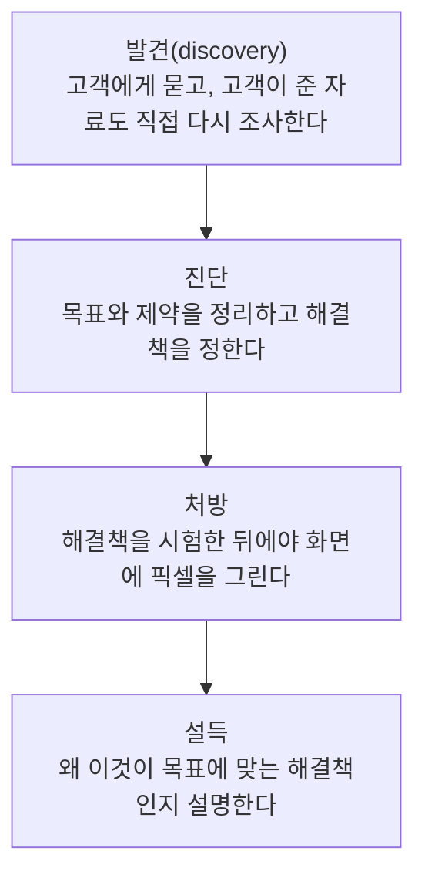

> 웹액츄얼리가 번역한 Michael Lopp(Rands)의 「디자이너와 개발자여. 더 자주 함께 파티하라!」(2012.03), Mike Monteiro가 A List Apart에 쓴 「Before You Hire Designers」의 번역 「디자이너를 채용하기 전, 준비해야 할 것들」(2015.04)과 「마이크 몬테이로가 전하는 훌륭한 디자인이란」(2015.01), Smashing Magazine의 「혁신 주도를 위한 다양한 디자인팀 구성하기」(2018.09), Happy Cog의 「브랜드 에이전시 여러분께」(2012.03)를 바탕으로 재구성한 노트다.

## 디자인이란

디자인은 **제약 조건 안에서 문제를 푸는 해결책**이고, 디자이너는 그 문제를 푸는 전문가다. 보기 좋게 다듬는 일은 그 일부일 뿐이다.

개발자와 디자이너 사이의 긴장은 소프트웨어가 "누구나" 쓰는 물건이 되면서 생겼다. 얼리어답터는 프로그램이 가끔 멈춰도 참았다. 일반 사용자는 반려동물 사진 한 장을 가장 간단하게 보내고 싶을 뿐이다. 개발자는 "덜 멈추게"를 목표로 삼기 쉽고, 사용자는 "한 번에 되게"를 원한다. 디자인은 이 둘을 잇는다. **좋은 디자인은 개발자의 노력을 드러내면서 동시에 사용자에게서 숨긴다.**

## 디자인의 세 갈래

"디자이너가 필요하다"는 말이 무엇을 뜻하는지부터 나눠야 한다.

| 분야 | 관심사 | 주요 산출물 | 오해 |
| --- | --- | --- | --- |
| 그래픽 디자인(GD) | 추상적인 생각에 시각적 형태를 준다. 제품에 신뢰감과 전문성을 입힌다 | 시안, 비주얼 시스템 | "예쁘게 만들어 달라"는 요청만 받으면 제품 작동 방식을 모른 채 겉만 바뀐다 |
| 인터랙션 디자인(IxD) | 형태에서 기능을 분리해 작업 흐름(workflow)을 설계한다 | 와이어프레임, 작업 흐름도 | 와이어프레임은 생김새가 아니라 동작을 설명한다. 그림자 색 논쟁으로 새면 안 된다 |
| 사용자 경험 디자인(UXD) | 시각과 인터랙션을 포함한 **전체 경험**을 책임진다 | 리서치, 프로토타입, 경험 전략 | 직함보다 "전체를 책임질 의지가 있는 사람"이라는 뜻이 중요하다 |

IxD 주변에는 정보를 분류 체계로 정리하는 정보 설계(IA), 사용자 행동을 정량적으로 연구하는 인간-컴퓨터 상호작용(HCI)이 있다. 형태와 기능을 완전히 떼어 낼 수는 없다. 색·글꼴·간격은 제품의 분위기를 만들고, 분위기는 작동 방식만큼 중요하다.

사용성(usability)을 별도 부서로 떼어 두기보다 제품 팀 전체에 퍼뜨리는 조직이 더 쓰기 좋은 제품을 만든다. 핵심은 **디자이너와 개발자가 서로의 일에 계속 끼어드는 팀**이다.

## 디자이너를 뽑기 전에 정할 것

디자이너를 데려오기만 하면 일이 풀리지 않는다. 청소 도우미가 오기 전에 집을 먼저 치워야 진짜 청소를 받을 수 있는 것과 같다. **기대를 정하고 무대를 만들어야 한다.**

| 준비 | 내용 |
| --- | --- |
| 조직에 알린다 | 디자이너가 오면 일하는 방식이 바뀌고 반발이 생긴다. 왜 뽑는지, 무엇을 맡는지, 누구의 일이 줄어드는지 리더가 직접 설명한다. 바자회 포스터 같은 잡일 요청은 리더가 먼저 막아 준다 |
| 책임 범위 | 디자인은 "어떻게 보이나"가 아니라 "문제를 어떻게 푸나"다. **전략 회의에 참여시킨다.** 다 정해진 뒤 실행만 시키면 디자이너가 아닌 사람이 디자인한 것과 같다 |
| 권한 | 회계사의 장부, 개발자의 코드처럼 디자이너가 소유하는 것을 정한다. UI 최종 결정권이 있는지, 조언만 구하는지, 모든 이해관계자 승인이 필요한지 미리 정한다 |
| 도구 | 디자이너에게 필요한 도구를 첫날부터 갖춘다. 승인 절차로 몇 주를 보내게 하지 않는다 |
| 성공 기준 | 무엇을 이루면 성공인지(전환율, 일정 내 출시 등) 미리 정하고 알려 준다. 잘하면 잘한다고, 아니면 방향을 바로 말해 준다. 기준 없이 평가하면 양쪽 모두 놀란다 |
| 직무 기술서 | 필요한 **기술 목록**이 아니라 **하고 싶은 일 목록**을 쓴다(브랜딩, 인터페이스, 일러스트, 편집, 모바일). 다 쓰고 보면 한 명으로 안 된다는 걸 깨닫는다 |

### 포트폴리오만 보지 않는다

포트폴리오는 완성된 결과의 겉모습만 보여 준다. 채용할 때는 **그 디자이너가 무엇을 풀려고 했고, 어떤 제약(예산·일정·이해관계자) 안에서, 처음 목표를 이뤘는지**를 묻는다. 그 답을 듣기 전까지 알 수 있는 것은 "예쁜 그림을 그릴 수 있다"뿐이다.

## 다양한 관점으로 팀 꾸리기: 경쟁가치모형

혁신은 공통점이 아니라 **차이**에서 나온다. 서로 다른 관점이 부딪히면 맹점이 드러난다. 경쟁가치모형(Competing Values Framework, CVF)은 Quinn과 Rohrbaugh가 만든 조직 효과성 모델로, 사람과 팀의 성향을 네 사분면으로 나눈다.

| 사분면 | 중시하는 것 | 강점 | 약점 |
| --- | --- | --- | --- |
| 협력(Collaborate) | 공유된 가치, 신뢰, 멘토링, 장기 성장 | 일체감, 공감 | 위험을 피하고 새 의견을 꺾을 수 있다 |
| 창의(Create) | 변화, 실험, 위험 감수 | 트렌드를 만든다 | 실행이 비논리적이고 혼란스러울 수 있다 |
| 경쟁(Compete) | 성과, 속도, 시장 1위 | 빠른 결정과 자원 활용 | 장기 비전과 사람을 놓친다 |
| 제어(Control) | 안정, 효율, 체계 | 복잡한 일을 질서 있게 만든다 | 자기만족에 빠지고 예측 불가능한 일을 두려워한다 |

팀의 현재 위치를 보고 **빈 사분면을 채운다.** 갈등 없이 지낸 협력형 팀에는 결과를 끌어낼 경쟁형이, 실험과 실패를 반복한 창의형 팀에는 안정과 확장을 맡을 제어형이 필요하다. 사람을 늘릴 수 없으면 지금 팀원의 다른 면을 끌어낸다.

다양성을 키우는 방법:

- 채용: 포괄적인 직무 기술서를 쓰고, 실제 사례로 문제 해결력과 공감 능력을 묻는다.
- 익숙한 환경 벗어나기: 사용자를 직접 만나고, 다른 맥락에서 일하는 사람에게서 배운다.
- 사내 해커톤·워크숍으로 팀을 섞는다.
- 서로 고마운 점을 나누는 자리를 정기적으로 둔다. 약점을 드러내도 안전한 공간이 된다.

관리하지 않으면 다양성은 의사소통 장벽, 끼리끼리 문화, 협력 대신 경쟁으로 번진다. 다른 관점을 다루는 방법은 **프로젝트 초기에** 이야기한다.

## 고객과 디자이너: 의사처럼 일한다

**두려움이 나쁜 디자인을 만든다.** 디자이너가 머뭇거리며 "어떻게 할까요?"를 고객에게 되물으면 결정은 디자인을 모르는 사람에게 넘어간다. 의사가 환자에게 어떤 수술을 원하느냐고 묻지 않는 것과 같다.

- 고객을 최우선에 둔다는 말은 **고객이 원하는 대로 해 준다는 뜻이 아니다.** 고객은 목표를 들고 오지만 진행하며 그 목표를 비켜 가려 한다. 목표로 되돌리는 것이 디자이너의 일이다.
- "디자인은 잘 몰라서요"라는 고객에게는 "대신 사업은 저보다 훨씬 잘 아신다. 함께 풀자"로 역할을 나눈다.
- 피드백은 "이 서체 쓸 건가요?"가 아니라 처음 정한 목표와 문제에 비추어 "왜 이렇게 정했나"를 묻는 방식이 좋다.
- 팔지 못하는 디자인은 버려진다. **설명하지 못하는 훌륭한 디자인보다 설명할 수 있는 괜찮은 디자인이 낫다.**

## 브랜드 에이전시와 웹 팀

브랜드 아이덴티티를 만든 에이전시와 그것을 웹으로 옮기는 팀은 같은 고객을 두고 함께 일한다. 웹 쪽이 미리 짚어야 할 것들이 있다.

| 쟁점 | 원칙 |
| --- | --- |
| 운영 가능성 | 웹사이트는 출시 후 고객 내부 인력이 매일 고친다. 고객이 유지할 수 없는 컨셉은 처음부터 잘못된 것이다 |
| 사진 | 최고급 사진을 늘 쓸 예산은 드물다. 스톡 사진이나 사진에 기대지 않는 디자인 시스템을 준비하고, 사진 사용 가이드를 넘긴다 |
| 서체 | 인쇄에서 좋은 서체가 화면에서도 좋은 것은 아니다. 웹폰트 라이선스, 작은 크기의 가독성, 여러 운영체제의 렌더링을 구매 전에 시험한다 |
| 브랜드 가이드 | 브랜드는 매일 그것을 쓰는 사람과 함께 진화한다. 가이드는 규칙이 아니라 의도로 받아들이고, 웹 디자이너에게 결정권을 준다 |

## 정리

- 디자인은 제약 안에서 문제를 푸는 일이다. 그래픽·인터랙션·UX는 관심사가 다르니 "디자이너가 필요하다"의 뜻부터 정한다.
- 디자이너를 뽑기 전에 책임 범위·권한·도구·성공 기준을 정하고, 조직의 반발은 리더가 막는다. 전략 회의에 부른다.
- 팀은 경쟁가치모형으로 빈 관점을 찾아 채운다. 다양성은 관리해야 힘이 된다.
- 디자이너는 의사처럼 발견하고 진단하고 설명한다. 고객 중심은 고객의 지시를 따르는 것이 아니다.
- 중요한 것은 직함과 약어가 아니라 서로의 일을 이해하려는 존중이다.

관련 노트: [[product-minded-engineer|제품 중심 개발자]], [[content-strategy|콘텐츠 전략과 핵심 모델]], [[presentation-design|발표·포트폴리오 디자인 팁]], [[practical-empathy|공감하는 제품 만들기]], [[wireframe-mockup-prototype|와이어프레임, 목업, 프로토타입]], [[user-research|사용자 리서치]]
