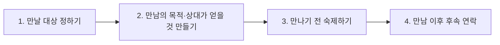

> 2023년 3월에 발표한 「개발자, 네트워킹하기」 자료를 바탕으로, 발표에서 참고한 HBR·Fast Company 글과 개발자 설문을 함께 재구성한 노트다.

## 네트워킹이란

**네트워킹(Networking)은 전문 분야나 공통 관심사에 관한 정보를 관련된 사람들과 나누는 활동이다.** 명함을 많이 모으는 일이 아니라, 서로 도움이 되는 관계를 만들고 이어 가는 일이다.

## 왜 하나

| 이유 | 설명 |
| --- | --- |
| 느슨한 연결의 힘 | 사회학자 Mark Granovetter의 「약한 연결의 힘(The Strength of Weak Ties)」(1973)에 따르면, 새 일자리나 정보는 가까운 친구보다 가끔 연락하는 지인에게서 더 자주 온다. 가까운 사람들은 이미 내가 아는 것을 알기 때문이다 |
| 좁아지는 시야 넓히기 | 한 회사·한 팀에만 있으면 보는 기술과 일하는 방식이 굳는다. 다른 회사·직무의 사람을 의식적으로 만나야 시야가 넓어진다 |
| 커뮤니케이션 능력 | 처음 보는 사람에게 나와 내 일을 설명하는 연습이 된다 |
| 즐거움 | 새 사람을 알아 가는 것 자체가 재미다 |

## 내향적이어도 할 수 있다

개발자는 내향적인 사람이 많은 직군이다. 프로그래머스의 2020년 개발자 MBTI 설문에서는 INTP(12.4%), INFP(11.0%), INTJ(8.7%)가 상위 3개였고, 상위 1~4위가 모두 IN으로 시작했다. 가장 적은 유형은 ESTP(2.7%), ESFP(3.3%), ESFJ(3.8%)였다. 오픈서베이의 2022년 개발자 설문에서도 스스로 내향적이라고 답한 비율(43.7%)이 외향적(31.7%)보다 높았다.

**말을 잘하거나 외향적이어야만 네트워킹을 잘하는 것은 아니다.** 큰 행사에서 여러 사람과 어울리는 방식만 있는 것이 아니라, 1:1 대화·온라인 커뮤니티·글처럼 방법이 다양하기 때문이다. 내향적인 사람은 준비를 많이 하고, 깊은 1:1 대화로 관계를 만드는 쪽이 잘 맞는다.

## 어디서 하나

| 채널 | 예 | 특징 |
| --- | --- | --- |
| 기업 컨퍼런스 | 삼성 SDC(Samsung Developer Conference), Google I/O, if(kakao), 토스 SLASH, AWS Community Day, 인프콘(INFCON) | 회사가 기술과 문화를 공개하는 자리. 발표 뒤 질문·부스에서 그 회사 개발자를 만난다 |
| 분야별 컨퍼런스 | PyCon Korea, FEConf, JSConf Korea, 데이터야놀자 | 같은 기술을 쓰는 사람이 모인다. 발표자·참가자와 공통 화제가 분명하다 |
| 행사 정보 모음 | [Dev-Event](https://github.com/brave-people/Dev-Event)(개발자 행사 목록과 주간 뉴스레터) | 컨퍼런스·밋업·해커톤 일정을 한곳에서 찾는다 |
| 모임·단체 | 개발자 연합 동아리, 기술 분야의 여성 개발자 모임 | 정기적으로 만나 관계가 이어진다. 운영진·자원봉사로 참여하면 더 깊게 알게 된다 |
| 강의·멘토링 | 현업자 초청 커피챗, 멘토링 프로그램 | 소규모라 질문하기 쉽다 |
| 커피챗 요청 | SNS에서 「커피챗 환영」을 밝힌 개발자에게 연락 | 아래 「커피챗」 참고 |
| 국내 온라인 커뮤니티 | OKKY, 분야별 오픈카톡방(프론트엔드·파이썬 등) | 질문·답변으로 시작해 관계로 이어진다 |
| 해외 커뮤니티 | Discord 개발자 채널(스터디·오픈소스 서버), X(옛 Twitter)·LinkedIn, Reddit(예: r/programming) | 국경 없이 같은 관심사를 가진 개발자와 소통한다 |

- 예로 든 행사는 해마다 열리는지가 바뀐다. 일정은 Dev-Event 같은 모음에서 확인한다.
- 단체도 사라질 수 있다. 예를 들어 기술 분야 여성의 성장을 돕던 국제 비영리 단체 Women Who Code는 자금난으로 2024년 4월 해산했다. 일부 지역 모임은 새 이름으로 활동을 이어 갔다.

### 커피챗

**커피챗(Coffee Chat)은 궁금한 업계·회사·직무·학교의 사람을 만나 커피 한 잔을 두고 부담 없이 묻고 답하는 정보형 만남이다.** 채용 면접이 아니라 정보를 얻는 자리라서, 받는 쪽도 시간을 내어 주는 문화가 있다.

- SNS에 「근처에 자주 가니 커피챗 요청은 언제나 환영」, 「커피챗 필요하신 분 연락 주세요」처럼 **먼저 커피챗을 열어 두는 개발자**가 많다.
- 요청할 때는 내가 누구인지, 왜 그 사람인지, 무엇을 묻고 싶은지를 짧게 적는다.

## 잘하는 법: 네 단계

| 단계 | 할 일 | 예 |
| --- | --- | --- |
| 1. 대상 정하기 | 누구를 만나고 싶은지 먼저 정한다 | 커리어상 동경하는 사람, 같이 프로젝트를 하고 싶은 사람 |
| 2. 목적·이점 만들기 | 만남의 안건(agenda)이나 상대가 얻을 것(benefit)을 만든다 | 「강연을 듣고 만나고 싶다」만으로는 약하다. 강연자는 나를 만날 이유가 없다 |
| 3. 숙제하기 | 만날 사람의 이력과 해 온 일을 미리 알아 둔다 | 블로그·발표·오픈소스 기록 읽기 |
| 4. 후속 연락 | 만남 뒤에 관계를 잇는다 | SNS 팔로우 신청, 감사 인사, 상대가 관심 가질 만한 기사 보내기 |

### 원칙

- **꼭 행사장에 가지 않아도 된다.** LinkedIn·X처럼 만나고 싶은 사람이 많이 쓰는 SNS로 1:1 대화를 시작할 수 있다.
- **상대에게 관심을 가진다.** 「네트워킹을 위한 네트워킹」에 지친 사람이 많다. 반면 자기 이야기를 들어 주려는 사람은 누구도 마다하지 않는다. 질문하고 듣는 쪽이 관계를 만든다.
- **목적이 분명해야 한다.** 목적 없는 네트워킹은 시간 낭비가 되기 쉽다. 준비를 많이 할수록 얻어 가는 것도 많고, 숙제를 하다 보면 네트워킹 실력도 는다.

## 정리

- 네트워킹은 관심사가 같은 사람과 정보를 나누고 관계를 잇는 일이다.
- 기회는 가까운 사람보다 느슨한 연결에서 더 자주 온다.
- 외향성은 조건이 아니다. 1:1 대화, 온라인 커뮤니티, 커피챗처럼 방법이 많다.
- 대상 → 목적 → 숙제 → 후속 연락의 네 단계로 준비한다.
- 결국 상대에게 관심을 갖고, 목적을 분명히 하는 사람이 네트워킹을 잘한다.

관련 노트: [[reputation-building|실력만으로는 부족하다: 명성 쌓기와 커뮤니티 기여]], [[open-source-contribution|오픈소스 기여 시작하기]], [[tech-blogging|개발자 기술 블로그]], [[behavioral-interview-questions|인성 면접 준비: STAR, 핵심 사례, 단골 질문]]
