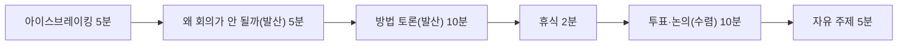

> 테오(teo)의 「[Tip: 효과적으로 회의 하는 법](https://velog.io/@teo/Tip-효과적으로-회의-하는-법)」(2021.12)을 중심으로, 「[스프린트, 협업을 위한 장치 그리고 마인드](https://velog.io/@teo/sprint-and-mind)」(2024.02)의 논의 원칙을 더해 요약·재구성한 노트다. 참석 인원 기준은 Bain & Company의 「[Effective Decision Making and the Rule of 7](https://www.bain.com/insights/effective-decision-making-and-the-rule-of-7/)」(2010)에서 가져왔다.

## 회의가 안 되는 이유

특정 사람이 있으면 회의가 늘 안 된다. 그래서 회의는 사람 문제라고 생각하기 쉽다. 하지만 **프로세스를 바꾸면 같은 사람끼리도 회의가 달라진다.** 가장 흔한 원인은 참석자마다 "지금 무엇을 하는 회의인지"를 다르게 알고 있다는 것이다. 주최자는 회의를 잡은 배경을 알지만 참석자는 제목만 안다. 서로 같은 그림을 보고 있다고 착각한 채로 시작한다.

## 열기 전에: 꼭 회의여야 하나

회의는 참석자 모두의 시간을 동시에 쓰는 가장 비싼 소통 수단이다. 잡기 전에 메일, 메신저, 문서 댓글로 대신할 수 있는지 먼저 따진다. 열기로 했다면 **목적(Purpose), 안건(Agenda), 결과(Result)** 세 가지를 초대장에 적는다. 셋 중 하나라도 적지 못하면 아직 열 때가 아니다.

회의는 목적에 따라 네 가지로 나뉘고, 유형마다 끝났을 때 남아야 하는 것이 다르다.

| 유형 | 목적 | 결정이 필요한가 | 대신할 수 있는 것 |
| --- | --- | --- | --- |
| 정보 공유형 | 모두가 같은 내용을 알게 한다 | 아니다 | 문서나 녹화 영상으로 대부분 대신할 수 있다 |
| 창의적 토론형 | 아이디어를 넓힌다(발산) | 아니다 | 각자 먼저 쓰고 모이면 짧아진다 |
| 합의 결정형 | 하나를 고른다(수렴) | 그렇다 | 결정권자와 기준이 정해져 있으면 비동기로도 된다 |
| 교류형 | 관계와 신뢰를 쌓는다 | 아니다 | 대신하기 어렵다 |

| 항목 | 기준 |
| --- | --- |
| 인원 | 결정하는 회의는 **7명 안팎**으로 잡는다. 결정 집단이 7명을 넘으면 한 명 늘 때마다 의사결정의 효과가 약 10%씩 떨어진다는 것이 「7의 법칙」이다(『Decide & Deliver』). 발언 없이 노트북만 보는 참석자가 있다면 그 사람은 회의록만 받아도 된다는 신호다 |
| 길이 | 30분을 기본으로 하고, 안건에 따라 15분이나 45분으로 잡는다. 달력의 기본값인 1시간을 그대로 쓰지 않는다 |
| 반복 회의 | 주기와 길이가 지금도 맞는지 정기적으로 점검한다. 비슷한 반복 회의는 하나로 합친다 |
| 발표 | 슬라이드 한 장에 3분처럼 발표 시간을 정해 둔다 |

## 발산하는 회의와 수렴하는 회의

| | 발산 | 수렴 |
| --- | --- | --- |
| 목적 | 아이디어를 꺼내고 덧대며 생각을 키운다 | 고르고, 비교하고, 결정한다 |
| 태도 | 어떤 의견도 일단 목록에 올린다. **평가하지 않는다** | 감정이 섞이지 않게 기준선을 먼저 세운다 |
| 질문 | "왜 그 의견이 필요하다고 생각했어요?" | "누가, 언제까지, 어떤 기준으로 정하나요?" |
| 흔한 실패 | 누군가 수렴하는 말투로 의견을 깎는다 | 누군가 새 아이디어를 계속 낸다 |

**잘 안 되는 회의는 한 회의 안에서 발산과 수렴의 경계가 흐리고 자주 바뀐다.** 그래서 지금이 어느 단계인지 모두가 알 수 있게 시작할 때 맞추고, 모드를 바꿀 때는 짧게 쉬며 다 같이 전환한다.

### 발산할 때: 결정하려 들지 않는다

- 해법이 별로라고 문제 인식까지 별로인 것은 아니다. 의견의 **내용보다 배경**을 묻는다.
- 둘 중 하나를 미리 고르려는 유혹을 참는다. 배제된 의견은 미련이 남아 나중에 다시 돌아온다.
- 논의는 `A vs B`가 아니라 `A + B = C`다. 옳고 그름을 가리는 순간 논의가 논쟁이 된다.
- 동의하기 어려운 의견에는 반박 대신 순수한 호기심으로 의도를 묻는다. 같은 질문도 말투가 논쟁용인지 논의용인지 상대는 안다.

### 수렴할 때: 기준선을 먼저 세운다

결정 단계에서는 각자가 자기 기준으로 말하기 때문에 부딪힌다. 모두가 알아야 하는 경계를 먼저 깐다.

- 예산, 기한, 최종 결정권자, 우선 가치(보안 우선, 출시 우선 등), 결정 이후 절차

결정권자를 정하는 법은 [[decision-making|의사결정 체크리스트]]에 정리했다.

## 회의 설계 4요소

### 1. 결과물을 정의한다

아젠다만으로는 부족하다. "신규 프로젝트 아이디어 논의"라는 제목만 보고 누구는 아이디어 나열을, 누구는 하나를 확정하는 자리를 상상한다. **회의가 끝나면 손에 무엇이 남아야 하는지**를 적는다. 예: "다음 회의를 위한 아이디어 5개". 이것만으로도 "발산하다가 5개로 수렴하겠구나"를 모두가 그릴 수 있다.

### 2. 그라운드 룰을 정한다

모든 참석자가 알고 동의한 규칙이다. 처음 모일 때 정해 두고 글로 남기면 더 좋다.

- 감정적이 되면 10분 쉬고 다시 한다.
- 메신저가 아니라 메시지를 공격한다.
- 의견을 비판하기 전에 문제 인식부터 묻는다.
- 우리는 사용자 친화적인 제품을 만든다.

정할 때는 뻔한 말 같지만, 대립 상황에서 **모두가 한 번 동의한 문장**이라서 서로를 누그러뜨리는 말이 된다.

### 3. 마감을 촘촘하게 둔다

회의가 길다고 결과가 좋아지지 않는다. 1시간 회의라면 5~10분 단위 챕터로 나누고 각 챕터에 소주제와 마감을 붙인 진행표를 미리 공유한다.

### 4. 미리 문서로 공유한다

- **아젠다**: 회의를 잘하는 법 논의
- **결과물**: 다 같이 실천할 항목 3~4개
- **그라운드 룰**: 이상보다 당장 할 수 있는 것을 고른다

진행:

## 상황별 처방

| 증상 | 처방 |
| --- | --- |
| 아무도 말을 안 한다 | 회의와 상관없는 가벼운 주제(오늘 기분 점수, 점심 메뉴)로 한 바퀴 돈다. 입을 한 번 떼게 하는 것이 목적이다 |
| 생각은 있는데 말로 안 나온다 | **먼저 쓰게 한다.** 5분 안에 각자 적고, 서로 돌려 읽으며 댓글·동그라미를 단 뒤 발표한다. 분위기를 미리 알면 발언 부담이 줄고 앞 사람 의견에 묻어가는 것도 막는다 |
| 투표가 대세에 휩쓸린다 | [[decision-making\|의사결정 체크리스트]]의 「결정권자를 합의로 위임한다」 참고 |
| 같은 말이 계속 반복된다 | 기록하는 사람이 없다는 신호다. 모두가 보는 화면에 실시간으로 회의록을 쓴다. 이미 적힌 말은 다시 하기 어렵다 |

말은 휘발되고 글은 고치기 어렵다. **말로 소통하고 글로 기록하는 것**을 번갈아 해야 생각이 시각화되고 좋은 의견이 남는다.

## 회의가 끝난 뒤: 후속 공유

후속 공유의 목적은 기록이 아니라 **실행으로 잇는 것**이다. 회의 유형에 따라 담을 내용이 다르다.

| 유형 | 후속 공유에 담을 것 |
| --- | --- |
| 정보 공유형 | 핵심 내용, 자료 링크, 추가로 확인할 사항의 담당자와 기한 |
| 창의적 토론형 | 나온 주요 아이디어, 이후 어떻게 추려서 정할지 |
| 합의 결정형 | 결정 내용, 효력이 생기는 시점, 실행 담당자 |
| 교류형 | 합의한 점의 재확인, 다음 행동 |

- 끝내기 전에 여섯 가지를 확인한다: 결정 사항을 정리했나, 담당자를 정했나, 기한을 정했나, 다음 행동이 분명한가, 각자의 할 일 목록에 옮겼나, 참석자와 불참한 관계자에게 공유했나.
- **액션 아이템은 회의록에 두지 않는다.** 이슈 트래커나 할 일 목록처럼 평소 일을 관리하는 시스템으로 옮긴다. 회의록에만 남은 할 일은 다음 회의 때까지 아무도 보지 않는다.
- 옮길 때는 실행할 것, 참고할 것, 다른 사람에게 넘길 것, 버릴 것으로 나누고, 실행할 것에는 기한을 붙인다. 주 단위로 한 번 전체를 다시 훑는다.
- 안건 양식과 후속 공유 양식을 미리 만들어 두면 매번 같은 항목이 빠지지 않는다.

## 참석자가 할 수 있는 일

주최자가 아니어도 회의를 바꿀 수 있다.

- 시작할 때 환기 질문: "이번 회의는 아이디어를 내는 자리예요, 정하는 자리예요?"
- 대립이 심해지면 경계 질문: "최종 결정은 누가 해요?", "언제까지 정해야 해요?", "무엇을 기준으로 고르면 돼요?"
- 회의록을 자청한다. 했던 말을 짚어 주는 것만으로 반복이 줄고, 발언권이 없어도 영향력이 생긴다.
- 개입하기 어렵다면 제3자처럼 관찰한다. 덜 감정적이 되고 바꿀 지점이 보인다.

## 정리

- 회의는 사람보다 방식의 문제다. 프로세스가 바뀌면 사람도 바뀐다.
- 지금이 **발산인지 수렴인지** 모두가 알게 하고, 각 모드에 맞게 행동한다.
- 회의로 풀 일인지 먼저 따지고, 연다면 목적·안건·결과를 적는다. 결정하는 회의는 7명 안팎으로 잡는다.
- 아젠다보다 **결과물**을 먼저 정한다.
- 그라운드 룰과 짧은 마감은 대립과 지지부진을 막는 가장 싼 장치다.
- 발언 전에 쓰고, 회의 중에 기록한다. 끝나면 액션 아이템을 업무 시스템으로 옮긴다.

관련 노트: [[decision-making|의사결정 체크리스트]], [[agile-sprint|애자일과 스프린트]], [[collaborative-developer|협업을 잘하는 개발자]], [[work-habits|사회 초년생을 위한 직장 생활 팁]]
