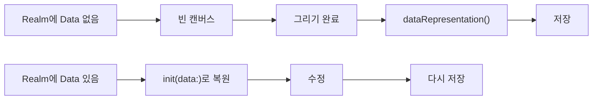

> 개발세탁소의 「[개발 자료 잘 찾는 개발자 되기](https://teqoo.tistory.com/277)」(2022.04)를 바탕으로 재구성한 노트다.

## 자료를 찾는 순서

구현하다 막히면 아래 순서로 범위를 좁혀 간다. 위 단계에서 답이 없으면 아래로 내려간다.

| 단계 | 어디서 | 무엇을 얻나 |
| --- | --- | --- |
| 1. 검색 | 구글, Stack Overflow | 남들이 이미 겪은 같은 문제와 해결 코드 |
| 2. 공식 문서 | API 레퍼런스, 튜토리얼 | 함수가 무엇을 받고 무엇을 돌려주는지 |
| 3. 소스 코드 | IDE의 정의로 이동 | 문서에 없는 실제 동작, 주석, 기본값 |
| 4. 이슈·PR | 라이브러리의 GitHub 저장소 | 같은 한계를 겪은 사람의 우회법, 개발 중인 기능 |

## 1. 검색: 영어로, 관용 키워드로

**개발 자료는 영어로 검색한다.** 문서·질문·답변의 양이 압도적으로 많다. 검색어에는 개발자들이 질문 제목에 오래 써 온 관용 표현을 붙인다.

| 패턴 | 언제 | 예 |
| --- | --- | --- |
| `how to <작업>` | 방법을 찾을 때 | `how to add HTML elements` |
| `<작업> programmatically` | UI·설정으로 하던 일을 코드로 할 때 | `add HTML elements programmatically` |
| `<작업> dynamically` / `dynamic` | 실행 중에 바꾸거나 만들 때 | `add HTML elements dynamically` |
| `"<오류 메시지>"` | 오류를 그대로 찾을 때 | `"Cannot read properties of undefined"` |

결과가 너무 많거나 낡았으면 연산자로 좁힌다. 개발 검색에서 자주 쓰는 것은 셋이다.

- `before:` / `after:`: 버전이 바뀐 API를 찾을 때. 옛 버전 호환 코드가 필요하면 그 버전이 쓰이던 기간으로 자른다(`camera2 api 21 before:2020`). 검색 결과 화면의 **도구 → 모든 날짜 → 기간 설정**으로도 지정한다.
- `site:`: 믿을 만한 출처로 고정한다(`android view site:stackoverflow.com`).
- `" "`: 반드시 들어가야 할 단어를 묶는다(`app developer roadmap "ios"`).

연산자 전체 목록은 [[google-search-operators|구글 검색 연산자]]에 있다.

## 2. 공식 문서: 입출력부터 확인한다

레퍼런스가 없는 조합(라이브러리 A의 객체를 저장소 B에 넣기 같은)은 검색으로 안 나온다. 이때는 **양쪽 공식 문서에서 "무엇을 받고 무엇을 내보내는지"를 찾아 연결점을 만든다.** 번역해서 읽어도 된다.

예: iOS PencilKit의 서명 그림(`PKDrawing`)을 Realm 로컬 DB에 임시 저장하고 다시 불러와 수정하기.

```text
Realm 문서      → 저장 가능한 타입에 Data(바이너리)가 있다
PKDrawing 문서  → dataRepresentation() -> Data   그림을 Data로 내보낸다
                → init(data: Data)               Data로 그림을 되살린다
```

설계



"직렬화할 수 있는 형식"이라는 공통분모를 문서에서 찾으면 예제 없이도 구현할 수 있다.

## 3. 소스 코드: 정의로 이동해서 읽는다

라이브러리와 프레임워크의 소스는 이미 프로젝트 안에 있다. 쓰려는 메서드에서 **정의로 이동**하면 구현과 주석을 바로 볼 수 있다.

| IDE | 정의로 이동 |
| --- | --- |
| VS Code | `F12` 또는 `Cmd/Ctrl` + 클릭 |
| JetBrains 계열 | `Cmd+B` / `Ctrl+B` 또는 `Cmd/Ctrl` + 클릭 (Go to Declaration or Usages) |
| Xcode | `Cmd` + 클릭 → Jump to Definition |

시그니처, 주석, 기본값, 그 메서드를 부르는 다른 코드를 보면 어떤 입력에 어떤 결과가 나오는지 문서보다 정확히 알 수 있다.

## 4. 오픈소스 저장소: 이슈와 PR을 검색한다

- 사용자가 많은 라이브러리는 Stack Overflow에 답이 있다.
- 사용자가 적거나 기능의 한계에 부딪혔다면 **GitHub 저장소의 이슈와 PR을 검색한다.** 같은 기능을 요청한 이슈, 포크해서 직접 구현한 사람의 설명, 메인테이너의 개발 계획이 나온다. 검색어는 변형까지 넣는다(`nest`, `nested`, `nesting`).
- 해결책을 알게 되면 이슈에 답을 남기거나 PR로 기여한다.

예: React Flow에서 플로우 안에 플로우를 넣는 중첩 기능은 처음에 없었고, 이슈에서 요청과 포크 구현이 먼저 공유됐다. 지금은 **서브 플로우(Sub Flows)** 로 정식 지원한다. 자식 노드에 `parentId`(11.11 이전 이름은 `parentNode`)를 주면 부모 기준 좌표로 배치되고 부모와 함께 움직인다. 이슈에서 "개발 중"이던 기능이 나중에 릴리즈되는 경우가 많으므로, 오래된 이슈를 봤다면 최신 문서와 변경 로그를 다시 확인한다.

## 빠르게 다시 찾아보는 자료

이미 아는 도구의 문법을 잊었을 때는 공식 문서 전체보다 **치트시트**가 빠르다. [Devhints](https://devhints.io/)는 언어·프레임워크·CLI(Bash, Git, Docker, React 등)의 자주 쓰는 문법을 한 페이지씩 모은 치트시트 모음이다. 치트시트로 실마리를 잡고, 세부 동작은 공식 문서에서 확인한다.

## 정리

- 영어로, `how to`·`programmatically`·`dynamically` 같은 관용 키워드로 검색한다.
- 결과는 `before:`/`after:`, `site:`, `" "`로 좁힌다.
- 예제가 없으면 공식 문서에서 양쪽의 입출력 타입을 찾아 직접 잇는다.
- 문서로 부족하면 정의로 이동해 소스를 읽고, 그래도 막히면 저장소의 이슈·PR을 뒤진다.
- 찾은 답은 이슈 답변이나 PR로 돌려준다.

관련 노트: [[google-search-operators|구글 검색 연산자]], [[computational-thinking|컴퓨팅 사고와 개발 실력 늘리는 법]], [[reputation-building|실력만으로는 부족하다: 명성 쌓기와 커뮤니티 기여]], [[open-source-maintenance|오픈소스 프로젝트 운영]]
