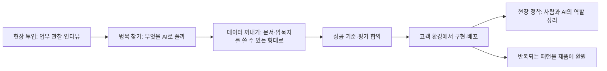

> 팩플(FACTPL)의 「채용 800% 폭발! 'AI 특공대' FDE가 돈 버는 법」(2026.04)을 바탕으로, 직무의 기원과 회사별 운영은 Gergely Orosz(The Pragmatic Engineer)의 「[What are Forward Deployed Engineers, and why are they so in demand?](https://newsletter.pragmaticengineer.com/p/forward-deployed-engineers)」(2025.08)로 보강해 재구성한 노트다.

## FDE란

**전방 배치 엔지니어(FDE, Forward Deployed Engineer)** 는 고객 현장에 들어가 그 조직의 업무를 이해하고, 고객의 데이터와 인프라 위에서 직접 코드를 짜서 제품이 실제로 성과를 내게 만드는 엔지니어다. 「개발하는 컨설턴트」라고도 부른다. 조언하고 떠나는 것이 아니라, 고객과 같이 출퇴근하며 운영에 올라갈 때까지 만든다.

기업 AI 전환(AX)이 제품만 팔아서는 굴러가지 않는다는 사실이 이 직무의 수요를 만들었다. 범용 모델과 플랫폼이 있어도, 고객사마다 데이터가 흩어져 있고 업무 방식이 달라 누군가 현장에서 둘을 이어야 한다. 조직 차원에서 FDE가 갖는 의미(AI 확산이 인력과 현장 적용 시간에 묶인다는 점)는 [[organizational-ax|조직 AX: 개발 자동화에서 전사 AI 전환까지]]에 있다.

## 기원: 팔란티어

- 팔란티어가 2010년대 초에 만든 직무다. 사내에서는 「Delta」라 불렀다. 정부·대기업 고객 현장에 엔지니어를 붙여 데이터 분석 플랫폼을 고객 업무에 맞췄다.
- 한때 팔란티어에는 일반 소프트웨어 엔지니어보다 FDE가 더 많았다. 이후 플랫폼(Foundry)이 성숙하면서 많은 FDE가 제품 개발로 옮겨 현장에서 배운 것을 제품에 넣었다.
- 생성형 AI 이후 OpenAI, Anthropic 같은 AI 기업과 AX 스타트업, 사내 AX를 위해 내부 FDE를 두는 기업까지 같은 직무를 뽑기 시작했다. 채용 공고 수가 1년 사이 몇 배로 늘었다는 집계가 여럿 있다.

## 하는 일

| 단계 | 내용 |
| --- | --- |
| **범위 잡기** | 현장에서 실제 업무 흐름을 보고 비효율을 찾는다. 전사 차원의 추상적인 AX보다 직원의 워크플로를 잘게 쪼개 「무엇을 AI로 풀지」를 구체적으로 고른다 |
| **데이터 확보** | 가장 먼저 부딪히는 일이다. 창고의 종이 문서, 숙련자 머릿속의 **암묵지**를 AI가 쓸 수 있는 데이터로 꺼낸다. 부서 간 이해관계(「우리 부서 노하우를 왜 가져가나」)와 부딪히는 지점이기도 하다 |
| **검증 기준** | 무엇을 성공으로 볼지 고객과 합의하고 평가(eval)를 만든다([[evaluation-driven-development\|평가 주도 개발]]) |
| **구현** | 고객의 인프라·데이터 위에서 직접 코드를 짜고 배포한다. 플랫폼이 막으면 플랫폼 쪽 코드도 고친다 |
| **정착** | AI와 사람의 역할과 업무 비중을 정한다. 만든 도구를 현장이 쓰지 않으면 비싼 기계일 뿐이다 |
| **제품에 환원** | 한 고객을 위해 만든 것 중 다른 고객에게도 쓸 수 있는 것을 일반화해 제품으로 돌려보낸다 |

**무엇을 건드리지 않을지 아는 것**이 중요하다. 오래된 현장의 암묵지 안에는 이미 최적화된 프로세스가 숨어 있는 경우가 많다. 전체를 뒤흔들지 않으면서 무엇을 꺼내 자동화할지 고르는 판단이 FDE의 실력이다.

## 비슷한 직무와의 차이

| 직무 | 언제 | 무엇을 | 성공 기준 |
| --- | --- | --- | --- |
| **솔루션 엔지니어(세일즈 엔지니어)** | 계약 전 | 데모, 기술 질의 응답, 개념 검증(PoC) | 계약을 따낸다 |
| **솔루션 아키텍트** | 계약 전후 | 구조를 설계하고 넘긴다. 주로 조언 | 설계가 채택된다 |
| **컨설턴트** | 프로젝트 단위 | 진단과 권고. 코드를 직접 짜지 않는 경우가 많다 | 권고안 전달 |
| **SI 개발자** | 계약 후 | 정해진 요구대로 시스템을 구축 | 명세대로 납품 |
| **FDE** | 계약 후, 장기 | 고객 환경에서 문제를 정의하고 직접 만들어 운영까지 | 고객이 제품으로 실제 성과를 낸다 |

FDE는 SI의 진화형으로도 불린다. 차이는 **모호한 문제를 스스로 정의한다는 점**과 **제품 회사에 속해 현장의 학습을 제품으로 돌려보낸다는 점**이다. 실무에서는 직함이 서로 섞이고, 회사마다 FDE에 기대하는 정도가 다르다.

## 필요한 역량

| 역량 | 내용 |
| --- | --- |
| 소프트웨어 엔지니어링 기본기 | 낯선 인프라와 데이터 위에서 실제로 배포해 본 경험. 데이터 파이프라인, 통합, 디버깅 |
| AI 활용 | 모델·에이전트·평가를 고객 문제에 맞춰 조합하는 능력 |
| 문제 정의 | 모호한 요구를 쪼개고, 되묻고, 범위를 좁힌다 |
| 고객 커뮤니케이션 | 현업의 언어로 듣고 설명한다. AI가 내 자리를 대체할까 두려워하는 실무진과 경영진을 설득한다 |
| 비즈니스 이해 | 고객의 업무와 돈이 흐르는 구조를 이해해 효과가 큰 곳을 고른다 |
| 주도성과 서비스 정신 | 정해진 일이 없는 상황에서 스스로 일을 찾는다. 교육·리더십·창업·초기 스타트업 경험이 좋은 신호로 여겨진다 |

대체로 사회 경험과 엔지니어링 이해를 함께 갖춘 경력직을 선호하지만, 육성 차원에서 신입을 뽑는 곳도 있다.

## 위험과 단점

| 위험 | 내용 |
| --- | --- |
| **고객별 코드** | 고객마다 맞춤 코드를 쌓으면 유지보수가 어려운 문어발 코드베이스가 된다. 일반화해 제품으로 돌려보내는 원칙이 없으면 SI와 같아진다. 실제로 대부분의 회사에서 FDE가 플랫폼에 기여하는 비중은 크지 않다 |
| **업무 강도와 출장** | 현장 상주, 잦은 출장, 공장·보안 시설 같은 환경. 고객 일, 플랫폼 일, 사내 회의가 동시에 몰린다 |
| **경력 정체** | 범용 역량이 넓은 대신 깊이를 쌓기 어렵다. 작은 회사에서는 성장 경로가 좁다. 소프트웨어 엔지니어와 같은 직급 체계를 두는 회사인지 확인한다 |
| **사업 모델의 지속성** | 다재다능한 사람을 계속 구하기 어렵고, 사람을 고객 현장에 보내는 모델이 언제까지 유효할지 의문이 있다. 제품이 성숙하면 FDE 수요가 줄 수 있다 |
| **보상** | 회사마다 다르다. 업무 강도 때문에 높게 주는 곳도, 일반 엔지니어와 비슷하거나 조금 낮은 곳도 있다 |

반대로 FDE 경험은 제품 리더나 창업으로 가는 발판이 되기도 한다. 고객 문제를 가장 가까이서 보고 직접 풀어 본 경험이기 때문이다.

## 정리

- FDE는 고객 현장에서 문제를 정의하고, 고객의 데이터·인프라 위에 직접 만들어, 운영까지 책임지는 엔지니어다.
- 팔란티어에서 시작했고, 기업 AX가 제품만으로 굴러가지 않으면서 AI 기업과 AX 회사의 핵심 직무가 됐다.
- 일의 중심은 데이터와 암묵지를 꺼내는 일, 무엇을 자동화할지 고르는 판단, 사람과 AI의 역할 정리다.
- 솔루션 엔지니어는 계약을, 컨설턴트는 권고를, FDE는 고객의 실제 성과를 목표로 한다.
- 고객별 코드, 업무 강도, 경력 정체가 위험이다. 일반화해 제품으로 돌려보내는 구조가 있는 회사인지 본다.

관련 노트: [[organizational-ax|조직 AX: 개발 자동화에서 전사 AI 전환까지]], [[ai-era-developer|AI 시대 개발자의 역할]], [[product-minded-engineer|제품 중심 개발자]], [[data-job-roles|데이터 직군]], [[evaluation-driven-development|평가 주도 개발]], [[engineering-levels|엔지니어 레벨]]
