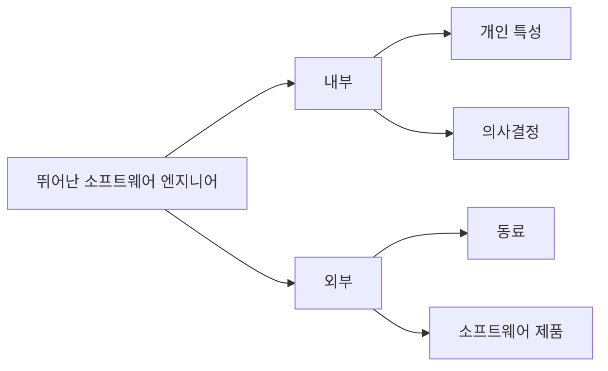

> Paul Luo Li·Amy J. Ko·Jiamin Zhu의 논문 「[What Makes A Great Software Engineer?](https://faculty.washington.edu/ajko/papers/Li2015GreatEngineers.pdf)」(ICSE 2015), Addy Osmani의 「[21 Lessons From 14 Years at Google](https://addyosmani.com/blog/21-lessons/)」(2026.01), 요즘IT의 「[채용 공고에서 말하는 '주도적인 사람'은 누굴까?](https://yozm.wishket.com/magazine/detail/3656)」(2026.03)를 바탕으로 재구성한 노트다.

## 「뛰어남」을 정의하기 어려운 이유

한 사람이 커리어에서 함께 일해 보는 동료 수는 제한적이고, 그중 정말 뛰어난 엔지니어를 만나는 일은 드물다. 그래서 남의 정의를 빌려 오게 되는데, 그 정의는 조직마다 다르다. 어떤 곳은 압도적으로 빨리 코드를 내는 사람을, 어떤 곳은 갈등을 줄이고 일을 굴러가게 하는 사람을 높이 친다.

그래서 한 사람의 감보다 **여러 경험자의 관찰을 모은 연구**와, 오래 일한 사람의 **반복되는 교훈**을 함께 본다. 두 자료가 같은 결론에 닿는다. **뛰어난 엔지니어는 코드만이 아니라 코드가 놓인 환경까지 다룬다.**

## 연구: Microsoft의 53가지 특성

Microsoft 13개 사업부의 경력 엔지니어 59명(SDE II 이상, 절반은 Principal SDE·Senior Dev Manager·Partner·Architect·Technical Fellow급)을 반구조화 인터뷰해 뛰어난 엔지니어의 특성 53가지를 찾았다. 특성은 **내부(개인 특성, 의사결정)**와 **외부(동료와 제품에 주는 영향)** 네 영역으로 묶인다.

| 영역 | 논문이 자세히 다룬 핵심 특성 | 나머지 특성 |
| --- | --- | --- |
| **개인 특성** (18개) | **개선한다**(현상에 만족하지 않고 자신·제품·주변을 계속 낫게 한다), **열정**(보상이 아니라 일 자체에 관심), **열린 마음**(새 정보로 생각을 바꾼다), **데이터 기반**(행동과 결과를 측정해 기대와 비교한다) | 체계적, 생산적, 끈기, 근면, 호기심, 위험 감수, 적응력, 자립, 자기 인식, 정렬(개인 이익보다 제품과 조직), 실행(분석 마비에 빠지지 않음), 자부심, 만들어 냄, 집중 |
| **의사결정** | **사람과 조직을 안다**, **멘탈 모델을 갱신한다**, **숲과 나무를 함께 본다**, **복잡성을 다룬다** | 기술 도메인·고객과 비즈니스·도구·엔지니어링 프로세스에 대한 지식, 상태와 결과를 모델링한다 |
| **동료** | **공유된 맥락을 만든다**, **함께 성공을 만든다**, **안전한 피난처를 만든다**(실수해도 비난받지 않는 곳), **정직하다** | 맥락 통합, 예의, 맥락 습득, 개인적으로 받아들이지 않음, 멘토링, 문제 제기, 말과 행동 일치, 기대 관리, 좋은 평판, 소신, 호의 교환, 친근함, 도움 요청 |
| **소프트웨어 제품** | **우아하다**, **창의적이다**, **필요를 앞서 본다** | 트레이드오프 판단, 세부에 주의, 맥락에 맞춤, 진화 가능, 장기적, 신중하게 만듦 |

- 열정, 호기심 같은 개인 특성은 **타고나거나 성장 과정에서 형성돼 바꾸기 어렵다**고 보는 응답이 많았다. 반대로 의사결정과 동료 영역의 특성은 경험으로 배울 수 있다.
- 실무용으로 줄이면 다섯 가지다: 좋은 코드를 쓴다, 미래의 가치와 비용을 고려해 행동을 조절한다, 근거 있는 결정을 한다, **남의 일을 어렵게 만들지 않는다**, 계속 배운다(Li의 2016년 학위논문 요약). 이 다섯 줄 요약은 [[frontend-career-tracks|프론트엔드 엔지니어의 세 가지 성장 트랙]]의 바탕 역량으로도 쓴다.
- 한계: 한 회사, 경력자의 주관적 판단에서 나온 목록이다. 무엇이 성과를 **예측**하는지 측정한 것은 아니다.

## 현장: 코드 밖에서 결과를 만드는 사람

Google에서 14년 일한 경험에서 나온 21가지 교훈은 결국 「최고의 엔지니어는 최고의 프로그래머가 아니라 사람, 조직의 정치, 목표 정렬, 불확실성을 헤쳐 결과를 만드는 사람」이라는 결론으로 모인다. 주제별로 묶으면 다음과 같다.

| 주제 | 교훈 |
| --- | --- |
| **문제에서 출발한다** | 사용자 문제를 깊이 이해하고 해법은 거기서 따라 나오게 한다. 가장 좋은 해법은 아예 안 만드는 것일 때가 있다 |
| **이기기보다 합의** | 기술 논쟁에서 이기는 것보다 팀의 합의가 중요하다. 매번 논쟁에서 이긴다면 동료가 동의가 아니라 조용히 저항하고 있다는 신호일 수 있다([[picking-battles\|싸울 논쟁 고르기]]) |
| **완벽보다 실행** | 일찍 내고 반복한다. 실제 피드백이 긴 이론 논쟁보다 많이 가르친다 |
| **영리함보다 명료함** | 읽기 쉬운 코드가 영리한 코드보다 낫다. 낯선 기술은 숨은 운영 비용이 있으니 검증된 표준을 기본값으로 둔다. 추상화는 복잡성을 없애지 않고 옮길 뿐이며 장애 때 다시 드러난다 |
| **느림의 원인은 정렬** | 느린 프로젝트는 대개 노력 부족이 아니라 방향이나 인터페이스에 대한 합의 부족이다. 성능 향상도 복잡성을 더하기보다 불필요한 일을 없애는 데서 온다 |
| **규모가 바꾸는 것** | 규모가 커지면 관찰 가능한 모든 동작이 누군가의 의존성이 된다. 호환성 작업도 제품 작업이다 |
| **보이게 일한다** | 결정은 내가 없는 방에서 내려지니 내 영향력을 말해 줄 사람이 필요하다. 보이지 않는 지원 업무는 가치 있지만 범위를 정하고, 돌아가며 맡고, 드러나게 한다 |
| **측정과 프로세스** | 지표가 목표가 되면 사람들이 지표를 최적화해 지표가 의미를 잃는다(굿하트의 법칙). 프로세스는 불확실성과 위험을 줄이려고 있지, 서류나 책임 추궁을 만들려고 있지 않다 |
| **불확실성을 드러낸다** | 리더가 모른다고 말하면 다른 사람도 질문하고 문제를 꺼낸다 |
| **영향 범위에 집중** | 바꿀 수 있는 것에 힘을 쓰고 바꿀 수 없는 것은 걱정하지 않는다 |
| **복리로 쌓인다** | 가르치거나 글을 쓰면 내 이해의 빈틈이 보인다. 전문성은 꾸준한 의도적 연습과 글·재사용 도구 같은 복리 투자로 자란다. 직업적 관계는 어떤 직장보다 오래 간다. 커리어가 깊어질수록 시간이 돈보다 귀해지니 의식적으로 교환한다 |

## 주도성: 채용 공고의 「주도적인 분」이 뜻하는 것

「주도적으로 문제를 해결하는 분」은 「알아서 야근하고 남의 일까지 챙기는 분」이 아니다. 주도성(ownership, agency)은 **완료의 기준을 「티켓 종료」가 아니라 「문제 해결」에 두는 태도**다.

| 상황 | 수동적 | 주도적 |
| --- | --- | --- |
| 어려운 요청을 받았다 | 「지금 구조상 안 돼요. 서버 부하가 커서요」 | 「지금 구조로는 부하가 걱정되는데, 노출 범위를 제한하거나 캐시를 쓰면 될 것 같아요」 |
| 기능을 다 만들었다 | 「요청하신 기능 구현했습니다」 | 「만들다 보니 사용자 흐름이 끊겨서 로딩 애니메이션을 더했어요」 |
| 나중에 문제가 될 부분을 봤다 | 지금 요구만 처리한다 | 「여기는 병목이 될 것 같다」고 미리 말하고 최소한의 설계를 해 둔다 |
| 일이 늦어질 것 같다 | 마감에 알린다 | 터지기 전에 먼저 공유한다 |
| 요구사항이 모호하다 | 짐작으로 만든다 | 코드를 쓰기 전에 질문해 분명히 한다 |

- 주도성은 모든 요청에 「예」라고 하는 것이 아니다. **본질을 해치는 요청은 논리적으로 거절하고** 정말 중요한 문제에 힘을 모으는 선택이다.
- 주도적인 사람은 협업의 변수를 예측 가능하게 바꿔 동료의 확인 비용을 줄인다. 리더가 사사건건 챙기지 않아도 되는 팀원이 된다.
- 주도성은 회사가 아니라 나를 위한 것이다. 같은 5년을 일해도 면접에서 「어떤 기술을 썼나」에 기술 목록을 대는 사람과 「왜 골랐고 어떤 문제를 어떻게 풀었나」를 말하는 사람으로 갈린다. 시장은 코드를 생산하는 사람보다 **문제를 정의하고 해법을 내는 사람**에게 더 낸다.
- 타고나는 성격이 아니라 습관이다. 「안 되는 이유」 대신 「**어떻게 하면 되게 할 수 있을까**」를 한 번 묻는 것부터 시작한다.

연구 쪽에서도 같은 결이 나온다. 스타 엔지니어 연구의 첫 번째 업무 전략이 직무 사이의 빈틈을 맡아 끝까지 해내는 주도성(blazing trails)이다([[developer-productivity|개발자 생산성]]).

## 정리

- 뛰어난 엔지니어는 코드 품질에 더해 의사결정, 동료, 제품에 미치는 영향으로 드러난다. 연구도 현장도 같은 결론이다.
- 바꾸기 어려운 개인 특성보다 배울 수 있는 것에 집중한다: 멘탈 모델 갱신, 숲과 나무 보기, 공유된 맥락 만들기, 정직, 남의 일을 어렵게 만들지 않기.
- 논쟁에서 이기기보다 합의하고, 영리함보다 명료함을 고르고, 완벽보다 실행을 택한다.
- 주도성은 희생이 아니라 완료의 기준을 문제 해결에 두는 습관이다.

관련 노트: [[developer-productivity|개발자 생산성]], [[engineering-levels|엔지니어 레벨]], [[developer-skill-roadmap|개발자 역량 지도]], [[frontend-career-tracks|프론트엔드 엔지니어의 세 가지 성장 트랙]], [[collaborative-developer|협업을 잘하는 개발자]], [[picking-battles|싸울 논쟁 고르기]], [[product-minded-engineer|제품 중심 개발자]]
