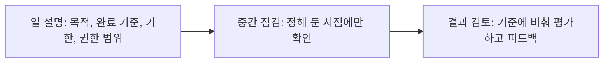
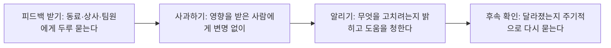

> L. David Marquet의 『Turn the Ship Around!』(2013), John French와 Bertram Raven의 「The Bases of Social Power」(1959), David Owen과 Jonathan Davidson의 「Hubris syndrome: An acquired personality disorder?」(Brain, 2009), Laurence Peter와 Raymond Hull의 『The Peter Principle』(1969), Marshall Goldsmith와 Mark Reiter의 『What Got You Here Won't Get You There』(2007)를 바탕으로 종합한 노트다.

## 리더십은 직함이 아니라 영향력이다

리더는 따르는 사람이 있어야 성립한다. 직위는 지시할 권한을 주지만, 사람이 실제로 움직이는 이유는 여러 가지다. 이 노트는 그 이유를 다루는 다섯 개념을 모았다.

| 개념 | 묻는 것 | 원전 |
| --- | --- | --- |
| 인텐트 기반 리더십 | 결정을 누가 내리게 할 것인가 | Marquet, 『Turn the Ship Around!』(2013) |
| 권력의 기반 | 사람이 왜 따르는가 | French와 Raven(1959), Raven(1965) |
| 휴브리스 신드롬 | 권력이 리더를 어떻게 바꾸는가 | Owen과 Davidson(2009) |
| 피터의 법칙 | 승진이 왜 무능으로 이어지는가 | Peter와 Hull(1969) |
| 스무 가지 습관 | 성공한 사람이 무엇을 그만둬야 하는가 | Goldsmith와 Reiter(2007) |

개발자가 리더 역할로 옮겨 갈 때 겪는 변화는 [[tech-lead-transition|개발자에서 리더로]]에 따로 정리했다.

## 인텐트 기반 리더십: 통제권을 넘긴다

인텐트 기반 리더십(Intent-Based Leadership)은 미 해군 핵잠수함 산타페함(USS Santa Fe)의 함장이 1999년부터 승조원을 지시받는 사람이 아니라 리더로 대하면서 만든 방식이다. 함장이 명령하고 승조원이 따르는 구조에서는 틀린 명령도 그대로 실행된다. 그래서 **정보를 가진 사람에게 결정권을 내려보낸다.**

| 구분 | 리더-팔로워 | 리더-리더 |
| --- | --- | --- |
| 결정하는 사람 | 위에서 정하고 아래는 실행한다 | 일을 가장 잘 아는 사람이 정한다 |
| 말의 형태 | "~해도 되겠습니까?", "어떻게 할까요?" | "~하겠습니다(I intend to ~)" |
| 리더의 일 | 지시하고 승인한다 | 의도를 듣고, 빠진 점을 묻고, 목적을 분명히 한다 |
| 생각하는 사람 | 리더 한 명 | 모든 구성원 |

**"~하겠습니다"라고 말하려면 스스로 판단을 끝내야 한다.** 허락을 구하는 말은 생각을 상사에게 넘기지만, 의도를 밝히는 말은 근거와 위험을 먼저 따져 보게 만든다.

통제권을 넘기는 것만으로는 혼란이 생긴다. 두 가지가 함께 받쳐야 한다.

| 기둥 | 내용 |
| --- | --- |
| 역량(Competence) | 결정을 맡은 사람이 그 결정을 내릴 기술적 실력을 갖췄는가. 통제권을 넘길수록 학습과 훈련을 늘린다 |
| 명료성(Clarity) | 조직이 무엇을 이루려 하는지 모두가 아는가. 목적이 분명해야 각자의 판단이 같은 방향을 향한다 |

결정을 위임해도 결과에 대한 최종 책임은 리더에게 남는다. 위임은 책임을 넘기는 일이 아니라 판단할 기회를 넘기는 일이다.

## 업무 위임 기준과 절차

위임을 미루는 흔한 이유는 설명할 시간이 없다, 떠넘기는 것 같아 미안하다, 남의 결과물을 믿지 못하겠다, 내 자리가 약해질까 두렵다는 네 가지다. 모두 위임하지 않았을 때 치르는 비용(리더가 병목이 되고 팀원이 자라지 못한다)보다 작다.

| 질문 | 기준 |
| --- | --- |
| 무엇을 넘기나 | 창의적 판단이 필요 없는 반복 업무, 한 번으로 끝나거나 드물게 생기는 일, 내가 자신 없는 일, 남이 더 잘하는 일, 더 중요한 일의 시간과 에너지를 빼앗는 일 |
| 누구에게 넘기나 | 누가 잘하는가, 누가 좋아하는가, 누가 배우면 좋은가, 누가 시간이 있는가 |
| 언제 외부 인력을 쓰나 | 팀에 없는 전문성이 필요할 때, 숙련이 필요 없는 일일 때, 팀원이 이미 과부하일 때 |

절차는 세 단계이고, 단계마다 시간을 따로 잡는다.

**의미 있는 일은 쥐고 사소한 일만 넘기면 위임이 아니다.** 팀원이 실력을 입증할 기회를 얻지 못해 떠난다.

## 권력의 여섯 가지 기반

사회심리학에서 권력(social power)은 다른 사람의 행동이나 생각을 바꿀 수 있는 잠재력이다. 1959년 논문이 다섯 가지 기반을 제시했고, 1965년 레이븐이 정보 권력을 더해 여섯 가지가 되었다.

| 기반 | 따르는 이유 | 한계 |
| --- | --- | --- |
| 강압(Coercive) | 따르지 않으면 불이익을 받는다 | 지켜볼 때만 작동한다. 저항과 원망을 키운다 |
| 보상(Reward) | 따르면 원하는 것을 얻는다 | 역시 감시가 필요하다. 보상에 익숙해지면 같은 보상이 더는 동기가 되지 않는다 |
| 합법(Legitimate) | 그 자리에 지시할 권한이 있다고 인정한다 | 자리와 함께 사라진다. 이것 하나로는 영향력이 약하다 |
| 전문(Expert) | 그 사람이 더 잘 안다고 믿는다 | 전문 분야 밖에서는 통하지 않고, 지식은 낡는다. 전문성이 판단의 옳음을 보장하지 않는다 |
| 준거(Referent) | 그 사람을 좋아하고 닮고 싶어 한다 | 쌓는 데 오래 걸리고 쉽게 잃는다. 맹목적 추종으로 흐를 수 있다 |
| 정보(Informational) | 그 사람이 내놓은 정보와 논리가 설득력 있다 | 정보를 주는 순간 권력도 함께 넘어간다. 가장 일시적이다 |

- 강압·보상·합법 권력은 **직위**에서, 전문·준거·정보 권력은 **사람**에게서 나온다. 직위가 없는 사람도 뒤의 세 가지로 영향력을 가진다.
- 정보 권력은 무엇을 공개하고 무엇을 빼며 어떻게 해석해 전달하느냐에서 생긴다. 그래서 조직에서는 정보의 독점, 선택적 공개, 왜곡을 경계한다.
- 직급이 오를수록 강압·보상 권력은 커지지만, 그것에 기대면 구성원은 감시가 있을 때만 움직인다.

## 휴브리스 신드롬: 권력이 판단을 흐린다

휴브리스 신드롬(hubris syndrome)은 큰 권력을 일정 기간 쥔 사람이 **권력을 얻은 뒤에** 보이는 과신과 독선의 행동 양상이다. 지난 100년의 미국 대통령과 영국 총리를 분석한 2009년 논문이 「후천적 성격 장애」로 제안했다.

| 항목 | 내용 |
| --- | --- |
| 성격 장애와의 차이 | 성격 장애는 대개 청소년기나 성인 초기에 시작한다. 휴브리스 신드롬은 권력을 쥔 뒤 나타나는 후천적 상태다 |
| 판정 기준(제안) | 14가지 징후 가운데 3가지 이상이 보이고, 그중 하나 이상이 고유 징후 5가지에 속한다 |
| 다른 진단과의 겹침 | 14가지 중 9가지는 DSM-IV의 자기애성·반사회성·연극성 성격 장애 기준과 겹친다 |
| 공식 지위 | DSM과 ICD 어느 쪽에도 들어 있지 않다. 정식 진단명이 아니라 연구자가 제안한 개념이다 |
| 경과 | 체계적으로 추적한 연구가 없다 |

고유 징후 다섯 가지는 다음과 같다.

- 자신을 국가나 조직과 동일시해 자기 이익과 조직의 이익을 같은 것으로 본다.
- 자신을 3인칭으로 부르거나 「우리」라는 말로 자신을 가리킨다.
- 역사나 더 높은 심판이 자신을 옳다고 판정해 줄 것이라고 흔들림 없이 믿는다.
- 안절부절못하고 무모하며 충동적이다.
- 도덕적으로 옳다는 「큰 그림」을 앞세워 실현 가능성, 비용, 결과를 따지지 않는다.

조직이 할 수 있는 일은 견제를 제도로 만드는 것이다. 반대 논리를 맡는 역할을 지정하고, 결정 권한을 나누고, 권력 밖에 있는 사람의 말이 리더에게 닿는 통로를 둔다. 구체적인 장치는 [[team-operating-models|팀 운영 모델]]의 「집단사고와 반대 장치」에 있다.

## 피터의 법칙: 승진은 무능의 단계에서 멈춘다

**「위계 조직에서 모든 구성원은 자신의 무능 수준까지 승진하는 경향이 있다.」** 지금 자리에서 잘하면 승진하고, 새 자리에서도 잘하면 또 승진한다. 승진은 못하는 자리에 이르러서야 멈춘다. 그래서 시간이 지나면 각 자리는 그 일을 감당하지 못하는 사람으로 채워진다는 것이 따름 정리다. 원래 풍자로 쓰인 책이지만 승진 관행에 대한 진지한 비판으로 읽힌다.

- **원인은 현재 직무의 성과로 다음 직무의 적합성을 판단하는 데 있다.** 뛰어난 영업 사원이나 개발자가 좋은 관리자라는 보장은 없다.
- 미국 기업 214곳의 영업 조직을 분석한 연구(Benson·Li·Shue, 2018년 워킹 페이퍼, 2019년 Quarterly Journal of Economics 게재)에서, 회사는 관리 역량의 증거보다 이전 직무의 실적을 보고 승진시켰고 실적이 높았던 사람일수록 관리자로서의 성과는 나빴다.

| 주체 | 대응 |
| --- | --- |
| 조직 | 과거 성과가 아니라 새 직무에 필요한 역량으로 승진을 판단한다. 관리직 승진 외에 전문가 경로를 둔다([[engineering-levels\|엔지니어 레벨]]의 IC 트랙). 승진 전에 그 역할을 작게 맡겨 본다 |
| 개인 | 새 역할이 요구하는 능력이 지금 잘하는 일과 다르다는 점을 받아들인다. 부족한 영역은 위임하고 직언을 듣는다. 맞지 않는 자리라면 역할을 조정하거나 돌아가는 것도 선택지다 |

## 성공한 사람이 고쳐야 할 스무 가지 습관

성과를 내며 올라온 사람은 자신의 모든 행동이 성공의 원인이라고 믿기 쉽다. 실제로는 그 행동 **덕분에**가 아니라 그 행동**에도 불구하고** 성공한 부분이 섞여 있다. 직급이 오르면 가벼운 의견도 지시로 들리기 때문에 예전에는 문제가 되지 않던 대인 습관이 팀을 누른다. 이 단계에서 필요한 것은 새 기술을 익히는 일이 아니라 **무엇을 그만둘지** 정하는 일이다.

| 묶음 | 습관 |
| --- | --- |
| 이기려는 습관 | 1. 지나친 승부욕(상관없는 일에서도 이기려 든다) 2. 의견 보태기(모든 논의에 한마디를 얹는다) 6. 내가 얼마나 똑똑한지 알리기 |
| 깎아내리는 말 | 3. 평가하기(남을 내 기준으로 재단한다) 4. 파괴적인 말(쓸데없는 빈정거림) 5. 「아니」, 「하지만」, 「그런데」로 말 시작하기 7. 화난 채로 말하기 8. 부정부터 하기(「그게 왜 안 되느냐면」) |
| 나누지 않는 습관 | 9. 정보 쥐고 있기 10. 인정에 인색하기 11. 남의 공 가로채기 14. 편애하기 |
| 책임을 피하는 습관 | 12. 변명하기 13. 과거 탓하기 15. 사과하지 않기 19. 책임 전가 |
| 듣지 않는 습관 | 16. 경청하지 않기 17. 감사 표현하지 않기 18. 나쁜 소식을 전한 사람에게 화풀이하기 |
| 자기 고집 | 20. 「나는 원래 이래」(결점을 정체성으로 포장한다) |

2번 「의견 보태기」가 대표적인 예다. 팀원의 아이디어에 리더가 개선점을 덧붙이면 아이디어는 조금 나아지지만, 그것이 더는 자기 아이디어가 아니게 된 팀원의 실행 의지는 크게 떨어진다.

고치는 순서는 다음과 같다. 스무 가지를 다 고치려 하지 않고 주변에 가장 큰 영향을 주는 한두 가지를 고른다.

알리는 단계가 필요한 이유는 행동이 바뀌어도 주변의 인식은 저절로 바뀌지 않기 때문이다. 피드백을 받는 태도는 [[kind-engineering|친절한 엔지니어링]]의 「피드백을 받는 법과 주는 법」과 같다.

## 겸손: 방에서 가장 똑똑한 사람이 되지 않는다

위대한 기업으로 도약한 회사의 최고 경영자를 가리키는 「단계 5 리더」(Jim Collins, Harvard Business Review, 2001)는 **개인적 겸손과 강한 의지**를 함께 가진 사람이다. 겸손은 결정을 미루거나 다수결에 맡기는 태도가 아니다.

- 직급이 높을수록 리더의 가치는 혼자 답을 아는 데서가 아니라 흩어진 정보를 잇고 다른 의견을 조율하는 데서 나온다.
- 책임은 자신이 지고 공은 나눈다. 모르는 것은 모른다고 말하고 묻는다.
- 스스로 점검할 질문: 회의에 답을 정해 놓고 들어가는가, 상대의 말을 끊는가, 들으면서 딴생각을 하는가.
- 충분히 들은 뒤의 최종 결정은 리더가 내린다.

## 정리

- 결정권은 정보를 가진 사람에게 내려보내되, 실력과 목적의 명료성이 함께 받쳐야 한다.
- 직위에서 나오는 권력(강압·보상·합법)은 감시가 있을 때만 작동한다. 오래가는 영향력은 전문성, 신뢰, 설득에서 나온다.
- 권력은 사람을 바꾼다. 견제 장치는 리더가 건강할 때 만들어 둔다.
- 지금 일을 잘한다는 사실은 다음 역할의 적합성을 말해 주지 않는다.
- 직급이 오를수록 더 잘하는 법보다 그만둘 습관을 찾는다.

관련 노트: [[tech-lead-transition|개발자에서 리더로]], [[team-operating-models|팀 운영 모델]], [[engineering-levels|엔지니어 레벨]], [[kind-engineering|친절한 엔지니어링]], [[decision-making|의사결정 체크리스트]]
