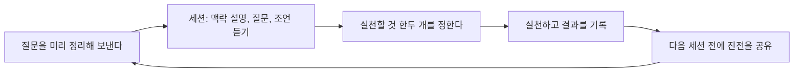

> 고코더의 「["혼자 성장하는 개발자는 없다" 멘토가 필요한 이유](https://yozm.wishket.com/magazine/detail/3467/)」(요즘IT, 2025.11)를 바탕으로, 사람을 키우는 쪽의 원칙은 썸원 레터가 요약한 츠타야(CCC)의 육성 철학(2026.01)으로, 역멘토링의 기원은 [SHRM](https://www.shrm.org/hr-today/news/all-things-work/pages/knowledge-is-best-shared.aspx) 자료로 보강해 재구성한 노트다.

## 멘토가 필요한 문제

기술 문제는 검색, 문서, AI로 대부분 풀린다. 하지만 **커리어 방향, 기술 선택의 우선순위, 팀 내 갈등, 번아웃**은 검색으로 답이 나오지 않는다. 맥락과 경험이 필요한 판단이기 때문이다. 멘토는 기술을 가르치는 사람이라기보다 **그 길을 먼저 걸어 본 사람이 옆에서 지도를 펼쳐 주는 관계**다. 30분 대화가 몇 달 묵은 고민을 정리해 주기도 한다.

## 멘토·코치·스폰서·매니저

비슷해 보이지만 하는 일이 다르다. 한 사람이 여러 역할을 겸하기도 한다.

| 역할 | 하는 일 | 대화의 모양 | 누가 맡나 |
| --- | --- | --- | --- |
| **멘토(mentor)** | 자기 경험을 바탕으로 조언하고 선택지를 보여 준다 | 「나라면 이렇게 하겠다」, 「그때 나는 이랬다」 | 한두 단계 앞선 선배, 사내외 시니어 |
| **코치(coach)** | 답을 주지 않고 질문으로 스스로 답을 찾게 한다. 특정 목표·행동에 집중한다 | 「무엇이 걸림돌인가?」, 「다음에 무엇을 해 볼 건가?」 | 매니저, 전문 코치 |
| **스폰서(sponsor)** | 내가 없는 자리에서 나를 추천하고, 기회와 승진에 자기 평판을 건다 | 대화보다 행동. 「이 프로젝트는 ○○에게 맡기자」 | 영향력 있는 상위 리더 |
| **매니저** | 업무를 배정하고 평가한다. 위 세 역할을 일부 겸한다 | 1:1, 성과 대화 | 직속 상사 |

조언은 멘토에게서, 행동 변화는 코치에게서, **기회는 스폰서에게서** 온다. 커리어 후반으로 갈수록 결정이 내가 없는 방에서 내려지므로 스폰서의 비중이 커진다.

## 멘토가 주는 세 가지

| 가치 | 내용 | 예 |
| --- | --- | --- |
| **실패의 지름길을 피한다** | 흔한 실수를 미리 막는다. 과도한 기술 스택 도입, 커리어 초반의 잘못된 선택, 번아웃을 부르는 과도한 업무 수용 | 팀 규모에 맞지 않는 마이크로서비스 도입 대신 「지금은 모놀리식, 필요할 때 전환」 |
| **안 보이던 선택지를 보여 준다** | 경험이 적으면 선택지 자체를 모른다 | 「백엔드냐 프론트엔드냐」 대신 「풀스택으로 가면서 데브옵스 역량을 키우는 길」 |
| **정서적 지지** | 지금의 좌절이 누구나 겪는 성장통이라는 것을 경험으로 말해 준다 | 「나도 2년 차 때 같은 생각을 했다」 |

## 멘토를 찾는 법

**좋은 멘토는 하늘에서 떨어지지 않는다.** 처음부터 「멘토가 되어 주세요」라고 부담을 주지 말고, 작은 질문으로 시작해 관계를 키운다.

| 경로 | 방법 |
| --- | --- |
| **회사 안** | 같은 회사 시니어가 내 문제를 가장 잘 이해한다. 코드 리뷰를 적극적으로 요청하고, 점심·커피 시간에 가볍게 대화를 시작한다. 정기적인 식사가 몇 달 뒤 기술·커리어를 깊이 나누는 관계가 된다 |
| **커뮤니티·행사** | 컨퍼런스, 밋업, 해커톤, 개발자 커뮤니티에서 만난다. 발표 뒤 질문하고, 「발표 중 A 부분이 궁금한데 30분 커피챗이 가능할까요」처럼 범위와 시간을 정해 요청한다. 온라인에서 먼저 관계를 쌓고 오프라인으로 잇는다 |
| **역멘토링 제안** | 내가 줄 수 있는 것을 내민다(아래 「역멘토링」) |

멘토는 멀리 있는 구루보다 **나보다 한두 단계 앞서 있으면서 잘한다고 알려진 사람**이 현실적이다([[growing-at-work|회사에서 빠르게 성장하는 법]]). 사람을 만나는 채널은 [[developer-networking|개발자 네트워킹]]에 있다.

## 세션을 준비하고 관계를 이어 가는 법

### 시작할 때 기대치를 맞춘다

만남 빈도, 다룰 범위(기술·커리어·생활), 연락 방식(메신저, 정기 미팅)을 처음에 솔직하게 정한다. 멘토링이 기대와 달랐던 경우 상당수는 이 합의가 없어서다.

### 매 세션의 흐름

| 원칙 | 내용 |
| --- | --- |
| 멘토의 시간을 존중한다 | 질문을 미리 보내고, 약속 시간을 지키고, 받은 조언을 실천하는 모습을 보인다 |
| 진전을 공유한다 | 멘토가 가장 보람을 느끼는 순간은 멘티의 성장을 볼 때다. 「추천해 주신 강의를 듣고 프로젝트에 적용했다」, 「면접에 합격했다」 같은 작은 성과를 정기적으로 알린다 |
| 일방적 수혜에서 벗어난다 | 정보 공유, 작은 도움, 사람 소개, 감사 표현처럼 내가 줄 수 있는 것을 찾아 준다. 그래야 상호 성장의 관계로 오래 간다 |

## 역멘토링

**역멘토링(reverse mentoring)**은 주니어가 시니어를 가르치는 짝이다. 1999년 GE의 잭 웰치가 임원 500여 명에게 젊은 직원을 짝지어 인터넷과 전자상거래를 배우게 한 프로그램으로 널리 알려졌다.

- 주니어가 줄 수 있는 것: 새 프레임워크, AI 코딩 도구 같은 새 개발 도구, 다른 세대 사용자의 관점.
- 주니어는 상위 리더를 가까이서 볼 기회를 얻고, 시니어는 새 기술과 시각을 얻는다. 양쪽이 이익을 보니 관계가 지속된다.

## 멘토 쪽: 사람을 키우는 원칙

- **가르치면서 배운다.** 멘토링은 일방적이지 않다. 후배에게서 새 흐름을 배우고, 설명하며 내 이해의 빈틈을 찾는다. 경험이 쌓였다면 점심 대화, 커피 한 잔의 조언도 멘토링이다.
- **성장은 정보가 아니라 경험에서 온다.** 사람은 지금 능력을 넘어서는 도전의 자리에 섰을 때 가장 크게 자란다. 멘토와 리더는 답을 주기보다 **과감한 도전 기회를 주고, 그 일을 온전히 맡긴다**(위임하는 법은 [[leadership-principles|리더십 원칙]]).
- AI가 주니어의 연습 기회를 가져가는 환경에서는 연습을 일부러 설계해야 한다([[growing-engineers-with-ai|AI 시대에 주니어를 시니어로 기르기]]).

## 정리

- 멘토는 검색으로 풀리지 않는 판단(방향, 우선순위, 갈등, 번아웃)을 돕는다.
- 조언은 멘토, 행동 변화는 코치, 기회는 스폰서가 준다. 셋을 구분해 찾는다.
- 작은 질문으로 시작해 관계를 키우고, 처음에 기대치를 맞추고, 세션마다 실천하고 결과를 공유한다.
- 주는 것이 있어야 오래 간다. 역멘토링은 주니어도 줄 것이 있다는 것을 보여 준다.
- 멘토 쪽은 답보다 도전 기회와 위임으로 사람을 키운다.

관련 노트: [[growing-at-work|회사에서 빠르게 성장하는 법]], [[developer-networking|개발자 네트워킹]], [[growing-engineers-with-ai|AI 시대에 주니어를 시니어로 기르기]], [[tech-lead-transition|개발자에서 리더로]], [[leadership-principles|리더십 원칙]], [[pair-programming|페어 프로그래밍]]
