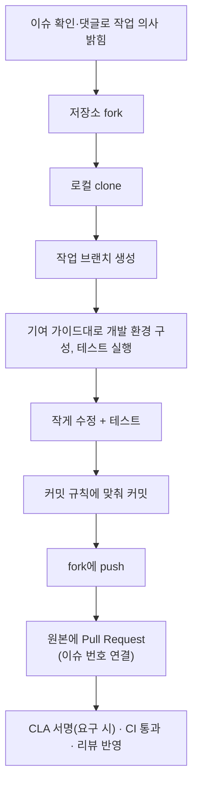

> 「[차근차근 오픈소스에 기여해보기](https://rinae.dev/posts/how-to-contribute-oss)」(2019.09), 「[파이썬 코어 개발자가 되기까지](https://muchtrans.com/translations/my-path-to-becoming-a-python-core-developer.ko.html)」(Emily Morehouse의 글 번역), 「[내가 StackOverflow를 사용하는 방법](https://rinae.dev/posts/how-i-use-stackoverflow-kor)」을 바탕으로, 절차는 GitHub의 [Open Source Guides](https://opensource.guide/how-to-contribute/)로 확인해 재구성한 노트다.

## 기여의 종류

**오픈소스 기여는 코드 작성에 한정되지 않는다.**

| 기여 | 예 | 진입 장벽 |
| --- | --- | --- |
| 문서 | 오타·예제 수정, 번역, 빠진 설명 추가 | 낮음 |
| 커뮤니티 답변 | 이슈·Discussions·Stack Overflow에서 질문에 답하기 | 낮음 |
| 재현과 분류 | 버그 재현 절차 작성, 중복 이슈 정리 | 낮음 |
| 글·발표 | 사용법 튜토리얼, 발표, 사례 공유 | 중간 |
| 코드 리뷰 | 다른 사람의 PR 검토 | 중간 |
| 코드 | 버그 수정, 기능 추가, 테스트 보강 | 높음 |
| 후원 | GitHub Sponsors, Open Collective 등으로 금전 지원 | 낮음 |

## 프로젝트 고르기

- **지금 쓰는 라이브러리부터 본다.** 업무에서 이미 맥락을 알고 있어 문제를 찾기 쉽고, 고친 결과를 바로 쓴다.
- **재미를 느끼는 분야**여야 오래 간다. 기여는 의무가 아니라 자발적 참여다.
- `good first issue`, `help wanted` 레이블로 입문자용 이슈를 찾는다.
- 기여 전에 `CONTRIBUTING.md`, 행동 강령(Code of Conduct), 라이선스, 최근 PR이 어떻게 처리되는지를 확인한다. 응답 없는 저장소는 피한다.

## 첫 기여 흐름

큰 변경은 PR보다 **이슈로 먼저 제안**해 방향을 합의한다. 거절된 PR의 대부분은 코드 품질보다 프로젝트 방향과 맞지 않아서다.

## Q&A 답변으로 배우기

공개 Q&A에 답하는 것은 기여이면서 훈련이다.

- 작고 명확한 문제를 푸는 일이 여러 분야를 넘나드는 두뇌 훈련이 된다.
- 남의 문제를 디버깅하며 **적은 정보로 핵심을 짚는 질문 능력**과 남의 코드를 읽는 능력이 는다.
- 새 분야를 배울 때 질문을 읽고 답을 떠올려 보는 것만으로 이해도를 점검할 수 있다. 처음에는 생각만 하고, 확신이 생기면 답한다.
- **확신 없는 답은 쓰지 않는다.** 점수를 목표로 삼으면 답의 질이 떨어진다.
- 남이 고쳐 준 편집 이력은 영어 글쓰기 교정 자료가 된다.

## 깊은 기여로 넘어가기

입문용 이슈는 금방 바닥난다. 핵심 기여자가 되는 길은 다음과 같다.

| 원칙 | 방법 |
| --- | --- |
| **사람과 관계를 맺는다** | 밋업·컨퍼런스에서 메인테이너와 대화하고, 이후에도 연락을 이어 간다. 멘토링 기회가 여기서 생긴다 |
| **내부를 직접 추적한다** | 소스를 읽고 중간 값을 찍어 동작을 확인한다. 문서로는 얻기 힘든 구조적 이해가 생긴다 |
| **토론 채널을 따라간다** | 메일링 리스트, RFC·PEP 같은 제안 문서, Discussions에서 지금 쟁점을 파악해야 실질적인 대화에 낄 수 있다 |
| **어려운 영역 중 내가 다룰 곳을 찾는다** | 쉬운 일만 고르면 성장도 멈춘다 |
| **결과물을 목표로 공부한다** | 막연한 공부보다 개념 증명(PoC) 구현처럼 손에 잡히는 산출물을 정한다 |
| **프로토타입으로 빨리 보여 준다** | 제안이 오면 먼저 동작하는 코드로 검증하고, 피드백으로 반복하며 합의 과정에 참여한다 |
| **꾸준히 쌓는다** | 눈에 띄는 성과가 없는 기간이 길어도 작은 진전이 신뢰가 되고, 신뢰가 권한(커밋 권한·코어 팀)이 된다 |

## 기여자를 대하는 태도

기여는 누구도 강요하지 않은 시간이다. 메인테이너든 기여자든 **존중하고 격려**하는 태도가 커뮤니티를 유지한다. 리뷰가 늦거나 거절돼도 개인 공격으로 받지 않는다.

## 정리

- 문서, 답변, 재현, 리뷰도 모두 기여다. 진입 장벽이 낮은 것부터 시작한다.
- 쓰고 있는 라이브러리의 `good first issue`가 가장 쉬운 입구다.
- 큰 변경은 이슈로 먼저 합의하고, 작은 PR로 쪼갠다.
- 깊은 기여는 사람과의 관계, 소스 추적, 토론 참여, 빠른 프로토타입에서 나온다.

관련 노트: [[reputation-building|명성 쌓기와 커뮤니티 기여]], [[finding-dev-references|개발 자료 잘 찾는 법]], [[tech-blogging|개발자 기술 블로그]], [[growing-at-work|회사에서 빠르게 성장하는 법]]
