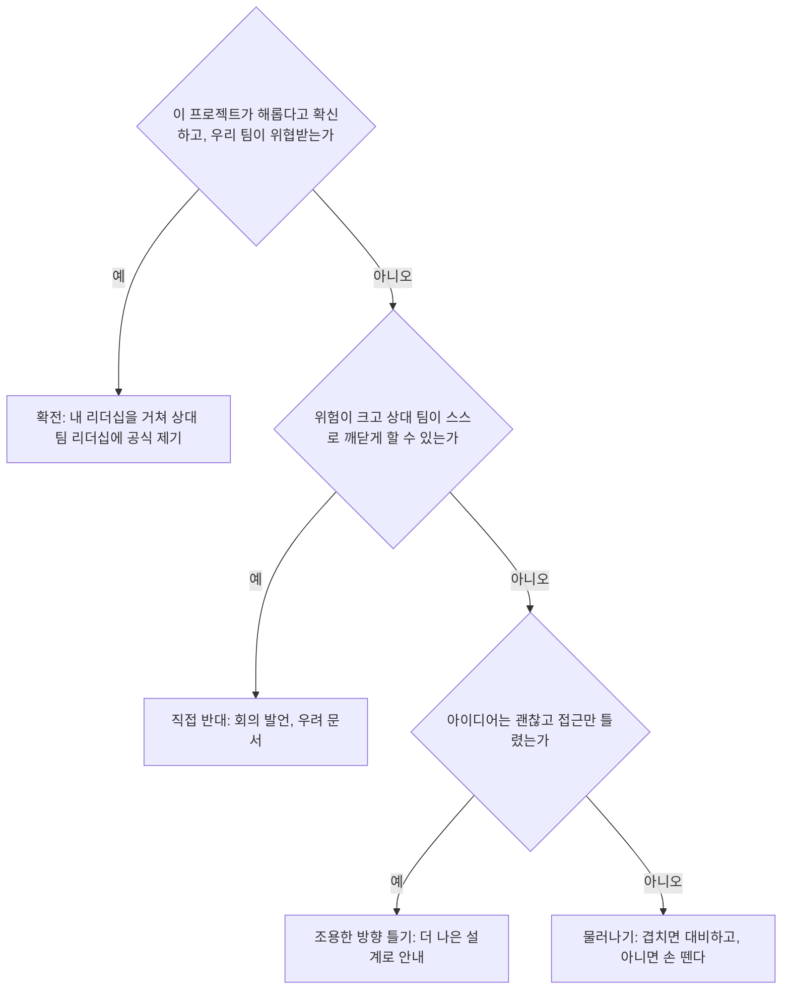

> Lalit Maganti의 「[Why Senior Engineers Let Bad Projects Fail](https://lalitm.com/post/why-senior-engineers-let-bad-projects-fail/)」(2026.01, [한국어 번역](https://velog.io/@typo/why-senior-engineers-let-bad-projects-fail))과 Cong Wang의 「[Why I Stopped Arguing With People](https://wangcong.org/2026-06-30-why-i-stopped-arguing-with-people.html)」(2026.06)을 바탕으로 재구성한 노트다.

## 맞는 것과 효과적인 것은 다르다

시니어 엔지니어는 잘못된 프로젝트를 일찍 알아본다. 그래도 말리지 않는 일이 많다. **옳다는 것(being right)과 효과적이라는 것(being effective)은 다르기 때문이다.** 근거가 탄탄한 반대도 비용을 치르고, 그 비용이 얻는 것보다 크면 반대는 손해다.

| 반대의 비용 | 왜 생기나 |
| --- | --- |
| 속도를 늦춘다 | 소프트웨어 회사는 속도를 중시한다. 반대는 계획에 없던 검토를 만들고, 아주 설득력 있는 이유가 아니면 결과를 바꾸지 못한다 |
| 부정적인 사람으로 보인다 | 한두 번은 품질을 지키는 사람으로 보이지만, 잦아지면 늘 반대하는 사람이 된다. 막아 낸 사고는 일어나지 않았으니 기억되지 않는다 |
| 관계가 상한다 | 누군가의 평가가 걸린 프로젝트, 임원이 아끼는 프로젝트를 건드리면 사람을 잃는다 |
| 내가 닳는다 | 모든 문제와 싸우는 엔지니어는 냉소적으로 변한다 |

## 영향력은 은행 계좌다

조직 안의 영향력(정치적 자본, political capital)은 계좌처럼 쌓고 쓴다.

- **입금**: 꾸준히 좋은 일을 한다. 제때 출시하고, 동료를 돕고, 마찰을 줄인다.
- **출금**: 반대할 때마다 판돈에 비례해 빠져나간다.

| 출금 규모 | 예 | 조건 |
| --- | --- | --- |
| 작다 | 코드 리뷰의 사소한 지적 | 일상적이고 비용이 낮다 |
| 중간 | 아키텍처 결정이나 일정에 이의 제기 | 잔고가 넉넉해야 한다 |
| 크다 | 임원이 아끼는 프로젝트를 접자고 주장 | 커리어에서 드물게만 쓸 수 있다 |

사소한 일마다 조금씩 쓰면 정말 큰일이 왔을 때 잔고가 없다. 잔고를 넘겨 쓰면 **정치적 파산**이다. 회의에 불리지 않고, 의견이 무시되고, 일을 해내는 능력 자체가 줄어든다.

## 언제 쓸 것인가

먼저 겸손하게 따진다. 내가 이 문제를 판단할 전문성이 있는가. 내 의견은 나눌 관점이지 내가 쥔 결정이 아니다. 엔지니어는 다른 팀의 CEO가 아니므로, 말했는데도 팀이 진행하기로 하면 받아들이고 넘어간다.

그다음 세 가지를 본다.

| 기준 | 비용이 낮다 | 비용이 높다 |
| --- | --- | --- |
| **거리** | 우리 팀 안의 일. 의견을 내는 비용이 거의 0이다 | 다른 조직, 조직 밖의 일. 대개 감당하기 어렵다 |
| **우리 팀에 오는 영향** | 영향이 없다 | 다른 팀의 결과를 우리 팀이 수습하게 되거나, 잘되면 공은 그쪽이 갖고 안 되면 탓은 우리가 듣는 구조다. 이때는 팀을 지키는 일이라 쓸 가치가 있다 |
| **회사 전체 영향** | 주변 기능 | 핵심 시스템에 깊이 엮여 오래 남는 기술 부채나 넓은 피해를 만든다. 더 쓸 이유가 된다 |

## 대응 네 가지: 비용 순

| 대응 | 비용 | 언제, 어떻게 |
| --- | --- | --- |
| **확전(escalate)** | 가장 높다 | 「이 프로젝트는 진행하면 안 된다」고 분명히 말한다. 보통 내 리더십에 먼저 알리고, 그다음 상대 팀 리더십에 공식적으로 올린다. 해롭다는 확신이 있고, 가만히 있으면 우리 팀이 위협받을 때만 쓴다 |
| **직접 반대** | 중간 | 회의에서 말하거나 우려 문서(concern doc)를 쓴다. 목표는 내가 이기는 것이 아니라 **상대 팀이 스스로 위험을 결론 내리게 하는 것**이다 |
| **조용한 방향 틀기** | 낮다 | 큰 방향은 맞고 방법이 틀렸을 때 더 나은 설계 쪽으로 안내한다. 한 시간 논의로 다른 팀의 몇 달 낭비를 막으면 방해꾼이 아니라 돕는 사람으로 보인다 |
| **물러나기** | 거의 없다 | 내 일과 겹치면 조용히 대비한다(의존성을 줄이고, 추상화 계층을 두고, 쓸 만한 핵심 아이디어는 내 쪽의 더 나은 해법으로 가져온다). 겹치지 않으면 손을 뗀다. 불만은 사적인 자리에서 풀고 공개적으로 싸우지 않는다 |

### 팀에게는 솔직하게

공식 입장이라는 이유로 문제 있는 프로젝트를 괜찮은 척하지 않는다. 확인한 사실은 사내 정치를 빼고 팀에 공유하고, 제약 안에서 무엇을 하고 있는지 분명히 말한다.

### 결정이 나면 따른다

반대 의견은 근거를 들어 한 번 분명히 말하고, 결정이 나면 그 결정을 온전히 실행한다. Amazon 리더십 원칙의 「Have Backbone; Disagree and Commit」이 이 태도다. 반대를 반복하는 것은 계좌에서 같은 돈을 계속 빼는 일이다.

## 논쟁 대부분은 아이디어가 아니라 자아의 문제다

어떤 논쟁에 힘을 쓸지 고를 때는 그 논쟁이 무엇에 관한 것인지도 본다.

| 원리 | 내용 | 그래서 |
| --- | --- | --- |
| 옳음은 반쪽이다 | 논쟁에서 이기면 지는 사람이 생긴다. 사실로 옳은 것과 그 순간에 좋은 일을 한 것은 다르다 | 옳음 자체를 목표로 삼지 않는다 |
| 의견이 곧 정체성인 사람이 있다 | 자아가 강한 사람에게 아이디어 반박은 인신공격으로 들린다. 논거가 강할수록 더 버틴다 | 생각이 열린 사람과는 장단점을 함께 따지고, 자아가 앞선 사람과는 옳고 그름을 다투지 않는다 |
| 사람은 감정이 먼저다 | 대부분 감정으로 결론을 내고 이유를 나중에 붙인다. 자신감을 옳음으로 착각하고 다수를 따른다 | 논리로 감정을 바꾸려 하지 않는다 |
| 바로잡기는 잘 돕지 못한다 | 상대는 내 선의가 아니라 비판을 듣는다. 사람은 조언보다 결과에서 배운다 | 때로는 스스로 선택의 결과를 겪게 두는 것이 존중이다 |
| 예외: 도움을 청할 때 | 요청이 문을 연다. 방어가 낮아 조언이 들린다 | 초대를 기다렸다가, 열리면 아낌없이 돕는다 |
| 차이에서 이익을 낸다 | 남이 믿지 않는 것을 믿는다면 설득하지 말고 만들어서 현실이 판정하게 한다. 남의 회의론이 내 경쟁 우위가 된다 | 주장하지 말고 출시한다 |
| 바꿀 수 있는 건 나뿐이다 | 남을 바꾸려는 시간은 나를 바꿀 시간에서 나온다 | 피드백을 청하고 듣는다. 이겨야 하는 자아가 듣기를 막는다 |

## 한계

- 이 계산은 **나에게 돌아오는 비용** 기준이다. 보안·데이터 손실·법적 위험처럼 사람이나 회사에 큰 피해가 확실한 문제는 비용이 커도 확전 대상이다.
- 물러나기가 습관이 되면 조직은 나쁜 소식을 듣지 못한다. 엔지니어가 말해도 바뀌지 않는다고 느끼면 그 침묵은 이탈의 전조다([[retention-conversations|퇴사를 미리 막는 대화]]).

## 정리

- 옳은 반대도 비용이 든다. 영향력은 평소의 좋은 일로 쌓고, 반대할 때마다 판돈만큼 꺼내 쓴다.
- 쓸 곳은 거리, 우리 팀 영향, 회사 전체 영향으로 고른다.
- 대응은 확전 > 직접 반대 > 조용한 방향 틀기 > 물러나 대비하기 순으로 비싸다. 가장 싼 수단부터 쓴다.
- 이길 수 있는 싸움, 침묵하면 팀이 다치는 싸움, 실패 비용이 내가 틀릴 비용보다 큰 싸움만 고른다. 나머지는 지켜보고 대비한다.

관련 노트: [[decision-making|의사결정 체크리스트]], [[kind-engineering|친절한 엔지니어링]], [[leadership-principles|리더십 원칙]], [[team-operating-models|팀 운영 모델]], [[principled-negotiation|원칙 중심 협상과 BATNA]], [[technical-debt|기술 부채]]
