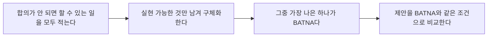

> Roger Fisher와 William Ury의 『Getting to Yes』(1981, 2판부터 Bruce Patton 공저)와 하버드 로스쿨 협상 프로그램(Program on Negotiation)의 「[BATNA 해설](https://www.pon.harvard.edu/daily/batna/translate-your-batna-to-the-current-deal/)」을 바탕으로 재구성한 노트다.

## 원칙 중심 협상이란

원칙 중심 협상(principled negotiation)은 **누가 더 버티느냐가 아니라 무엇이 타당하냐로 합의하는 방법**이다. 하버드 협상 프로젝트에서 나왔고, 1981년 책 『Getting to Yes』로 알려졌다.

흔한 협상은 입장 협상(positional bargaining)이다. 한쪽이 높게 부르고 다른 쪽이 낮게 부른 뒤 조금씩 양보해 중간에서 만난다.

| 구분 | 입장 협상 | 원칙 중심 협상 |
| --- | --- | --- |
| 상대 | 이겨야 할 적 | 같은 문제를 푸는 사람 |
| 다루는 것 | 내가 부른 조건(입장) | 그 조건을 원하는 이유(이해관계) |
| 선택지 | 내 안과 상대 안 사이의 한 점 | 양쪽 이해를 함께 채우는 여러 안 |
| 합의 기준 | 버티는 힘, 의지 | 시장 가격, 선례, 법, 전문가 판단 |
| 결과 | 한쪽이 양보하거나 결렬, 관계 손상 | 합의의 질이 높고 관계가 남는다 |

입장 협상에서는 입장을 지키는 것이 자존심 문제가 되어, 양쪽 모두에게 더 나은 안이 있어도 찾지 못한다.

## 네 가지 원칙

| 원칙 | 내용 | 하는 법 |
| --- | --- | --- |
| 1. 사람과 문제를 분리한다 | 감정, 자존심, 오해는 실제 쟁점과 다른 층이다. 상대를 공격하지 않고 문제를 공격한다 | 상대의 관점에서 상황을 말해 본다. 감정은 인정하되 맞받지 않는다. 「당신이 틀렸다」가 아니라 「이 문제를 어떻게 풀까」로 말한다 |
| 2. 입장이 아니라 이해관계에 집중한다 | 입장은 요구한 것, 이해관계는 그것을 요구하게 만든 필요, 걱정, 바람이다 | 「왜 그 조건이 필요한가」, 「왜 이 안은 안 되는가」를 묻는다. 내 이해관계도 구체적으로 밝힌다 |
| 3. 상호 이익이 되는 선택지를 만든다 | 파이를 나누기 전에 키운다 | 안을 내는 단계와 고르는 단계를 나눈다. 비판 없이 여러 안을 먼저 낸다. 양쪽이 다르게 평가하는 항목을 맞바꾼다 |
| 4. 객관적 기준을 고집한다 | 의지의 대결 대신 양쪽이 인정할 수 있는 기준으로 정한다 | 시장 가격, 업계 관행, 선례, 법, 전문가 평가, 통계를 근거로 든다. 압력에는 굴하지 않고 근거에는 열려 있다 |

2번의 예: 「이 가격이 아니면 안 된다」는 입장 뒤에 「원가를 넘겨야 한다」, 「이번 분기 현금이 필요하다」 같은 이해관계가 있다. 이해관계가 현금 흐름이라면 가격을 그대로 두고 선금 비율이나 지급 시점을 바꾸는 안이 나온다. 입장은 하나지만 한 이해관계를 채우는 방법은 여럿이다.

3번에서 안을 내는 단계와 고르는 단계를 나누는 이유는 [[effective-meetings|회의 잘하는 법]]의 발산과 수렴과 같다.

## BATNA: 합의가 깨졌을 때의 최선의 대안

BATNA(Best Alternative To a Negotiated Agreement)는 **합의에 이르지 못했을 때 내가 실제로 하게 될 일 가운데 가장 좋은 것**이다. 『Getting to Yes』에서 만들어진 말이다.

| 역할 | 내용 |
| --- | --- |
| 수락 기준 | 제안이 BATNA보다 나으면 받고, 못하면 받지 않는다. 손해인 합의를 받는 실수를 막는다 |
| 협상력의 원천 | 협상력은 재력이나 지위가 아니라 **합의하지 않아도 되는 정도**에서 나온다. 대안이 좋으면 양보할 이유가 적고, 대안이 없으면 불리한 조건도 받게 된다 |
| 결렬 시점 | 언제 자리에서 일어날지를 미리 정해 준다. 대안이 준비되어 있으면 상대를 압박하거나 조급해할 이유도 줄어든다 |

### 평가하고 키우는 법

- **희망이 아니라 현실이어야 한다.** 「다른 데서도 받아 줄 것이다」는 BATNA가 아니다. 실제로 받은 다른 제안, 실행할 수 있는 계획만 센다.
- **같은 조건으로 비교한다.** 30% 싼 대안이 알고 보니 보장 범위가 좁은 경우처럼, 겉으로 나아 보이는 대안이 조건을 맞추면 못할 수 있다.
- **협상 전에 만든다.** 대안은 협상 중이 아니라 그 전에 다른 선택지를 실제로 진행해 두어야 생긴다. BATNA를 키우는 것이 협상력을 키우는 가장 확실한 방법이다.
- **상대의 BATNA도 추정한다.** 상대에게 대안이 없으면 내 BATNA가 약해도 유리하다.
- **새 정보가 나오면 다시 평가한다.** 상대가 내 대안을 깎아내리는 말은 상대의 이익이 걸린 말이니 그대로 믿지 않는다.

연봉 협상에서 대안을 만들고 알리는 구체적인 방법은 [[job-offer-negotiation|연봉 협상]]에, 프로젝트 견적에서 값을 정하는 법은 [[project-pricing|웹 프로젝트 가격 책정]]에 있다.

## 한계

| 비판 | 내용 |
| --- | --- |
| 분배형 협상을 덜 다룬다 | 파이를 키울 여지가 없고 한쪽의 이득이 곧 다른 쪽의 손실인 협상(일회성 가격 흥정)에서는 누가 더 가져가느냐가 남는다 |
| 신뢰와 합리성을 전제한다 | 상대가 정보를 감추거나 감정적으로 움직이거나 힘으로 밀어붙일 때는 네 원칙만으로 부족하다 |
| 당사자를 하나로 본다 | 실제 협상 상대는 회사나 조직이고, 그 안에 서로 다른 이해를 가진 사람들이 있다 |

그래서 네 원칙은 BATNA와 함께 쓴다. 상대가 원칙에 응하지 않을 때 나를 지키는 것은 준비된 대안이다.

## 정리

- 입장(무엇을 달라)을 다투지 않고 이해관계(왜 필요한가)를 맞춘다.
- 사람은 부드럽게, 문제는 단단하게 다룬다.
- 고르기 전에 선택지를 늘리고, 고를 때는 양쪽이 인정하는 기준을 쓴다.
- 협상력은 대안에서 나온다. 협상 전에 BATNA를 만들고, 그보다 못한 합의는 받지 않는다.

관련 노트: [[job-offer-negotiation|연봉 협상]], [[project-pricing|웹 프로젝트 가격 책정]], [[decision-making|의사결정 체크리스트]], [[effective-meetings|회의 잘하는 법]], [[kind-engineering|친절한 엔지니어링]]
