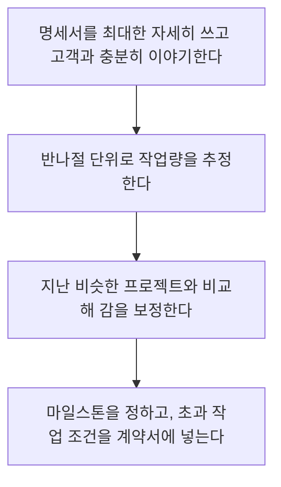

> 웹액츄얼리가 번역한 Code Poet의 전자책 「워드프레스 프로젝트 제값 받기(Getting Pricing Right)」(2013.05)를 바탕으로 재구성한 노트다.

## 적절한 가격이란

적절한 가격의 유일한 정의는 **양쪽이 합의한 가격**이다. 원가 계산으로 나오는 숫자가 아니다. 웹사이트는 사람의 일당과 머릿수로 원가가 정해지는 공산품이 아니기 때문이다.

그래서 가격은 한 번 정하고 끝나는 값이 아니라 **실험하며 맞춰 가는 값**이다. 계획하고, 부르고, 반응을 보고, 고친다.

## 가격이 맞는지 읽는 신호

| 신호 | 해석 | 대응 |
| --- | --- | --- |
| 아무도 가격에 이의를 달지 않는다 | 너무 싸다. 견적을 받아들였다는 것은 더 낼 수 있었다는 뜻이다 | 천천히 올린다 |
| 3~6개월 내내 감당할 수 있는 것보다 일이 많다 | 수요가 공급을 넘었다 | 올린다 |
| 좋은 프로젝트를 바빠서 계속 거절한다 | 같은 신호 | 올린다 |
| 문의한 고객 중 약 4분의 1이 가격 때문에 거절한다 | 대체로 적정선이다 | 유지한다 |
| 일이 비어 있거나 꼭 하고 싶은 프로젝트다 | 수요가 적다 | 할인할 수 있다 |

기본 원리는 수요와 공급이다. 경쟁사의 가격을 추측하는 데 힘을 쓰기보다 **내 일의 수요**를 본다. 처음에는 참고할 기준이 없어 막막하므로, 우호적인 동종 업체와 견적 항목과 가격 구성을 나눠 보면 출발점을 잡기 쉽다. 경험이 쌓일수록 남의 전략은 덜 중요해진다.

**가격으로 경쟁하지 않는다.** 서비스, 지식, 기술, 믿음직함으로 경쟁한다. 무료 대안이 많은 시장에서 가격 경쟁은 이길 수 없는 싸움이다.

## 계약 방식 고르기

| 방식 | 맞는 경우 | 주의 |
| --- | --- | --- |
| 고정가(프로젝트 단위) | 범위가 명확하다. 고객과 제작자 모두 예측 가능해서 가장 선호된다 | 예상 못 한 상황을 대비해 작업 시간을 넉넉히 잡는다. 범위 밖 작업은 추가 비용을 계약서에 미리 적는다 |
| 시간제 | 변수가 많다. 조사·유지보수처럼 범위를 정하기 어렵다 | 숙련될수록 같은 일을 더 빨리 끝내므로 손해다. 4시간 걸리던 일을 30분에 끝내도 그 가치는 30분이 아니다 |
| 월 단위 선불(retainer) | 꾸준히 이어지는 일. 선불로 받고 매달 정해진 시간까지 일한다 | 시간 한도를 분명히 한다 |

둘 다 가능하면 고정가와 시간제를 함께 제시해 고객이 고르게 하는 것도 방법이다.

고정가를 정하는 흐름:

## 고객의 예산을 묻는다

포르셰도 혼다도 만들 수 있다. 둘 다 좋은 차다. 범위를 정하기 전에 **고객의 예산과 필요**를 알아야 맞는 것을 만든다.

- 문의가 오면 먼저 일정 상황과 최소 프로젝트 금액을 알리고, 범위·일정·예산을 묻는다. 거절하려는 것이 아니라 어떤 고객인지 알기 위해서다.
- 예산을 말하지 않으면 여러 번 다시 묻는다. 그래도 안 되면 금액을 하나씩 올려 부르며 반응을 본다("1천만 원대인가요? 2천? 4천?").
- 공개 입찰처럼 이길 근거가 없는 경쟁에는 들어가지 않는다. 의사결정권자와 관계를 쌓고 "이번에 이기려면 무엇이 필요한가, 성공한 프로젝트란 무엇인가"를 직접 묻는다.
- 같은 질문을 여러 번 하면 답이 바뀐다. 처음엔 "혁신적이고 멋진 사이트"였던 것이 나중엔 "6월까지 무언가 나오지 않으면 실패로 간주된다, 완벽보다 속도가 중요하다"가 된다. 그 진짜 답이 범위를 정한다.

가격에 영향을 주는 요소는 고객의 예산, 내 여유 시간, 고객이 얼마나 까다로울지에 대한 예상이다. 프로젝트가 얼마나 재미있는지, 함께 일하고 싶은 고객인지도 실제로 작용한다.

## 견적서와 협상

- **숫자만 쓰지 않는다.** 그 숫자가 어떻게 나왔는지, 고객이 무엇을 받는지 항목별로 적는다. 보안 설정처럼 고객 눈에 안 보이는 일까지 적어야 "5분이면 만든다던데"라는 오해가 없다.
- 협상이 생기는 것은 대개 제공 범위가 불분명할 때다. 고객이 주저하면 가격을 깎기 전에 하는 일을 더 자세히 설명한다.
- 흥정을 관례로 여기는 고객도 있다. 원하는 가격보다 조금 높게 부르는 방법도 있지만, "우리는 가격 협상을 하지 않는다"를 분명히 해 신뢰를 주는 방법도 있다. 어느 쪽이든 일관되게 지킨다.
- 처음 해 보는 기술이 들어간 프로젝트는 학습 시간을 과소평가하기 쉽다. 견적에 따로 넣는다.

## 시간을 기록한다

청구할 수 없는 시간까지 **모든 시간을 기록한다.** 쌓인 기록은 어느 일에서 돈이 남고 새는지 보여 주고, 가격·입찰·프로젝트 형태를 실험할 근거가 된다. 청구서 작성은 허드렛일이니 시간 기록·회계 도구로 자동화한다.

## 잊기 쉬운 것: 프로젝트의 긴 꼬리

프로젝트는 출시로 끝나지 않는다. 사후 서비스, 지원, 관리, 교육이 계속 따라온다. 이를 계약에 넣지 않으면 제작자는 끝없는 수정 요청에 제값을 못 받는다고 느끼고, 고객은 대접받지 못한다고 느낀다. **유지보수와 교육을 처음부터 계약서에 넣는다.** 직접 할 수 없으면 할 수 있는 사람과 연결한다.

다음 일을 찾는 시점도 중요하다. 모두가 가장 만족한 때는 프로젝트가 반쯤 진행됐을 때다. 그때 다른 부서의 기회나 소개를 부탁한다. 끝날 때까지 기다리면 기회가 사라진다.

## 가격을 올리는 방법

| 방법 | 내용 |
| --- | --- |
| 기대를 넘는다 | 명세서에 없던 작은 것(편집 화면 스타일, SNS용 이미지)을 더해 준다. 오래 일하려면 가격보다 품질과 기대 초과가 중심이어야 한다 |
| 믿음을 쌓는다 | 고객이 고르는 이유는 가장 똑똑하거나 창의적이어서가 아니라 **결과를 믿을 수 있어서**다. 책임감과 관계가 가격을 올린다 |
| 계속 배운다 | 웹 서버, 캐시, 성능처럼 한 단계 깊은 기술을 직접 써 본다. 이론과 경험의 차이가 값의 차이다 |
| 이름을 알린다 | 무료 플러그인·테마, 글, 발표로 커뮤니티에 알려지면 문의가 먼저 온다 |
| 정직하다 | 잘못되면 책임지고 바로 고친다. 사람은 정직함을 기억한다 |

## 정리

- 적절한 가격은 양쪽이 합의한 가격이다. 아무도 이의를 달지 않으면 싸다.
- 일이 넘치면 올리고, 비면 할인한다. 경쟁사 가격보다 내 수요를 본다.
- 범위가 명확하면 고정가, 변수가 많으면 시간제, 꾸준한 일은 월 단위 계약.
- 견적 전에 예산과 진짜 성공 기준을 묻고, 견적서에는 숫자의 근거를 쓴다.
- 모든 시간을 기록하고, 유지보수·교육은 처음부터 계약에 넣는다.

관련 노트: [[reputation-building|명성 쌓기와 커뮤니티 기여]], [[side-project-tips|사이드 프로젝트를 시작하고 끝까지 가는 10가지 팁]], [[wordpress|워드프레스]]
