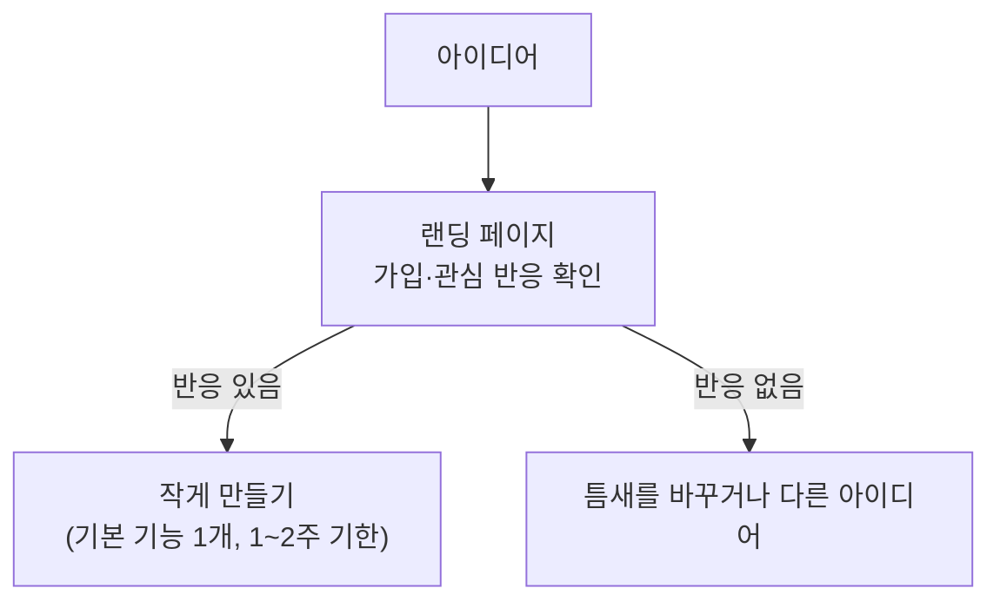

> Chris Yang의 「[당신의 사이드 프로젝트를 위한 10가지 팁](https://velog.io/@chris/10-tips-for-starting-and-creating-side-projects)」(2019.08)을 바탕으로 재구성한 노트다. 원 자료는 Traversy Media의 영상 「[10 Tips For Starting & Creating Side Projects](https://www.youtube.com/watch?v=eCAj3mWFpNM)」다. 출시 이후의 원칙은 웹액츄얼리가 번역한 「한계에서 이어진 나의 앱스토어 성공과 실패 이야기」(2015.04)를 바탕으로 덧붙였다.
> 「내가 쓸 것을 내가 만든다」, MVP·MMP·MLP, 빌드 인 퍼블릭은 배휘동의 발표 자료 「나날이 발전하고픈 개발자를 위한 AI 활용법」(2025.08) 2부를 바탕으로 더했다.
> 업무에서 얻기 어려운 경험, 「빨리 내고 관찰한다」, 「이름과 상표를 먼저 점검한다」는 「[프로젝트가 장난이야?!](https://techblog.woowahan.com/2590/)」, 「[곽철용 짤 생성기, 이렇게 만들어졌습니다](https://wormwlrm.github.io/2019/10/13/Kwakcheolyong-Image-Creator-Development-Story.html)」(2019.10), 「[임금님 귀는 당나귀 귀! 대나무숲 슬랙 앱 만들기](https://wormwlrm.github.io/2022/05/07/Bamboo-Forest-Slack-App.html)」(2022.05), 「[마이크로소프트에게 내용증명 받고 23만 유저 앱 삭제한 건에 대하여](https://cho.sh/ko/w/5ADC58)」를 바탕으로 보강했다.

## 사이드 프로젝트가 필요한 이유

사이드 프로젝트는 대부분 실패한다. 그래도 계속 하는 이유는 **상사도 클라이언트도 없는 유일한 개발**이기 때문이다. 기술을 마음대로 고르고, 배우고 싶은 것을 배우고, 만들고 싶은 것을 만든다. 본업에 지쳐 열정이 식을 때 동기를 지켜 주는 장치다.

업무에서 얻기 어려운 경험도 사이드 프로젝트에서 얻는다.

- **원리를 직접 구현해 본다.** 안정성이 중요한 업무에서는 라이브러리를 그대로 쓸 뿐 직접 만들어 볼 기회가 적다. 개인 프로젝트에서는 동작 원리를 파 볼 수 있다.
- **새 기술을 먼저 시험한다.** 업무에는 검증되고 스스로 문제를 풀 수 있을 만큼 익은 기술만 들인다. 그 검증 장소가 사이드 프로젝트다.
- **설계부터 배포·운영까지 한 바퀴 돈다.** 인프라를 직접 다루지 않는 자리라도 전 과정을 알면 설계와 문제 해결의 질이 오른다. 비용이 제약이 되므로 목적에 맞는 규모를 고르는 연습도 된다.
- 여럿이 할 때는 할 일 목록만 나누지 말고 **목적과 배경을 공유**한다. 맥락 없이 쪼갠 작업은 의도가 전달되지 않는다.

흔한 아이디어도 **특정 집단이라는 틈새**에 맞추면 새로운 제품이 된다. 특정 가수의 팬만을 위한 데이팅 사이트가 그런 예다.

## 10가지 팁

팁은 네 묶음으로 다시 묶었다. 시작 전 태도, 아이디어 고르기, 진행 방식, 그리고 막혔을 때다.

### 태도: 늘 하나는 굴린다

| 팁 | 내용 |
| --- | --- |
| 1. 항상 사이드 프로젝트를 둔다 | 하루 한 시간이든 주 한 시간이든 꾸준히. 양보다 끊기지 않는 것이 중요하다 |
| 10. 지금 시작한다 | 바쁘다는 핑계로 미루면 영영 시작하지 못한다. 이동 중에 아이디어를 굴리고 주 1시간만 써도 된다 |

### 아이디어: 내 불편에서 틈새로

| 팁 | 내용 |
| --- | --- |
| 2. 좋은 아이디어는 아직 남아 있다 | 내 불편함, 주변 사람의 필요, 일반 사용자의 문제에서 찾는다. "이런 게 있으면 좋겠다"는 말이 힌트다 |
| 3. 틈새를 찾는다 | 참신함이 성공을 보장하지 않는다. 이미 있는 아이디어라도 좁은 대상에 맞추면 된다 |
| 4. 관심 있는 분야를 고른다 | 아는 게 많아 만들기 쉽고, 동기도 오래 간다. 취미 분야(예: DJ를 위한 커뮤니티)는 사용자의 불편을 이미 알고 있다는 이점이 있다 |
| 9. 앱일 필요는 없다 | 코딩에 지쳤다면 책, 유튜브·팟캐스트, 밋업·컨퍼런스 주최, 아이들 코딩 교육도 사이드 프로젝트다 |

### 진행: 작게, 기한을 두고

| 팁 | 내용 |
| --- | --- |
| 5. 작게 시작한다 | 큰 그림부터 그리면 압도당한다. 기본 기능이나 간단한 디자인 하나부터. 디자인과 기능 중 무엇이 먼저인지는 취향이다 |
| 6. 목표와 기한을 정한다 | 번아웃이 올 만큼 빡빡하게 잡지 않는다. 실제로 해낼 수 있는 **1~2주 단위** 기한이 적당하다. 목적은 즐기는 것이다 |

### 막혔을 때: 기술은 배우고 사람은 구한다

| 팁 | 내용 |
| --- | --- |
| 7. 자신을 의심하지 않는다 | 아는 기술에 프로젝트를 맞추지 말고, 프로젝트에 필요한 기술에 나를 맞춘다. S3나 Cloudinary 이미지 업로드를 처음 해 본다면 배우면 된다 |
| 8. 필요하면 도움을 구한다 | 막히거나 시간이 없으면 팀원을 찾는다. 지인이 아니어도 온라인에서 구할 수 있다. 20~30명에게 물어 1~2명이 남아도 그 한두 명이 큰 힘이 된다 |

## 덧붙은 팁: 코딩 전에 검증한다

가장 흔한 실수는 **사용자를 어떻게 모을지 생각하지 않고 코딩부터 시작하는 것**이다. 코드를 짜기 전에 랜딩 페이지를 먼저 올려 가입 반응을 보고, 반응이 확인된 뒤에 본격적으로 만든다. 반응이 먼저 보이면 시간을 더 들일지 판단할 근거도 생긴다.

## 출시 이후: 작은 앱을 운영할 때

| 원칙 | 내용 |
| --- | --- |
| 한계를 장점으로 쓴다 | 돈도 서버 지식도 없다면 서버 없이 앱 안에서 모든 걸 처리한다. 고정 비용이 거의 없는 구조가 된다 |
| 관점을 뒤집는다 | 새 아이디어가 아니어도 된다. 바쁜 일정 대신 **빈 시간**을 강조하는 캘린더처럼, 모두가 당연시하는 것을 다르게 보여 주면 눈에 띈다 |
| 반복은 기능 추가가 아니다 | 반복할수록 기능이 불어나 핵심 가치가 흐려진다. 사용자 대부분은 핵심 기능 하나만 쓰고, 부가 기능은 한 자릿수 비율만 쓰는 일이 흔하다. 최소 기능 제품을 다듬는 데 시간을 쓴다 |
| 온보딩은 건너뛸 수 있게 | 기능을 설명하는 긴 안내 화면은 이탈의 원인이다. "건너뛰기"를 반드시 둔다 |
| 내 문제가 모두의 문제는 아니다 | 내가 쓰고 싶은 것을 만들되, 남도 같은 방식으로 원하리라 기대하지 않는다. 개발 기간의 큰 몫을 쓴 기능을 극소수만 쓰기도 한다 |
| 처음부터 세계용으로 | 다국어를 지원하지 않으면 해외 사용자를 놓친다. 날짜·시간은 특히 위험하다. 서머타임으로 자정이 없는 날, 윤일, 음력·이슬람력 같은 다른 달력이 있으니 직접 계산하지 말고 OS의 날짜 라이브러리를 쓴다. 주말·근무 시간도 문화와 야간 근무 여부에 따라 다르다 |
| 작은 디테일에 공을 들인다 | 사람들은 기능 목록보다 로딩 애니메이션 같은 작은 즐거움을 기억한다 |
| 업데이트를 끊지 않는다 | 업데이트가 멈추면 버그와 OS 변화로 신뢰를 잃고 사용자가 빠르게 떠난다. 매일 쓰는 앱이라면 시간이 지나며 어떻게 개선할지까지 계획한다 |

### 빨리 내고 관찰한다

- 만들기 전에 비슷한 서비스가 있는지 검색해 빈자리를 확인한다.
- 화제성이 있는 아이디어는 **핵심 기능 하나만으로 빨리** 낸다. 타이밍이 지나면 완성도가 높아도 쓰이지 않는다.
- 다운로드·공유 버튼 같은 핵심 행동에 이벤트 추적을 붙여 얼마나, 언제 쓰이는지 본다.
- 출시 뒤 실제 사용자가 헤매는 지점을 보고 바로 고친다. 범용 메뉴에 숨긴 기능은 잘 못 찾으므로 명시적인 버튼으로 꺼낸다.
- 기존 유료 도구가 인원수 과금으로 부담스럽고 요구가 단순하면 **작은 사내 도구를 직접 만드는 것**도 좋은 사이드 프로젝트다. 메신저 봇처럼 플랫폼에 붙는 앱은 응답 시한(예: Slack 상호작용은 3초 안에 확인 응답)을 먼저 확인하고, 무거운 작업 전에 즉시 응답하는 구조로 짠다. 로컬 터널은 개발용으로만 쓰고 운영은 별도 호스팅에 올린다.

### 이름과 상표를 먼저 점검한다

- **남의 브랜드명·로고를 앱 이름이나 아이콘에 넣지 않는다.** 「OO용 클라이언트」처럼 원 브랜드를 그대로 쓰면 출처 혼동을 이유로 상표권자의 경고를 받을 수 있다.
- 상대 서비스에 도움이 된다는 논리나 무료·오픈소스라는 사실이 상표 문제를 막아 주지 않는다. 큰 회사는 브랜드 보호 업체로 침해를 체계적으로 찾는다.
- 경고장에는 짧은 대응 기한이 붙는 경우가 많다. 받으면 바로 검토하고, 판단이 필요하면 전문가와 상담한다.
- 공개 배포 전에 이름을 상표 검색(한국은 KIPRIS, 미국은 USPTO)으로 확인하고, 연동 대상의 브랜드 가이드라인을 읽는다.

## AI 도구와 사이드 프로젝트

AI 코딩 도구로 프로토타입을 만드는 비용이 크게 줄었다. 그만큼 원칙의 무게가 옮겨 간다.

- **만드는 것보다 고르는 것이 어렵다.** 아이디어 검증(랜딩 페이지, 대기 명단)과 틈새 선택의 비중이 더 커졌다.
- 모르는 기술에 나를 맞추는 일(팁 7)은 쉬워졌다. 대신 생성된 코드를 이해하고 설명할 수 있는지가 학습의 기준이 된다.
- 기한을 짧게 잡기 쉬워졌으니, 1~2주마다 실제 사용자에게 보여 줄 수 있는 결과를 낸다.

### 내가 쓸 것을 내가 만든다

내가 만든 것을 내가 써 보는 개밥 먹기(dogfooding)는 원래 소프트웨어 개발의 관행이다. AI 시대에는 거꾸로도 된다. **내가 쓸 것을 내가 만든다.** 바이브 코딩에 막 입문했다면 이것이 가장 좋은 출발점이다.

| 이유 | 내용 |
| --- | --- |
| 만들기 쉽다 | 코딩은 서툴러도 내 문제에는 내가 전문가다. 풀렸는지 바로 확인할 수 있고, 내 환경에서만 돌면 된다. 그래서 바이브 코딩은 개인용·사내용 생산성 도구에 가장 잘 맞는다 |
| 실력이 빨리 는다 | 알맞은 난이도와 빠른 피드백이 몰입을 만든다. 당장 삶이 편해지니 계속할 동기가 생긴다. 워드 커닝햄의 조언대로 **작지만 쓸모 있는 프로그램을 자주** 만든다 |
| 넓히기 쉽다 | 한 사람에게 생긴 문제는 다른 사람에게도 생긴다. 같은 문제를 겪는 사람이 모인 곳을 찾아 알리면 제품이 된다 |

무엇을 만들지는 세 축을 함께 놓고 고른다.

| 누구의 | 어떤 문제를 | 어떻게 (복잡도) |
| --- | --- | --- |
| 나 | 단순 반복 작업을 빠르게 | UI + 로직 |
| 몇몇 지인 | 일상 업무를 효율적으로 | UI + 로직 + DB (사람마다, 기록에 따라 다르게) |
| 불특정 다수 | 못하던 것을 점점 잘하게 | UI + 로직 + 외부 API (슬랙·캘린더 연동) / 전부 |

내 반복 작업은 대개 UI + 로직으로 풀리고, 주변 사람의 업무 효율화에는 DB나 API가 필요하며, 불특정 다수가 돈을 내려면 전부 필요하다. 프로그램은 입력을 처리해 출력하는 코드이니, **입력·처리·출력에서 사람이 직접 하던 일을 줄일수록** 쓸모가 커진다.

아이디어는 **불편 일기**로 모은다.

- 오늘 가장 비효율적이라고 느낀 순간은?
- 단순 반복 작업에 쓴 시간은 얼마였나?
- 결과에 비해 과정이 너무 복잡했던 일은?
- 「누가 대신해 주면 좋겠다」고 생각한 순간은?
- 한 작업을 하려고 앱 여러 개를 오간 적은?

적은 불편마다 지금 쓰는 임시방편과 해결책을 생각한다. 큰 해결책을 한 번에 만들지 말고, 해야 할 일을 쪼개 **가장 고통스럽고 프로그램으로 만들기 쉬운 단계**부터 만든다. 그 한 단계만으로 충분히 편해져 나머지가 필요 없어지기도 한다. 일을 쪼개는 법은 [[ai-delegation-toolkit|AI에게 일 맡기기]]의 인지 작업 분석과 같다.

## 검증의 단계: MVP 너머 MMP와 MLP

최소 기능 제품(MVP)은 초기 사용자의 피드백을 얻을 만큼만 만든 제품이다. PoC·프로토타입과의 차이는 [[project-process|새 서비스 개발 프로젝트 진행 순서]]에 있다. 그것만으로는 변화가 생기지 않는다. 검증할 것이 셋이다.

| 단계 | 검증하는 것 | 사람이 바뀌는 방향 |
| --- | --- | --- |
| MVP (Minimum Viable) | 아이디어 자체가 유효한가 | 사용자 |
| MMP (Minimum Marketable) | 누구에게 얼마를 받고 팔 수 있나 | → 고객 |
| MLP (Minimum Lovable) | 고객이 제품을 좋아해 자랑스럽게 후기를 쓰나 | → 홍보대사 |

- 셋은 차례로가 아니라 **처음부터 함께** 만든다. 「일단 동작만 하게 만들고 기능을 붙여 간다」가 아니라, 처음부터 전체를 맛볼 수 있는 조각 케이크처럼 만든다. 처음 한 명부터 돈을 낼 만하고, 입소문이 날 만해야 한다.
- 초기에는 사람이 손으로 대신해도 된다. 스케일이 안 되는 일을 기꺼이 한다(폴 그레이엄의 「Do things that don't scale」). 자동화는 수요가 확인된 뒤에 한다.
- 사용자와 고객이 다르면(정부 기관, 학생 대상 교육, 중개 플랫폼) 핵심 가설을 검증하기 어려우니 조심한다.
- 획득 → 활성화 → 유지 → 추천 → 수익(AARRR)은 제품 상태를 보는 틀이다. 순서를 꼭 따를 필요는 없다. 유지와 수익부터 챙기는 변주(RARRA)도 있다. 단계별 지표와 OMTM은 [[product-analytics|프로덕트 데이터 분석]]에 있다.

## 빌드 인 퍼블릭: 만드는 과정을 공개한다

만드는 과정을 SNS에 투명하게 공유해 팬과 초기 사용자를 모으는 방식이다. 제품을 만드는 사람이 콘텐츠 제작자를 겸한다. 1인 창업가 피터 레벨스가 대표적이다. 광고비 없이 시작할 수 있는 유입 경로다.

| 하지 않는다 | 한다 |
| --- | --- |
| 「오늘 이걸 만들었다」(What)만 올린다. 이미 팬인 사람 말고는 관심이 없다 | 「이게 너무 불편해서 만들었다, 해 보니 이게 생각만큼 안 됐다, 그래서 이렇게 바꿨다, 누가 피드백을 줘서 바로 고쳤다」(Why + How) |

- 잠재 고객이 모인 플랫폼을 고른다. 개인 계정으로 할지 제품 전용 계정으로 할지 정한다.
- 올릴 것: 내가 겪은 문제와 만든 이유, 공개해도 되는 지표(가입자, 활성 사용자), 아이디어 투표·피드백 요청처럼 독자를 참여자로 만드는 글, 배포 전 반응 확인.
- 글쓰기를 AI에게 도움받아도 **목소리는 내 것**이어야 한다.
- 베끼는 사람은 공개하지 않아도 생긴다. 모든 것을 공개할 필요는 없고, 꾸준히 개선하는 쪽이 결국 이긴다. 그래서 더욱 나만의 문제, 나만의 이유로 시작한다.
- 목적은 조회수가 아니라 **내 채널로의 유입과 전환**이다. 글마다 링크에 UTM을 달아 전환을 확인한다. 본문에 링크를 넣는 대신 프로필 링크로 유입시키기도 한다.

## 정리

- 사이드 프로젝트의 핵심은 규모가 아니라 **끊기지 않는 것**이다. 주 1시간이면 된다.
- 아이디어는 내 불편에서 찾고, 넓은 시장보다 **좁은 틈새**를 겨냥한다.
- 작게 시작하고 1~2주 기한을 둔다. 번아웃은 사이드 프로젝트의 목적과 반대다.
- 모르는 기술은 배우고, 막히면 사람을 구한다.
- 코딩보다 **랜딩 페이지가 먼저**다. 반응을 보고 만든다.
- 출시 후에는 기능을 늘리기보다 핵심 하나를 다듬고, 업데이트를 끊지 않는다.
- 빨리 내고 사용 데이터를 본다. 이름에 남의 상표를 쓰지 않는다.
- 내가 쓸 것을 내가 만든다. 불편 일기로 아이디어를 모으고, 가장 고통스럽고 만들기 쉬운 단계부터.
- MVP·MMP·MLP를 처음부터 함께: 쓸 만하고, 돈 낼 만하고, 자랑할 만하게.
- 빌드 인 퍼블릭은 What이 아니라 Why와 How를 공유하고, 유입과 전환으로 성과를 본다.

관련 노트: [[project-process|새 서비스 개발 프로젝트 진행 순서]], [[growing-at-work|회사에서 빠르게 성장하는 법]], [[web-dev-study-guide|초보 웹 개발자의 공부 방향과 차별화]], [[reputation-building|명성 쌓기와 커뮤니티 기여]], [[ai-delegation-toolkit|AI에게 일 맡기기: 권한·정보·도구]], [[startup-engineering|초기 스타트업과 창업]]
