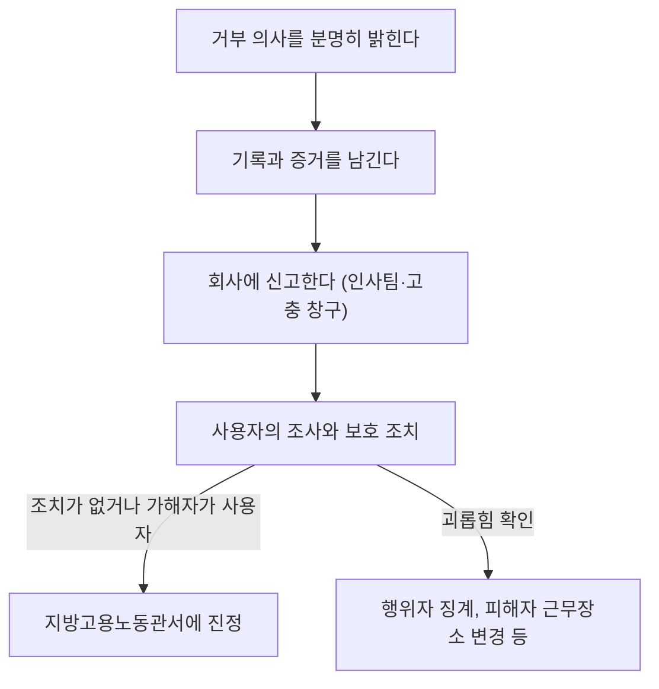

> 국가법령정보센터의 근로기준법 제23조·제28조·제76조의2·제76조의3·제109조·제116조, 통신비밀보호법 제3조·제14조·제16조 현행 조문을 바탕으로 정리한 노트다. 드라마 삼각형은 Stephen Karpman의 논문 「Fairy Tales and Script Drama Analysis」(1968)에서 나온 모델이다.

## 직장 내 괴롭힘이란

근로기준법 제76조의2는 직장 내 괴롭힘을 이렇게 정의한다. 세 요건을 모두 갖춰야 한다.

| 요건 | 내용 |
| --- | --- |
| 우위 | 사용자 또는 근로자가 직장에서의 **지위 또는 관계 등의 우위**를 이용한다. 직급뿐 아니라 인원수, 나이, 근속, 정규직 여부 같은 관계의 우위도 포함된다 |
| 적정범위 초과 | **업무상 적정범위를 넘는** 행위다. 업무상 필요한 지시나 정당한 평가는 불쾌하더라도 해당하지 않는다 |
| 결과 | 다른 근로자에게 **신체적·정신적 고통**을 주거나 **근무환경을 악화**시킨다 |

이 규정은 상시 5명 이상의 근로자를 쓰는 사업장에 적용된다.

## 대응 절차

### 1. 처음에 분명히 말한다

초기에는 불쾌하니 그만하라고 분명하게 말하는 것만으로 멈추는 경우가 많다. 다만 상습적이거나 정도가 심한 가해자에게는 통하지 않거나 공격이 더 심해질 수 있다. 그때는 혼자 맞서지 않고 바로 다음 단계로 넘어간다.

### 2. 타협하지 않고 증거를 남긴다

| 자료 | 남기는 방법 |
| --- | --- |
| 폭언·모욕 | 녹음한다. 메신저·메일은 화면을 저장해 둔다 |
| 녹음이 어려울 때 | 그날 바로 메모한다: **시간, 장소, 동석자, 상대의 말과 행동, 자신의 반응** |
| 피해 | 진료 기록, 상담 기록 |
| 목격자 | 같은 자리에 있던 사람, 비슷한 일을 겪은 동료 |

**녹음의 허용 범위**: 통신비밀보호법이 금지하는 것은 「공개되지 아니한 타인 간의 대화」를 녹음하는 것이다(제3조, 제14조). 자신이 참여한 대화를 녹음하는 것은 타인 간의 대화가 아니어서 이 금지에 해당하지 않는다. 반대로 자신이 없는 자리에 녹음기를 두고 남들의 대화를 녹음하면 1년 이상 10년 이하의 징역에 처하는 범죄다(제16조).

### 3. 권한 있는 제3자에게 알린다

누구든지 직장 내 괴롭힘을 알게 되면 사용자에게 신고할 수 있다. 피해자 본인이 아니어도 된다. 신고를 받거나 괴롭힘을 인지한 사용자에게는 아래 의무가 생긴다(제76조의3).

| 단계 | 사용자의 의무 | 위반하면 |
| --- | --- | --- |
| 조사 | 지체 없이 당사자 등을 대상으로 객관적으로 조사한다 | 500만 원 이하의 과태료 |
| 조사 중 보호 | 필요하면 피해자의 근무장소 변경, 유급휴가 명령 등을 한다. 피해자의 의사에 반하는 조치는 할 수 없다 | - |
| 확인 후 피해자 조치 | 피해자가 요청하면 근무장소 변경, 배치전환, 유급휴가 명령 등을 한다 | 500만 원 이하의 과태료 |
| 확인 후 행위자 조치 | 지체 없이 징계, 근무장소 변경 등을 한다. 그 전에 피해자의 의견을 듣는다 | 500만 원 이하의 과태료 |
| 불리한 처우 금지 | 신고한 근로자와 피해자에게 해고나 그 밖의 불리한 처우를 하지 않는다 | **3년 이하의 징역 또는 3천만 원 이하의 벌금** |
| 비밀 유지 | 조사에 참여한 사람은 알게 된 비밀을 피해자 의사에 반해 누설하지 않는다 | 500만 원 이하의 과태료 |

- **사용자 본인이나 사용자의 친족인 근로자가 가해자**이면 1천만 원 이하의 과태료 대상이다(제116조 제1항). 이때는 회사 내부 신고가 의미가 없으므로 사업장 관할 지방고용노동관서에 진정한다.
- 회사가 신고를 받고도 조사나 조치를 하지 않을 때도 지방고용노동관서에 진정한다.

### 4. 피해가 길거나 심하면 먼저 벗어난다

조사 기간의 유급휴가나 근무장소 변경을 요청하거나, 휴직으로 그 공간에서 먼저 벗어난다. 떨어져 있는 동안 증거를 정리하고 도움을 줄 사람과 기관을 더 확보한다.

## 왜 제3자가 필요한가: 드라마 삼각형

**드라마 삼각형(Drama Triangle)**은 갈등 속 사람들의 역할을 세 가지로 나눈 교류분석 모델이다.

| 역할 | 모습 |
| --- | --- |
| 박해자(Persecutor) | 비난하고 통제하고 공격한다 |
| 희생자(Victim) | 무력하다고 느끼고 당한다 |
| 구원자(Rescuer) | 끼어들어 돕는다 |

이 모델의 핵심은 **역할이 고정되지 않고 짧은 시간에도 바뀐다**는 점이다. 괴롭힘 상황에 적용하면, 가해자와 피해자 둘만 있는 구도에서는 피해자의 위치가 바뀌기 어렵다. 상사, 인사 담당자, 노동청, 변호사, 공적 상담 기관처럼 **권한이 있는 제3자**가 들어와야 구도가 움직인다. 2단계에서 가해자와 사적으로 타협하지 말라는 것도 같은 이유다. 타협은 둘만의 구도로 되돌아가는 일이다.

## 조용한 해고

**조용한 해고(Quiet Firing)**는 해고 절차를 밟지 않고 근로자가 스스로 나가도록 만드는 행태를 가리킨다. 승진·보상에서 계속 제외하기, 핵심 업무에서 빼기, 정보 차단, 필요 없는 원거리 전보나 잦은 부서 이동이 대표적이다. 용어 자체는 법률 개념이 아니고 그 자체로 독립된 위법 행위도 아니다. 대응은 **각 행위가 어떤 법 조항에 걸리는지**로 나눠서 한다.

| 행위 | 법적 수단 |
| --- | --- |
| 정당한 이유 없는 전보·전직, 휴직, 정직, 감봉 | 근로기준법 제23조 제1항이 금지하는 「부당해고등」이다. 노동위원회에 **구제신청**을 할 수 있다 (제28조) |
| 지속적인 업무 배제, 정보 차단, 조직적 따돌림 | 직장 내 괴롭힘(제76조의2)에 해당할 수 있다. 회사에 신고하거나 지방고용노동관서에 진정한다 |
| 사직 권유·압박 | 사직서를 내면 해고가 아니라 자발적 퇴사가 되어 부당해고를 다투기 어려워진다. 동의하지 않으면 서명하지 않는다 |

- 구제신청은 그 처분이 **있었던 날부터 3개월 이내**에 사업장 관할 지방노동위원회에 한다. 기간을 넘기면 신청할 수 없다. 상시 5명 이상 사업장에만 적용된다.
- 전보·전직의 정당성은 **업무상 필요성**과 근로자가 입는 **생활상 불이익**을 견주어 판단하고, 근로자와 협의하는 절차를 거쳤는지도 본다. 발령 사유를 문서로 요청해 받아 두고, 통근 시간·가족 돌봄처럼 생활상 불이익을 보여 주는 자료를 모은다.
- 자발적 퇴사로 처리되어도 **퇴직급여 지급 의무는 없어지지 않는다.** 계속근로기간이 1년 이상이면 퇴직 사유와 무관하게 받는다([[employee-labor-law#퇴직급여: 퇴직금과 퇴직연금|퇴직급여]]).

## 정리

- 괴롭힘의 요건은 우위, 업무상 적정범위 초과, 고통 또는 근무환경 악화다.
- 혼자 버티거나 가해자와 타협하지 않는다. 기록을 남기고 권한 있는 제3자에게 알린다.
- 자신이 참여한 대화의 녹음은 통신비밀보호법이 금지하는 녹음이 아니다.
- 신고를 이유로 한 불리한 처우는 형사처벌 대상이다.
- 부당한 전보·전직은 3개월 안에 노동위원회에 구제신청을 한다.

관련 노트: [[employee-labor-law|직장인이 알아야 할 노동법]], [[parental-leave-benefits|임신·육아기 근로시간 단축과 육아휴직급여]], [[kind-engineering|친절한 엔지니어링]]
