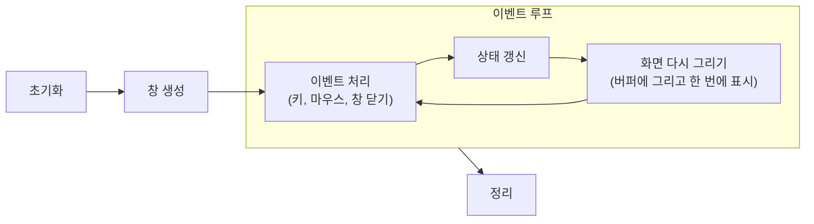

> 팔만코딩경(42Seoul 커뮤니티 위키)의 「SDL 2.0 을 알아보자」 연재(2~6탄), 「FDF - 어떤 걸 배울 수 있을까」 1·2편, 「mlx와 fdf 문제해결 정리」, 「그래픽 과제의 메인은 그래픽이 아니다.(mlx)」를 SDL 공식 문서와 함께 재구성한 노트다.

## 그래픽 라이브러리의 공통 구조

C 표준에는 화면 출력 기능이 없다. 창을 띄우고 픽셀을 그리려면 OS의 창 시스템과 GPU를 감싼 라이브러리를 쓴다.

| 라이브러리 | 특징 |
| --- | --- |
| SDL | 창·입력·오디오·렌더링을 아우르는 크로스플랫폼 라이브러리. 게임과 에뮬레이터에서 널리 쓰인다. 현재 메이저 버전은 SDL3(2025년 정식 출시) |
| MiniLibX | 42 교육과정용 최소 라이브러리. X11(리눅스)·Cocoa(macOS) 위에서 창, 이미지, 이벤트만 제공 |
| raylib | 초보자용 게임 라이브러리. 함수 몇 개로 도형·텍스처·3D까지 |

어느 것을 쓰든 프로그램의 뼈대는 같다.



그래픽 과제의 대부분은 그래픽이 아니라 **파싱, 자료구조, 좌표 계산, 메모리 관리**다. 맵 파일을 읽어 2차원 배열로 만들고, 좌표를 변환하고, 종료 시 할당한 자원을 모두 해제하는 일이 코드의 대부분을 차지한다.

## 이벤트 루프

라이브러리는 키 입력이나 창 닫기 같은 사건을 **이벤트 큐**에 쌓아 둔다. 프로그램은 루프를 돌며 큐에서 이벤트를 꺼내 종류별로 처리한다.

```c
/* SDL3 */
bool running = true;
SDL_Event e;
while (running) {
    while (SDL_PollEvent(&e)) {
        if (e.type == SDL_EVENT_QUIT)
            running = false;
        else if (e.type == SDL_EVENT_KEY_DOWN && e.key.key == SDLK_ESCAPE)
            running = false;
    }
    draw(renderer);
    SDL_RenderPresent(renderer);
}
```

MiniLibX는 반대로 라이브러리가 루프를 쥐고(`mlx_loop`), 프로그램은 `mlx_hook`·`mlx_key_hook`으로 이벤트마다 부를 함수를 등록한다. 창 닫기 버튼(X11 이벤트 17, `DestroyNotify`)도 직접 연결해야 프로그램이 정상 종료된다.

## 픽셀을 찍는 두 가지 길

| 방식 | SDL | MiniLibX | 성격 |
| --- | --- | --- | --- |
| 화면에 바로 한 점씩 | (지원하지 않음) | `mlx_pixel_put` | 호출마다 창 시스템과 통신해 매우 느리고 화면이 깜빡인다 |
| 메모리 버퍼에 그린 뒤 한 번에 표시 | Surface에 그리고 창에 복사 | `mlx_new_image` + `mlx_get_data_addr` 후 `mlx_put_image_to_window` | 표준 방식 |
| GPU 텍스처로 렌더링 | Renderer + Texture | (없음) | 하드웨어 가속, 확대·회전·합성이 빠름 |

SDL의 **Surface**는 CPU 메모리에 있는 픽셀 배열이고, **Texture**는 GPU 메모리에 올린 이미지다. 픽셀을 하나하나 계산해 채울 때는 Surface나 스트리밍 Texture에 쓰고, 이미 있는 이미지를 반복해서 그릴 때는 Texture로 변환해 Renderer로 그린다. PNG·JPG를 읽으려면 확장 라이브러리 SDL_image가 필요하다.

이미지 버퍼에 직접 쓸 때는 한 줄의 바이트 수(`line_length`, pitch)가 `너비 × 픽셀당 바이트`보다 클 수 있다는 점을 주의한다. 줄 끝에 정렬용 여백이 붙기 때문이다.

```c
void put_pixel(t_img *img, int x, int y, unsigned int color)
{
    if (x < 0 || y < 0 || x >= img->width || y >= img->height)
        return;                                   /* 화면 밖은 버린다 */
    char *dst = img->addr + y * img->line_length + x * (img->bpp / 8);
    *(unsigned int *)dst = color;
}
```

## 색: ARGB를 정수 하나에

32비트 정수 하나에 투명도와 RGB를 8비트씩 담는다. 비트 시프트와 마스크로 넣고 뺀다.

```c
unsigned int argb(int a, int r, int g, int b) { return (a << 24) | (r << 16) | (g << 8) | b; }
int get_r(unsigned int c) { return (c >> 16) & 0xFF; }
```

라이브러리마다 채널 순서(ARGB, RGBA, BGRA)와 바이트 순서(엔디언)가 다르므로, 이미지 정보에서 형식을 확인한다.

## 기본 알고리즘

| 알고리즘 | 하는 일 | 핵심 |
| --- | --- | --- |
| 브레젠험 직선(Bresenham's line) | 두 점 사이를 픽셀로 잇기 | 변화량이 큰 축을 1씩 늘리면서, 누적 오차가 절반을 넘을 때만 다른 축을 1 옮긴다. **정수 덧셈과 비교만** 쓴다 |
| 선형 보간(linear interpolation) | 두 색 사이의 그라데이션 | 진행 비율 `t`(0~1)에 대해 채널마다 `c = c0 + (c1 - c0) × t`. `t`는 변화량이 큰 축 기준으로 구한다 |
| 회전 변환 | 점을 원점 기준으로 회전 | 회전 행렬을 곱한다. 2D·3D 행렬과 곱하는 순서는 [[transformation-matrix\|변환 행렬]]에 있다 |
| 등각 투영(isometric projection) | 3D 격자를 2D 화면에 비스듬히 | `X = (x − y) × cos30°`, `Y = (x + y) × sin30° − z` |

좌표계가 다르다는 점이 자주 버그를 만든다. 화면 좌표는 **y가 아래로 갈수록 커지지만**, 수학의 3D 좌표에서 z(높이)는 위로 갈수록 커진다. 인터넷의 회전 공식을 그대로 썼는데 반대로 돈다면 축 방향이 다른 것이다. 변환은 "맵 좌표 → 확대 → 회전 → 투영 → 화면 중앙으로 이동" 순서로 한 단계씩 적용하면 디버깅이 쉽다. 회전과 투영을 여러 점에 반복 적용하는 계산은 [[c-low-level-optimization|C 저수준 최적화]]의 SIMD로 빠르게 할 수 있다.

## SDL2에서 SDL3로

SDL2 자료가 많지만 새 프로젝트는 SDL3를 쓴다. 개념은 같고 이름과 시그니처가 정리되었다.

| SDL2 | SDL3 |
| --- | --- |
| `#include <SDL2/SDL.h>` | `#include <SDL3/SDL.h>` |
| `SDL_Init`이 0을 반환하면 성공 | `bool`을 반환, `true`가 성공 |
| `SDL_CreateWindow(title, x, y, w, h, flags)` | `SDL_CreateWindow(title, w, h, flags)` |
| `SDL_QUIT`, `SDL_KEYDOWN`, `e.key.keysym.sym` | `SDL_EVENT_QUIT`, `SDL_EVENT_KEY_DOWN`, `e.key.key` |
| `SDL_RenderCopy(r, tex, &src, &dst)` (정수 `SDL_Rect`) | `SDL_RenderTexture(r, tex, &src, &dst)` (실수 `SDL_FRect`) |

설치는 리눅스 패키지 관리자(`libsdl3-dev`), macOS Homebrew(`brew install sdl3`), 또는 소스를 CMake로 빌드한다. 빌드한 라이브러리를 링크하는 방법은 [[gcc-compile-and-link|GCC 컴파일과 링크]]에 있다.

## 정리

- 그래픽 프로그램은 초기화 → 이벤트 루프(입력·갱신·그리기) → 정리의 구조다.
- 한 점씩 화면에 찍지 말고, 버퍼에 다 그린 뒤 한 번에 표시한다. 줄 바이트 수(pitch)를 지킨다.
- 색은 정수 하나에 비트로 패킹하고, 직선은 브레젠험, 그라데이션은 선형 보간으로 그린다.
- 좌표계의 축 방향이 다르면 회전·투영이 뒤집힌다. 변환은 단계별로 적용한다.

관련 노트: [[c-low-level-optimization|C 저수준 최적화]], [[gcc-compile-and-link|GCC 컴파일과 링크]], [[c-struct-and-function-pointer|C 사용자 정의 타입과 함수 포인터]], [[Blender|Blender 기초 조작과 모델링]]
