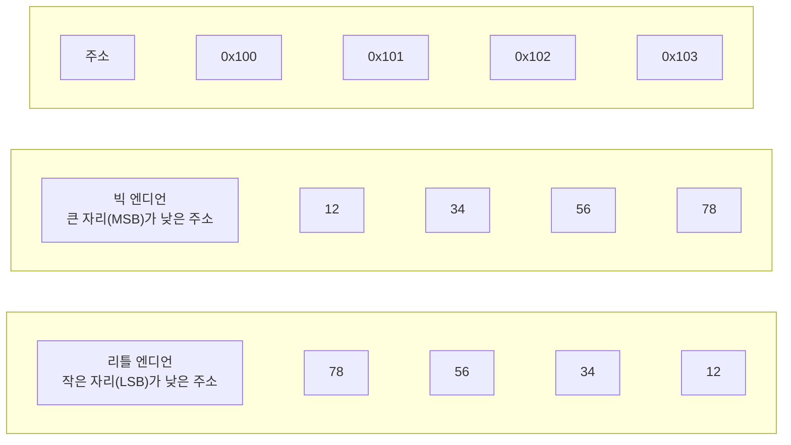

> 진법 변환·KiB·부호 확장·IEEE 754 세부·해밍 코드 부분은 팔만코딩경(42Seoul 커뮤니티 위키)의 「원리를 알면 까먹지 않을 10진법을 2진법으로 변환하는 방법」, 「KB(킬로바이트)와 KiB(키비바이트)」, 「Unsigned char와 Char의 차이」, 「실수의 비트 표현 방법」, 「JavaScript에서 표현할 수 있는 수의 범위와 부동소수점」, 「Parity Bit (패리티 비트)」, 「Born2BeRoot를 진행하며 궁금했던 부분들」을 바탕으로 보강했다. 보수로 하는 뺄셈은 고무오리 CS 스터디의 『컴퓨터 시스템 구조』(Mano) 정리를 바탕으로 보강했다.
>
> 바이트 순서는 ByteByteGo의 System Design 101 가이드 「[Big Endian vs Little Endian](https://bytebytego.com/guides/big-endian-vs-little-endian)」을 바탕으로 보강했다.
> 유니코드 평면과 UTF-16 대리 쌍은 「[Frontend_TIL: 아스키코드 와 유니코드](https://github.com/AI-Dev-Lex-Kim/Frontend_TIL/blob/master/%EC%9B%B9%20%EC%A7%80%EC%8B%9D/%EC%95%84%EC%8A%A4%ED%82%A4%EC%BD%94%EB%93%9C%20%EC%99%80%20%EC%9C%A0%EB%8B%88%EC%BD%94%EB%93%9C.md)」를 바탕으로, 코드 포인트와 인코딩의 구분은 Joel Spolsky의 「[The Absolute Minimum Every Software Developer Must Know About Unicode and Character Sets](https://www.joelonsoftware.com/articles/Unicode.html)」(2003)를 바탕으로 보강했다.
> 「데이터의 종류와 진법」(워드), 「문자 코드」(EUC-KR 예, UTF-8 비트 틀) 절은 강민철의 「혼자 공부하는 컴퓨터 구조+운영체제」 강의(한빛미디어)를 바탕으로 보강했다.
> 「2진수 덧셈」 절과 「고정 소수점」의 비트 폭별 정수 범위, 「문자 코드」의 ASCII 제어 문자·상호 운용성, 「이미지와 소리의 표현」 절은 CrashCourse의 「Crash Course Computer Science」 강의를 바탕으로 보강했다.
> 「32비트와 64비트」 절은 「[fru1tworld/cs-basic 모의 면접 질문 목록](https://github.com/fru1tworld/cs-basic/blob/main/interview/cs/etc.md)」을 점검해 보강했다.

컴퓨터는 모든 정보를 0과 1로 저장한다. 정수, 실수, 문자를 어떤 규칙으로 비트에 담는지 알아야 오버플로우나 부동 소수점 오차 같은 현상을 이해할 수 있다.

## 데이터의 종류와 진법

레지스터가 다루는 데이터는 크게 산술 연산용 **숫자**, 문자 처리용 **영문자**, 특수 목적의 **기호**로 나뉜다.

| 표현 | 묶는 단위 | 비고 |
| --- | --- | --- |
| 2진수 | 1비트 | 기수(radix) 2 |
| 8진수 | 2진수 3자리 | |
| 16진수 | 2진수 4자리 | 16진수 2자리 = 1바이트 |
| BCD | 10진수 한 자리를 4비트로 | 0000~1001, 예전 금전 등록기·전광판 |

- **비트**는 0과 1을 나타내는 가장 작은 단위이고, n비트로 2^n가지 정보를 표현한다. 8비트가 1**바이트**다.
- **KB와 KiB**: SI 접두어 KB·MB·GB는 1000배씩(10³), 이진 접두어 KiB·MiB·GiB는 1024배씩(2¹⁰) 커진다. 예전에는 KB를 1024바이트로 섞어 써서 "1TB 디스크가 931GB로 보이는" 혼란이 생겼고, 1998년 IEC가 이진 접두어를 따로 정했다. 디스크 제조사는 10진, 메모리와 많은 OS 도구는 2진을 쓴다. Linux `free -k`는 KiB, `free --kilo`는 KB다.
- **워드(word)**: CPU가 한 번에 처리하는 정보의 크기다. 바이트처럼 고정된 값이 아니라 CPU마다 다르며, 64비트 CPU라면 1워드가 64비트다. 워드의 절반을 하프 워드, 같은 크기를 풀 워드, 두 배를 더블 워드라 한다. 다만 x86 어셈블리는 16비트 시절의 이름을 그대로 써서 `WORD`가 16비트, `DWORD`가 32비트, `QWORD`가 64비트다.
- 이진수는 십진수와 헷갈리지 않게 수학에서는 `1101(2)`, 코드에서는 `0b1101`로 쓴다. 십육진수는 10~15를 A~F로 쓰고 `1A2B(16)` 또는 `0x1A2B`로 표기한다.
- 십육진수를 많이 쓰는 이유는 이진수와 변환이 쉬워서다. 십육진수 한 자리는 이진수 4비트이므로 자리마다 4비트로 바꿔 이어 붙이면 된다. `0x1A2B` = `0001 1010 0010 1011`. 반대로 이진수는 네 자리씩 끊어 한 글자로 바꾼다.

### 32비트와 64비트

「32비트 CPU」, 「64비트 OS」의 비트 수는 **범용 레지스터의 폭**, 곧 워드 크기다. 레지스터 하나에 주소도 담으므로 이 폭이 포인터 크기와 가상 주소 공간의 크기를 함께 정한다.

| 비교 | 32비트 (x86, IA-32) | 64비트 (x86-64, ARM64) |
| --- | --- | --- |
| 범용 레지스터 폭 | 32비트 | 64비트. 한 번에 64비트 정수를 계산한다 |
| 범용 레지스터 수 | x86은 8개 | x86-64는 16개, ARM64는 31개. 함수 인자를 레지스터로 넘겨 메모리 접근이 준다 |
| 포인터 크기 | 4바이트 | 8바이트 |
| 가상 주소 공간 | 2³² = 4GB. 그중 일부는 커널 몫 | 이론상 2⁶⁴ = 16EB. x86-64는 실제로 48비트(256TB)나 57비트만 쓴다 |
| C 데이터 모델 | ILP32: `int`·`long`·포인터가 모두 32비트 | Linux·macOS는 LP64(`long`·포인터 64비트), Windows는 LLP64(`long`은 32비트, `long long`·포인터만 64비트) |

- 32비트에서 메모리가 4GB로 묶이는 이유는 주소를 32비트로 나타내 2³²개의 바이트 주소만 만들 수 있기 때문이다. 페이지 테이블 계산과 물리 메모리를 늘린 PAE는 [[memory-management|메모리 관리]]에 있다.
- 64비트가 늘 이득은 아니다. 포인터가 두 배라 포인터가 많은 자료구조는 메모리와 캐시를 더 쓴다. 그래서 64비트 JVM은 힙이 32GB 미만이면 객체 참조를 32비트로 압축해 저장한다(compressed oops).
- 64비트 OS는 32비트 프로그램을 호환 모드로 돌린다(Windows WoW64, Linux multilib). 반대로 32비트 OS는 64비트 프로그램을 돌리지 못한다.

### 10진수를 2진수로

n진수의 각 자리는 n의 거듭제곱이다. `1234 = 1×10³ + 2×10² + 3×10¹ + 4×10⁰`처럼, 2진수 `1111011`은 `2⁶+2⁵+2⁴+2³+2¹+2⁰ = 123`이다. 그래서 10진수를 2진수로 바꾸는 방법은 두 가지다.

| 방법 | 123의 경우 |
| --- | --- |
| 큰 2의 거듭제곱부터 빼기 | 123−64=59, 59−32=27, 27−16=11, 11−8=3, 3−2=1, 1−1=0 → 쓴 자리(6,5,4,3,1,0)에 1 → `1111011` |
| 2로 나눈 나머지를 거꾸로 | 123→61 r1, 61→30 r1, 30→15 r0, 15→7 r1, 7→3 r1, 3→1 r1, 1→0 r1 → 아래부터 읽어 `1111011` |

나머지를 거꾸로 읽는 이유는 첫 나머지가 2⁰ 자리, 마지막 나머지가 가장 높은 자리이기 때문이다.

### 2진수 덧셈

10진 덧셈과 같은 규칙이다. 한 자리의 합이 그 진법의 기수를 넘으면 윗자리로 1을 올린다(carry). 2진에는 숫자 2가 없으므로 `1 + 1 = 10`(합 0, 올림 1), `1 + 1 + 1 = 11`(합 1, 올림 1)이다.

```text
  183      1 0 1 1 0 1 1 1
+  19    + 0 0 0 1 0 0 1 1
-----    -----------------
  202      1 1 0 0 1 0 1 0
```

이 자리별 규칙이 그대로 반가산기·전가산기 회로가 된다([[digital-logic-circuits|디지털 논리 회로와 부품]]).

## 문자 코드

- **문자 집합**: 컴퓨터가 인식하고 표현할 수 있는 문자의 모음
- **문자 인코딩**: 문자 집합의 문자를 0과 1로 바꾸는 것. 같은 문자 집합에도 인코딩 방식은 여러 가지일 수 있다
- **문자 디코딩**: 0과 1로 된 문자 코드를 사람이 읽는 문자로 되돌리는 것

- **ASCII**: 7비트(패리티 1비트를 붙여 8비트로 쓰기도 함). 128개 코드에 영문 대소문자, 숫자, 문장 부호와 함께 줄 바꿈(LF, 10)·캐리지 리턴(CR, 13) 같은 **제어 문자**(0~31, 127)를 담는다. 숫자와 알파벳이 순서대로 배치되어 있다. 예: `A` = 65 = `100 0001`, `a` = 97 = `110 0001`. 대소문자는 정확히 32(비트 하나) 차이라 비트 하나만 바꾸면 대소문자가 바뀐다. 서로 다른 회사의 컴퓨터가 같은 코드표를 쓰게 되면서 텍스트를 그대로 주고받을 수 있는 **상호 운용성**(interoperability)이 생겼다.
- **EBCDIC**: IBM 메인프레임에서 쓰던 8비트 코드.
- **확장 ASCII와 코드 페이지**: ASCII에 1비트를 더해 256개 문자를 표현한다. 128 아래는 모두 같지만 128~255에 무엇을 둘지는 지역마다 달라, 같은 바이트가 코드 페이지(DOS의 437·737·862, Windows-1252, ISO-8859-1 등)에 따라 다른 글자가 됐다. 여전히 한글을 담기엔 부족하다. 동아시아는 글자에 따라 1바이트나 2바이트를 쓰는 DBCS를 썼는데, 앞으로는 쉽게 읽어도 뒤로 한 글자 돌아가기가 어렵다.
- **EUC-KR**: 대표적인 한글 **완성형** 인코딩. 초성·중성·종성이 모두 결합된 글자 하나에 2바이트(십육진수 네 자리) 코드를 준다. 예를 들어 `가`는 `B0A1`, `각`은 `B0A2`다. 약 2,350개 글자만 표현할 수 있어 `쀍` 같은 글자는 담지 못하고, 이 때문에 이름을 전산 시스템에 등록하지 못하는 문제도 생겼다. 이를 확장한 것이 마이크로소프트의 CP949다. (초성·중성·종성 각각에 비트열을 주고 조합하는 방식은 조합형이라 한다.)
- **Unicode**: ASCII로는 한글·한자 등을 표현할 수 없어 만든 전 세계 문자 집합. 유니코드 컨소시엄이 정한다. 실제 저장은 인코딩 방식에 따라 다르며, 웹에서 가장 많이 쓰는 **UTF-8**은 문자에 따라 1~4바이트를 쓰는 가변 길이 방식(ASCII 영역은 1바이트로 호환), UTF-16은 2 또는 4바이트를 쓴다.

유니코드는 처음에 16비트(65,536자)면 충분하다고 보고 설계했다. 이 첫 영역이 **기본 다국어 평면**(BMP, `U+0000`~`U+FFFF`)이고, 한글 완성형 11,172자도 여기 있다. 모자라자 유니코드 2.0부터 평면을 17개(BMP + 보충 평면 16개, `U+10FFFF`까지 약 111만 자리)로 넓혔다. 이모지·옛 한자는 보충 평면에 있다.

UTF-16은 BMP 글자는 2바이트 하나로, 보충 평면 글자는 BMP 안에 비워 둔 **대리 영역**(surrogate, 상위 1,024개 + 하위 1,024개)의 두 값을 짝지어 4바이트로 쓴다. 1,024 × 1,024 = 1,048,576이 보충 평면 16개의 크기다. JavaScript 문자열이 UTF-16이라 이모지 `length`가 2인 이유가 이것이다([[js-strings|JavaScript 문자열]]).

### 코드 포인트와 인코딩은 다르다

유니코드를 「한 글자 = 16비트」로 아는 것이 가장 흔한 오해다. 유니코드는 두 층으로 나뉜다.

| 층 | 뜻 | 예 |
| --- | --- | --- |
| 코드 포인트 | 글꼴과 상관없는 추상적인 글자에 붙인 번호. `U+` 뒤에 16진수로 쓴다 | `A` = `U+0041`, 아랍 문자 Ain = `U+0639`, `가` = `U+AC00` |
| 인코딩 | 코드 포인트를 메모리·파일의 바이트로 바꾸는 규칙 | UTF-8, UTF-16, UTF-32 |

| 인코딩 | 코드 포인트당 | 특징 |
| --- | --- | --- |
| UTF-8 | 1~4바이트 | `U+0000`~`U+007F`가 ASCII와 같은 1바이트라 영문 텍스트는 ASCII와 바이트가 똑같다. 바이트 순서 문제가 없다. 웹 페이지의 약 99%가 쓴다 |
| UTF-16 | 2 또는 4바이트 | Windows·Java·JavaScript의 내부 문자열 형식. 바이트 순서가 둘이라 앞에 **BOM**(바이트 순서 표시 `U+FEFF`)을 붙여 구별한다: `FE FF`면 빅 엔디언, `FF FE`면 리틀 엔디언 |
| UTF-32 | 4바이트 고정 | 인덱싱은 쉽지만 공간을 많이 쓴다 |

UTF-8은 코드 포인트의 범위로 바이트 수를 정하고, 코드 포인트를 2진수로 바꿔 아래 틀의 `x` 자리에 뒤에서부터 채운다. 첫 바이트 앞의 1 개수가 전체 바이트 수이고, 이어지는 바이트는 모두 `10`으로 시작한다. 그래서 중간 바이트부터 읽어도 글자의 시작을 찾을 수 있다.

| 코드 포인트 범위 | 바이트 | 비트 틀 |
| --- | --- | --- |
| `U+0000`~`U+007F` | 1 | `0xxxxxxx` |
| `U+0080`~`U+07FF` | 2 | `110xxxxx 10xxxxxx` |
| `U+0800`~`U+FFFF` | 3 | `1110xxxx 10xxxxxx 10xxxxxx` |
| `U+10000`~`U+10FFFF` | 4 | `11110xxx 10xxxxxx 10xxxxxx 10xxxxxx` |

```text
'한' = U+D55C = 1101 010101 011100   (3바이트 범위)
       1110 1101 | 10 010101 | 10 011100  →  ED 95 9C
```

한글 완성형 글자는 모두 3바이트 범위에 있어 UTF-8에서 3바이트, EUC-KR에서 2바이트다.

과거의 UCS-2는 BMP만 담는 2바이트 고정 형식이었고 지금은 UTF-16으로 대체됐다. UTF-8도 처음 설계에서는 6바이트까지 썼지만 2003년 RFC 3629가 `U+10FFFF`까지만 쓰도록 4바이트로 제한했다. 레거시 인코딩(Windows-1252, ISO-8859-1, EUC-KR)으로도 유니코드 문자열을 저장할 수는 있지만 그 인코딩에 없는 글자는 `?`나 `�`로 바뀐다. UTF-8·16·32는 모든 코드 포인트를 담는다.

### 인코딩을 모르는 문자열은 읽을 수 없다

**「평범한 텍스트(plain text)」는 없다.** 바이트열만 있고 어떤 인코딩인지 모르면 128 이상의 바이트를 해석할 수도, 문자열이 어디서 끝나는지 알 수도 없다. 깨진 글자(mojibake) 문제는 거의 다 인코딩 정보를 잃은 데서 생긴다. 그래서 문자열을 주고받을 때는 인코딩을 함께 밝힌다.

| 매체 | 밝히는 곳 |
| --- | --- |
| 이메일 | `Content-Type: text/plain; charset="UTF-8"` 헤더 |
| HTTP 응답 | `Content-Type: text/html; charset=utf-8` 헤더 |
| HTML 문서 | `<meta charset="utf-8">`. 브라우저가 처음 1024바이트 안에서 찾으므로 `<head>` 맨 앞에 둔다. 찾으면 그 인코딩으로 다시 해석한다 |
| 데이터베이스 | 열·테이블의 문자 집합. MySQL은 4바이트 문자(이모지)를 담으려면 `utf8mb4`를 쓴다 |

HTML 표준은 새 문서에 UTF-8만 쓰도록 요구한다. 선언이 없으면 브라우저는 바이트 분포로 인코딩을 추측하는데, 추측은 틀릴 수 있다.

## 이미지와 소리의 표현

글자를 코드표로 숫자에 대응시키듯, 그림과 소리도 결국 **숫자의 긴 목록**이다. 어떤 규칙으로 늘어놓았는지는 파일 앞부분의 메타데이터(헤더)가 알려 준다([[file-system|파일 시스템]]의 「파일 형식」).

| 대상 | 쪼개는 단위 | 단위마다 담는 값 | 크기를 정하는 것 |
| --- | --- | --- | --- |
| 이미지 | **픽셀(pixel)**: 화면을 이루는 작은 정사각형 점 | 빨강·초록·파랑(RGB) 세 채널의 세기. 채널당 8비트면 0~255 | 가로 × 세로 × 색 깊이(color depth, 픽셀당 비트 수) |
| 소리 | **표본(sample)**: 1초를 잘게 나눈 시점의 순간 | 그 순간 공기 압력의 크기(진폭, amplitude) | 표본화율(초당 표본 수) × 표본당 비트 수 × 채널 수 × 길이 |

- 화면의 RGB는 빛을 더할수록 밝아지는 **가산 혼합(additive color)** 이다. `(255, 255, 255)`는 흰색, `(0, 0, 0)`은 검정, `(255, 255, 0)`은 빨강과 초록을 섞은 노랑이다. 채널당 8비트, 픽셀당 24비트면 약 1,677만 색을 표현한다.
- 압축하지 않은 1920×1080, 24비트 이미지는 1920 × 1080 × 3 ≈ 6.2MB다.
- 압축하지 않은 CD 음질(44.1kHz, 16비트, 스테레오)은 초당 44,100 × 16 × 2 ≈ 1,411kbps, 1분에 약 10MB다. 아날로그 소리를 표본화·양자화하는 과정은 [[voip-sip-rtp|VoIP 전화망]]에 있다.
- 이렇게 큰 원본을 줄이는 방법은 [[data-compression|데이터 압축]]에 있다.

## 보수 (Complement)

CPU는 뺄셈을 따로 구현하지 않고 **보수를 더하는 방식**으로 처리한다.

| 체계 | 구하는 법 | 예 |
| --- | --- | --- |
| (r-1)의 보수 | 각 자리를 (r-1)에서 뺌 | 9의 보수: 99999 − 12389 = 87610 / 1의 보수: 0001111 → 1110000 |
| r의 보수 | (r-1)의 보수 + 1 | 10의 보수: 87611 / 2의 보수: 0001111 → 1110001 |

### 보수로 하는 뺄셈 (부호 없는 수)

n자리 수 M − N은 **M에 N의 r의 보수를 더해서** 구한다. M + (rⁿ − N)이므로 결과는 M과 N의 크기에 따라 갈린다.

| 경우 | 덧셈 결과 | 답 |
| --- | --- | --- |
| M ≥ N | 맨 앞에서 캐리(end carry)가 나온다 | 캐리를 버린 나머지가 M − N |
| M < N | 캐리가 나오지 않는다. 합은 (N − M)의 r의 보수다 | 합의 r의 보수를 다시 구하고 음수 부호를 붙인다 |

```text
72532 − 13250     72532 + 86750 (13250의 10의 보수) = 1 59282 → 캐리 버림 →  59282
13250 − 72532     13250 + 27468 (72532의 10의 보수) =   40718 → 캐리 없음 → −(40718의 10의 보수) = −59282

1010100 − 1000011   1010100 + 0111101 = 1 0010001 → 캐리 버림 →  0010001
1000011 − 1010100   1000011 + 0101100 =   1101111 → 캐리 없음 → −(2의 보수) = −0010001
```

부호 있는 2의 보수 표현에서는 이 판단이 필요 없다. 부호 비트까지 그대로 더하고 캐리는 버린다(아래 고정 소수점 참고).

## 고정 소수점: 정수 표현

소수점 위치를 고정해 두는 방식으로, 정수는 맨 오른쪽(LSB) 뒤에 소수점이 있다고 본다. 맨 왼쪽 비트(MSB)는 부호 비트(양수 0, 음수 1)다.

**−14를 8비트로 표현하기** (14 = `00001110`)

| 방식 | 비트 | 설명 |
| --- | --- | --- |
| 부호-절댓값 | `10001110` | 부호 비트만 1로 |
| 1의 보수 | `11110001` | 모든 비트 반전 |
| 2의 보수 | `11110010` | 1의 보수 + 1, 대부분의 CPU가 사용 |

2의 보수는 0이 하나뿐이고 덧셈 회로만으로 뺄셈이 되어 가장 널리 쓰인다.

**비트 폭별 정수 범위** (부호 있는 쪽은 2의 보수)

| 폭 | 부호 없음 | 부호 있음 |
| --- | --- | --- |
| 8비트 | 0 ~ 255 | −128 ~ 127 |
| 16비트 | 0 ~ 65,535 | −32,768 ~ 32,767 |
| 32비트 | 0 ~ 4,294,967,295 (약 43억) | −2,147,483,648 ~ 2,147,483,647 (약 ±21억) |
| 64비트 | 0 ~ 약 1.8 × 10¹⁹ | 약 ±9.2 × 10¹⁸ |

n비트는 2ⁿ가지 값을 담고, 부호 있는 수는 그 절반을 음수에 쓴다. 32비트 부호 있는 정수로는 세계 인구(80억 명대)도 담지 못해 큰 수량·ID·타임스탬프에 64비트를 쓴다. 메모리 주소도 같은 제약을 받는다. 32비트 주소는 2³²바이트 = 4GiB까지만 가리키므로, 메모리가 그보다 커지면서 64비트 주소가 필요해졌다.

### 같은 비트, 다른 해석: 부호 확장

비트 패턴은 같아도 **타입이 해석을 정한다.** 8비트 `10010110`은 `unsigned char`로 150, `signed char`로 −106이다. 작은 타입을 큰 타입으로 넓힐 때 차이가 드러난다.

| 변환 | 규칙 | `10010110` → 32비트 |
| --- | --- | --- |
| 부호 있는 타입 → `int` | **부호 확장**: 빈 상위 비트를 부호 비트로 채움 | `11111111 … 10010110` = −106 |
| 부호 없는 타입 → `int` | **0 확장**: 0으로 채움 | `00000000 … 10010110` = 150 |

C에서 `char`가 부호 있는지는 구현마다 다르다(x86은 보통 signed, ARM Linux는 unsigned). 그래서 `strcmp`·`memcmp`는 바이트를 `unsigned char`로 바꿔 비교하도록 정해져 있다. 그대로 빼면 128 이상의 바이트(확장 ASCII, UTF-8의 비 ASCII 바이트)가 음수로 확장되어 비교 결과가 뒤집힌다. 문자 분류 함수(`isalpha` 등)에 `char`를 넘길 때도 `(unsigned char)`로 바꿔야 한다.

### 오버플로우

- 정해진 비트 수로 결과를 담을 수 없을 때 발생한다. 종이 위 계산에는 없는, 레지스터 크기 때문에 생기는 문제다.
- **같은 부호끼리 더할 때만** 발생할 수 있다(부호가 다르면 결과의 크기가 줄어들기 때문).
- 검출: MSB로 들어오는 캐리와 MSB에서 나가는 캐리가 **서로 다르면** 오버플로우다. 검출되면 결과를 쓰지 않고 인터럽트나 에러로 처리한다.

## 부동 소수점: 실수 표현

- 표준은 **IEEE 754**. 수를 `부호 × 가수(mantissa) × 2^지수(exponent)` 꼴로 나타낸다.
  - 가수: 유효 숫자, 지수: 소수점의 위치
- **정규화**: 가수의 최상위 자리가 0이 되지 않도록 소수점을 옮기고, 옮긴 만큼 지수를 조정한다. 같은 비트로 최대한 많은 유효 숫자를 담기 위해서다.
- 정규화된 수의 맨 앞 자리는 항상 1이므로 저장하지 않는다(숨은 비트). 그만큼 가수에 1비트를 더 쓴다.
- 지수는 부호 없이 저장하려고 **바이어스**를 더한다. 실제 지수 = 저장된 지수 − 바이어스.

| 형식 | 전체 | 부호 | 지수 | 가수 | 바이어스 | 십진 유효 자릿수 | C 타입 |
| --- | --- | --- | --- | --- | --- | --- | --- |
| 단정밀도 (binary32) | 32 | 1 | 8 | 23 | 127 | 약 7자리 | `float` |
| 배정밀도 (binary64) | 64 | 1 | 11 | 52 | 1023 | 약 15~17자리 | `double` |

값 = (−1)^부호 × 1.가수 × 2^(지수−바이어스). 지수 필드의 양 끝은 특별한 값이다.

| 지수 필드 | 가수 | 뜻 |
| --- | --- | --- |
| 모두 0 | 0 | ±0 (부호가 다른 0이 둘 있다) |
| 모두 0 | 0 아님 | **비정규 수**(subnormal): 앞자리를 0으로 보고 지수를 최소로 고정. 0 근처의 아주 작은 수를 표현(점진적 언더플로) |
| 1 ~ 최댓값−1 | 아무거나 | 정규 수 |
| 모두 1 | 0 | ±Infinity |
| 모두 1 | 0 아님 | NaN |

### 배정밀도의 범위: JavaScript의 Number

JavaScript의 `Number`는 배정밀도 부동 소수점 하나뿐이다. 그래서 범위가 곧 binary64의 범위다.

| 상수 | 값 | 어디서 나오나 |
| --- | --- | --- |
| `Number.MAX_VALUE` | ≈ 1.7977 × 10³⁰⁸ | 지수 2046(실제 2¹⁰²³) × 가수 전부 1 → (2 − 2⁻⁵²) × 2¹⁰²³ |
| 가장 작은 양의 정규 수 | ≈ 2.2251 × 10⁻³⁰⁸ | 지수 1 → 2⁻¹⁰²² |
| `Number.MIN_VALUE` | 5 × 10⁻³²⁴ | 가장 작은 **비정규 수** 2⁻¹⁰⁷⁴ |
| `Number.MAX_SAFE_INTEGER` | 2⁵³ − 1 | 가수 52비트 + 숨은 비트 1 = 53비트까지 정수를 빠짐없이 표현 |
| `Number.EPSILON` | 2⁻⁵² | 1과 그다음 표현 가능한 수의 차이 |

2⁵³을 넘는 정수는 건너뛰며 표현되어 `2**53 + 1 === 2**53`이 참이다. 큰 정수 ID는 `BigInt`나 문자열로 다룬다. 유효 자릿수가 약 16자리인 것도 53비트(≈ 10^15.95)에서 나온다. `0.1 + 0.2 !== 0.3` 같은 반올림 오차, 같음 비교, 오차 누적은 [[floating-point-arithmetic|부동소수점 오차: 반올림·비교·누적]]에 있다.

- 필요한 정밀도(float/double)만큼만 선언하는 것이 메모리를 아끼는 방법이다.

## 기타 이진 코드

- **Gray 코드**: 인접한 수로 바뀔 때 한 비트만 변한다. 여러 신호가 동시에 바뀌며 생기는 오류를 줄여 제어 장치(로터리 인코더 등)에 쓰인다.
- **BCD(8421 코드)**: 10진수 한 자리를 4비트로.
- **Excess-3 코드**: BCD에 3(`0011`)을 더한 코드. 자기 보수 성질이 있어 10진 연산에 유리하다.

## 에러 검출: 패리티 비트

- 데이터에 비트 하나를 추가해 1의 개수를 짝수(even) 또는 홀수(odd)로 맞춘다. 어느 쪽을 쓸지는 송수신 측이 미리 약속한다.
- 송신 측 **패리티 발생기**가 비트를 붙이고, 수신 측 **패리티 검사기**가 다시 계산해 맞지 않으면 에러로 판단한다.
- 가장 간단하지만 **두 비트가 동시에 틀리면 검출하지 못하고**, 어느 비트가 틀렸는지도 모른다. 틀리면 통째로 다시 받아야 한다. 계산이 가볍기 때문에 메모리 버스, 직렬 통신, RAID 3~5의 패리티 디스크처럼 하드웨어 수준에서 쓴다.

## 에러 정정: 해밍 코드

해밍 코드(Hamming code)는 패리티 비트를 여러 개 두어 **틀린 비트의 위치까지 찾아 고친다.**

- 패리티 비트는 2의 거듭제곱 위치(1, 2, 4, 8, …)에 둔다. 나머지 자리에 데이터를 넣는다.
- 위치 p의 패리티는 **위치 번호를 2진수로 썼을 때 p 비트가 1인 자리들**을 검사한다. p1은 1·3·5·7·9·11…, p2는 2·3·6·7·10·11…, p4는 4~7·12~15….
- 받은 쪽이 각 패리티 그룹을 다시 계산해 틀린 그룹 번호를 더하면 **그 합이 오류 위치**다. 합이 0이면 오류가 없다.

```text
데이터 1001 1010 (8비트) → 패리티 4개, 총 12비트
위치   1  2  3  4  5  6  7  8  9 10 11 12
구성   p1 p2 d  p4 d  d  d  p8 d  d  d  d
값     0  1  1  1  0  0  1  0  1  0  1  0   (짝수 패리티)
수신 후 p2·p4 그룹만 틀림 → 2 + 4 = 6번 비트를 뒤집는다
```

비트 하나 정정(SEC)에 전체 패리티 하나를 더하면 두 비트 오류를 검출(SECDED)할 수 있다. 서버용 ECC 메모리가 이 방식이다.

## 바이트 순서: 빅 엔디언과 리틀 엔디언

여러 바이트로 된 값(예: 4바이트 정수 `0x12345678`)을 메모리에 놓는 순서를 **바이트 순서(byte order)** 또는 엔디언(endianness)이라 한다.



| 방식 | 쓰는 곳 | 특징 |
| --- | --- | --- |
| 빅 엔디언 | 네트워크 프로토콜(그래서 「네트워크 바이트 순서」라고 부른다), 많은 파일 형식, 옛 PowerPC·Motorola 68k | 사람이 숫자를 쓰는 순서와 같아 덤프를 읽기 쉽다 |
| 리틀 엔디언 | x86·x86-64, 대부분의 ARM 운영 환경 | 낮은 주소에서 하위 바이트부터 읽으므로 크기가 다른 정수로 바꿔 읽기 쉽다 |

엔디언은 **서로 다른 시스템 사이에서 데이터를 주고받을 때** 문제가 된다. 리틀 엔디언 컴퓨터가 정수를 그대로 네트워크로 보내면 받는 쪽은 뒤집힌 값을 읽는다. 그래서 소켓 프로그래밍에서는 `htonl()`·`ntohl()`처럼 호스트 순서와 네트워크 순서를 바꾸는 함수를 쓰고, 바이너리 파일 형식은 어느 엔디언인지 명세에 적는다. JavaScript의 `DataView`가 엔디언을 인자로 받는 이유도 같다.

## 핵심 정리

- 32비트·64비트는 레지스터 폭(워드)이고, 포인터 크기와 가상 주소 공간(4GB 대 사실상 무제한)을 함께 정한다.
- 정수는 2의 보수, 실수는 IEEE 754 부동 소수점으로 저장한다.
- 오버플로우는 같은 부호의 덧셈에서만 생기며, MSB 전후 캐리 비교로 검출한다.
- 같은 비트도 타입에 따라 다르게 해석된다. 부호 있는 타입은 넓힐 때 부호 확장된다.
- 배정밀도는 2⁵³까지 정수를 정확히 담는다. JavaScript `Number`의 한계가 여기서 나온다.
- 문자는 ASCII/Unicode, 오류 검출은 패리티, 오류 정정은 해밍 코드처럼 약속된 코드로 처리한다.

C에서 자료형별 크기와 문자를 숫자로 다루는 예(ASCII로 대소문자 바꾸기)는 [[c-basics|C 기초]]에 있다.

관련 노트: [[developer-traps|개발자가 빠지는 함정 모음]], [[js-numbers|숫자와 Math]], [[memory-management|메모리 관리]]
