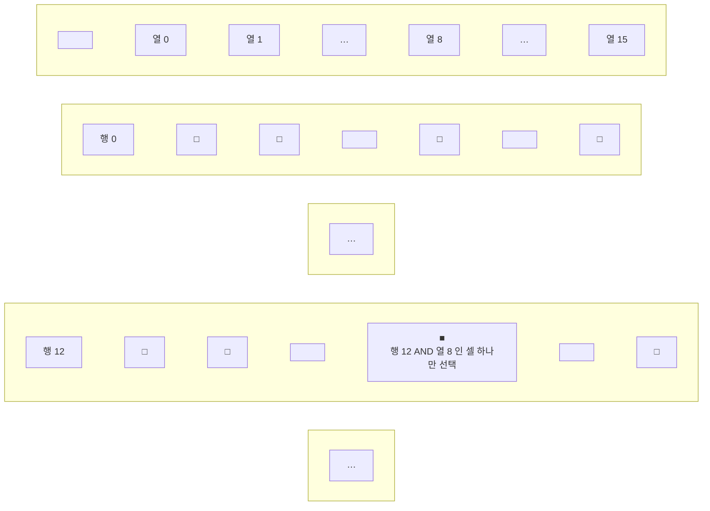

> 「왜 2진인가」, 「추상화 계층」, 「트랜지스터로 게이트 만들기」, 「래치」, 「메모리 셀을 행렬로 배치하는 이유」 절은 CrashCourse의 「Crash Course Computer Science」 강의를 바탕으로 보강했다.

컴퓨터의 모든 부품은 결국 0과 1을 다루는 논리 회로로 만들어진다. 논리 게이트로 덧셈 회로를 만들고, 플립플롭으로 값을 기억하는 회로를 만들면 레지스터·메모리·CPU로 확장할 수 있다. 이 노트는 게이트와 부울 대수에서 출발해 디코더·MUX 같은 조합 부품, 레지스터·카운터 같은 순차 부품, RAM·ROM과 집적회로까지 다룬다.

## 디지털 컴퓨터

**이진 시스템**으로 계산을 수행하는 디지털 시스템이다. 비트의 묶음으로 숫자, 문자 등 모든 정보를 표현하고 처리한다.

| 구분 | 구성 |
| --- | --- |
| 하드웨어 | CPU(산술·논리 연산, 데이터 저장, 제어. 사실상 컴퓨터 그 자체), 메모리(RAM/ROM), 저장 장치, 입출력 장치 |
| 소프트웨어 | 운영체제, 시스템 프로그램(유틸리티, DB, 편집기 등. OS에 포함되거나 연결되어 시스템 운영을 보조), 응용 프로그램 |

### 왜 2진인가

트랜지스터는 전류를 켜고 끄는 것뿐 아니라 여러 단계의 전류 세기도 만들 수 있다. 실제로 3진(ternary)·5진을 쓴 초기 전자식 컴퓨터도 있었다. 하지만 상태가 많을수록 상태 사이의 전압 간격이 좁아진다. 전원 전압이 흔들리거나 주변 전기 잡음이 끼면 이웃한 상태와 헷갈리고, 초당 수십억 번 상태를 바꾸는 회로에서는 이 문제가 더 커진다. **켜짐과 꺼짐 두 상태만 쓰면 두 신호를 가장 멀리 떨어뜨릴 수 있어 잡음에 강하다.** 또 참·거짓 두 값만 다루는 수학인 부울 대수가 이미 완성되어 있어, 회로 설계에 그 규칙을 그대로 쓸 수 있었다.

### 추상화 계층

컴퓨터는 아래 층을 상자로 감싸 위 층의 부품으로 쓰는 방식으로 쌓아 올린다.


한 층을 상자로 감싸면 그 안의 수많은 트랜지스터와 배선을 잊고 입력·출력만 생각하면 된다. 프로세서 설계자도 트랜지스터 수준이 아니라 게이트나 더 큰 블록 수준에서 일한다. 복잡도를 감당할 수 있는 이유가 이 계층이다.

## 논리 게이트

불 대수에 따라 하나 이상의 입력을 받아 하나의 논리 출력을 내는 가장 기초적인 회로다. 이진 정보는 전압으로 표현한다(예: 0V~5V 시스템, 0.5V~3V 시스템). 각 게이트의 동작은 **진리표**로 정의한다.

| 게이트 | 식 | 출력이 1인 경우 |
| --- | --- | --- |
| AND | `x · y` | 모두 1 |
| OR | `x + y` | 하나라도 1 |
| NOT | `x'` | 입력이 0 |
| Buffer | `x` | 입력이 1 (신호 증폭·지연용) |
| NAND | `(x · y)'` | AND의 반대 |
| NOR | `(x + y)'` | OR의 반대 |
| XOR | `x ⊕ y` | 두 입력이 다를 때 |
| XNOR | `(x ⊕ y)'` | 두 입력이 같을 때 |

### 트랜지스터로 게이트 만들기

트랜지스터는 전기로 여닫는 스위치다. 전극 두 개와 제어선 하나가 있고, 제어선에 전압을 걸면 두 전극 사이로 전류가 흐른다. 제어선을 입력, 전류가 나가는 쪽을 출력으로 보면 스위치 배치만으로 기본 게이트가 된다.

| 게이트 | 배치 | 동작 |
| --- | --- | --- |
| NOT | 출력선을 트랜지스터 **앞**에서 뽑고, 트랜지스터 뒤는 접지(ground)에 잇는다 | 입력이 켜지면 전류가 접지로 빠져 출력이 꺼지고, 입력이 꺼지면 전류가 출력으로 간다 |
| AND | 트랜지스터 두 개를 **직렬**로 잇는다 | 둘 다 켜져야 전류가 끝까지 지나간다 |
| OR | 트랜지스터 두 개를 **병렬**로 잇는다 | 어느 한쪽만 켜져도 전류가 지나간다 |

이 표는 원리를 보인 모형이다. 실제 칩의 CMOS 회로는 서로 반대로 동작하는 트랜지스터 쌍으로 만들고, NAND·NOR가 가장 적은 트랜지스터로 만들어진다. AND는 NAND 뒤에 NOT을 붙여 만든다.

게이트가 생기면 트랜지스터를 잊고 게이트끼리 조합한다. XOR는 「OR이지만 둘 다 참이면 거짓」이므로 OR의 결과에서 「둘 다 참」인 경우만 빼면 된다.

```text
A ⊕ B = (A + B) · (A · B)'      OR 게이트, AND 뒤에 NOT, 마지막 AND
```

## 부울 대수

참(1)과 거짓(0) 두 값만 다루는 대수로, 기본 연산은 AND, OR, NOT이다. 예: `F = x + y'z`

**쓰는 이유**

- 변수 사이의 진리표 관계를 대수식으로 표현
- 논리도(회로도)의 입출력 관계를 식으로 표현
- 같은 기능을 하는 **더 간단한 회로**를 찾기 위해

**기본 법칙**: 항등원·역원(`x + 0 = x`, `x + x' = 1`, `x · 1 = x`, `x · x' = 0`), 교환·결합·분배 법칙, 드 모르간의 법칙

```text
드 모르간:  (x + y)' = x' · y'
            (x · y)' = x' + y'
```

**간략화 예**

```text
F = ABC + ABC' + A'C
  = AB(C + C') + A'C
  = AB + A'C
```

**보수 구하기**: 드 모르간을 적용해 AND↔OR를 바꾸고 각 변수를 반전한다.

```text
F  = AB + C'D' + B'D
F' = (A' + B')(C + D)(B + D')
```

## 카르노 맵 (Karnaugh Map)

부울 함수를 표 형태의 그림으로 그려 인접한 1들을 묶어 간소화하는 방법이다(Veitch diagram이라고도 함). 진리표에서 출력이 1인 항(minterm)이나 0인 항(maxterm)을 이용한다.

```text
F(A, B, C)    = Σ(3, 4, 6, 7)             = BC + AC'
F(A, B, C, D) = Σ(0, 1, 2, 6, 8, 9, 10)   = B'D' + B'C' + A'CD'
```

- **곱의 합(SOP)**: 1인 칸을 묶어 간소화
- **합의 곱(POS)**: 0인 칸을 묶어 간소화. 두 결과는 동치다.
- **무정의 조건(don't care)**: 실제로 나오지 않는 입력 조합은 0이든 1이든 편한 쪽으로 써서 더 크게 묶는다.

```text
F(A, B, C) = Σ(0, 2, 6),  d(A, B, C) = Σ(1, 3, 5)
→ F = A' + BC'
```

## 조합 회로

출력이 **현재 입력의 조합만으로** 결정되는 회로다. 입력이 n개면 가능한 입력 조합은 2ⁿ가지다.

**설계 절차**

1. 해결할 문제 정의
2. 입력·출력 변수에 기호 부여
3. 입출력 관계를 진리표로 도출
4. 각 출력의 간소화된 부울 함수 도출
5. 논리도 작성
6. 회로 구현

### 반가산기 (Half Adder)

두 비트를 더한다.

```text
S (Sum)   = x ⊕ y
C (Carry) = x · y        ← 다음 자리로 올라가는 값
```

### 전가산기 (Full Adder)

아랫자리에서 올라온 캐리 z까지 포함해 **세 비트**를 더한다. 반가산기 2개와 OR 게이트로 만들 수 있다.

```text
S = x ⊕ y ⊕ z
C = xy + (x ⊕ y)z
```

전가산기를 여러 개 이으면 n비트 덧셈기가 된다([[register-transfer|레지스터 전송과 마이크로 연산]]).

### 디코더와 인코더

- **디코더**: N비트 입력을 받아 2^N개의 출력 중 **딱 하나만** 활성화한다. 2×4, 3×8 디코더 등. Enable 신호가 꺼져 있으면 동작하지 않는다.
  - NAND 게이트로 만든 디코더는 출력이 반전(active-low)되며, AND로 만드는 것보다 경제적이다.
- **인코더**: 디코더의 반대. 2^N개 입력 중 1인 하나의 위치를 N비트 코드로 출력한다(한 번에 하나만 1이라고 가정).

### 멀티플렉서 (MUX)

- N개의 선택 신호로 2^N개의 입력 중 하나를 골라 출력에 연결한다.
  - 4×1 MUX: 선택 입력 S0, S1로 I0~I3 중 하나를 선택
- "여러 입력 중 하나를 골라 연결"하는 구조라 전화 교환기, 네트워크 스위치 같은 장비의 기본 요소가 된다.

## 래치 (Latch)

조합 회로는 신호가 한 방향으로만 흐른다. **출력을 다시 입력으로 되먹이면(feedback)** 회로가 자기 상태를 붙잡아 값을 기억한다.

| 되먹임 회로 | 동작 | 한계 |
| --- | --- | --- |
| OR 출력 → OR 입력 | 다른 입력을 한 번 1로 올리면 출력 1이 되먹임되어, 입력을 0으로 내려도 1이 유지된다 | 0으로 되돌릴 수 없다 |
| AND 출력 → AND 입력 | 다른 입력을 한 번 0으로 내리면 출력 0이 유지된다 | 1로 되돌릴 수 없다 |

둘을 합치면 1로 만드는 set 입력과 0으로 만드는 reset 입력을 가진 **SR 래치**(AND-OR 래치)가 된다. set과 reset이 모두 0이면 마지막 값을 그대로 낸다. 값에 「걸려(latch) 멈춰 있다」는 뜻의 이름이다.

set·reset을 따로 다루기는 불편하다. 게이트를 몇 개 더해 입력을 「저장할 값」과 「쓰기 허용」으로 바꾼 것이 **게이트 래치**(gated latch, D 래치)다.

| 입력 | 역할 |
| --- | --- |
| Data | 저장할 값(0 또는 1) |
| Write Enable | 1일 때만 Data를 받아들인다. 0이면 Data를 아무리 바꿔도 저장된 값이 그대로다 |

Write Enable을 1로 올려 값을 넣고 0으로 내리면 그 값이 잠긴다. 메모리에 값을 넣는 것을 **쓰기**(write), 꺼내는 것을 **읽기**(read)라 한다. 래치 8개를 나란히 두고 Write Enable 선 하나를 함께 연결하면 8비트 값을 한 번에 쓰는 레지스터가 된다.

래치는 Enable이 켜져 있는 **동안 내내** 입력을 따라간다(레벨 트리거). 클럭 에지 한 순간에만 값을 받도록 만든 것이 아래의 플립플롭이다.

## 플립플롭 (Flip-Flop)

**1비트를 저장**하는 이진 셀이다. 입력이 상태를 바꾸기 전까지 이전 출력을 그대로 유지하므로 값을 기억하는 것처럼 동작하며, **클럭에 동기화**되어 움직인다. 동기식 순차 회로의 기본 요소다.

| 종류 | 입력 | 동작 |
| --- | --- | --- |
| SR | S(set), R(reset), 클럭 | 클럭 펄스가 들어올 때 S면 1, R이면 0. **S와 R이 동시에 1이면 결과가 정의되지 않으므로** 피해야 함 |
| D | D, 클럭 | 클럭 펄스 때 D 값을 그대로 저장 |
| JK | J, K, 클럭 | SR과 같지만 J=K=1이면 현재 값을 **반전** |
| T | T, 클럭 | T=1이면 반전, 0이면 유지 |

### 에지 트리거 플립플롭

클럭 신호의 **변화 순간(모서리)** 에만 동작한다.

- **상승 에지(upward)**: 클럭이 0 → 1로 올라갈 때 출력이 바뀜
- **하강 에지(downward)**: 클럭이 1 → 0으로 내려갈 때 출력이 바뀜

올바르게 동작하려면 최소 신호 유지 시간이 필요하다.

- **Setup time**: 클럭 에지 **전에** 입력이 안정적으로 유지되어야 하는 최소 시간
- **Hold time**: 클럭 에지 **후에도** 입력이 바뀌지 않아야 하는 최소 시간

## 순차 회로

| 구분 | 출력을 결정하는 것 |
| --- | --- |
| 조합 회로 | 현재 입력 |
| 순차 회로 | 현재 입력 + **이전 상태**(이전 사이클의 결과) |

순차 회로는 조합 회로에 기억 기능(플립플롭)을 더한 회로다. 클럭 펄스에 동기화된 입력 순서에 따라 제어되므로 **입력 순서가 다르면 출력도 달라질 수 있다.** 클럭으로 상태가 바뀌는 동기식과, 클럭 없이 바뀌는 비동기식이 있다.

- **플립플롭 입력식**: 플립플롭의 입력을 만들어 내는 조합 회로 부분을 부울식으로 표현한 것
- **상태표(state table)**·**상태도(state diagram)**: 현재 상태와 입력에 따른 다음 상태·출력을 표와 그림으로 나타낸 것

### 설계 예: 2비트 이진 카운터

입력 x가 1일 때만 `00 → 01 → 10 → 11 → 00` 순으로 상태가 바뀌고, 0이면 유지하는 카운터.

1. 상태표·상태도 작성
2. 여기표(excitation table) 작성: 원하는 상태 변화를 만들려면 각 플립플롭에 어떤 입력이 필요한지
3. 플립플롭 종류를 고르고 입력식을 도출(카르노 맵으로 간소화)
4. 회로도 구현

### 레지스터

플립플롭 N개와 조합 회로로 이루어진, **N비트를 저장하는 장치**. 담는 비트 수 N을 레지스터의 **폭**(width)이라 한다. 초기 마이크로프로세서는 8비트였고 16비트, 32비트를 거쳐 지금 PC·스마트폰 CPU의 범용 레지스터는 64비트다.

- 클럭 펄스에 맞춰 입력값을 저장하고, 저장된 값은 출력에서 항상 읽을 수 있다.
- **병렬 로드 레지스터**: 여러 비트를 동시에 입력. 클럭이 와도 Load 신호가 1일 때만 값이 바뀐다. Clear 입력으로 초기화.
- **시프트 레지스터**: 플립플롭을 사슬처럼 연결해 저장된 비트를 왼쪽/오른쪽으로 이동시킨다. 병렬 로드, 양방향 시프트, 병렬 출력을 모두 지원하는 것이 일반적인 범용 레지스터다.

### 이진 카운터

- 클럭이나 입력에 따라 정해진 순서(0, 1, 2, …)로 상태가 바뀌는 레지스터.
- 사건 횟수 세기(예: 개찰구 통과 인원), 동작 순서를 위한 타이밍 신호 생성에 쓰인다.
- 병렬 입력이 있으면 초깃값을 로드할 수 있다. 주요 기능: Load, Clear, Increment.

레지스터 전송과 마이크로 연산은 [[register-transfer|레지스터 전송과 마이크로 연산]]에 있다.

## 메모리 장치

정보를 **워드(word)** 단위로 저장·입출력하는 저장 요소의 집합이다. 워드는 한 번에 다루는 비트 묶음으로, 64비트 컴퓨터라면 레지스터와 버스 폭이 64비트(8바이트)다.

### RAM

- 위치와 관계없이 모든 워드에 **같은 시간**으로 접근(random access).
- K개의 주소선으로 2^K개 워드 중 하나를 선택하고, R/W 신호로 읽기/쓰기를 지정한다.

### 메모리 셀을 행렬로 배치하는 이유

래치를 한 줄로 늘어놓으면 비트마다 입력선과 출력선이 따로 필요하다. 256비트면 입력 256개, 출력 256개, Enable 1개로 **513개**의 선이 든다. 그래서 셀을 **격자**로 놓는다.

256비트 = 16 × 16 격자:



- 셀마다 AND 게이트를 두어 **행 선, 열 선, Write Enable이 모두 1일 때만** 쓰기가 가능하게 한다. 한순간에 선택되는 셀은 하나뿐이다.
- 그래서 데이터선을 **모든 셀이 하나로 공유**해도 된다. 선택되지 않은 셀은 데이터선의 값을 무시한다. 읽기도 Read Enable로 같은 방식으로 한다.
- 선 개수: 행 16 + 열 16 + 데이터 1 + Write Enable 1 + Read Enable 1 = **35개**. 513개에서 크게 줄었다.
- **주소**는 행 번호와 열 번호를 이어 붙인 것이다. 행 12(`1100`)와 열 8(`1000`)의 셀 주소는 `11001000`이다. 4비트 행 번호를 16개 행 선 중 하나로 바꾸는 부품이 디코더다(행용, 열용 하나씩).

이 256비트 판을 8장 두고 **같은 주소를 동시에** 넣으면 판마다 한 비트씩 맡아 주소 하나에 8비트(1바이트)를 저장한다. 256개 주소 × 1바이트 메모리가 된다. 실제 메모리 칩도 이렇게 작은 셀 행렬을 묶고, 그 묶음을 다시 묶는 **중첩 구조**로 기가바이트까지 커진다. 위치가 늘어나면 주소 비트도 늘어야 한다(8비트 주소는 256곳, 32비트 주소는 2³² = 4GiB).

셀 하나를 무엇으로 만드느냐가 메모리 종류를 가른다. 래치(서로 물린 게이트)로 만들면 SRAM, 커패시터로 만들면 DRAM이고, 플래시는 전하를 가두는 셀을 쓴다. 셀 회로는 달라도 **셀을 행렬로 놓고 행·열 주소로 고르는 구조**는 같다. SRAM·DRAM의 셀 차이와 DRAM이 주소를 행·열로 나눠 보내는 타이밍은 [[memory-hierarchy|메모리 계층 구조]]에 있다.

### ROM

N비트 워드 M개(2^K = M)를 저장하며 읽기만 가능하다.

| 종류 | 쓰기/지우기 |
| --- | --- |
| Mask ROM | 제조 공정에서 내용이 고정됨 |
| PROM | 사용자가 한 번만 기록 가능 |
| EPROM | 자외선으로 지우고 다시 기록 |
| EEPROM | 전기 신호로 지우고 다시 기록 |

### ROM처럼 쓰는 비휘발성 RAM

- **Flash 메모리**: 전원이 꺼져도 유지되며 특정 조건에서만 쓰기 가능. BIOS, USB 메모리, SD 카드. (BIOS는 원래 EPROM에 담겼지만 지금은 대부분 Flash)
- **NV-RAM**: 배터리로 내용을 유지하는 RAM.

## 집적회로 (IC)

디지털 게이트를 이루는 소자들을 실리콘 칩 하나에 넣은 것. 칩마다 부품 번호가 있고, 동작 사양은 데이터 시트(모아 놓은 책은 databook)에서 확인한다. IC가 등장한 배경과 포토리소그래피 공정, 무어의 법칙은 [[computing-history#집적회로와 반도체 공정|컴퓨터의 역사]]에 있다.

### 집적 규모

| 분류 | 게이트 수 | 예 |
| --- | --- | --- |
| SSI (소규모) | ~10개 | 기본 게이트 몇 개 |
| MSI (중규모) | 10~200개 | 디코더, 가산기, 레지스터 |
| LSI (대규모) | 200~수천 개 | 프로세서, 메모리 칩 |
| VLSI (초대규모) | 수천 개 이상 | 대용량 메모리, 마이크로프로세서 |

### 논리군 (Logic Family)

| 논리군 | 특징 |
| --- | --- |
| TTL | 일반적인 게이트 로직 부품 |
| ECL | 매우 빠름(ns 이하), 고속 시스템·슈퍼컴퓨터용 |
| MOS | 고밀도 집적에 적합 |
| CMOS | 고밀도, 단순한 공정, **저전력** → 휴대 기기 등 현대 칩의 주류 |

## 핵심 정리

- 부울 대수와 카르노 맵은 같은 기능을 더 적은 게이트로 만드는 도구다.
- 조합 회로는 현재 입력만, 순차 회로는 입력과 이전 상태로 출력이 정해진다.
- 반가산기 → 전가산기 → n비트 가산기, 플립플롭 → 레지스터·카운터로 컴퓨터 부품이 만들어진다.
- 출력을 입력으로 되먹이면 값을 기억하는 래치가 되고, 래치를 행렬로 놓고 행·열 주소로 하나만 고르면 RAM이 된다.
- 디코더는 「하나만 켜기」, MUX는 「하나만 고르기」, 레지스터는 「N비트 기억하기」다.
- RAM은 읽기/쓰기 모두, ROM 계열은 읽기 위주이며 Flash가 그 사이를 채운다.
