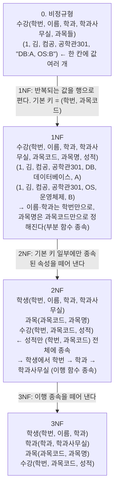

> 분해 조건, 정규화의 장단점, 반정규화 판단 기준은 jbee의 「[Interview Question for Beginner](https://github.com/jbee37142/Interview_Question_for_Beginner)」 데이터베이스 문서를 바탕으로 보강했다.
> 정규형 단계별 테이블 변화 예시는 「[fru1tworld/cs-basic 모의 면접 질문 목록](https://github.com/fru1tworld/cs-basic/blob/main/interview/cs/db.md)」의 질문을 실마리로 보강했다.

정규화는 테이블의 중복을 줄여 데이터를 넣고 고치고 지울 때 생기는 **이상 현상(anomaly)** 을 없애는 과정이다. 반대로 조회 성능을 위해 정규화를 의도적으로 되돌리는 것이 반정규화다. 둘은 "정합성 vs 성능"의 트레이드오프다.

## 이상 현상

중복이 많은 테이블에서 생기는 세 가지 문제.

| 이상 | 예시 (학생-학과 정보가 한 테이블에 있을 때) |
| --- | --- |
| 삽입 이상 | 학생이 없으면 새 학과 정보를 넣을 수 없음 |
| 갱신 이상 | 학과 사무실이 바뀌면 그 학과 학생 행을 모두 고쳐야 하고, 일부만 고치면 불일치 |
| 삭제 이상 | 마지막 학생을 지우면 학과 정보까지 사라짐 |

## 함수 종속

`X → Y`: X 값이 정해지면 Y 값이 하나로 결정된다(X가 결정자).

- **부분 함수 종속**: 기본키의 **일부**만으로 다른 속성이 결정됨 (복합키일 때)
- **완전 함수 종속**: 기본키 **전체**가 있어야 결정됨
- **이행 함수 종속**: `X → Y`, `Y → Z`이므로 `X → Z`

## 정규형 단계

| 정규형 | 조건 (이전 단계 만족 + ) | 외우는 키워드 |
| --- | --- | --- |
| 1NF | 모든 속성 값이 **원자값** | 도메인 원자값 |
| 2NF | **부분 함수 종속 제거** → 완전 함수 종속 | 부분 |
| 3NF | **이행 함수 종속 제거** | 이행 |
| BCNF | 모든 **결정자가 후보키** | 결정자 |
| 4NF | **다치(다중 값) 종속 제거** | 다치 |
| 5NF | **조인 종속 제거** (후보키를 통한 조인 종속만 남김) | 조인 |

외우는 법: "**도부이결다조**".

- 각 정규형은 앞 단계보다 엄격하다. 실무 설계의 목표는 보통 **3NF 또는 BCNF**다.

### 단계별로 테이블이 바뀌는 모습

수강 정보를 한 테이블에 담은 상태에서 출발한다.

- 2NF가 없애는 것: 과목명을 바꾸려면 그 과목을 들은 모든 수강 행을 고쳐야 하던 갱신 이상.
- 3NF가 없애는 것: 학생이 한 명도 없는 학과의 사무실을 기록할 수 없던 삽입 이상, 마지막 학생을 지우면 사무실 정보도 사라지던 삭제 이상.
- **BCNF**는 후보키가 여럿이고 서로 겹칠 때 3NF로도 남는 이상을 없앤다. `특강(학생, 과목, 교수)`에서 `(학생, 과목) → 교수`이고 교수는 한 과목만 맡아 `교수 → 과목`이면, 결정자 `교수`가 후보키가 아니다. 그래서 `담당(교수, 과목)`과 `특강(학생, 교수)`로 나눈다. 이 분해는 `(학생, 과목) → 교수`를 한 테이블에서 검사할 수 없게 만들어 종속성 보존을 포기한다.

### 좋은 분해의 조건

릴레이션을 쪼갤 때는 두 가지를 지켜야 한다.

| 조건 | 뜻 |
| --- | --- |
| 무손실 조인(lossless join) | 쪼갠 테이블을 다시 조인하면 원래 테이블이 정확히 나온다. 가짜 행이 생기지 않는다 |
| 종속성 보존(dependency preservation) | 원래의 함수 종속을 쪼갠 테이블 각각에서 검사할 수 있다 |

3NF까지는 두 조건을 모두 지키는 분해가 항상 있지만, BCNF는 종속성 보존을 포기해야 할 때가 있다.

## 정규화의 장단점

| 장점 | 단점 |
| --- | --- |
| 이상 현상이 사라진다 | 테이블이 늘어 **조인이 많아지고** 조회가 느려질 수 있다 |
| 새 데이터 종류가 생겨도 구조 변경이 작다 | 쿼리가 복잡해진다 |
| 같은 사실이 한 곳에만 있어 저장 공간과 쓰기 비용이 준다 | - |

## 반정규화 (Denormalization)

정규화된 모델을 성능 향상, 개발·운영 편의를 위해 **의도적으로 통합·중복·분리**하는 것. 조회는 빨라지지만 데이터 일관성과 무결성이 떨어질 수 있고, 중복된 값을 함께 고쳐야 하므로 입력·수정·삭제는 오히려 느려진다. 꼭 필요한 곳에만 적용한다.

반정규화를 검토하는 경우:

- 자주 쓰는 조회가 늘 같은 범위만 읽고, 그 조회에 접근하는 요청이 가장 많다
- 대량 데이터의 넓은 범위를 자주 집계해 성능 문제가 난다
- 테이블 사이 경로가 멀어 조인이 지나치게 많다

먼저 인덱스, 쿼리 개선, 캐시, 구체화된 뷰(materialized view)로 풀리는지 본 뒤에 반정규화한다.

| 기법 | 설명 |
| --- | --- |
| 테이블 통합 | 자주 함께 조인되는 테이블을 하나로 합침 |
| 테이블 분할 | 수평 분할(행 기준), 수직 분할(자주 쓰는 컬럼만 따로) |
| 중복 테이블 추가 | 집계 테이블, 이력 테이블 등을 별도로 둠 |
| 중복 속성 추가 | 조인을 피하려고 다른 테이블의 컬럼을 복사해 둠 |
