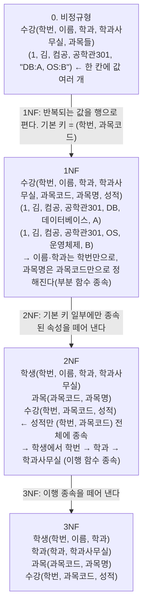

> 분해 조건, 정규화의 장단점, 반정규화 판단 기준은 jbee의 「[Interview Question for Beginner](https://github.com/jbee37142/Interview_Question_for_Beginner)」 데이터베이스 문서를 바탕으로 보강했다.
> 정규형 단계별 테이블 변화 예시는 「[fru1tworld/cs-basic 모의 면접 질문 목록](https://github.com/fru1tworld/cs-basic/blob/main/interview/cs/db.md)」의 질문을 실마리로 보강했다.
> 함수 종속이 데이터의 의미에서 나온다는 점과 다중값 속성을 1NF로 펴는 세 가지 방법은 고려사이버대학교 「데이터베이스시스템」(2024-1학기), 수직 분할을 검토하는 조건은 「데이터베이스 설계구축」(2023-2학기) 강의 내용으로 보강했다.
> 자명한 종속, 암스트롱 공리와 속성 폐포, 주요 속성으로 쓴 정규형의 정의, 4NF·5NF 예시, 무손실 분해 판정은 GitHub 자료 모음 「[Subjective-studies_OS-CN-DBMS](https://github.com/avgspacelover/Subjective-studies_OS-CN-DBMS)」의 DBMS 면접 정리를 바탕으로 보강했다.

정규화는 테이블의 중복을 줄여 데이터를 넣고 고치고 지울 때 생기는 **이상 현상(anomaly)** 을 없애는 과정이다. 반대로 조회 성능을 위해 정규화를 의도적으로 되돌리는 것이 반정규화다. 둘은 "정합성 vs 성능"의 트레이드오프다.

정규화의 기본 원칙은 **서로 독립적인 사실은 별개의 릴레이션에 담는다**는 것이다. 이상 현상은 여러 종속 관계를 한 릴레이션에 섞어 둔 데서 생기므로, 종속 관계를 분석해 릴레이션을 프로젝션으로 쪼갠다(분해, decomposition). 쪼갠 뒤에도 같은 정보를 잃지 않아야 하고(무손실), 중복은 줄어야 한다.

## 이상 현상

중복이 많은 테이블에서 생기는 세 가지 문제.

| 이상 | 예시 (학생-학과 정보가 한 테이블에 있을 때) |
| --- | --- |
| 삽입 이상 | 학생이 없으면 새 학과 정보를 넣을 수 없음 |
| 갱신 이상 | 학과 사무실이 바뀌면 그 학과 학생 행을 모두 고쳐야 하고, 일부만 고치면 불일치 |
| 삭제 이상 | 마지막 학생을 지우면 학과 정보까지 사라짐 |

## 함수 종속

`X → Y`: X 값이 정해지면 Y 값이 하나로 결정된다(X가 결정자).

- **부분 함수 종속**: 기본키의 **일부**만으로 다른 속성이 결정됨 (복합키일 때)
- **완전 함수 종속**: 기본키 **전체**가 있어야 결정됨
- **이행 함수 종속**: `X → Y`, `Y → Z`이므로 `X → Z`

- **자명한(trivial) 종속**: Y가 X의 부분집합이다(`{학번, 이름} → 이름`). 늘 성립하므로 정보가 없다. Y가 X에 없는 속성을 하나라도 포함하면 **비자명한(non-trivial)** 종속이고, 정규형은 비자명한 종속만 따진다.

함수 종속은 **데이터의 의미(업무 규칙)에서 정해지는 제약**이다. 지금 들어 있는 행을 보고 추론하는 것이 아니다. 현재 데이터에서 우연히 이름이 겹치지 않아도 동명이인이 생길 수 있으면 `이름 → 학과`는 함수 종속이 아니다. 반대로 `학번 → 학년`이 규칙인데 한 학생의 학년이 두 값으로 저장돼 있다면, 그 데이터가 잘못된 것이다.

### 암스트롱 공리와 속성 폐포

주어진 종속 집합 F에서 논리적으로 따라 나오는 모든 종속의 집합을 F의 폐포 F⁺라 한다. F⁺는 **암스트롱 공리(Armstrong's axioms)** 를 되풀이 적용해 얻는다.

| 규칙 | 내용 |
| --- | --- |
| 반사(reflexivity) | Y ⊆ X이면 X → Y (자명한 종속) |
| 첨가(augmentation) | X → Y이면 XZ → YZ |
| 이행(transitivity) | X → Y이고 Y → Z이면 X → Z |
| 합집합(union, 유도 규칙) | X → Y이고 X → Z이면 X → YZ |
| 분해(decomposition, 유도 규칙) | X → YZ이면 X → Y, X → Z |
| 의사 이행(pseudo-transitivity, 유도 규칙) | X → Y이고 WY → Z이면 WX → Z |

실제로 쓰는 것은 **속성 폐포** X⁺, 곧 X로 결정되는 모든 속성의 집합이다. X에서 출발해 「왼쪽이 이미 모은 속성에 다 들어 있는 종속」의 오른쪽을 더하기를 더 늘지 않을 때까지 반복한다. X⁺가 릴레이션의 모든 속성이면 X는 **슈퍼키**이고, 그중 속성을 하나라도 빼면 슈퍼키가 아니게 되는 최소 집합이 **후보키**다. 후보키에 속한 속성을 **주요 속성(prime attribute)**, 나머지를 비주요 속성이라 한다. 키의 종류는 [[sql-basics#제약 조건|SQL 기초]]에 있다.

```text
R(학번, 과목코드, 이름, 학과, 학과사무실, 성적)
F = { 학번 → 이름, 학번 → 학과, 학과 → 학과사무실, (학번, 과목코드) → 성적 }

{학번}⁺        = {학번, 이름, 학과, 학과사무실}           ← 과목코드·성적이 없어 키가 아니다
{학번, 과목코드}⁺ = {학번, 과목코드, 이름, 학과, 학과사무실, 성적} ← 전부. 후보키
```

아래 「단계별로 테이블이 바뀌는 모습」이 바로 이 릴레이션을 쪼개는 과정이다.

## 정규형 단계

| 정규형 | 조건 (이전 단계 만족 + ) | 외우는 키워드 |
| --- | --- | --- |
| 1NF | 모든 속성 값이 **원자값** | 도메인 원자값 |
| 2NF | **부분 함수 종속 제거** → 완전 함수 종속 | 부분 |
| 3NF | **이행 함수 종속 제거** | 이행 |
| BCNF | 모든 **결정자가 후보키** | 결정자 |
| 4NF | **다치(다중 값) 종속 제거** | 다치 |
| 5NF | **조인 종속 제거** (후보키를 통한 조인 종속만 남김) | 조인 |

외우는 법: "**도부이결다조**".

- 각 정규형은 앞 단계보다 엄격하다. 실무 설계의 목표는 보통 **3NF 또는 BCNF**다.

키워드만으로는 2NF~BCNF의 경계가 흐리다. 주요 속성을 써서 정확히 쓰면 다음과 같다(X → Y는 비자명한 종속).

| 정규형 | 금지하는 종속 |
| --- | --- |
| 2NF | 후보키의 **진부분집합** → 비주요 속성 (부분 종속) |
| 3NF | 모든 X → Y에서 **X가 슈퍼키이거나, Y가 주요 속성**이어야 한다. 곧 슈퍼키가 아닌 것 → 비주요 속성(이행 종속)을 금지한다 |
| BCNF | 모든 X → Y에서 **X가 슈퍼키**여야 한다. 3NF의 「Y가 주요 속성이면 봐준다」는 예외가 없다 |

### 단계별로 테이블이 바뀌는 모습

수강 정보를 한 테이블에 담은 상태에서 출발한다.



- 2NF가 없애는 것: 과목명을 바꾸려면 그 과목을 들은 모든 수강 행을 고쳐야 하던 갱신 이상.
- 3NF가 없애는 것: 학생이 한 명도 없는 학과의 사무실을 기록할 수 없던 삽입 이상, 마지막 학생을 지우면 사무실 정보도 사라지던 삭제 이상.
- **BCNF**는 후보키가 여럿이고 서로 겹칠 때 3NF로도 남는 이상을 없앤다. `특강(학생, 과목, 교수)`에서 `(학생, 과목) → 교수`이고 교수는 한 과목만 맡아 `교수 → 과목`이면, 결정자 `교수`가 후보키가 아니다. 그래서 `담당(교수, 과목)`과 `특강(학생, 교수)`로 나눈다. 이 분해는 `(학생, 과목) → 교수`를 한 테이블에서 검사할 수 없게 만들어 종속성 보존을 포기한다.

- **4NF**는 **다치 종속(multivalued dependency)** `X ↠ Y`를 다룬다. X 값 하나에 Y 값의 집합이 대응하고, 그 집합이 다른 속성과 서로 독립이라는 뜻이다. `강좌(과목, 교수, 교재)`에서 한 과목을 여러 교수가 가르치고 교재도 여럿인데 교수와 교재가 무관하면, 교수 2명 × 교재 3권 = 6행을 모든 조합으로 넣어야 한다. 교재 하나를 더하면 교수 수만큼 행이 는다. 키가 세 속성 전체라 BCNF는 만족하지만 `과목 ↠ 교수`, `과목 ↠ 교재` 때문에 중복이 남는다. `과목교수(과목, 교수)`와 `과목교재(과목, 교재)`로 나누면 사라진다.
- **5NF**는 두 개로는 무손실 분해가 안 되고 **셋 이상으로 나눠야만** 무손실인 경우(조인 종속)를 다룬다. `공급(공급자, 부품, 프로젝트)`에 「공급자가 그 부품을 다루고, 그 프로젝트가 그 부품을 쓰고, 공급자가 그 프로젝트에 납품하면 반드시 그 조합으로 공급한다」는 규칙이 있으면, 세 이항 릴레이션(공급자-부품, 부품-프로젝트, 공급자-프로젝트)으로 나눠야 중복이 사라지고 셋을 조인하면 원래대로 돌아온다. 이런 규칙은 드물어 실무에서 5NF를 따로 검토하는 일은 거의 없다.

### 다중값 속성을 1NF로 펴는 방법

`부서(부서번호, 부서명, 위치)`에 위치가 `{서울, 부산, 대구}`처럼 여러 값이면 1NF가 아니다. 펴는 방법은 세 가지다.

| 방법 | 결과 | 문제 |
| --- | --- | --- |
| 행으로 편다. 기본 키를 `(부서번호, 위치)`로 넓힌다 | 위치 수만큼 행이 생긴다 | 부서명이 위치 수만큼 중복돼 2NF 위반(부분 종속)이 남는다 |
| 열로 편다. `위치1, 위치2, 위치3` | 행 수는 그대로다 | 최대 개수를 미리 정해야 하고 빈칸(NULL)이 많다. 「서울에 있는 부서」를 찾으려면 열 세 개를 다 봐야 한다 |
| **별도 릴레이션으로 뗀다.** `부서(부서번호, 부서명)` + `부서위치(부서번호, 위치)` | 다중값 속성이 독립된 테이블이 된다 | 조인이 하나 는다. 보통 이 방법을 쓴다 |

ER 모델의 다중값 속성을 테이블로 옮길 때도 같은 이유로 세 번째 방법을 쓴다([[sql-and-relational-algebra#논리적 설계: ERD를 테이블로|ERD를 테이블로]]).

### 좋은 분해의 조건

릴레이션을 쪼갤 때는 두 가지를 지켜야 한다.

| 조건 | 뜻 |
| --- | --- |
| 무손실 조인(lossless join) | 쪼갠 테이블을 다시 조인하면 원래 테이블이 정확히 나온다. 가짜 행이 생기지 않는다 |
| 종속성 보존(dependency preservation) | 원래의 함수 종속을 쪼갠 테이블 각각에서 검사할 수 있다 |

**무손실인지 판정하기.** R을 R1, R2 둘로 나눌 때 **공통 속성 R1 ∩ R2가 R1이나 R2의 슈퍼키**이면(`R1 ∩ R2 → R1` 또는 `R1 ∩ R2 → R2`가 F⁺에 있으면) 무손실이다. 공통 속성이 한쪽을 유일하게 정하니 조인할 때 짝이 하나로만 맞는다.

손실 분해의 결과는 행이 사라지는 것이 아니라 **늘어나는 것**이다. `학생(학번, 이름, 학과)`을 `(학번, 학과)`와 `(이름, 학과)`로 나누면 공통 속성 `학과`가 어느 쪽의 키도 아니다. 같은 학과 학생이 둘이면 다시 조인할 때 학번과 이름이 엇갈린 가짜 행(spurious tuple)이 생기고(R1 ⋈ R2 ⊋ R), 어느 조합이 진짜였는지 알 수 없게 된다. 정보가 손실된 것이다.

**종속성 보존 판정.** 각 조각에서 성립하는 종속 F1, F2를 모아 폐포를 냈을 때 원래의 F⁺와 같으면(`(F1 ∪ F2)⁺ = F⁺`) 보존된다. 보존되지 않으면 그 종속을 검사하려고 매번 조인해야 한다.

3NF까지는 두 조건을 모두 지키는 분해가 항상 있지만, BCNF는 종속성 보존을 포기해야 할 때가 있다.

## 정규화의 장단점

| 장점 | 단점 |
| --- | --- |
| 이상 현상이 사라진다 | 테이블이 늘어 **조인이 많아지고** 조회가 느려질 수 있다 |
| 새 데이터 종류가 생겨도 구조 변경이 작다 | 쿼리가 복잡해진다 |
| 같은 사실이 한 곳에만 있어 저장 공간과 쓰기 비용이 준다 | - |

## 반정규화 (Denormalization)

정규화된 모델을 성능 향상, 개발·운영 편의를 위해 **의도적으로 통합·중복·분리**하는 것. 조회는 빨라지지만 데이터 일관성과 무결성이 떨어질 수 있고, 중복된 값을 함께 고쳐야 하므로 입력·수정·삭제는 오히려 느려진다. 꼭 필요한 곳에만 적용한다.

반정규화를 검토하는 경우:

- 자주 쓰는 조회가 늘 같은 범위만 읽고, 그 조회에 접근하는 요청이 가장 많다
- 대량 데이터의 넓은 범위를 자주 집계해 성능 문제가 난다
- 테이블 사이 경로가 멀어 조인이 지나치게 많다

먼저 인덱스, 쿼리 개선, 캐시, 구체화된 뷰(materialized view)로 풀리는지 본 뒤에 반정규화한다.

| 기법 | 설명 |
| --- | --- |
| 테이블 통합 | 자주 함께 조인되는 테이블을 하나로 합침 |
| 테이블 분할 | 수평 분할(행 기준), 수직 분할(자주 쓰는 컬럼만 따로). 수직 분할은 한 행의 컬럼 길이 합이 블록(페이지) 크기를 넘거나, 컬럼마다 사용 빈도 차이가 크거나, 사용자 그룹별로 쓰는 컬럼이 갈릴 때 검토한다. 나눈 테이블을 한 트랜잭션에서 함께 고치거나 늘 조인해야 한다면 나누지 않는다 |
| 중복 테이블 추가 | 집계 테이블, 이력 테이블 등을 별도로 둠 |
| 중복 속성 추가 | 조인을 피하려고 다른 테이블의 컬럼을 복사해 둠 |

관련 노트: [[sql-and-relational-algebra|관계대수·관계해석과 DB 설계]], [[sql-basics|SQL 기초]], [[database-scaling|데이터베이스 확장과 성능 최적화]]
