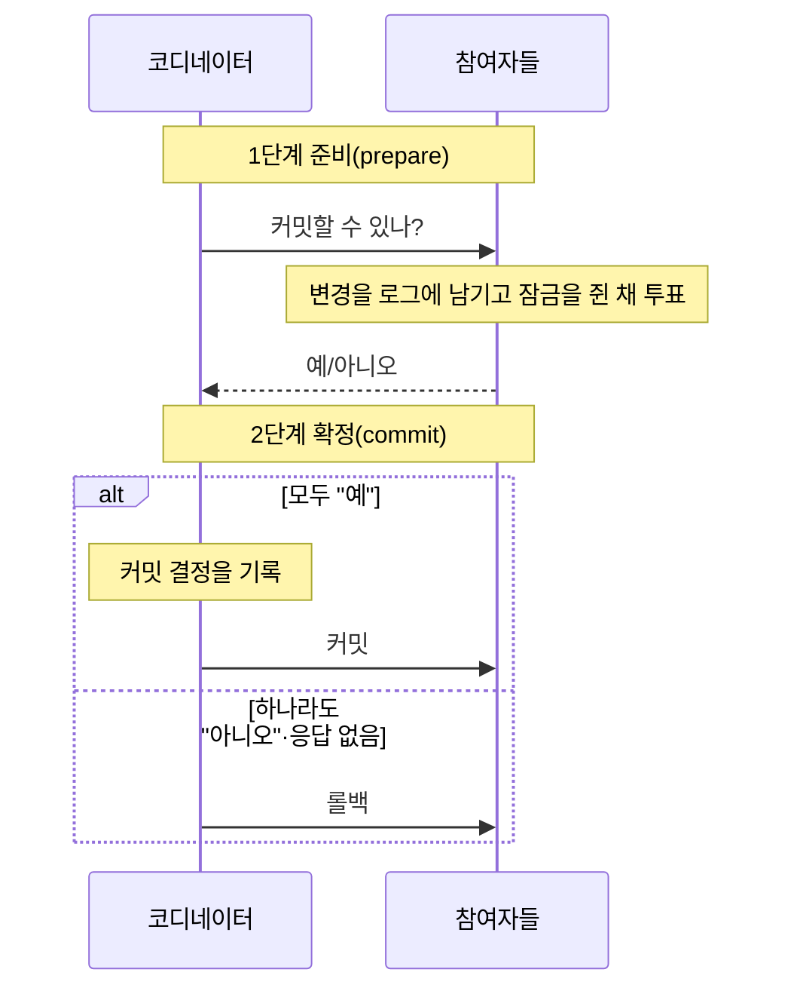

> 노션 정리를 바탕으로, MVCC·잠금의 종류·비관적/낙관적 잠금은 ByteByteGo의 System Design 101 가이드 「[What does ACID mean?](https://bytebytego.com/guides/what-does-acid-mean)」, 「[What are Database Isolation Levels?](https://bytebytego.com/guides/what-are-database-isolation-levels)」, 「[What are the Differences Among Database Locks?](https://bytebytego.com/guides/what-are-the-differences-among-database-locks)」, 「[Pessimistic vs Optimistic Locking](https://bytebytego.com/guides/pessimistic-vs-optimistic-locking)」로, 버퍼 정책·로그·재시작 복구는 「[DBMS는 어떻게 트랜잭션을 관리할까?](https://d2.naver.com/helloworld/407507)」로 보강했다.
> 트랜잭션의 상태와 DB 교착 상태는 jbee의 「[Interview Question for Beginner](https://github.com/jbee37142/Interview_Question_for_Beginner)」 데이터베이스 문서를 바탕으로 보강했다.
> 스냅숏 격리와 쓰기 스큐, SSI, InnoDB와 PostgreSQL의 MVCC 비교, VACUUM, 분산 트랜잭션, 비정상 종료 시 잠금 해제는 「[fru1tworld/cs-basic 모의 면접 질문 목록](https://github.com/fru1tworld/cs-basic/blob/main/interview/cs/db.md)」의 질문을 실마리로 PostgreSQL·MySQL 공식 문서로 확인해 보강했다.

트랜잭션은 데이터베이스에서 **하나의 논리적 작업 단위**다. 계좌 이체처럼 "출금"과 "입금"이 둘 다 되거나 둘 다 안 되어야 하는 작업을 묶는다. 트랜잭션이 지켜야 할 네 가지 성질(ACID)과, DBMS가 각 성질을 보장하는 수단을 짝지어 기억하면 이해가 쉽다.

## ACID

| 특성 | 의미 | 보장 수단 |
| --- | --- | --- |
| 원자성 (Atomicity) | 모두 반영되거나 전혀 반영되지 않음 (All or Nothing) | Commit / Rollback, 회복 |
| 일관성 (Consistency) | 트랜잭션 전후로 DB가 일관된 상태(제약 조건 만족) | 무결성 제약, 병행 제어 |
| 격리성 (Isolation) | 실행 중인 트랜잭션에 다른 트랜잭션이 끼어들 수 없음 | 고립화 수준, 로킹 |
| 지속성 (Durability) | 커밋된 결과는 장애가 나도 영구히 유지 | 로그, 회복 기법 |

예: 송금 도중 장애가 나서 출금만 되고 입금이 안 되면 원자성이 깨진 것이다. 이때 Rollback으로 출금도 취소해야 한다.

- **ACID의 일관성과 CAP의 일관성은 다른 말이다.** ACID의 C는 「트랜잭션이 끝나도 제약 조건·불변식(잔액은 음수가 아니다 등)이 지켜진다」는 뜻이고, [[database-models|CAP 정리]]의 C는 「어느 노드에서 읽어도 가장 최근에 쓴 값을 본다」는 뜻이다.
- **격리성의 이상형은 직렬성(serializability)** 이다. 모든 트랜잭션이 혼자 도는 것처럼 보이게 한다. 비용이 커서 실제로는 더 느슨한 고립화 수준을 기본값으로 쓴다.
- **분산 환경의 지속성**은 디스크 기록만으로 부족하다. 커밋한 데이터를 다른 노드에도 복제해야 한 서버가 통째로 사라져도 남는다.

## 트랜잭션 제어어 (TCL)

| 명령 | 의미 |
| --- | --- |
| `COMMIT` | 트랜잭션 결과를 DB에 영구 반영 |
| `ROLLBACK` | 트랜잭션 실행 이전 상태로 되돌림 |
| `SAVEPOINT` | 롤백할 중간 지점 지정 (`ROLLBACK TO 이름`) |

## 트랜잭션의 상태

```text
            ┌──────────────── 오류 ───────────────┐
            │                                     ▼
 시작 ──▶ 활동(Active) ──마지막 연산 끝──▶ 부분 완료 ──기록 성공──▶ 완료(Committed)
            │                     (Partially Committed)
            └──오류──▶ 실패(Failed) ◀──── 커밋 중 오류 ┘
                          │
                          ▼ ROLLBACK
                       철회(Aborted) ──▶ 재시작 또는 종료
```

| 상태 | 뜻 |
| --- | --- |
| 활동(Active) | 연산을 실행하는 중 |
| 부분 완료(Partially Committed) | 마지막 연산까지 실행했고 **커밋 처리만 남은** 상태. 변경은 아직 버퍼에만 있을 수 있다 |
| 완료(Committed) | 커밋 기록(로그)이 디스크에 남아 결과가 확정된 상태 |
| 실패(Failed) | 오류로 더 진행할 수 없음을 알게 된 상태 |
| 철회(Aborted) | 롤백으로 시작 전 상태로 되돌린 상태. 다시 시작하거나 버린다 |

부분 완료와 완료의 차이는 **지속성이 보장됐는가**다. 부분 완료 상태에서 장애가 나면 커밋 로그를 쓰지 못한 것이므로 실패로 가서 철회된다.

잠금과 트랜잭션은 목적이 다르다. **잠금은 동시에 같은 자원을 고치지 못하게 하는 동시성 제어 수단**이고, **트랜잭션은 작업 묶음이 전부 반영되거나 전혀 반영되지 않게 하는 정합성 단위**다. 쿼리가 하나뿐인 작업도 트랜잭션이다.

## 언제 트랜잭션으로 묶나

대부분의 DBMS는 **자동 커밋(autocommit)** 이 기본이라, 명시적으로 묶지 않은 문장 하나하나가 각자 트랜잭션으로 실행되고 바로 커밋된다. 그래서 「트랜잭션을 건다」는 말은 **여러 문장을 한 단위로 묶는다**는 뜻이다.

| 상황 | 묶는 이유 |
| --- | --- |
| 계좌 이체, 주문 생성 + 재고 차감 + 결제 기록 | 여러 쓰기가 전부 되거나 전부 안 되어야 한다(원자성) |
| 읽은 값을 보고 쓰는 작업(잔액 확인 후 차감) | 읽기와 쓰기 사이에 다른 트랜잭션이 끼어들지 못하게 잠금·격리 수준을 함께 쓴다 |
| 여러 테이블을 읽어 한 시점의 보고서를 만든다 | 문장마다 다른 시점을 보면 합계가 맞지 않는다. 한 트랜잭션의 스냅숏으로 읽는다 |

**읽기만 하는 작업에도 트랜잭션이 필요할 수 있다.** `SELECT` 한 문장은 그 자체로 한 시점의 일관된 결과를 보므로 따로 묶지 않아도 된다. 하지만 서로 맞아야 하는 `SELECT`를 여러 번 하면, 그 사이 커밋된 변경 때문에 결과끼리 어긋난다. 이때는 Repeatable Read 이상의 트랜잭션으로 묶어 같은 스냅숏을 읽는다.

- **읽기 전용 트랜잭션**(`START TRANSACTION READ ONLY`, `SET TRANSACTION READ ONLY`)은 쓰기를 막고, DB가 최적화할 여지를 준다. InnoDB는 읽기 전용 트랜잭션에 트랜잭션 ID를 할당하지 않는다. Spring의 `@Transactional(readOnly = true)`는 JPA의 변경 감지·flush를 건너뛰고, 설정에 따라 읽기 복제본으로 보내는 기준이 된다.
- **긴 읽기 트랜잭션은 비싸다.** 오래된 스냅숏을 쥐고 있는 동안 옛 버전을 지울 수 없어, InnoDB는 undo 로그가, PostgreSQL은 죽은 튜플이 쌓인다(아래 「MVCC 구현 비교」).

## 병행 제어 (Concurrency Control)

여러 트랜잭션이 동시에 실행될 때 결과가 순차 실행한 것과 같도록 보장한다.

- **로킹(Locking)**: 접근할 데이터에 잠금을 걸어 연산이 끝날 때까지 다른 트랜잭션의 접근을 막는다(상호 배제). 잠금 단위가 크면 관리가 쉽지만 병행성이 떨어지고, 작으면 그 반대다.
- **낙관적 검증**: 일단 실행하고 커밋 직전에 충돌 여부를 검사한다.
- **타임스탬프 순서**: 트랜잭션 시작 시각 순서대로 실행 순서를 정한다.
- **다중 버전 동시성 제어(MVCC)**: 데이터의 여러 버전을 두어 읽기와 쓰기가 서로 막지 않게 한다.

## 고립화 수준 (Isolation Level)

격리를 얼마나 엄격하게 할지 고르는 설정이다. 아래로 갈수록 엄격하고 성능 비용이 크다.

| 수준 | Dirty Read | Non-repeatable Read | Phantom Read |
| --- | --- | --- | --- |
| Read Uncommitted | 발생 | 발생 | 발생 |
| Read Committed | 방지 | 발생 | 발생 |
| Repeatable Read | 방지 | 방지 | 발생 |
| Serializable | 방지 | 방지 | 방지 |

위 표는 SQL 표준의 정의다. 표준은 「이 수준에서 막아야 할 현상」만 정하고 구현 방법은 정하지 않는다. 그래서 **모든 DBMS가 네 수준을 그대로 구현하지는 않는다.** 잠금 기반이 아니라 MVCC로 만든 DB는 더러운 읽기를 허용할 이유가 없고(옛 버전을 읽으면 되므로), 표준보다 강한 수준으로 올려 처리한다.

| DBMS | 지원 수준과 실제 동작 | 기본값 |
| --- | --- | --- |
| MySQL InnoDB | 네 수준 모두. Repeatable Read는 일반 읽기를 스냅숏으로 하고, 잠금 읽기·쓰기에는 넥스트 키 잠금을 걸어 팬텀을 대부분 막는다. Serializable은 자동 커밋이 아닐 때 일반 `SELECT`를 `SELECT ... FOR SHARE`로 바꾼다 | Repeatable Read |
| PostgreSQL | 네 수준을 받지만 Read Uncommitted는 Read Committed로 동작한다. Repeatable Read는 스냅숏 격리라 팬텀도 막는다. Serializable은 SSI | Read Committed |
| Oracle | Read Committed와 Serializable 두 가지(와 Read Only)만 있다. Oracle의 Serializable은 실제로는 스냅숏 격리라 쓰기 스큐가 생긴다 | Read Committed |
| SQL Server | 네 수준 + `SNAPSHOT`. `READ_COMMITTED_SNAPSHOT` 옵션을 켜면 Read Committed도 잠금 대신 버전으로 읽는다 | Read Committed |

### MVCC가 스냅숏으로 읽는 방식

MVCC는 행을 덮어쓰지 않고 **새 버전을 만들고 옛 버전을 남겨**, 읽는 트랜잭션이 자기에게 보여야 할 버전을 고르게 한다. MySQL InnoDB를 예로 들면 다음과 같다.

- 각 행에는 숨은 컬럼이 있다. 마지막으로 고친 트랜잭션 ID(`DB_TRX_ID`)와, undo 로그의 이전 버전을 가리키는 롤 포인터(`DB_ROLL_PTR`)다. 버전들이 포인터로 이어진 체인이 된다.
- 읽는 트랜잭션은 **읽기 뷰(read view)** 를 만든다. 「이 시점에 커밋되지 않았던 트랜잭션 ID 목록」이다. 행의 트랜잭션 ID가 그 목록에 있거나 더 나중이면 보이지 않으므로, 롤 포인터를 따라 보이는 버전까지 거슬러 올라간다.

```text
balance 행의 버전 체인
  [trx 201, balance=200] ──roll_ptr──▶ [trx 200, balance=100] (커밋됨)
     ▲ 트랜잭션 A가 수정 중(미커밋)

트랜잭션 B의 읽기 뷰: 201은 미커밋 → 건너뛰고 trx 200 버전을 읽는다 → 100
A가 커밋한 뒤에도 B(Repeatable Read)는 처음 만든 읽기 뷰를 계속 써서 100을 본다
```

| 수준 | 읽기 뷰를 만드는 때 | 결과 |
| --- | --- | --- |
| Read Committed | **문장마다** 새로 만든다 | 같은 트랜잭션 안에서도 다른 트랜잭션이 커밋한 새 값이 보인다 |
| Repeatable Read | 트랜잭션의 **첫 읽기 때 한 번** 만든다 | 트랜잭션 내내 같은 스냅숏을 본다 |

MVCC는 **읽기**의 충돌을 없앨 뿐이고, 같은 행을 동시에 **쓰는** 충돌은 여전히 잠금으로 막는다.

### InnoDB의 undo와 redo

InnoDB는 변경 하나에 두 종류의 로그를 남긴다. 이름이 비슷하지만 목적이 반대다.

| 구분 | redo 로그 | undo 로그 |
| --- | --- | --- |
| 담는 것 | 페이지를 **어떻게 바꿨나**(변경 후 정보, 물리적) | 바꾸기 **전 값**(되돌리는 데 필요한 정보, 논리적) |
| 목적 | 지속성: 커밋됐지만 데이터 파일에 아직 안 쓰인 변경을 재시작 때 다시 적용 | 원자성: 롤백. 그리고 MVCC: 다른 트랜잭션에 옛 버전을 보여 준다 |
| 위치 | 고정 크기의 순환 파일. 8.0.30부터 `innodb_redo_log_capacity`로 크기를 정하고 `#innodb_redo` 디렉터리에 둔다 | undo 테이블스페이스(기본 2개) 안의 롤백 세그먼트 |
| 지우는 때 | 체크포인트로 해당 페이지가 디스크에 내려가면 그 구간을 재사용한다 | 커밋 뒤에도 그 버전을 볼 읽기 뷰가 남아 있으면 유지한다. 아무도 안 보게 되면 **퍼지(purge) 스레드**가 지운다 |

삭제도 바로 지우지 않고 「지움 표시」만 한 뒤 퍼지가 정리한다. 오래 열린 트랜잭션이 있으면 퍼지가 멈춰 undo가 쌓이고(`SHOW ENGINE INNODB STATUS`의 History list length가 늘어난다), 버전 체인이 길어져 읽기도 느려진다.

### MVCC 구현 비교: InnoDB와 PostgreSQL

| 항목 | MySQL InnoDB | PostgreSQL |
| --- | --- | --- |
| 옛 버전이 있는 곳 | undo 로그. 테이블에는 최신 버전만 있다 | **테이블(힙) 안**. UPDATE는 새 튜플을 추가하고 옛 튜플에 `xmax`를 적는다 |
| 버전 판단 | 행의 `DB_TRX_ID`와 읽기 뷰 | 튜플의 `xmin`(만든 트랜잭션)·`xmax`(지운 트랜잭션)와 스냅숏 |
| 옛 버전 정리 | 퍼지 스레드 | **VACUUM** |
| 인덱스 | 보조 인덱스는 기본 키를 가리켜 행이 바뀌어도 그대로인 경우가 많다 | 인덱스가 튜플 위치를 가리키므로 UPDATE마다 인덱스 항목도 새로 생길 수 있다. 인덱스 컬럼이 안 바뀌고 같은 페이지에 자리가 있으면 **HOT(Heap-Only Tuple)** 갱신으로 인덱스를 건드리지 않는다 |
| 롤백 | undo를 적용해 되돌린다 | 되돌릴 것이 없다. 중단된 트랜잭션의 튜플은 커밋 기록(`pg_xact`)상 중단으로 보여 그냥 안 보인다 |
| 약점 | 긴 트랜잭션이 undo를 키운다 | 갱신이 잦은 테이블이 죽은 튜플로 부푼다(bloat) |

### VACUUM과 autovacuum

PostgreSQL에서 UPDATE·DELETE가 남긴 옛 튜플은 어떤 스냅숏에서도 보이지 않게 되면 **죽은 튜플(dead tuple)** 이 된다. VACUUM이 하는 일은 넷이다.

| 일 | 이유 |
| --- | --- |
| 죽은 튜플 공간을 재사용 가능으로 표시 | 공간을 비워 테이블이 끝없이 커지지 않게 한다. 일반 VACUUM은 파일을 줄이지 않고 그 안을 재사용한다 |
| 가시성 맵(visibility map) 갱신 | 모든 튜플이 보이는 페이지를 표시해 인덱스 전용 스캔이 힙을 읽지 않게 한다 |
| 트랜잭션 ID 동결(freeze) | 트랜잭션 ID는 32비트라 한 바퀴 돌면 과거가 미래처럼 보인다(wraparound). 오래된 튜플을 「언제나 과거」로 표시해 막는다 |
| 통계 갱신(`VACUUM ANALYZE`) | 옵티마이저가 쓰는 통계를 새로 만든다 |

`VACUUM FULL`은 테이블을 새로 써서 파일 크기를 줄이지만 그동안 배타 잠금을 잡아 읽기·쓰기를 모두 막는다. 운영 중에는 pg_repack 같은 도구를 쓴다.

**autovacuum**은 이 일을 자동으로 한다. 런처 프로세스가 테이블을 살피다가 죽은 튜플 수가 `autovacuum_vacuum_threshold`(기본 50) + `autovacuum_vacuum_scale_factor`(기본 0.2) × 행 수를 넘으면 워커가 VACUUM을, 비슷한 기준으로 ANALYZE를 돌린다.

| 문제 상황 | 원인 | 대응 |
| --- | --- | --- |
| 큰 테이블이 부푼다 | 기준이 행 수의 20%라 1억 행 테이블은 2천만 개가 쌓여야 돈다 | 그 테이블만 `scale_factor`를 낮춘다(`ALTER TABLE ... SET (autovacuum_vacuum_scale_factor = 0.01)`) |
| VACUUM이 돌아도 줄지 않는다 | 오래 열린 트랜잭션, 쓰이지 않는 복제 슬롯, 남은 준비된 트랜잭션이 옛 스냅숏을 붙잡고 있다 | `pg_stat_activity`의 `xact_start`로 긴 트랜잭션을 찾고 `idle_in_transaction_session_timeout`을 건다 |
| 갑자기 I/O가 튄다 | VACUUM이 많은 페이지를 읽고 쓴다. 비용 제한(`autovacuum_vacuum_cost_limit`)이 낮으면 반대로 따라잡지 못한다 | 비용 한도와 워커 수를 부하에 맞춘다 |
| 강제 VACUUM이 끝나지 않는다 | wraparound가 가까우면 꺼 둔 테이블에도 공격적인 동결 VACUUM이 돈다. 끝까지 못 하면 DB가 새 트랜잭션 ID 발급을 거부한다 | 평소에 동결이 따라가도록 autovacuum을 끄지 않는다 |

### 스냅숏 격리와 쓰기 스큐

**스냅숏 격리(Snapshot Isolation, SI)** 는 트랜잭션이 시작한 시점의 커밋된 데이터만 보는 격리 방식이다. 읽기는 스냅숏에서 하므로 잠금을 걸지 않고, 쓰기 충돌은 **먼저 커밋한 쪽이 이긴다(first-committer-wins)**. 같은 행을 두 트랜잭션이 고치면 뒤에 커밋하려는 쪽이 실패한다. SQL 표준의 네 수준에는 없는 이름이고, PostgreSQL의 Repeatable Read가 이것이다.

| 비교 | Read Committed | 스냅숏 격리 |
| --- | --- | --- |
| 스냅숏을 잡는 때 | 문장마다 | 트랜잭션의 첫 읽기 때 한 번 |
| 같은 트랜잭션에서 다시 읽기 | 그사이 커밋된 값이 보인다(반복 불가능한 읽기) | 처음 본 값을 계속 본다 |
| 같은 행 동시 갱신 | 먼저 쓴 쪽의 커밋을 기다렸다가 최신 값에 다시 적용한다. 갱신 손실이 생길 수 있다 | 뒤에 커밋하는 쪽이 직렬화 오류로 실패한다(PostgreSQL) |
| 쓰기 스큐 | 생긴다 | **생긴다** |

InnoDB의 Repeatable Read는 순수한 스냅숏 격리와 다르다. 일반 `SELECT`는 스냅숏을 읽지만 `UPDATE`·`SELECT ... FOR UPDATE`는 **가장 최신 커밋 버전(current read)** 을 읽고 고친다. 그래서 충돌로 실패하지 않는 대신, 스냅숏으로 읽은 값을 보고 계산해 쓰면 갱신 손실이 날 수 있다.

**쓰기 스큐(write skew)** 는 두 트랜잭션이 **같은 조건을 읽고, 서로 다른 행을 고쳐서** 둘이 합쳐지면 조건이 깨지는 현상이다. 고친 행이 다르니 쓰기 충돌 검사에 걸리지 않는다.

```text
규칙: 당직 의사는 최소 1명 (현재 A, B 두 명이 당직)

T1(A): SELECT count(*) FROM oncall WHERE on_duty → 2   T2(B): SELECT count(*) ... → 2
T1: 2명이니 빠져도 된다 → UPDATE oncall SET on_duty=false WHERE doctor='A'
                                                     T2: UPDATE ... WHERE doctor='B'
T1 COMMIT, T2 COMMIT  → 당직 0명. 둘 다 각자의 스냅숏에서는 옳았다
```

막는 방법은 세 가지다. 판단 근거가 된 행을 `SELECT ... FOR UPDATE`로 잠그거나, 충돌을 표현하는 행(당직표 한 행 같은 잠금용 행)을 두어 실제 쓰기 충돌로 바꾸거나, Serializable 격리를 쓴다.

### SSI: 직렬화 가능한 스냅숏 격리

PostgreSQL의 Serializable(9.1부터)은 **SSI(Serializable Snapshot Isolation)** 다. 스냅숏 격리 위에 「트랜잭션 사이의 읽기-쓰기 의존」을 추적하는 장치를 더해, 직렬 실행으로는 나올 수 없는 결과가 될 위험이 보이면 한쪽을 중단시킨다.

| 항목 | 스냅숏 격리 | SSI |
| --- | --- | --- |
| 읽기 | 스냅숏, 잠금 없음 | 스냅숏 + 읽은 범위를 **SIREAD 잠금**(술어 잠금)으로 기록. 이 잠금은 아무도 막지 않고 의존 관계를 찾는 데만 쓴다 |
| 감지 | 같은 행을 쓴 충돌만 | 내가 읽은 것을 남이 고치는 읽기-쓰기 의존(rw-conflict)이 순환을 만들 수 있는 모양(연속된 두 rw 의존)이 보이면 중단 |
| 쓰기 스큐 | 생긴다 | 막는다. 한 트랜잭션이 `could not serialize access`(SQLSTATE `40001`)로 실패한다 |
| 비용 | 낮다 | 추적 비용과 오탐에 의한 중단이 있다. **애플리케이션이 재시도**해야 한다 |

잠금으로 Serializable을 만드는 방식(2PL)은 읽기도 다른 쓰기를 막지만, SSI는 아무것도 막지 않고 낙관적으로 진행하다 위험할 때만 중단한다. 읽기 전용 트랜잭션은 `READ ONLY DEFERRABLE`로 선언하면 중단될 일이 없는 스냅숏을 기다렸다가 받는다.

## 잠금의 종류와 단위

### 잠금 모드

| 잠금 | 허용 | 다른 트랜잭션 |
| --- | --- | --- |
| 공유 잠금(S lock) | 읽기 | 다른 S 잠금은 함께 걸 수 있다. X 잠금은 기다린다 |
| 배타 잠금(X lock) | 읽기·쓰기 | 어떤 잠금도 함께 걸 수 없다 |
| 갱신 잠금(U lock) | 「곧 고칠 것」이라는 예약. 읽는 동안 S처럼 동작하다 쓸 때 X로 바뀐다 | 두 트랜잭션이 S를 들고 서로 X로 올리려다 생기는 교착을 막는다(SQL Server) |
| 의도 잠금(intention lock) | 「아래 행 어딘가에 잠금을 걸었다」는 표시를 테이블에 남긴다 | 테이블 잠금을 걸려는 쪽이 모든 행을 뒤지지 않고 충돌을 판단한다 |
| 스키마 잠금 | 테이블 구조 변경(DDL) 중 보호 | 구조를 바꾸는 동안 쿼리가 기다린다 |
| 대량 갱신 잠금(BU lock) | 대량 삽입 중 테이블 단위 잠금 하나로 처리 | 잠금 수를 줄여 적재가 빨라진다(SQL Server) |
| 키 범위 잠금 | 인덱스의 범위(빈 틈 포함)를 잠근다 | 이미 읽은 범위에 새 행이 끼어드는 **팬텀 읽기**를 막는다. InnoDB의 갭 잠금·넥스트 키 잠금이 같은 역할이다 |

```text
호환성    S    X
   S     ○    ✕
   X     ✕    ✕
```

### 잠금 단위

| 단위 | 장점 | 단점 |
| --- | --- | --- |
| 행 | 다른 행은 동시에 쓸 수 있어 병행성이 높다 | 잠금 수가 많아 관리 비용이 크다 |
| 페이지 | 고정 크기 블록 단위. 중간 | 같은 페이지의 무관한 행까지 막는다 |
| 테이블 | 구현이 단순하고 비용이 작다 | 병행성이 크게 떨어진다 |

잠금이 너무 많아지면 DB가 행 잠금을 테이블 잠금으로 합치기도 한다(lock escalation).

### 비관적 잠금과 낙관적 잠금

| 항목 | 비관적 잠금(pessimistic) | 낙관적 잠금(optimistic) |
| --- | --- | --- |
| 가정 | 충돌이 자주 난다 | 충돌은 드물다 |
| 방법 | 고치기 전에 먼저 잠근다. 다른 트랜잭션은 잠금이 풀릴 때까지 기다린다 | 잠그지 않고 진행하고, 커밋할 때 그사이 누가 바꿨는지 검사한다. 바뀌었으면 실패시키고 다시 시도한다 |
| 구현 | `SELECT ... FOR UPDATE` | 버전 컬럼이나 수정 시각을 조건에 넣는다 |
| 장점 | 충돌이 많아도 정합성이 확실하다. 재시도가 없다 | 잠금 대기가 없어 처리량이 높다 |
| 단점 | 대기·교착 상태, 처리량 저하 | 충돌이 잦으면 재시도가 폭증한다 |
| 맞는 곳 | 재고 차감, 좌석 예약처럼 같은 행에 경쟁이 몰릴 때 | 게시글 수정, 설정 변경처럼 충돌이 드물 때 |

```sql
-- 비관적: 읽으면서 잠근다
BEGIN;
SELECT stock FROM product WHERE id = 1 FOR UPDATE;
UPDATE product SET stock = stock - 1 WHERE id = 1;
COMMIT;

-- 낙관적: 읽은 버전이 그대로일 때만 쓴다
UPDATE product SET stock = 9, version = version + 1
WHERE id = 1 AND version = 3;   -- 영향받은 행이 0이면 누군가 먼저 고쳤다 → 다시 읽고 재시도
```

### DB의 교착 상태

두 트랜잭션이 각자 잠금을 쥔 채 상대의 잠금을 기다리면 **교착 상태(deadlock)** 다. InnoDB는 쓰기(INSERT·UPDATE·DELETE)에 행 잠금을 걸므로 테이블 접근 순서만 엇갈려도 생긴다.

```sql
-- T1                               -- T2
BEGIN; INSERT INTO b VALUES (1);    BEGIN; INSERT INTO a VALUES (1);
INSERT INTO a VALUES (1);  -- T2의 잠금 대기
                                    INSERT INTO b VALUES (1);  -- T1의 잠금 대기
-- ERROR 1213 (40001): Deadlock found when trying to get lock; try restarting transaction
```

대부분의 DBMS는 대기 그래프(wait-for graph)로 교착을 스스로 감지해 한쪽(보통 되돌릴 작업이 적은 쪽)을 롤백한다. MySQL은 `innodb_deadlock_detect`(기본 켜짐)와 `SHOW ENGINE INNODB STATUS`의 `LATEST DETECTED DEADLOCK`, PostgreSQL은 `deadlock_timeout`(기본 1초) 뒤 검사로 알린다. 감지는 피해를 줄일 뿐이므로 애플리케이션은 오류 코드를 보고 **트랜잭션 전체를 재시도**해야 한다.

| 빈도를 낮추는 방법 | 이유 |
| --- | --- |
| 모든 트랜잭션이 **같은 순서로** 테이블·행에 접근한다 | 순환 대기가 생기지 않는다(여러 행이면 기본 키 순으로 정렬해 갱신) |
| 트랜잭션을 짧게, 자주 커밋한다 | 잠금을 쥔 시간이 줄어 겹칠 확률이 준다 |
| 필요 없는 `SELECT ... FOR UPDATE`를 줄인다 | 읽기에도 쓰기 잠금이 걸린다 |
| 조건 컬럼에 인덱스를 둔다 | 인덱스가 없으면 InnoDB가 훑은 행 전체에 잠금을 걸어 범위가 커진다 |
| 경쟁이 심하면 테이블 잠금 등으로 직렬화한다 | 동시성은 떨어지지만 교착은 사라진다 |

잠금을 쓸 때의 원칙은 공통이다.

- 잠금은 **가능한 짧게** 잡는다. 트랜잭션 안에서 외부 API 호출처럼 오래 걸리는 일을 하지 않는다.
- 잠금은 **가능한 작은 단위**(테이블보다 행)로 건다.
- 충돌로 실패한 트랜잭션은 **재시도 로직**을 둔다.
- 트랜잭션 범위도 꼭 필요한 코드로 좁힌다. 트랜잭션이 길면 DB 커넥션을 오래 붙잡아 [[connection-pool|커넥션 풀]]이 바닥나고 다른 요청이 커넥션을 기다린다.

### 잠금을 쥔 클라이언트가 사라지면

DB의 잠금은 **트랜잭션에 묶여 있고, 트랜잭션은 세션(연결)에 묶여 있다.** 그래서 잠금이 영원히 남는 일은 대개 일어나지 않는다.

| 상황 | DB의 처리 |
| --- | --- |
| 애플리케이션 프로세스가 죽었다 | OS가 TCP 연결을 닫는다. 서버는 세션을 끝내며 열린 트랜잭션을 **롤백하고 잠금을 푼다** |
| 네트워크가 조용히 끊겼다 | 서버는 연결이 살아 있는 줄 안다. TCP keepalive(PostgreSQL `tcp_keepalives_idle` 등)나 유휴 연결 타임아웃(MySQL `wait_timeout`)이 끊긴 연결을 찾아낸 뒤 롤백한다. 그때까지 잠금이 남는다 |
| 클라이언트는 살아 있는데 트랜잭션을 연 채 멈췄다 | DB 입장에서는 정상이라 잠금이 계속 남는다. 가장 위험한 경우다 |

마지막 경우는 시간 제한으로 막는다.

| 장치 | 효과 |
| --- | --- |
| 잠금 대기 시간 제한 (MySQL `innodb_lock_wait_timeout` 기본 50초, PostgreSQL `lock_timeout`) | **기다리는 쪽**이 포기하게 한다. 잠금을 쥔 쪽은 그대로다 |
| 트랜잭션 안 유휴 시간 제한 (PostgreSQL `idle_in_transaction_session_timeout`) | 트랜잭션을 연 채 놀고 있는 세션을 끊어 잠금을 푼다 |
| 문장 실행 시간 제한 (PostgreSQL `statement_timeout`, MySQL `max_execution_time`은 SELECT만) | 오래 도는 쿼리를 끊는다 |
| 수동 정리 | 잠금을 쥔 세션을 찾아(MySQL `performance_schema.data_locks`·`information_schema.innodb_trx`, PostgreSQL `pg_locks`·`pg_stat_activity`) `KILL`이나 `pg_terminate_backend()`로 끊는다 |

DB 밖에서 만든 분산 락(Redis 키 등)은 세션이 없으므로 **만료 시간(TTL)을 반드시 둔다.** 만료 뒤에 옛 주인이 늦게 쓰는 일을 막으려면 락을 얻을 때마다 커지는 번호(펜싱 토큰)를 함께 쓴다.

## 분산 트랜잭션

한 DB의 ACID는 그 서버 안에서만 성립한다. 주문 DB와 결제 DB처럼 여러 저장소에 걸친 작업을 하나로 묶으려면 다른 장치가 필요하다.

### 2단계 커밋 (2PC)

**코디네이터**가 참여자(각 DB)에게 두 단계로 묻는다.



- 준비에 「예」라고 답한 참여자는 혼자 결정할 수 없다. **코디네이터가 2단계 직전에 죽으면 참여자는 잠금을 쥔 채 결과를 기다린다(in-doubt).** 2PC가 블로킹 프로토콜이라 불리는 이유다.
- 모든 참여자를 기다리므로 가장 느린 참여자가 전체 지연을 정하고, 하나만 죽어도 전체가 실패한다.
- 표준 인터페이스는 X/Open **XA**다. MySQL은 `XA START ... XA PREPARE ... XA COMMIT`, PostgreSQL은 `PREPARE TRANSACTION`(기본값 `max_prepared_transactions = 0`이라 켜야 쓴다)을 제공한다. 남겨진 준비된 트랜잭션은 잠금과 VACUUM을 막으므로 감시한다.
- Spanner·CockroachDB 같은 분산 SQL도 내부적으로 2PC를 쓰되, 참여자 각각을 합의(Raft·Paxos)로 복제해 코디네이터 장애에도 결정이 사라지지 않게 한다.

### 사가와 최종 일관성

마이크로서비스처럼 참여자가 서로 다른 팀·기술의 서비스면 2PC의 잠금과 결합을 견디기 어렵다. 그래서 하나의 큰 트랜잭션 대신 **로컬 트랜잭션의 연쇄**로 나누고, 중간에 실패하면 앞 단계를 취소하는 **보상 트랜잭션**을 실행하는 **사가(saga)** 를 쓴다. 격리성을 포기하는 대신 가용성을 얻는다. 사가의 구현(오케스트레이션·코레오그래피)과 아웃박스 패턴은 [[distributed-data-patterns|데이터 관리 패턴]]에 있다.

| 비교 | 2PC | 사가 |
| --- | --- | --- |
| 일관성 | 강한 일관성(원자적 커밋) | 최종 일관성. 중간 상태가 남에게 보인다 |
| 잠금 | 준비부터 확정까지 쥔다 | 단계마다 로컬 트랜잭션으로 짧게 |
| 실패 처리 | 롤백 | 보상 트랜잭션(환불, 재고 복구)을 직접 설계 |
| 맞는 곳 | 한 조직이 관리하는 소수의 DB | 서비스 경계를 넘는 긴 업무 흐름 |

## 회복 기법 (Recovery)

장애가 났을 때 DB를 일관된 상태로 되돌린다. 로그에 기록된 정보로 **REDO**(커밋된 작업을 다시 반영)와 **UNDO**(커밋 안 된 작업을 취소)를 수행한다.

| 기법 | 방식 | 회복 시 |
| --- | --- | --- |
| 지연(연기) 갱신 | 커밋될 때까지 DB 반영을 미룸 | REDO만 |
| 즉시 갱신 | 변경을 즉시 DB에 반영 | REDO와 UNDO 모두 |
| 그림자 페이징 | 페이지 복사본(그림자)을 두고 실패 시 복사본으로 교체 | 로그 불필요 |
| 검사점(Checkpoint) | 주기적으로 검사점을 로그에 기록 | 최근 검사점 이후만 회복 → 시간 단축 |
| 미디어 회복 | 주기적으로 DB를 다른 저장 장치에 덤프 | 디스크 손상 대비 |

### 버퍼 관리 정책이 UNDO·REDO를 정한다

DBMS는 데이터를 고정 크기 **페이지** 단위로 읽고 쓰며, 메모리의 페이지는 **버퍼 관리자**가 관리한다. 수정된 페이지를 언제 디스크에 내리느냐에 따라 필요한 회복이 달라진다.

| 정책 | 뜻 | 결과 |
| --- | --- | --- |
| STEAL | 커밋 전이라도 수정된 페이지를 디스크에 쓸 수 있다 | 미완료 변경이 디스크에 남을 수 있으므로 **UNDO** 필요 |
| ¬STEAL | 트랜잭션이 끝날 때까지 수정 페이지를 버퍼에 붙잡는다 | UNDO 불필요. 대신 버퍼가 커야 한다 |
| FORCE | 커밋 시점에 수정 페이지를 모두 디스크에 쓴다 | REDO 불필요. 커밋이 느리다 |
| ¬FORCE | 커밋 시점에 데이터 페이지는 쓰지 않고 로그만 쓴다 | 커밋된 변경이 디스크에 없을 수 있으므로 **REDO** 필요 |

대부분의 DBMS는 버퍼를 자유롭게 쓰고 커밋을 빠르게 하려고 **STEAL + ¬FORCE**를 고른다. 그래서 UNDO와 REDO가 둘 다 필요하고, 그 정보를 로그에 남긴다.

### 로그와 WAL

로그는 갱신을 순서대로 덧붙여 쓰는 기록이고, 레코드마다 단조 증가하는 **LSN(Log Sequence Number)** 이 붙는다.

| 로깅 방식 | 기록하는 것 | 특징 |
| --- | --- | --- |
| 물리적 상태 로깅 | 갱신 전 이미지와 후 이미지 | 가장 흔하다. 이미지를 덮어쓰기만 하면 되므로 복구가 멱등이다 |
| 물리적 전이 로깅 | 두 이미지의 XOR 차이 | 로그가 작다 |
| 논리적 전이 로깅 | 수행한 연산 자체(`a = a + 1`) | 로그가 작고, 페이지 분할·병합으로 위치가 바뀌는 B+트리 같은 구조에 적합하다. 다시 실행하면 결과가 달라질 수 있어 멱등성을 따로 챙긴다 |

실제 제품은 이 방식들을 섞어 쓴다. 로그 쓰기에는 두 규칙이 있다.

1. **WAL(Write-Ahead Logging)**: 데이터 페이지가 디스크에 쓰이기 전에 그 변경의 UNDO 정보가 먼저 로그에 쓰여야 한다.
2. 커밋이 끝나기 전에 그 트랜잭션의 REDO 정보가 로그 파일에 쓰여야 한다.

**PostgreSQL의 WAL**은 `pg_wal` 디렉터리에 16MB 세그먼트 파일로 쌓인다. PostgreSQL은 undo 로그가 없으므로(옛 버전이 힙에 남는다) WAL은 REDO 정보만 담는다.

| 역할 | 동작 |
| --- | --- |
| 크래시 복구 | 마지막 **체크포인트**(`checkpoint_timeout` 기본 5분, `max_wal_size` 기본 1GB 중 먼저 닿는 쪽)의 시작 지점부터 WAL을 다시 적용한다. 체크포인트 뒤 페이지를 처음 고칠 때는 페이지 전체를 WAL에 남겨(`full_page_writes`) 반쯤 쓰인 페이지(torn page)도 복구한다 |
| 물리 복제 | 스트리밍 복제는 WAL 레코드를 그대로 대기 서버로 보내 다시 적용한다. `synchronous_standby_names`를 정하면 커밋이 대기 서버의 확인을 기다린다 |
| 논리 복제 · CDC | `wal_level = logical`이면 WAL을 행 단위 변경으로 해석(논리 디코딩)해 다른 DB나 Debezium 같은 CDC 도구로 보낸다 |
| 시점 복구(PITR) | 베이스 백업 + 보관(archive)한 WAL을 원하는 시각까지 적용한다 |

복제 슬롯이 WAL을 붙잡고 있는데 소비자가 멈추면 `pg_wal`이 디스크를 채운다. 쓰지 않는 슬롯은 지운다.

### 커밋 비용 줄이기

커밋 시간의 대부분은 로그를 쓰고 `fsync`로 디스크 반영을 기다리는 시간이다.

| 기법 | 방식 | 대가 |
| --- | --- | --- |
| 그룹 커밋 | 잠깐 기다렸다가 여러 트랜잭션의 커밋 로그를 한 번의 `fsync`로 내린다 | 대기 시간을 길게 잡으면 응답이 느려진다 |
| 느슨한 플러시 | 커밋마다가 아니라 주기적으로 `fsync`한다 (MySQL InnoDB의 `innodb_flush_log_at_trx_commit` 값 0·2) | 장애 시 최근 1초 안팎의 커밋을 잃을 수 있다 |
| 비동기 커밋 | 로그 버퍼에만 쓰고 커밋을 끝낸다 (PostgreSQL `synchronous_commit = off`) | 지속성을 일부 포기한다 |

### 재시작 복구의 세 단계

장애 뒤 재시작할 때 ARIES 계열 DBMS는 다음 순서로 복구한다.

```text
1. 분석: 마지막 검사점부터 로그 끝까지 훑어 복구 시작점과 미완료 트랜잭션을 찾는다
2. REDO: 시작점부터 장애 직전까지 모든 로그를 다시 적용한다 (실패한 트랜잭션 것도)
         → "역사를 반복"해 장애 시점 상태를 그대로 재현한다
3. UNDO: 로그를 거꾸로 훑으며 미완료 트랜잭션을 철회한다
```

- 페이지마다 마지막으로 반영된 로그의 **page LSN**을 적어 두어, 이미 반영된 로그는 건너뛴다.
- UNDO를 할 때마다 **보상 로그 레코드(CLR, Compensation Log Record)** 를 남긴다. 복구 중에 또 장애가 나도 이미 되돌린 작업을 다시 되돌리지 않는다.
- 트랜잭션 하나를 철회할 때도 로그를 역방향으로 따라가며 같은 방식으로 UNDO한다.
- 운영 중에 뜨는 **퍼지 백업(fuzzy backup)** 은 미완료 변경이 섞인 스냅숏이다. 백업과 그 뒤의 로그를 함께 적용(roll-forward)해 일관된 시점으로 되살린다. 로그가 남아 있으면 원하는 시점까지 복원할 수 있다(PITR).

## 장애 대응 지표

- **RTO(Recovery Time Objective, 목표 복구 시간)**: 장애 발생부터 업무가 정상화될 때까지 허용되는 시간
- **RPO(Recovery Point Objective, 목표 복구 시점)**: 데이터를 어느 시점까지 되살려야 하는지(허용 가능한 데이터 손실량)

## 핵심 정리

- 원자성·지속성 ↔ 회복, 격리성 ↔ 고립화 수준·로킹, 일관성 ↔ 무결성 제약·병행 제어.
- 지연 갱신은 REDO만, 즉시 갱신은 REDO + UNDO. 실제 DBMS는 STEAL + ¬FORCE라서 WAL 로그로 둘 다 한다.
- MVCC는 버전을 남겨 읽기와 쓰기가 서로 막지 않게 하고, 쓰기끼리의 충돌은 잠금으로 막는다.
- 경쟁이 몰리는 데이터는 비관적 잠금, 충돌이 드문 데이터는 낙관적 잠금이 맞다.
- 스냅숏 격리도 쓰기 스큐를 막지 못한다. 막으려면 판단 근거 행을 잠그거나 SSI(PostgreSQL Serializable)를 쓴다.
- 여러 DB에 걸친 작업은 2PC(강한 일관성, 블로킹) 또는 사가(보상 트랜잭션, 최종 일관성)로 묶는다.

로킹으로 상호 배제를 구현하는 발상은 운영체제의 [[process-synchronization|프로세스 동기화]]와 같고, 트랜잭션끼리 서로의 잠금을 기다리면 [[deadlock|교착 상태]]가 생길 수 있다. SQL이 실행될 때 잠금 관리자가 어디에 끼는지는 [[database-internals|DB 내부 구조: 쿼리 실행과 인덱스 자료 구조]]에 있다.
