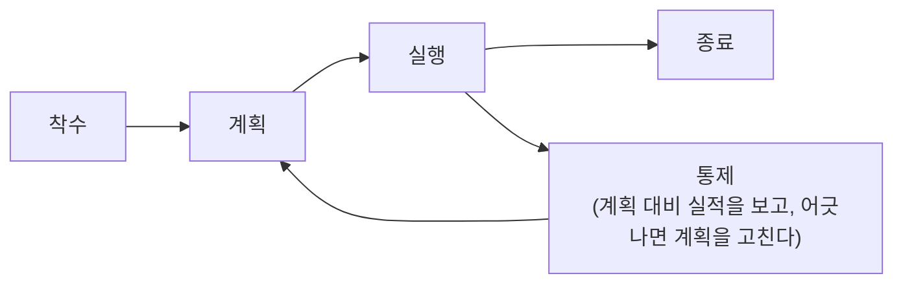
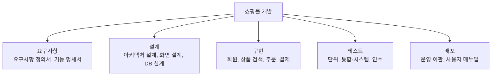
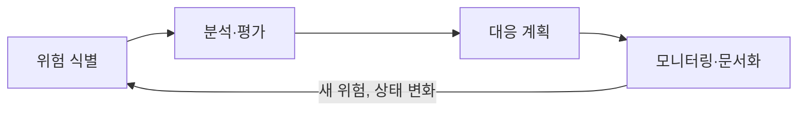

> 프로젝트의 정의와 단계, 참고 틀, WBS, 일정·통제·위험 관리는 고려사이버대학교 「소프트웨어공학」(2024-1학기) 강의 내용으로 정리했다.
> 비용 산정 기법의 분류와 기능 점수 계산은 GitHub 자료 모음 「[Subjective-studies_OS-CN-DBMS](https://github.com/avgspacelover/Subjective-studies_OS-CN-DBMS)」의 소프트웨어 공학 튜토리얼을 바탕으로 보강했다.

소프트웨어 프로젝트 관리는 정해진 비용과 일정 안에서 믿을 만한 품질의 소프트웨어를 내놓도록 **범위를 쪼개고, 비용과 일정을 산정하고, 진척을 수치로 통제하고, 위험을 미리 다루는** 일이다. 무엇을 만들지 정하는 요구공학과 어떻게 만들지 정하는 분석·설계는 [[software-engineering|소프트웨어 설계와 공학]]에 있고, 이 노트는 그 과정을 굴리는 관리 기법만 다룬다. 시험에서는 비용 산정 모델의 분류, COCOMO 모드, 기능 점수 계산, PERT 주 경로, EVM 지표, 위험 대응 유형을 묻는다.

## 소프트웨어 프로젝트 관리란

프로젝트는 **유일한** 결과물을 만들기 위한 **일시적인** 활동이다. 매일 반복하는 운영 업무나 끝나는 날이 없는 일은 프로젝트가 아니다. 프로젝트 관리는 품질(Quality)·비용(Cost)·일정(Delivery) 목표를 지키려고 지식, 기술, 도구를 적용하는 일이다. Standish Group의 CHAOS 보고서에서 일정·비용·기능을 모두 지킨 "성공" 프로젝트는 1994년 16%에서 2020년 31% 정도로 늘었을 뿐이고, 한 실패 원인 조사에서는 요구사항 정의 부실이 1위, 범위 정의 부실이 2위였다. 관리 기법의 대부분은 이 두 원인을 줄이는 쪽으로 짜여 있다.



| 단계 | 하는 일 | 이 노트의 절 |
| --- | --- | --- |
| 착수 | 프로젝트 시작을 공식 승인받는다 | - |
| 계획 | 목표와 범위를 이룰 활동, 일정, 비용, 인력, 품질 계획을 세운다 | WBS, 비용 산정, 일정 |
| 실행 | 인력과 자원을 갖추고 계획대로 수행한다 | - |
| 통제 | 주기적으로 점검하고, 목표와 차이가 나면 시정 조치를 한다 | EVM, 위험 관리 |
| 종료 | 결과물을 인도하고, 계약 의무를 다했으면 닫는다 | - |

## 참고하는 틀과 CMMI

| 틀 | 성격 | 내용 |
| --- | --- | --- |
| PMBOK (PMI) | 모든 산업의 프로젝트 관리 지침 | 통합, 범위, 일정, 원가, 품질, 자원, 의사소통, 리스크, 조달, 이해관계자 관리의 10개 지식 영역 (6판 기준. 7판은 원칙 중심으로 개편) |
| ISO/IEC/IEEE 12207 | 소프트웨어 생명주기 프로세스 국제 표준 | 계약, 조직 지원, 기술 관리, 기술 프로세스로 획득부터 폐기까지 규정 |
| CMMI | 조직 프로세스 개선을 위한 사실상의 업계 표준 | 프로세스 성숙도를 5단계로 평가 |

**CMMI(Capability Maturity Model Integration)** 는 조직이 프로세스를 얼마나 일관되게 수행하는지를 성숙도로 나타낸다.

| CMMI 단계 | 이름 | 모습 |
| --- | --- | --- |
| 1 | 초기 (Initial) | 그때그때 즉흥적으로 일한다. 결과가 사람에 따라 다르다 |
| 2 | 관리 (Managed) | 프로젝트 단위로 기본적인 계획·추적을 한다 |
| 3 | 정의 (Defined) | 조직 표준 프로세스가 있고 프로젝트가 그것을 맞춰 쓴다 |
| 4 | 정량적 관리 (Quantitatively Managed) | 프로세스를 수치로 측정하고 통제한다 |
| 5 | 최적화 (Optimizing) | 측정 결과로 프로세스를 계속 개선한다 |

성숙도가 낮은 조직은 일정·비용을 근거 없이 잡고 납기를 맞추려고 품질을 희생한다. 높은 조직은 이전 프로젝트 실적으로 일정을 잡고 품질을 객관적인 수치로 판단한다. 품질 보증(QA)과 품질 통제(QC)의 구분은 [[software-testing|소프트웨어 테스트]]에 있다.

## 범위: WBS

**WBS(Work Breakdown Structure)** 는 목표를 이루는 데 필요한 작업을 계층으로 쪼갠 것이다. 맨 아래 단위인 **작업 패키지**는 보통 2~3주 안에 끝낼 수 있을 만큼 작게 나누고, 담당자·공수·비용·일정을 붙일 수 있어야 한다. 비용 산정과 일정 계산은 모두 이 작업 패키지 위에서 한다.



가까운 단계는 상세하게, 먼 단계는 굵게 잡았다가 다가올 때 상세화하는 방식을 **롤링 웨이브(Rolling Wave)** 계획이라 한다. 애자일의 백로그 정제와 같은 발상이고, 에픽을 스토리로 쪼개 스토리 포인트로 재는 방식은 [[backlog-and-estimation|백로그와 추정]]에 있다.

## 비용 산정

비용을 너무 높게 잡으면 예산 낭비, 너무 낮게 잡으면 개발자 부담과 품질 저하가 생긴다. 결정 요소는 프로젝트(복잡도, 규모, 신뢰도), 자원(인적·하드웨어·소프트웨어), 생산성(개발자 능력, 기간)이다. 기법은 **하향식**(전체를 보고 경험으로 잡는다), **상향식**(작업 패키지별로 재서 더한다), **수학적**(규모를 공식에 넣는다)으로 나눈다.

| 구분 | 기법 | 설명 |
| --- | --- | --- |
| 하향식 | 전문가 감정 | 경험 많은 전문가 2명 이상에게 의뢰. 빠르지만 주관적 |
| 하향식 | 델파이 | 조정자 1명이 같은 질문을 여러 전문가에게 익명으로 묻고, 결과를 공유한 뒤 다시 묻기를 반복해 편견을 보완한다 |
| 상향식 | LOC | 모듈별 낙관·기대·비관 라인 수로 예측치 = (낙관치 + 4 × 기대치 + 비관치) / 6 |
| 상향식 | 개발 단계별 인월수 | 생명주기 단계별로 노력을 산정해 더한다 |
| 수학적 | COCOMO | LOC 기반, 조직형·반분리형·내장형별 공식 (보헴) |
| 수학적 | Putnam | Rayleigh-Norden 곡선으로 노력 분포 예측, 대형 프로젝트 |
| 수학적 | FP(기능 점수) | 사용자가 식별할 수 있는 입력·출력·질의·파일·인터페이스 수로 점수 산정 (알브레히트). 공공 SW 사업 대가 산정에 쓴다 |

LOC 계산 예: 총 30,000라인, 개발자 5명, 1인당 월 300라인이면 `30000 / (5 × 300) = 20개월`.

### COCOMO

**COCOMO 기본형**은 공수 `E = a × (KLOC)^b`(인월), 기간 `D = c × E^d`(월)로 계산한다. 계수는 프로젝트 유형(모드)에 따라 다르다.

| 유형 | 규모 | 예 | a | b | c | d |
| --- | --- | --- | --- | --- | --- | --- |
| 조직형 (Organic) | 5만 라인 이하, 기관 내부의 중소 규모 | 사무 처리·업무용·과학 계산용 응용 프로그램 | 2.4 | 1.05 | 2.5 | 0.38 |
| 반분리형 (Semi-detached) | 30만 라인 이하, 조직형과 내장형의 중간 | 트랜잭션 처리 시스템, 운영체제, DBMS | 3.0 | 1.12 | 2.5 | 0.35 |
| 내장형 (Embedded) | 30만 라인 이상, 초대형·엄격한 제약 | 신호기 제어, 미사일 유도, 실시간 처리 시스템 | 3.6 | 1.20 | 2.5 | 0.32 |

사내 업무 시스템 12 KLOC를 조직형으로 보면 E = 2.4 × 12^1.05 ≈ 32.6 인월, D = 2.5 × 32.6^0.38 ≈ 9.4개월, 평균 인원 ≈ 3.5명이다. LOC 기반 산정은 언어와 코딩 스타일에 따라 크게 흔들리므로 나온 숫자는 출발점으로만 쓴다.

### 기능 점수(FP)

**기능 점수(Function Point)** 는 코드가 아니라 사용자에게 보이는 기능으로 규모를 재서 언어에 덜 흔들린다. 다섯 가지 기능 유형을 세어 복잡도별 가중치를 곱하고, 시스템 특성으로 보정한다.

| 기능 유형 | 세는 것 | 단순 | 보통 | 복잡 |
| --- | --- | --- | --- | --- |
| 외부 입력(EI) | 밖에서 들어오는 서로 다른 형식의 입력 | 3 | 4 | 6 |
| 외부 출력(EO) | 서로 다른 형식·처리의 출력 | 4 | 5 | 7 |
| 외부 조회(EQ) | 입력과 출력이 짝을 이루는 조회 | 3 | 4 | 6 |
| 내부 논리 파일(ILF) | 시스템이 유지하는 논리적 데이터 묶음 | 7 | 10 | 15 |
| 외부 인터페이스 파일(EIF) | 다른 시스템과 공유·참조하는 파일 | 5 | 7 | 10 |

```text
미조정 FP(UFP) = Σ (유형별 개수 × 가중치)
가치 조정 인자(VAF) = 0.65 + 0.01 × N    N: 14개 일반 시스템 특성을 각 0~5로 매긴 합 (0~70)
조정 FP = UFP × VAF                      VAF 범위 0.65 ~ 1.35
```

14개 특성은 데이터 통신, 분산 처리, 성능, 운영 환경 부하, 트랜잭션 빈도, 온라인 입력, 사용자 효율, 온라인 갱신, 복잡한 처리, 재사용성, 설치 용이성, 운영 용이성, 다중 사이트, 변경 용이성이다. 결과 FP로 `비용/FP`, `결함 수/FP`, `FP/인월`(생산성)을 비교한다. 한국 공공 SW 사업은 보정 인자를 단순화한 간이법을 많이 쓴다.

## 일정: PERT와 주 경로

**PERT** 차트는 작업 사이의 선후 관계를 네트워크로 그리고, 작업마다 ES/EF(가장 빨리 시작·끝낼 수 있는 날), LS/LF(전체 일정을 늦추지 않고 가장 늦게 시작·끝내도 되는 날), **여유**(LS − ES)를 계산한다.

| 작업 | 기간(일) | 선행 | ES | EF | LS | LF | 여유 |
| --- | --- | --- | --- | --- | --- | --- | --- |
| A 요구사항 정의 | 3 | - | 0 | 3 | 0 | 3 | 0 |
| B 화면 설계 | 4 | A | 3 | 7 | 3 | 7 | 0 |
| C API 설계 | 2 | A | 3 | 5 | 5 | 7 | 2 |
| D 프론트엔드 구현 | 6 | B, C | 7 | 13 | 7 | 13 | 0 |
| E 백엔드 구현 | 5 | C | 5 | 10 | 8 | 13 | 3 |
| F 통합 테스트 | 3 | D, E | 13 | 16 | 13 | 16 | 0 |

- **앞으로 계산(ES·EF)**: 선행 작업의 EF 중 가장 큰 값이 ES다. D는 B(7)와 C(5) 중 7에 시작한다.
- **뒤로 계산(LS·LF)**: 후행 작업의 LS 중 가장 작은 값이 LF다. C는 D(7)와 E(8) 중 7까지 끝나야 한다.
- 여유가 0인 작업을 이은 **A → B → D → F(16일)** 가 **주 경로(Critical Path)** 다. 이 경로의 작업이 하루 밀리면 전체가 하루 밀리고, E는 3일까지 늦어도 괜찮다.

일정을 줄이려면 주 경로의 작업을 줄여야 한다. 여유가 있는 작업에 인력을 더 넣어도 완료일은 그대로다. 계산 자체는 위상 정렬 위의 최장 경로 DP다([[topological-sort|위상 정렬]]). **간트 차트**는 달력 위에 작업마다 막대를 그려 언제 무엇을 하는지, 오늘 기준으로 무엇이 늦었는지 보여 주지만 의존 관계는 덜 드러난다. 그래서 의존 관계는 PERT로 계산하고 공유는 간트 차트로 하는 경우가 많다.

## 통제: EVM

측정하지 않으면 관리할 수 없다. 일정·비용·공수·품질을 계획과 실적으로 나란히 놓고, 차이가 조직의 기준(예: 일정 차이 10% 초과)을 넘으면 이슈로 등록해 [[jira|Jira]], Redmine 같은 이슈 관리 시스템에서 시정 조치까지 추적한다. **EVM(Earned Value Management)** 은 일정과 비용을 **같은 단위(돈)** 로 바꿔 한 번에 비교한다.

| 용어 | 다른 이름 | 뜻 |
| --- | --- | --- |
| PV | BCWS | 지금까지 **하기로 계획한** 일의 예산 |
| EV | BCWP | 지금까지 **실제로 해낸** 일의 예산상 가치 |
| AC | ACWP | 지금까지 해낸 일에 **실제로 쓴** 돈 |
| BAC | - | 전체 일의 총예산 |

| 지표 | 식 | 해석 |
| --- | --- | --- |
| 일정 차이 SV | EV − PV | 음수면 일정 지연 |
| 비용 차이 CV | EV − AC | 음수면 비용 초과 |
| 일정 성과 지수 SPI | EV ÷ PV | 1보다 작으면 지연 |
| 비용 성과 지수 CPI | EV ÷ AC | 1보다 작으면 초과 |
| 완료 시 예상 비용 EAC | AC + (BAC − EV) ÷ CPI | 지금 효율이 이어진다고 가정한 최종 비용 |
| 완료 시 차이 VAC | BAC − EAC | 음수면 최종적으로 예산 초과 |

**예**: 총예산 1억 원, 8개월 프로젝트의 4개월 시점에 PV 5,000만 원, EV 4,000만 원, AC 4,500만 원이면 SV = −1,000만 원(계획한 일 중 1,000만 원어치를 못 했다), CV = −500만 원(해낸 일에 비해 500만 원을 더 썼다), SPI = 0.80, CPI ≈ 0.89, EAC ≈ 1억 1,250만 원, VAC ≈ −1,250만 원이다. 진척률만 보면 "절반쯤 했다"로 끝나지만, EVM은 늦은 정도와 돈이 새는 정도를 따로 보여 주고 결말까지 예측한다.

## 위험 관리

위험은 품질·비용·일정 목표 중 적어도 하나에 영향을 **줄 수도 있는**, 아직 일어나지 않은 사건이나 상태다. **이미 일어난** 문제는 이슈라 부른다. 위험 관리는 위험이 이슈가 되기 전에 다루는 일이다.



- **식별**: 체크리스트와 과거 위험 DB로 찾는다. "고객과의 소통 채널이 충분한가?", "핵심 인력이 다른 업무를 겸하고 있지 않은가?", "처음 써 보는 기술이 있는가?"
- **분석**: 발생 확률과 영향도를 등급(예: 1~5)으로 매기고 곱해서 우선순위를 정한다.
- **대응**: 네 가지 중 고른다.

| 대응 | 뜻 | 예 |
| --- | --- | --- |
| 회피 | 위험의 원인 자체를 없앤다 | 검증 안 된 신기술 도입을 다음 버전으로 미룬다 |
| 완화 | 확률이나 영향을 허용 가능한 수준까지 낮춘다 | 핵심 기능에 테스트를 더 배정한다 |
| 전가 | 피해를 외부로 넘긴다 | 보험, 외주 계약의 책임 조항 |
| 수용 | 허용 가능한 수준이면 받아들인다 | 사용 빈도가 낮은 관리자 화면의 사소한 오류 |

소프트웨어 프로젝트에서 자주 나오는 위험은 문서화되지 않았거나 계속 바뀌는 요구사항과 불분명한 인수 기준, 비현실적인 예산·일정과 계약 중의 기간 단축, 훈련받지 않은 인력과 불명확한 역할, 발주 측 담당자의 잦은 교체와 이해관계자의 참여 부족, 협력 업체 간 갈등과 통합 지연, 맞지 않는 도구·낯선 언어의 선택, 과도한 문서·검토 절차다. 같은 확률 × 영향도 계산으로 테스트 강도를 나누는 방법은 [[software-testing#위험 기반 테스트|위험 기반 테스트]]에 있다.

## 정리

- 프로젝트는 유일한 결과물을 만드는 일시적 활동이고, 관리는 품질·비용·일정 목표를 지키는 일이다. 착수 → 계획 → 실행 → 통제 → 종료를 돌며 통제 결과로 계획을 고친다.
- CMMI는 초기·관리·정의·정량적 관리·최적화 5단계로 조직 프로세스 성숙도를 잰다.
- 범위는 WBS로 2~3주짜리 작업 패키지까지 쪼개고, 먼 단계는 롤링 웨이브로 나중에 상세화한다.
- 비용은 하향식(전문가 감정, 델파이)·상향식(LOC, 단계별 인월수)·수학적(COCOMO, Putnam, FP)으로 산정한다. COCOMO는 `E = a × KLOC^b`, FP는 `UFP × (0.65 + 0.01N)`이다.
- 일정은 PERT로 ES/EF·LS/LF를 계산해 여유 0인 주 경로를 찾고, 통제는 EVM으로 SV·CV·SPI·CPI를 보고 EAC까지 예측한다.
- 위험은 확률 × 영향도로 순위를 매기고 회피·완화·전가·수용 중 하나로 대응한다. 산정과 일정은 숫자지만, 그 숫자는 출발점일 뿐이고 통제가 맞춰 간다.

관련 노트: [[software-engineering|소프트웨어 설계와 공학]], [[software-testing|소프트웨어 테스트]], [[backlog-and-estimation|백로그와 추정]], [[scrum-framework|스크럼: 책임·이벤트·산출물]], [[agile-sprint|애자일과 스프린트]], [[project-process|새 서비스 개발 프로젝트 진행 순서]], [[jira|Jira: 이슈 구성, JQL, 워크플로]], [[topological-sort|위상 정렬]]
