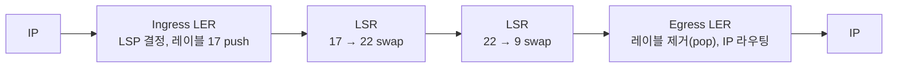

> 고려사이버대학교 「컴퓨터네트워크」(2023-2학기)와 「정보통신개론」(2023 겨울계절학기) 강의 내용을 바탕으로 정리했다. MPLS 절은 「컴퓨터네트워크」 강의의 MPLS 장을 바탕으로 했다.

## 망의 두 구간

집의 공유기에서 서버까지 가는 길은 크게 둘로 나뉜다.

- **가입자망(access network, 라스트 마일)**: 집·사무실에서 통신사 국사까지. 가구마다 따로 깔아야 해서 비용이 가장 많이 들고, 그래서 이미 깔린 전화선이나 케이블 TV 선을 재활용하는 기술이 먼저 나왔다.
- **광역망(WAN, 백본)**: 국사와 국사, 통신사와 통신사 사이. 많은 가입자의 트래픽을 모아 나르므로 광섬유와 고속 다중화를 쓴다.

가정·기업 안쪽의 LAN과 장비 배치는 [[network-basics|네트워크 기초]]에, 전파로 잇는 가입자망인 셀룰러 이동통신은 [[wireless-network|무선 네트워크]]에 있다.

## 유선 가입자망

### 전화 모뎀

전화망은 대부분 디지털화됐지만 집에서 전화국까지의 구리선(가입자 선로)은 아날로그로 남았다. 전화 모뎀은 디지털 데이터를 음성 대역(약 4kHz) 안의 아날로그 신호로 **변조**해서 보낸다. 대역이 좁아 56kbps(V.90)가 한계였고, 쓰는 동안 전화를 못 했다. 한계가 생기는 이유는 [[network-basics|네트워크 기초]]의 섀넌 용량(「신호 변환과 변조」)에 있다.

### xDSL: 전화선의 남는 대역 쓰기

구리선 자체는 1MHz 이상도 통과시킬 수 있다. 4kHz로 막고 있던 것은 전화국 교환기 앞의 필터다. **DSL**은 이 필터를 걷어내고 음성 위쪽의 넓은 대역을 데이터용으로 쓴다. 주파수로 나누므로 전화와 인터넷을 동시에 쓸 수 있다(FDM).

```text
ADSL의 주파수 분할 (대략)
0 ─ 4kHz      : 음성 전화
26 ─ 138kHz   : 업로드
138 ─ 1104kHz : 다운로드
```

- 집에서는 **스플리터**가 음성과 데이터 신호를 나누고, 전화국에서는 **DSLAM**이 여러 가입자의 DSL 회선을 모아 인터넷 쪽으로 넘긴다.
- 다운로드 대역을 더 크게 잡은 이유는 가정 사용자가 받는 양이 보내는 양보다 훨씬 많기 때문이다.

| 종류 | 특징 |
| --- | --- |
| ADSL (비대칭) | 다운로드가 업로드보다 빠르다(수 Mbps / 수백 kbps). 한국은 1999년 상용 서비스로 초고속 인터넷 시대를 열었다 |
| SDSL (대칭) | 상하향 속도가 같다. 서버를 두는 사업장용 |
| HDSL | 전화선 두 쌍(4선)을 데이터 전용으로. T1·E1급 대칭 속도, 전화는 못 쓴다 |
| VDSL | 가장 빠르지만 전화국(또는 아파트 통신실)에서 1km 안팎이어야 한다. 아파트 단지에 많이 쓰였다 |

DSL은 거리가 멀수록 신호가 약해져 속도가 떨어진다. 속도를 보장하기 어려운 이유다.

### 케이블 모뎀과 HFC

케이블 TV 선(동축 케이블)은 수백 MHz 대역을 쓴다. 방송 채널에 쓰고 남는 대역을 인터넷용으로 쓰는 것이 케이블 인터넷이다. 망 구조는 **HFC(Hybrid Fiber-Coaxial)** 로, 방송국에서 동네 광 노드까지는 광케이블, 노드에서 집까지는 동축 케이블이다. 같은 노드에 물린 가구들이 대역을 **공유**하므로 저녁 시간처럼 이용자가 몰리면 속도가 떨어진다. 국사 쪽에서 케이블 모뎀들을 모으는 장비를 CMTS라 하고, 규격은 DOCSIS다.

### FTTx: 광섬유를 어디까지 끌고 오나

구리선 구간이 짧을수록 빨라진다. **FTTx**는 광섬유가 어디까지 오느냐로 이름이 붙는다.

| 방식 | 광섬유 도달 지점 | 나머지 구간 |
| --- | --- | --- |
| FTTO (Office) | 도심 업무 빌딩 | 건물 내 배선 |
| FTTC (Curb) | 집 앞 길가의 함체 | 짧은 구리선 |
| FTTB (Building) | 아파트 통신실 | 건물 내 UTP·VDSL |
| FTTH (Home) | 집 안까지 | 없음 |

FTTH는 전화·인터넷·IPTV를 광케이블 한 가닥에 싣는다. 국사에 **OLT**, 집에 **ONT(ONU)** 를 두고, 중간의 수동 **광 스플리터**가 한 가닥을 여러 가구로 나눈다. 전원이 필요 없는 분배기로 나눈다는 뜻에서 이 구조를 **PON(Passive Optical Network)** 이라 부른다. 집집마다 장비를 달아야 해서 초기 비용이 컸지만, 지금은 신축 아파트의 기본이 됐다.

### 위성

땅에 선을 깔기 어려운 곳은 위성으로 잇는다.

| 궤도 | 고도 | 장점 | 단점 |
| --- | --- | --- | --- |
| 정지 궤도 | 약 36,000km | 위성 3~4기로 지구 대부분을 덮는다. 위성이 하늘에 멈춰 보여 안테나를 고정할 수 있다 | 왕복 거리가 길어 지연이 크다. 요청 하나가 오가는 데 전파 시간만 0.5초 가까이 걸린다 |
| 저궤도 | 수백~1,500km | 지연이 짧다 | 한 위성이 덮는 범위가 좁고 빨리 지나가서 수많은 위성이 필요하다 |

정지 궤도 위성은 방송처럼 한 방향으로 뿌리는 데 맞고, 왕복이 많은 인터넷에는 지연이 걸림돌이다. 수천 기를 띄우는 저궤도 위성 인터넷이 등장한 배경이다. 지연이 체감 성능에 주는 영향은 [[network-basics|네트워크 기초]]의 「성능을 정하는 두 값」을 보면 된다.

## 광역망 기술

### 디지털 계위: T1·E1과 SONET/SDH

전화망은 64kbps 음성 채널(DS-0)을 기본 단위로, 이를 시분할 다중화해 큰 회선을 만들었다.

| 북미 | 속도 | 음성 채널 |
| --- | --- | --- |
| DS-1 (T1) | 1.544Mbps | 24 |
| DS-3 (T3) | 44.736Mbps | 672 |

유럽식 **E1**은 64kbps 슬롯 32개를 묶은 2.048Mbps다(음성은 30채널, 나머지 2개는 동기·신호용). T1의 1.544Mbps 계산은 [[network-basics#다중화: 선로 하나를 나눠 쓰기|네트워크 기초의 다중화]]에 있다.

광섬유 시대에는 **SONET(북미)/SDH(국제)** 가 표준이 됐다. 기본 단위 OC-1이 51.84Mbps이고, OC-n은 그 n배다. OC-3 = 155.52Mbps(SDH의 STM-1), OC-48 ≈ 2.5Gbps, OC-192 ≈ 10Gbps 식이다. 모든 장비가 같은 클럭에 맞춰 도는 동기식이라 낮은 속도 신호를 큰 프레임에서 바로 꺼내고 넣기 쉽고, 링 구조로 장애 시 빠르게 우회한다.

### PPP: 점대점 링크 위의 2계층

**PPP(Point-to-Point Protocol)** 는 두 장비가 선 하나로 직접 붙어 있을 때 쓰는 단순한 2계층 프로토콜이다. 프레임 형식을 정하고, **LCP**로 링크를 열고 설정·인증하며, **NCP**로 그 위에 실을 3계층(예: IP 주소 할당)을 협상한다. 단순해서 전화 모뎀, 전용선 등 여러 물리 계층에 두루 쓰였다. ADSL 가입자 인증에 쓰던 PPPoE는 PPP를 이더넷 프레임에 담은 것이다.

### 패킷 교환 WAN의 변천: X.25 → 프레임 릴레이 → ATM

세 기술 모두 **가상 회선** 방식이다. 흐름은 「선로가 좋아질수록 망 안의 일을 덜어 낸다」로 요약된다.

| 기술 | 시기·계층 | 특징 | 쇠퇴 이유 |
| --- | --- | --- | --- |
| X.25 | 1970년대, 1~3계층 | 선로 품질이 나빠 홉마다 오류 제어·재전송을 했다 | 느리고, 3계층 기능이 IP와 겹친다 |
| 프레임 릴레이 | 1990년대, 2계층 | 선로가 좋아졌으니 오류 제어를 빼고 오류 프레임은 버리기만 한다. 재전송은 끝단(TCP)에 맡긴다 | ATM과 IP/MPLS에 밀림 |
| ATM | 1990년대, 2계층 | **53바이트 고정 셀**(헤더 5 + 데이터 48)을 SONET 위에서 하드웨어로 교환. 크기가 일정해 지연을 예측하기 쉽고, 적응 계층(AAL)으로 음성·영상·데이터를 각각 맞춰 실었다 | 복잡하고, 작은 셀마다 헤더가 붙어 IP 패킷을 실을 때 낭비가 크다. 이더넷과 IP가 이겼다 |

ATM의 셀 크기가 48바이트로 어정쩡한 것은 음성 지연을 줄이려는 쪽(32바이트)과 효율을 원하는 쪽(64바이트)이 타협한 결과로 알려져 있다. ATM이 남긴 「레이블로 고속 교환하고 트래픽 종류별 품질을 보장한다」는 발상은 아래 MPLS와 [[ip-qos|IP QoS]]로 이어졌다. 지금 통신사 백본은 대체로 광 전송(WDM) 위에 이더넷과 IP/MPLS를 올린 구조다.

### MPLS: IP 망 위의 레이블 스위칭

일반 IP 라우터는 패킷마다 라우팅 테이블에서 **최장 프리픽스 일치**를 찾는다([[network-layer|네트워크 계층 프로토콜]]). **MPLS(Multi-Protocol Label Switching)** 는 망 입구에서 패킷에 짧은 **레이블**을 붙이고, 안쪽 라우터는 레이블을 표의 인덱스처럼 써서 다음 홉을 바로 꺼낸다. 데이터를 보내기 전에 입구에서 출구까지 경로를 정해 두는 **가상 회선** 방식이라, 데이터그램인 IP 위에 X.25·ATM 계열의 연결형 경로를 다시 얹은 셈이다. 「Multi-Protocol」은 레이블이 위아래 프로토콜과 무관해 IP 말고 이더넷 프레임 같은 트래픽도 실을 수 있다는 뜻이다. 여러 회사의 호환되지 않던 레이블 스위칭(IP 스위칭, 태그 스위칭)을 IETF가 MPLS로 표준화했다.

| 용어 | 뜻 |
| --- | --- |
| 레이블 | 전달에 쓰는 짧은 식별자. 링크마다 의미가 다른 지역 값이다 |
| FEC | 같은 방식으로 전달할 트래픽 묶음. 레이블 바인딩은 FEC와 레이블을 짝짓는 것이다 |
| LER (Label Edge Router) | MPLS 영역 가장자리 라우터. 들어오는 쪽이 Ingress, 나가는 쪽이 Egress |
| LSR (Label Switch Router) | 영역 안에서 레이블만 보고 전달하는 라우터 |
| LSP (Label Switched Path) | Ingress에서 Egress까지 정해 둔 경로. 여러 플로우가 함께 쓸 수 있다 |



- **push**: Ingress LER가 IP 헤더를 한 번만 보고 LSP를 정해 레이블을 끼워 넣는다.
- **swap**: LSR은 들어온 레이블로 표를 찾아 나갈 인터페이스와 새 레이블로 바꿔 붙인다. 레이블은 **홉마다 바뀐다.**
- **pop**: Egress에서 레이블을 떼고 일반 IP 라우팅으로 넘긴다. 보통은 마지막 직전 LSR이 미리 떼어 출구의 일을 던다(penultimate hop popping).

MPLS 헤더는 2계층 헤더와 IP 헤더 사이에 들어가 「2.5계층」이라고도 한다.

```text
| L2 헤더 | Label 20 | TC(EXP) 3 | S 1 | TTL 8 | IP 헤더 | 데이터 |
```

TC(옛 이름 EXP)는 QoS 클래스로 IP의 DSCP 같은 역할을 하고([[ip-qos|IP QoS]]), TTL은 IP처럼 루프를 막는다. S 비트는 레이블을 여러 개 겹친 **레이블 스택**의 마지막인지 표시한다. 바깥 레이블로 백본 경로를, 안쪽 레이블로 어느 고객 VPN인지를 나타내는 식으로 쓴다.

**레이블 분배**는 이웃 LSR끼리 「이 FEC에는 이 레이블」을 합의하는 일이다. **LDP**는 IGP가 계산한 최단 경로를 따라 레이블을 나누고, **RSVP-TE**는 자원 예약 프로토콜 RSVP([[ip-qos#IntServ: 플로우마다 미리 예약|IntServ의 RSVP]])에 레이블 객체를 더해 경로를 명시하고 대역폭을 예약한다. 제약 조건을 더한 CR-LDP도 있었지만 IETF는 트래픽 엔지니어링용으로 RSVP-TE를 택했다.

**트래픽 엔지니어링(MPLS-TE)** 은 최단 경로 하나에 트래픽이 몰리고 돌아가는 빈 경로가 노는 문제를 푼다.

1. OSPF-TE·IS-IS-TE가 링크별 남은 대역폭 같은 정보를 함께 퍼뜨린다.
2. Ingress LER가 필요한 대역폭 같은 조건을 만족하는 경로를 계산한다. 최단이 아니어도 된다.
3. RSVP-TE로 그 경로에 LSP 터널을 세우고 자원을 예약한다.
4. 링크의 가용 대역폭이 줄거나 끊기면 대체 LSP로 돌린다.

처음 내세운 장점은 「최장 프리픽스 일치보다 빠른 조회」였지만, 라우터 하드웨어가 그것도 빠르게 처리하게 되면서 의미가 거의 없어졌다. 지금 MPLS가 통신사 백본에 남은 이유는 **트래픽 엔지니어링**과, 레이블 스택으로 고객별 망을 분리하는 **MPLS VPN**(기업 지점을 잇는 전용망 상품의 바탕)이다. 공용망 위의 암호화 터널로 잇는 VPN과의 차이는 [[network-security|네트워크 보안]]의 VPN 절과 비교하면 된다.

## 핵심 정리

- 가입자망은 비용 때문에 기존 전화선(DSL)과 케이블 TV 선(HFC)을 먼저 재활용했고, 지금은 광섬유(FTTH, PON)로 넘어왔다.
- DSL은 전화선의 4kHz 필터를 걷어내고 위쪽 대역을 쓴다. 거리가 멀수록 느리다.
- 케이블 인터넷은 같은 노드의 가구가 대역을 공유한다.
- 정지 궤도 위성은 지연이 크고, 저궤도 위성은 지연은 짧지만 많은 위성이 필요하다.
- 전화망의 TDM 계위(T1·E1)와 광 동기 전송(SONET/SDH)이 광역 회선의 바탕이었다.
- WAN 기술은 X.25 → 프레임 릴레이 → ATM을 거쳐 IP/MPLS로 수렴했다.
- MPLS는 입구에서 레이블을 push, 안에서 swap, 출구(또는 직전)에서 pop하는 가상 회선이고, 지금의 가치는 속도보다 트래픽 엔지니어링(RSVP-TE)과 MPLS VPN이다.

관련 노트: [[network-basics|네트워크 기초]], [[network-layer|네트워크 계층 프로토콜]], [[ip-qos|IP QoS]], [[network-security|네트워크 보안]], [[wireless-network|무선 네트워크]]
