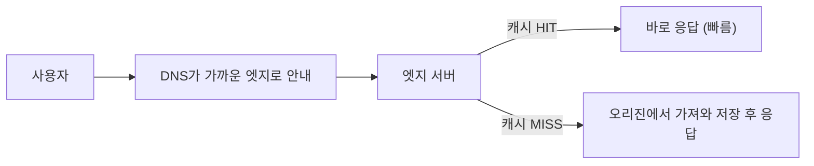
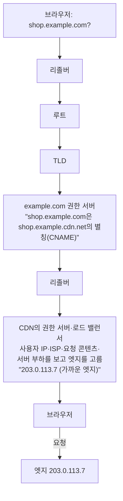
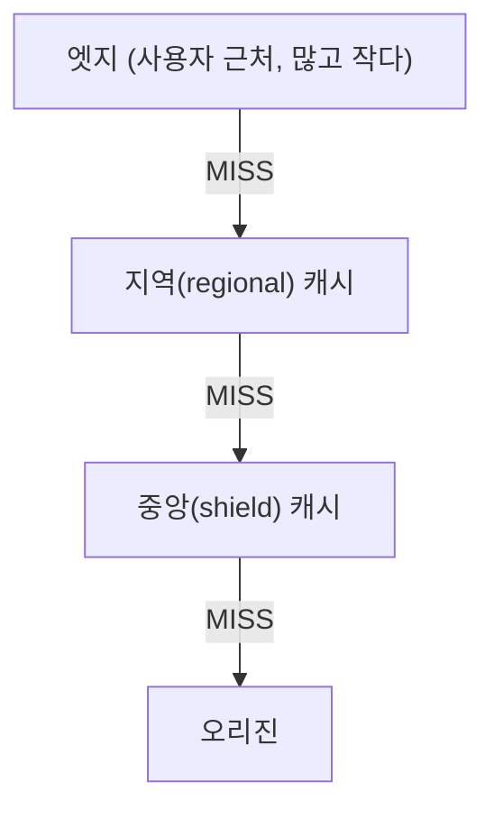

> 여러 자료를 종합한 노트에, ByteByteGo의 System Design 101 가이드 「[What is CDN?](https://bytebytego.com/guides/what-is-cdn-content-delivery-network)」, 「[How Does CDN Work?](https://bytebytego.com/guides/how-does-cnd-work)」, 「[Why are CDNs so Popular?](https://bytebytego.com/guides/why-are-content-delivery-networks-cdn-so-popular)」, 「[A Beginner's Guide to CDN](https://bytebytego.com/guides/a-beginner's-guide-to-cdn-content-delivery-network)」의 DNS 라우팅·계층 구조·요청 라우팅 내용을 보강했다. CDN 운영의 설계 판단은 Akamai의 「[Globally Distributed Content Delivery](https://kilthub.cmu.edu/articles/journal_contribution/Globally_distributed_content_delivery/6605972)」(IEEE Internet Computing, 2002)로 보강했다.
> 「비용과 위험」은 「[Must-Know-About-Frontend: CDN](https://github.com/baeharam/Must-Know-About-Frontend/blob/main/Notes/network/cdn.md)」을 바탕으로 보강했다.

## CDN이란

CDN(Content Delivery Network)은 **여러 지역에 흩어진 엣지 서버(PoP)에 콘텐츠 사본을 두고, 사용자와 가장 가까운 서버가 대신 응답하게 하는 네트워크**다. 서울 사용자가 미국 서버의 이미지를 받으려면 태평양을 왕복해야 하지만, CDN이 있으면 서울 근처 엣지에서 바로 받는다.

원래 데이터를 가진 서버는 **오리진(origin)** 이라고 부른다.

## 동작 방식

- 사용자를 가까운 엣지로 보내는 데 DNS 기반 라우팅이나 애니캐스트(Anycast)를 쓴다.
- 엣지가 얼마나 오래 보관할지는 오리진 응답의 `Cache-Control`(특히 `s-maxage`) 헤더로 정한다.

### DNS로 가까운 엣지 찾기

DNS 기반 CDN에서는 내 도메인을 CDN 도메인의 **별칭(CNAME)** 으로 걸어 둔다. 리졸버가 별칭을 따라가다 보면 CDN의 DNS(로드 밸런서)가 사용자에게 맞는 엣지 IP를 골라 준다.

조회 단계 자체는 [[dns|DNS]]의 재귀·반복 질의와 같다. CDN은 마지막 답을 「사용자마다 다르게」 돌려줄 뿐이다.

### 계층형 캐시

엣지에 없다고 바로 오리진으로 가지 않는다. 큰 CDN은 캐시를 여러 층으로 둔다.

위층으로 갈수록 수는 적고 용량은 크다. 여러 엣지의 미스가 한 곳으로 모이므로 **오리진까지 가는 요청이 크게 준다.** 오리진 앞에 중앙 캐시 하나를 두는 설정을 흔히 origin shield라고 부른다.

### 구성 요소와 요청 라우팅

| 구성 요소 | 역할 |
| --- | --- |
| 오리진 서버 | 콘텐츠의 원본 |
| 엣지 서버 | 전 세계에 흩어져 콘텐츠를 캐시하고 응답한다 |
| DNS | 도메인 이름을 가장 알맞은 엣지의 IP로 풀어 준다 |
| 컨트롤 플레인 | 엣지 서버의 설정·배포·캐시 퍼지를 관리한다 |

| 라우팅 방식 | 동작 |
| --- | --- |
| GSLB (Global Server Load Balancing) | 지리적 거리, 서버 부하, 네트워크 상태를 보고 DNS 응답을 고른다 |
| 애니캐스트(Anycast) | 여러 데이터센터가 **같은 IP**를 광고한다. 인터넷 라우팅(BGP)이 알아서 가장 가까운 곳으로 보낸다. DDoS 트래픽도 여러 곳으로 흩어진다 |
| IXP 입점 | 주요 인터넷 교환 지점(Internet Exchange Point)에 서버를 두고 ISP와 직접 트래픽을 주고받아 경로를 줄인다 |

### 정적 콘텐츠와 엣지 컴퓨팅

엣지는 정적 파일만 내려 주지 않는다. **엣지 컴퓨팅**은 코드를 엣지에서 실행해 개인화, A/B 테스트 분기, 인증 확인, 이미지 변환 같은 동적 처리를 중앙 데이터센터까지 가지 않고 끝낸다(Cloudflare Workers, Vercel Edge Functions 같은 형태). 실시간성이 중요한 영상 스트리밍·클라우드 게임도 엣지 가까이에서 처리해 지연을 줄인다.

### 캐시할 수 없는 것도 빠르게

정적 파일만 CDN의 몫은 아니다. 대규모 CDN이 초기부터 쓴 기법이다.

| 기법 | 동작 | 효과 |
| --- | --- | --- |
| TCP 연결 나누기 | 클라이언트 ↔ 엣지, 엣지 ↔ 원본으로 연결을 둘로 나눈다 | 엣지가 가까워 패킷 손실에 빨리 반응하고, 원본의 응답을 빠르게 받아 메모리에서 클라이언트 속도로 내보내 원본 자원을 일찍 풀어 준다. 원본은 소수의 엣지와만 오래 연결을 유지한다 |
| 엣지에서 조립(ESI) | 페이지를 캐시 가능한 조각과 개인화 조각으로 나눠 엣지에서 합친다 | 동적 페이지 대부분을 엣지에서 낸다. 원본이 죽으면 대체 조각을 낸다 |
| 엣지에서 인가 | 원본이 붙인 인가 토큰을 엣지가 검사한다 | 보호된 콘텐츠도 요청마다 원본까지 가지 않는다 |

오늘날의 엣지 함수(Cloudflare Workers, Lambda@Edge)와 서명 URL·서명 쿠키가 같은 발상을 잇는다.

## 얻는 것

| 효과 | 이유 |
| --- | --- |
| 지연 시간 감소 | 물리적 거리가 짧아져 RTT가 줄어든다 |
| 오리진 부하 감소 | 대부분의 요청을 엣지가 처리한다 |
| 대역폭 비용 절감 | 오리진에서 나가는 트래픽이 줄어든다 |
| 가용성 | 트래픽 폭증이나 DDoS를 분산해 흡수한다 |
| 부가 기능 | HTTPS 종료, 압축(gzip·Brotli), 이미지 변환, WAF |

## 비용과 위험

| 위험 | 내용 | 대응 |
| --- | --- | --- |
| 비용 | 전송량·요청 수·부가 기능(이미지 변환, WAF)마다 과금된다 | 캐시 적중률을 높여 오리진 전송량과 함께 줄인다 |
| 의존과 장애 | CDN 사업자 장애가 곧 서비스 장애다. 회사·국가 방화벽이 CDN 도메인을 막으면 그 사용자에게는 자원이 안 온다 | 중요한 서비스는 멀티 CDN이나 오리진 직접 경로를 둔다 |
| 커버리지 | 사용자 지역에 PoP가 없으면 먼 엣지를 거쳐 오히려 느려질 수 있다 | 사용자 분포에 맞는 사업자를 고른다 |
| 배포 복잡도 | 배포마다 오래된 사본을 어떻게 비울지 정해야 한다 | 아래 「캐시 무효화」. 올릴 대상을 정적 자산 위주로 고르는 것도 같은 이유다 |
| 공용 CDN의 착각 | cdnjs·jsDelivr 같은 공용 CDN으로 라이브러리를 받으면 「다른 사이트가 받아 둔 캐시를 공유한다」는 이점이 있었지만, 2020년 전후 주요 브라우저가 HTTP 캐시를 사이트별로 분리해 사라졌다. 대신 다른 출처로 연결을 하나 더 연다 | 라이브러리는 번들에 넣어 자기 출처·자기 CDN에서 내려 준다. 외부에서 받는다면 `integrity`(SRI)를 건다 |

CDN 자체의 장애도 설계 대상이다. DNS 응답에 IP를 여러 개 실어 하나가 죽어도 클라이언트가 다른 주소로 가게 하고, 상위 DNS가 여러 지역의 하위 DNS를 알려 줘 네트워크 일부가 끊겨도 이름 풀이가 된다. 디스크·메모리 손상이나 운영 실수는 파일 시스템 수준 검사로 다 잡지 못하므로, 다른 고객의 콘텐츠를 잘못 내거나 깨진 응답을 캐시하지 않도록 **끝에서 끝까지(end-to-end) 검사**를 한다. 수천 대의 상태는 분산 모니터링이 모아 SQL 같은 질의로 본다.

## 무엇을 올리나

- **정적 자산**: JS 번들, CSS, 폰트, 이미지, 영상. 가장 효과가 크다.
- **정적 HTML**: SSG로 빌드한 페이지. Vercel·Netlify·Cloudflare Pages는 빌드 결과를 기본으로 CDN에 올린다.
- **동적 응답 일부**: 짧은 TTL이나 `stale-while-revalidate`로 API·SSR 결과도 캐시할 수 있다. 사용자별 응답은 캐시하면 안 된다.

## 캐시 무효화

엣지에 오래된 파일이 남는 것이 CDN의 대표 문제다.

| 방법 | 설명 |
| --- | --- |
| 파일 이름에 해시 | `app.3f9a2c.js`처럼 내용이 바뀌면 URL이 바뀐다. 1년짜리 캐시를 걸어도 안전하다 (번들러 기본 동작) |
| Purge | CDN 관리 화면이나 API로 특정 경로·태그의 캐시를 지운다 |
| 짧은 TTL | HTML처럼 URL이 고정된 파일은 짧게 캐시하거나 매번 재검증한다 |

버전 번호를 이름에 넣은 객체(`app.3f2a.js`)는 내용이 바뀌면 이름이 바뀌므로 **TTL을 무한으로** 둬도 된다. 바뀔 수 있는 이름의 객체만 TTL과 즉시 삭제(purge)로 관리한다.

## 정리

- CDN은 사용자 가까운 엣지에서 캐시된 사본을 내려 주는 서버망이다.
- HIT면 엣지가 바로 응답하고, MISS면 지역·중앙 캐시를 거쳐 오리진에서 가져와 저장한다.
- 사용자를 가까운 엣지로 보내는 길은 DNS(CNAME + GSLB)와 애니캐스트다.
- 보관 정책은 결국 HTTP 캐시 헤더로 정해진다.
- **해시 붙은 정적 파일은 길게, HTML은 짧게**가 기본 전략이다.
- 대가는 비용과 사업자 의존이다. 공용 CDN의 캐시 공유 이점은 브라우저의 캐시 분리로 사라졌으니 라이브러리는 자기 출처에서 내려 준다.

관련 노트: [[http-cache|HTTP 캐시]], [[dns|DNS]], [[nextjs|Next.js]], [[spa-csr-ssr|SPA와 CSR·SSR]], [[frontend-latency-numbers|프론트엔드 개발자가 알아야 할 지연 시간 숫자]], [[high-traffic-resilience|대규모 트래픽에서 서비스를 지키는 설계]], [[image-cdn|이미지 CDN과 Accept 헤더 협상]], [[caching-strategies|캐시 전략]]
