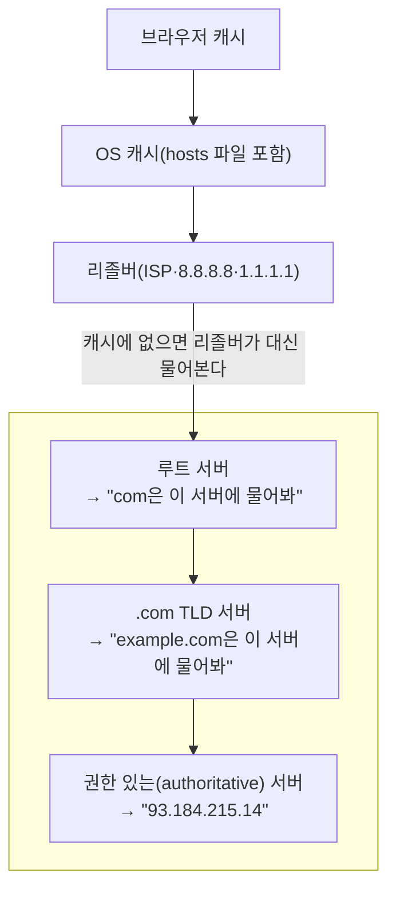

> 여러 자료를 종합한 노트에, ByteByteGo의 System Design 101 가이드 「[How Does the DNS Lookup Work?](https://bytebytego.com/guides/how-does-the-domain-name-system-dns-lookup-work)」, 「[DNS Record Types You Should Know](https://bytebytego.com/guides/dns-record-types-you-should-know)」의 서버 계층과 레코드 종류를 보강했다. DNS 라우팅 정책은 「[Internet Traffic Routing Policies](https://bytebytego.com/guides/internet-traffic-routing-policies)」로 보강했다.
> DNS 프라이버시와 DoH 부분은 Mozilla 웹 기술 블로그의 「[만화로 보는 DNS over HTTPS](http://hacks.mozilla.or.kr/2019/10/a-cartoon-intro-to-dns-over-https/)」를 바탕으로 보강했다.
> DNS의 계층과 전송 프로토콜, hosts 파일 우선순위, 손실 재시도, 잘못된 캐시 처리는 「[fru1tworld/cs-basic 모의 면접 질문 목록](https://github.com/fru1tworld/cs-basic/blob/main/interview/cs/network.md)」의 질문을 기준으로 빠진 개념을 보강했다.
> 도메인 이름 공간의 구조(레이블, FQDN·PQDN, 최상위 도메인 분류)와 동적 갱신은 고려사이버대학교 「컴퓨터네트워크」(2023-2학기) 강의 내용으로 보강했다.
> DNS 포워더와 조건부 포워딩은 GitHub 자료 모음 「[Subjective-studies_OS-CN-DBMS](https://github.com/avgspacelover/Subjective-studies_OS-CN-DBMS)」의 네트워크 면접 정리를 바탕으로 보강했다.

## DNS란

DNS(Domain Name System)는 `example.com` 같은 **도메인 이름을 IP 주소로 바꿔 주는 분산 데이터베이스**다. 사람은 이름을 기억하고, 컴퓨터는 IP로 통신한다. 그 사이를 잇는 전화번호부 역할이다.

DNS는 **응용 계층(7계층) 프로토콜**이고 53번 포트를 쓴다. 전송 계층은 상황에 따라 고른다.

| 전송 | 쓰는 때 | 이유 |
| --- | --- | --- |
| UDP | 일반 질의·응답 | 질문 하나, 답 하나로 끝나 연결 수립 왕복이 아깝다. 리졸버 하나가 초당 수많은 질의를 처리하는데 연결 상태를 들고 있지 않아도 된다 |
| TCP | 응답이 UDP 한도를 넘을 때, 영역 전송(AXFR·IXFR) | 원래 UDP 응답은 512바이트까지였다. EDNS(0)로 더 크게 보낼 수 있지만 단편화 문제로 1232바이트 안팎을 권장한다. 응답이 잘리면 서버가 헤더의 **TC(truncated) 비트**를 켜고, 클라이언트는 같은 질의를 TCP로 다시 보낸다. DNSSEC 서명이 붙으면 응답이 커져 TCP가 잦아진다 |
| TLS·HTTPS | 암호화가 필요할 때 | DoT(853)·DoH(443). 아래 「DNS의 보안과 프라이버시」 |

브라우저가 페이지를 열 때 가장 먼저 일어나는 네트워크 작업이 DNS 조회다. 조회가 느리면 그 뒤의 TCP·TLS 연결과 HTTP 요청이 모두 밀린다.

### 도메인 이름의 구조

도메인 이름 공간은 **루트를 꼭대기로 한 트리**다. 노드마다 **레이블**(최대 63자)이 붙고, 이름은 잎에서 루트 쪽으로 레이블을 점으로 이어 읽는다. 이름 전체는 최대 255바이트다. `www.example.com.`의 맨 끝 점이 루트이고, 바로 위 레이블부터 TLD(`com`), 그 아래가 기관이 등록한 도메인(`example`)이다.

| 구분 | 모양 | 쓰임 |
| --- | --- | --- |
| FQDN (완전한 이름) | 루트까지 다 적은 이름. `mail.corp.example.com.` | 그대로 조회한다. 설정 파일(DNS 존 파일)에서 끝 점을 빠뜨리면 영역 이름이 뒤에 붙어 엉뚱한 이름이 된다 |
| PQDN (부분 이름) | 루트까지 가지 않은 이름. `mail`, `mail.corp` | 리졸버가 **검색 접미사**를 붙여 완성한다. `/etc/resolv.conf`의 `search corp.example.com`(DHCP 옵션 15로도 받는다)이면 `mail` → `mail.corp.example.com` |

최상위 아래는 세 갈래다.

| 분류 | 예 | 설명 |
| --- | --- | --- |
| 일반 도메인(gTLD) | `com`, `org`, `net`, `edu`, `gov`, 새 gTLD(`app`, `dev`) | 기관의 성격으로 나눈다 |
| 국가 도메인(ccTLD) | `kr`, `jp`, `us` | 두 글자 국가 코드 |
| 역방향 도메인 | `in-addr.arpa`, `ip6.arpa` | IP → 이름 조회용. IP 주소를 뒤집어 붙인 이름에 PTR 레코드를 둔다(아래 「주요 레코드」) |

## 조회 흐름



- 브라우저 → 리졸버는 **재귀 질의**다. "답을 다 찾아서 줘"라고 맡긴다.
- 리졸버 → 루트·TLD·권한 서버는 **반복 질의**다. 다음에 물을 곳을 받아 차례로 따라간다.
- 캐시가 모두 빗나가면 루트·TLD·권한 서버를 차례로 오가야 해 조회가 느려진다. 그래서 각 층의 캐시와 TTL이 중요하다.

**DNS 포워더**(forwarder)는 자기 캐시에 없는 질의를 루트부터 직접 따라가지 않고 **다른 리졸버에게 통째로 넘기는**(재귀 질의) DNS 서버다. 받은 답은 캐시해 두었다가 다음 질의에 바로 쓴다.

| 쓰는 곳 | 동작 |
| --- | --- |
| 가정용 공유기 | DHCP로 자기 주소를 DNS 서버로 알려 주고, 받은 질의를 ISP나 공용 리졸버로 넘긴다(DNS 프록시) |
| 사내 DNS | 내부 도메인(`corp.example.com`)은 직접 답하고, 외부 이름만 상위 리졸버로 넘긴다. 바깥으로 나가는 DNS 트래픽을 한 곳에 모아 통제·기록할 수 있다 |
| 조건부 포워딩 | 특정 도메인만 정해 둔 서버로 넘긴다. 사내망과 클라우드 VPC, 합병한 두 회사의 내부 도메인을 서로 풀 때 쓴다 |

포워더를 거치면 캐시를 여럿이 나눠 써 외부 질의가 줄지만, 상위 리졸버가 죽으면 이름 풀이도 함께 멈춘다. 그래서 상위 리졸버를 두 곳 이상 지정한다.

**hosts 파일이 DNS보다 먼저다.** OS의 이름 해석기는 `/etc/hosts`(Windows는 `C:\Windows\System32\drivers\etc\hosts`)를 먼저 보고, 거기 없을 때만 DNS 서버에 묻는다. Linux에서는 이 순서를 `/etc/nsswitch.conf`의 `hosts: files dns` 줄이 정한다. 그래서 hosts 파일은 개발 중 도메인을 로컬 서버로 돌리거나 특정 도메인을 막는 데 쓰이고, 악성 코드가 은행 도메인을 가짜 IP로 바꾸는 파밍(pharming)의 표적이 되기도 한다. 브라우저가 DoH를 켜고 자체 리졸버로 조회하면 OS 해석기를 건너뛸 수 있지만, 주요 브라우저는 hosts 파일 항목을 먼저 확인한다.

**질의가 손실되면 재시도한다.** UDP에는 재전송이 없으므로 DNS 클라이언트가 직접 처리한다. 응답이 타임아웃(Linux `resolv.conf`의 기본 5초) 안에 오지 않으면 같은 질의를 다시 보내고, 설정된 다음 네임서버로 넘어가며 정해진 횟수(기본 2회)만큼 시도한다. 응답은 질의의 **16비트 ID**와 출발 포트로 짝을 맞추므로, 늦게 온 옛 응답이나 위조 응답을 거른다. 리졸버도 권한 서버 하나가 답하지 않으면 같은 영역의 다른 NS로 묻는다. 모두 실패하면 응용 프로그램은 `SERVFAIL`이나 타임아웃 오류를 받는다.

### 네임서버의 세 계층

DNS는 한 서버가 모든 이름을 알지 않고 **트리 모양으로 책임을 나눠** 확장성을 얻는다.

| 계층 | 아는 것 | 비고 |
| --- | --- | --- |
| 루트 네임서버 (`.`) | TLD 네임서버들의 주소 | 논리적으로 13개 이름(a~m.root-servers.net)이지만, 애니캐스트로 전 세계 수많은 인스턴스가 같은 주소로 응답한다 |
| TLD 네임서버 | 각 도메인의 권한 네임서버 주소 | 일반 TLD(`.com`, `.org`), 국가 코드 TLD(`.kr`, `.us`), 테스트·예약용(`.test`) 등 |
| 권한(authoritative) 네임서버 | 실제 레코드(최종 답) | 도메인 등록 기관이나 DNS 호스팅(Route 53, Cloudflare 등)에 등록해 둔다 |

## 주요 레코드

| 레코드 | 의미 | 예 |
| --- | --- | --- |
| A | 도메인 → IPv4 | `example.com → 93.184.215.14` |
| AAAA | 도메인 → IPv6 | `example.com → 2606:2800::...` |
| CNAME | 다른 도메인의 별칭 | `www.example.com → example.com` |
| MX | 메일 서버 | `example.com → mail.example.com` |
| TXT | 임의 텍스트. 도메인 소유 인증, SPF 등 | `"v=spf1 ..."` |
| NS | 이 도메인을 맡은 네임서버 | `ns1.vercel-dns.com` |
| PTR | IP → 도메인 (역방향 조회) | `14.215.184.93.in-addr.arpa → example.com`. 메일 서버의 신원 확인에 쓴다 |
| SRV | 특정 서비스의 호스트와 **포트** | `_sip._tcp.example.com → 10 60 5060 sip.example.com`. VoIP, XMPP 등 |

- CNAME은 서브도메인을 다른 이름에 붙일 때 쓰고, 도메인 루트(apex)에는 쓸 수 없다. 그래서 DNS 업체들이 ALIAS·CNAME flattening 같은 대안을 제공한다.
- TXT는 SPF·DKIM·DMARC 같은 메일 보안 설정과, 서비스가 「이 도메인의 주인이 맞는가」를 확인하는 인증 문자열에 쓴다.
- DNS는 원래 이름과 주소가 자주 바뀌지 않는다고 보고 레코드를 관리자가 손으로 고치게 설계됐다. 주소가 자주 바뀌는 환경을 위해 프로그램이 레코드를 고치는 **동적 갱신**(Dynamic DNS, RFC 2136)이 생겼다. 사내망에서는 DHCP 서버가 주소를 나눠 줄 때 A·PTR 레코드를 함께 갱신하고, 가정에서는 유동 공인 IP가 바뀔 때마다 공유기가 DDNS 서비스의 A 레코드를 고친다.

배포 서비스에 커스텀 도메인을 붙일 때 "A 레코드 또는 CNAME을 이렇게 설정하라"는 안내가 바로 이 레코드들이다.

## TTL과 캐시

각 레코드에는 **TTL(Time To Live, 초 단위)** 이 있다. 리졸버와 브라우저는 TTL 동안 답을 캐시하고 다시 묻지 않는다.

- TTL이 길면 조회가 빠르지만, IP를 바꿨을 때 반영이 늦다("DNS 전파에 시간이 걸린다").
- 서버 이전 전에는 TTL을 미리 짧게 낮춰 두는 것이 관례다.
- **없는 이름도 캐시된다**(negative caching). `NXDOMAIN` 응답은 그 영역 SOA 레코드가 정한 시간 동안 캐시되므로, 레코드를 새로 만들기 전에 한 번 조회했다면 그동안 계속 「없음」으로 보인다.

캐시가 틀린 답을 들고 있을 때 바로잡는 방법은 **기다리거나, 그 캐시를 직접 비우거나, 위조를 막는 것**이다.

| 원인 | 대응 |
| --- | --- |
| 레코드를 바꿨는데 옛 IP가 남음 | TTL이 지나면 저절로 새 값으로 바뀐다. 급하면 층마다 캐시를 비운다: 브라우저(`chrome://net-internals/#dns`), OS(macOS `sudo dscacheutil -flushcache; sudo killall -HUP mDNSResponder`, Windows `ipconfig /flushdns`, systemd-resolved `resolvectl flush-caches`), 공용 리졸버(Google·Cloudflare의 캐시 비우기 페이지) |
| 옛 서버를 바로 끌 수 없음 | 이전 기간에는 옛 서버를 살려 두거나 새 서버로 프록시해, 옛 IP를 받은 클라이언트도 응답을 받게 한다 |
| 캐시 오염(cache poisoning): 공격자가 위조 응답을 먼저 넣음 | 질의 ID와 출발 포트를 무작위로 해 맞히기 어렵게 하고, DNSSEC으로 서명을 검증해 위조 응답을 버린다. 오염된 항목은 리졸버 캐시를 비워 지운다 |

## DNS 라우팅 정책

권한 네임서버는 같은 이름에 대해 **누가, 어디서, 언제 묻느냐에 따라 다른 답**을 줄 수 있다. 이를 이용해 DNS 단계에서 트래픽 방향을 정하는 것이 라우팅 정책이다. 관리형 DNS(AWS Route 53 등)가 대부분 제공한다.

| 정책 | 답을 고르는 기준 | 쓰임 |
| --- | --- | --- |
| 단순(simple) | 조건 없이 정해진 레코드 하나 | 서버가 한 곳뿐일 때 |
| 장애 조치(failover) | 헬스 체크로 주 서버가 정상이면 주 서버, 아니면 보조 서버 | 재해 복구용 대기 사이트 |
| 지리(geolocation) | 질의한 사용자의 위치(국가·대륙) | 지역별 콘텐츠·언어, 데이터 주권 규정 준수 |
| 지연 시간(latency) | 사용자에게 지연이 가장 작은 리전 | 여러 리전에 배포한 서비스의 응답 속도 |
| 가중치(weighted) | 정해 둔 비율대로 나눔 | 새 버전에 10%만 보내기, 리전 간 비율 조정 |
| 다중 값 응답(multivalue) | 정상인 IP 여러 개를 함께 돌려주고 클라이언트가 고른다 | 간단한 분산. 순서를 돌려 가며 주는 DNS 라운드 로빈과 같은 발상이다. 로드 밸런서를 대신하지는 못한다 |

DNS 라우팅은 **TTL만큼 캐시된다는 한계**가 있다. 장애 조치가 반영되는 속도는 TTL과 리졸버의 캐시에 달려 있어, 초 단위 전환은 로드 밸런서나 애니캐스트가 맡는다. 여러 지역에 걸친 분산(GSLB)은 [[load-balancer|로드 밸런서]]에 정리했다.

## 프론트엔드에서 쓰는 것

```html
<!-- 나중에 쓸 외부 도메인의 DNS 조회만 미리 -->
<link rel="dns-prefetch" href="https://cdn.example.com" />
<!-- DNS + TCP + TLS 연결까지 미리 -->
<link rel="preconnect" href="https://fonts.gstatic.com" crossorigin />
```

폰트·이미지 CDN, 분석 스크립트처럼 **다른 도메인의 리소스를 곧 부를 때** 첫 요청 지연을 줄인다. 너무 많이 걸면 오히려 낭비다.

## DNS의 보안과 프라이버시

전통적인 DNS는 **평문 UDP**로 오가고 응답을 검증하지 않는다. 그래서 세 군데에서 새어 나가거나 조작될 수 있다.

| 위협 | 누가 | 결과 |
| --- | --- | --- |
| 추적(tracking) | 리졸버, 경로의 라우터, 질의를 받는 DNS 서버 | 어떤 IP가 어떤 사이트를 찾는지 모아 방문 기록 프로필을 만든다. 리졸버는 접속한 네트워크(카페·호텔 Wi-Fi)가 정해 주는 대로 바뀌므로 그 운영 정책을 알기 어렵다 |
| 스푸핑(spoofing) | 경로의 공격자, 악의적 리졸버 | 가짜 IP를 돌려줘 사기 사이트로 보내거나 특정 사이트를 막는다 |
| 차단·검열 | ISP의 리졸버 | 경고 페이지 IP를 대신 돌려준다 |

| 대책 | 막는 것 | 방식 |
| --- | --- | --- |
| DoT (DNS over TLS) | 경로 도청·변조 | DNS를 TLS로 감싼다. 전용 853 포트라 네트워크가 쉽게 구분·차단할 수 있다 |
| **DoH (DNS over HTTPS)** | 경로 도청·변조 | DNS 질의를 HTTPS(443) 요청으로 보낸다. 일반 웹 트래픽과 섞여 구분하기 어렵다 |
| 신뢰할 수 있는 재귀 리졸버(TRR) | 믿을 수 없는 리졸버 | 브라우저가 네트워크가 준 리졸버 대신, 로그 보관·제3자 제공을 제한하는 정책에 동의한 리졸버를 쓴다 |
| QNAME 최소화 | DNS 서버의 수집 | 리졸버가 루트·TLD 서버에는 필요한 부분(`org`)만 묻고 전체 이름(`en.wikipedia.org`)을 보내지 않는다 |
| ECS 축소 | DNS 서버의 수집 | 리졸버가 CDN 위치 선택용으로 붙이던 클라이언트 IP 앞부분(EDNS Client Subnet)을 보내지 않거나 줄인다 |
| DNSSEC | 응답 위조 | 레코드에 서명을 붙여 **응답이 진짜인지 검증**한다. 암호화는 하지 않으므로 프라이버시는 지켜 주지 않는다 |

- 주요 브라우저와 OS는 보안 DNS(DoH·DoT)를 지원한다. 설정한 리졸버가 지원하면 자동으로 올려 쓰거나, 브라우저가 고른 리졸버를 쓰는 방식이 있다.
- DNS를 암호화해도 TLS 핸드셰이크의 **SNI**에 접속할 도메인이 평문으로 남는다. 이를 숨기는 것이 ECH(Encrypted Client Hello)다([[https|HTTPS와 TLS]]).
- 회사망처럼 DNS로 접근을 통제하는 환경에서는 DoH가 정책을 우회하는 통로가 되므로, 관리 정책으로 끄거나 사내 DoH 리졸버를 지정한다.

## 정리

- DNS는 이름 → IP 변환이고, 모든 요청의 첫 단계다.
- 리졸버가 루트 → TLD → 권한 서버 순으로 찾아 준다.
- A·CNAME 레코드로 도메인을 서버·호스팅에 연결한다.
- TTL만큼 캐시되므로 변경이 즉시 반영되지 않는다.

관련 노트: [[transport-layer|전송 계층과 UDP]], [[cdn|CDN]], [[http-web-architecture|웹 앱의 요청·응답 구조]], [[url-to-page|URL을 입력하면 일어나는 일]], [[load-balancer|로드 밸런서]]
