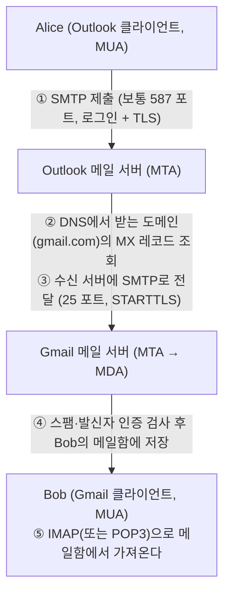

> ByteByteGo의 System Design 101 가이드 「[How is email delivered?](https://bytebytego.com/guides/how-is-email-delivered)」, 「[Design Gmail](https://bytebytego.com/guides/design-gmail)」을 바탕으로 재구성한 노트다.
> SMTP 포트별 용도와 POP3의 동작 모드는 GitHub 자료 모음 「[Subjective-studies_OS-CN-DBMS](https://github.com/avgspacelover/Subjective-studies_OS-CN-DBMS)」의 네트워크 면접 정리를 바탕으로 보강했다.

## 우편과 같은 구조

이메일은 우체통 → 우체국 → 도착지 우체국 → 우편함으로 가는 우편과 구조가 같다. 이름만 다르다.

| 역할 | 우편 | 이메일 |
| --- | --- | --- |
| 편지를 쓰고 읽는 도구 | 사람 | **MUA**(Mail User Agent): Outlook, Gmail 앱·웹, Apple Mail |
| 우체국 사이 중계 | 우체국 | **MTA**(Mail Transfer Agent): 메일 서버끼리 SMTP로 넘긴다 |
| 우편함에 넣기 | 집배원 | **MDA**(Mail Delivery Agent): 받은 메일을 사용자 메일함에 저장 |

## 흐름

- **보내는 프로토콜과 받는 프로토콜이 다르다.** 보내고 서버끼리 넘길 때는 SMTP, 메일함에서 읽어 올 때는 IMAP·POP3다. 포트는 [[transport-layer|전송 계층: 포트, TCP, UDP]]에 있다.
- 받는 서버를 찾는 열쇠는 DNS의 **MX 레코드**다 → [[dns|DNS]]
- 수신 서버가 잠시 받지 못하면 발신 MTA는 큐에 두고 몇 시간~며칠 동안 재시도한다. 그래서 이메일은 즉시성이 아니라 **결국 도착**을 보장하는 저장 후 전달(store-and-forward) 방식이다.

### SMTP 포트

SMTP는 TCP 위에서 동작하고, 무엇을 하느냐에 따라 포트가 갈린다.

| 포트 | 용도 | 암호화 |
| --- | --- | --- |
| 25 | **서버끼리 릴레이**(MTA → MTA) | STARTTLS로 올린다. 스팸 발송을 막으려 많은 ISP·클라우드가 일반 회선의 25번 송신을 막는다 |
| 587 | 클라이언트의 **제출**(submission, MUA → 발신 MTA). 로그인 필수 | 평문으로 연결한 뒤 STARTTLS로 올린다 |
| 465 | 클라이언트의 제출 | 처음부터 TLS로 연결한다(implicit TLS). 한때 폐기됐다가 RFC 8314가 제출용으로 권장하며 되살렸다 |

### IMAP과 POP3

| 구분 | IMAP | POP3 |
| --- | --- | --- |
| 메일 위치 | 서버에 남긴다. 클라이언트는 사본·상태를 동기화 | 내려받은 뒤 서버에서 지우는 삭제 모드가 기본이고, 서버에 남겨 두는 유지 모드도 있다 |
| 여러 기기 | 읽음·폴더 상태가 모든 기기에 맞춰진다 | 기기마다 따로 논다 |
| 포트 | 143(STARTTLS), 993(TLS) | 110(STARTTLS), 995(TLS) |
| 지금의 기본 | 대부분의 클라이언트 | 오프라인 보관용 일부 |

Gmail 웹·앱은 자체 API로 서버와 통신하고, IMAP·POP3는 외부 클라이언트용으로 제공한다.

## 발신자 인증: 위조 막기

SMTP는 원래 보낸 사람 주소를 검증하지 않는다. 누구나 `From: ceo@회사.com`이라고 쓸 수 있다. 그래서 도메인 소유자가 DNS에 정책을 공개하고, 받는 서버가 그것으로 검사한다.

| 기술 | 확인하는 것 | DNS에 두는 것 |
| --- | --- | --- |
| SPF | 이 메일을 보낸 서버 IP가 그 도메인이 허락한 발신 서버인가 | 허용 발신 서버 목록(TXT) |
| DKIM | 메일 헤더·본문이 발신 도메인의 개인키로 서명됐고 바뀌지 않았나 | 서명 검증용 공개키 → [[encoding-encryption-hashing\|디지털 서명]] |
| DMARC | 화면에 보이는 `From` 도메인이 SPF·DKIM을 통과한 도메인과 일치하나, 실패하면 어떻게 할까(none·quarantine·reject) | 정책과 보고서 받을 주소 |

주요 메일 서비스는 대량 발신자에게 세 가지를 모두 요구한다. 서비스에서 가입 메일·알림 메일을 보낸다면 발송 도메인에 SPF·DKIM·DMARC를 설정해야 스팸함으로 가지 않는다.

## 정리

- MUA로 쓰고, MTA끼리 SMTP로 릴레이하고, MDA가 메일함에 넣고, 받는 MUA가 IMAP·POP3로 가져온다.
- 받는 서버는 DNS MX 레코드로 찾고, 실패하면 큐에 두고 재시도한다.
- SMTP 자체는 발신자를 검증하지 않으므로 SPF(서버)·DKIM(서명)·DMARC(정책)로 위조를 막는다.

관련 노트: [[dns|DNS]], [[transport-layer|전송 계층: 포트, TCP, UDP]], [[osi-7-layer|OSI 7계층]], [[encoding-encryption-hashing|인코딩·암호화·해시·토큰화와 디지털 서명]]
