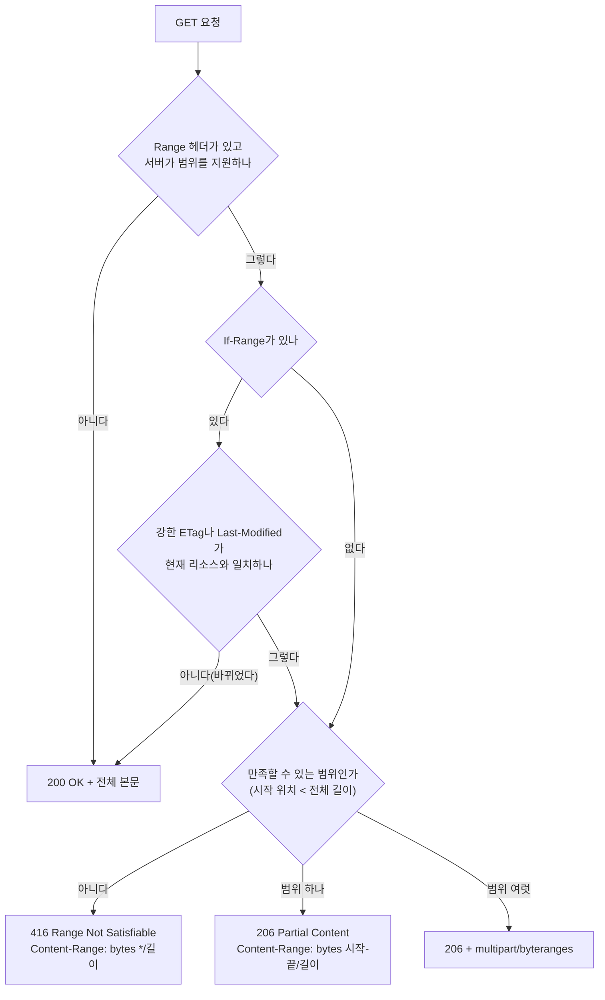
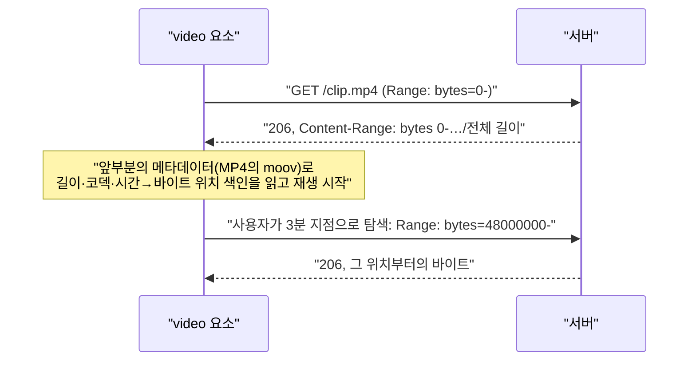

> smoores.dev의 「[Serving Video with HTTP Range Requests](https://smoores.dev/post/http_range_requests/)」(유승완 번역 「[HTTP 범위 요청(Range Requests)을 통한 동영상 제공하기](https://imnotadevleoper.tistory.com/377)」, 2025.12)를 바탕으로, 헤더와 상태 코드 규칙은 RFC 9110과 MDN으로 확인해 재구성한 노트다.

## 범위 요청이란

**범위 요청(range request)** 은 클라이언트가 리소스 전체가 아니라 특정 바이트 구간만 달라고 하는 HTTP 기능이다. 서버가 지원하면 `206 Partial Content`로 그 구간만 보낸다.

| 쓰임 | 왜 필요한가 |
| --- | --- |
| 동영상·오디오 재생 | 앞부분만 받아 바로 재생하고, 사용자가 뒤로 건너뛰면 그 위치부터 받는다 |
| 끊긴 다운로드 이어 받기 | 이미 받은 바이트 뒤부터 요청한다 |
| 큰 파일의 일부만 읽기 | 이미지 헤더, ZIP의 중앙 디렉터리, PDF의 특정 페이지처럼 필요한 부분만 가져온다 |
| 병렬 다운로드 | 파일을 구간으로 나눠 여러 연결로 동시에 받는다 |

HTTP 전반(메서드, 상태 코드, 헤더 구조)은 [[http|HTTP 프로토콜]]에, 범위 요청이 기대는 강한 ETag는 [[http-cache|HTTP 캐시]]에 있다.

## 헤더

| 헤더 | 방향 | 예 | 뜻 |
| --- | --- | --- | --- |
| `Accept-Ranges` | 응답 | `bytes` / `none` | 범위 요청을 받는지 알린다. 일반 `200` 응답에도 붙여 클라이언트가 다음부터 범위로 요청하게 한다 |
| `Range` | 요청 | `bytes=0-499` | 0~499번 바이트(양 끝 포함, 500바이트) |
| | | `bytes=500-` | 500번부터 끝까지 |
| | | `bytes=-500` | **마지막** 500바이트(접미사 범위) |
| | | `bytes=0-99, 200-299` | 여러 범위 |
| `Content-Range` | 응답 | `bytes 0-499/1234` | 이 응답에 담긴 구간과 전체 길이 |
| | | `bytes */1234` | `416`일 때 전체 길이만 알린다 |
| `If-Range` | 요청 | `"abc123"` 또는 HTTP 날짜 | 이 버전 그대로면 범위로, 바뀌었으면 전체를 달라 |

바이트 위치는 0부터 시작하고 **끝 위치를 포함한다.** 그래서 길이는 `end - start + 1`이다. 범위 처리는 `GET`에만 정의돼 있고, 서버는 다른 메서드의 `Range`를 무시한다.

## 서버는 어떻게 응답하나



| 응답 | 언제 | 꼭 넣을 것 |
| --- | --- | --- |
| `206 Partial Content` | 범위가 유효하다 | 범위 하나면 `Content-Range`와 그 구간 길이의 `Content-Length`. 200이었으면 보냈을 `ETag`·`Cache-Control` 등도 함께 |
| `206` + `multipart/byteranges` | 범위가 여럿이다 | `Content-Type: multipart/byteranges; boundary=…`. 파트마다 자기 `Content-Type`과 `Content-Range`를 갖는다 |
| `416 Range Not Satisfiable` | 시작 위치가 전체 길이 이상이다(빈 파일에 대한 접미사 범위도 포함) | `Content-Range: bytes */전체길이` |
| `200 OK` | 범위를 지원하지 않거나, `If-Range` 검증에 실패했다 | 전체 본문. 서버는 `Range`를 무시해도 규격 위반이 아니다 |

- **끝 위치가 길이를 넘는 것은 오류가 아니다.** `bytes=0-999999`를 1,234바이트 파일에 보내면 `bytes 0-1233/1234`로 잘라 준다. `416`은 **시작 위치**로 판단한다. 끝 위치로 검사하는 구현이 흔한 실수다.
- **`If-Range`가 필요한 이유**: 이어 받기 도중 파일이 바뀌면, 옛 파일의 앞부분과 새 파일의 뒷부분이 붙은 깨진 결과가 나온다. `If-Range`는 「같은 버전이면 나머지만, 아니면 처음부터 전체」를 한 번의 요청으로 처리한다. 그래서 **강한 ETag**나 `Last-Modified`만 쓸 수 있고 약한 ETag(`W/"…"`)는 안 된다.

## 동영상과 범위 요청

`<video>`는 파일을 한 번에 받지 않는다. 대략 이렇게 움직인다.



- 브라우저는 메타데이터의 색인으로 **시간 위치를 바이트 위치로 바꿔** 그 구간만 요청한다. 서버가 범위를 지원하지 않으면 탐색 바가 동작하지 않거나, 탐색할 때마다 처음부터 다시 받는다.
- **Safari는 범위 응답을 사실상 요구한다.** 먼저 `bytes=0-1`처럼 처음 2바이트를 요청해 `206`이 오는지 보고, 아니면 그 `<source>`를 건너뛰고 다음 후보로 넘어간다. 후보가 모두 실패하면 동영상이 아예 표시되지 않는다. Chrome에서는 되는데 Safari에서만 안 나오는 동영상은 범위 지원부터 확인한다.
- MP4의 메타데이터(`moov`)가 파일 **끝**에 있으면 재생 전에 끝부분을 한 번 더 요청해야 해서 시작이 늦어진다. 인코딩할 때 `ffmpeg -movflags +faststart`로 앞으로 옮긴다.
- 정적 파일 서버(nginx, CDN, 프레임워크의 `public` 폴더)는 대개 범위 요청을 기본 지원한다. 문제가 되는 것은 **애플리케이션 코드가 직접 파일을 스트리밍하는** 경우(권한 확인 뒤 사용자 업로드 파일 내려주기 등)다.
- 긴 영상, 화질 자동 전환이 필요하면 범위 요청으로 파일 하나를 내려주는 대신 HLS·DASH처럼 조각(segment)으로 나눈 적응형 스트리밍을 쓴다. 동영상 형식과 로딩 성능은 [[video-performance|동영상 성능]]에 있다.

## 직접 구현하기

애플리케이션이 파일을 직접 내려줄 때의 최소 구현이다. 범위 하나만 지원하고, 여러 범위는 전체 응답(`200`)으로 대신한다. 규격상 허용되는 단순화다.

```javascript
import { createServer } from 'node:http'
import { createReadStream } from 'node:fs'
import { stat } from 'node:fs/promises'

createServer(async (req, res) => {
  const path = './media/clip.mp4' // 실제로는 요청에서 경로를 풀고 권한을 확인한다
  const { size, mtime } = await stat(path)
  const etag = `"${mtime.getTime().toString(16)}-${size.toString(16)}"`
  const lastModified = mtime.toUTCString() // HTTP 날짜 형식

  const headers = {
    'Content-Type': 'video/mp4',
    'Accept-Ranges': 'bytes',
    ETag: etag,
    'Last-Modified': lastModified,
  }

  const range = req.headers.range
  const ifRange = req.headers['if-range']
  const rangeAllowed = !ifRange || ifRange === etag || ifRange === lastModified
  const m = range && rangeAllowed ? /^bytes=(\d*)-(\d*)$/.exec(range) : null // 범위 하나만

  if (!m || (m[1] === '' && m[2] === '')) {
    res.writeHead(200, { ...headers, 'Content-Length': size })
    return createReadStream(path).pipe(res)
  }

  let start, end
  if (m[1] === '') {                                  // bytes=-500: 마지막 500바이트
    start = Math.max(size - Number(m[2]), 0)
    end = size - 1
  } else {
    start = Number(m[1])
    end = m[2] === '' ? size - 1 : Math.min(Number(m[2]), size - 1) // 끝은 잘라 준다
  }

  if (start >= size || start > end || (m[1] === '' && Number(m[2]) === 0)) { // 시작 위치로 판단
    res.writeHead(416, { 'Content-Range': `bytes */${size}` })
    return res.end()
  }

  res.writeHead(206, {
    ...headers,
    'Content-Range': `bytes ${start}-${end}/${size}`,
    'Content-Length': end - start + 1,
  })
  createReadStream(path, { start, end }).pipe(res) // end도 포함한다
}).listen(3000)
```

| 함정 | 바로잡기 |
| --- | --- |
| `416`을 끝 위치로 판단 | 시작 위치가 길이 이상일 때만 `416`. 넘친 끝 위치는 `길이 - 1`로 자른다 |
| 생략된 시작·끝 값을 `parseInt`해 `NaN` | `bytes=500-`, `bytes=-500`을 따로 처리한다 |
| `Content-Length`를 전체 크기로 보냄 | 부분 응답의 `Content-Length`는 구간 길이(`end - start + 1`)다 |
| `Last-Modified`를 ISO 형식으로 보내고 다른 형식으로 비교 | HTTP 날짜(`toUTCString()`) 하나로 보내고 같은 문자열로 비교한다 |
| 바뀔 수 있는 응답(동적 변환, 압축)에 범위를 허용 | 같은 URL의 바이트가 요청마다 달라지면 구간이 맞지 않는다. 범위는 고정된 바이트에만 준다 |

스트림을 파일에서 응답으로 흘리는 방식과 백프레셔는 [[node-streams|Node.js 스트림]]에 있다.

## 캐시와 CDN

- HTTP 캐시는 `206` 응답도 저장할 수 있고, 같은 리소스(같은 강한 검증자)의 조각을 이어 붙여 다음 범위 요청에 답할 수 있다.
- CDN은 보통 원본에서 파일을 받아 두고 범위 요청은 캐시된 사본에서 잘라 응답한다. 아주 큰 파일은 처음 탐색 요청 하나 때문에 원본 전체를 끌어오지 않도록 고정 크기 조각 단위로 원본에 요청·캐시한다. nginx의 `slice` 모듈(`slice 1m;`)이 이 방식이다.
- 원본이 `Accept-Ranges: bytes`와 강한 `ETag`를 제대로 주어야 CDN과 브라우저 모두 범위 응답과 `If-Range` 검증을 정확히 할 수 있다.

## 정리

- 범위 요청은 `Range` → `206` + `Content-Range`의 짝이다. 바이트 위치는 0부터, 끝 포함이다.
- `416`은 시작 위치로 판단하고, 넘친 끝 위치는 잘라 준다. 지원하지 않거나 `If-Range`가 어긋나면 `200` 전체로 응답한다.
- `If-Range`는 바뀐 파일을 이어 붙이는 사고를 막는다. 강한 ETag나 `Last-Modified`만 쓴다.
- `<video>`는 범위 요청으로 메타데이터를 읽고 탐색한다. Safari는 범위 응답이 없으면 재생하지 않으니, 코드로 파일을 내려줄 때는 범위를 직접 구현한다.

관련 노트: [[http|HTTP 프로토콜]], [[http-cache|HTTP 캐시]], [[cdn|CDN]], [[video-performance|동영상 성능: 형식·poster·자동 재생·임베드]], [[node-streams|Node.js 스트림]]
