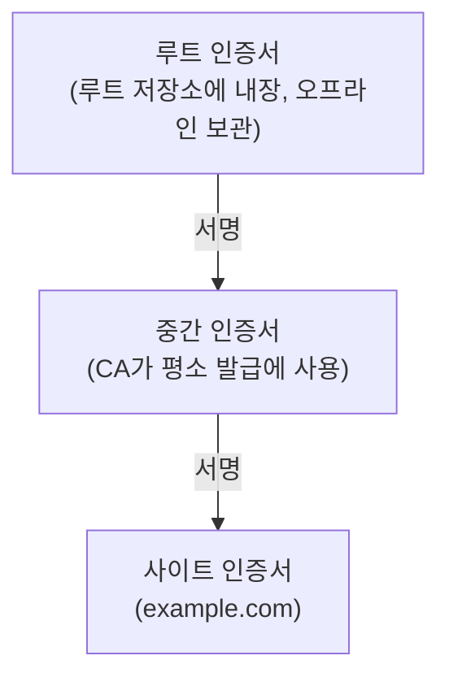
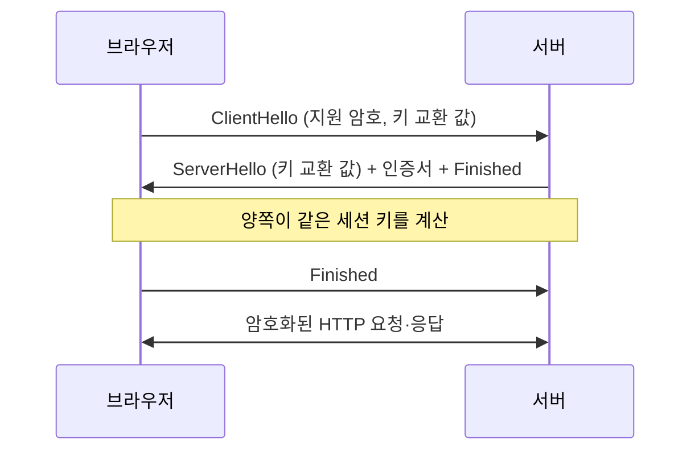
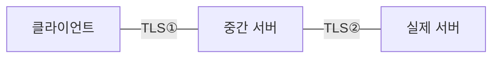

> 핸드셰이크·HSTS 부분은 테크유람의 요즘IT 연재 「[안전한 웹을 위해 HTTPS 이해하기 ①HTTPS의 작동 원리](https://yozm.wishket.com/magazine/detail/1852/)」·「[②HTTPS를 강제하는 HSTS 기술](https://yozm.wishket.com/magazine/detail/1862/)」(2023.01)을 요약·재구성해 보강했다.
> SSL·TLS 역사와 인증서 체인·검증 수준 부분은 DNSimple의 만화 「[How HTTPS Works](https://howhttps.works/)」(5화 연재)를 바탕으로 보강했다.
> 신뢰 저장소를 이용한 중간자 가로채기 부분은 ByteByteGo의 System Design 101 가이드 「[Is HTTPS Safe?](https://bytebytego.com/guides/is-https-safe)」, 「[How does HTTPS work?](https://bytebytego.com/guides/how-does-https-work)」를 바탕으로 보강했다.
> 패킷 캡처로 본 HTTP와 HTTPS의 차이는 「[HTTPS는 어떻게 다를까?](https://parksb.github.io/article/24.html)」를 바탕으로 보강했다.
> TLS 1.3의 변경점과 서버 설정 점검은 「[보안 프로토콜 TLS 1.3](https://brunch.co.kr/@mobiinside/1482)」, 「[안전한 SSL/TLS를 운영하기 위해 알아야 하는 것들](https://engineering.linecorp.com/ko/blog/best-practices-to-secure-your-ssl-tls/)」을 바탕으로 보강했다.

## HTTPS란

HTTPS는 **HTTP 메시지를 TLS(Transport Layer Security)로 암호화해 주고받는 방식**이다. HTTP 자체는 바뀌지 않는다. HTTP와 TCP 사이에 TLS 계층이 하나 끼어들 뿐이다. 기본 포트는 443이다.

평문 HTTP는 중간 경로(공용 와이파이, 프록시, ISP)에서 내용을 그대로 읽고 바꿀 수 있다. HTTPS는 이 문제를 세 가지로 막는다.

| 보장 | 막는 것 | 수단 |
| --- | --- | --- |
| 기밀성 | 도청 | 대칭키 암호화 (AES, ChaCha20) |
| 무결성 | 변조 | MAC·AEAD로 메시지 검증 |
| 인증 | 서버 위장 | 인증 기관(CA)이 서명한 인증서 |

### 패킷으로 보면: 숨는 것과 남는 것

Wireshark로 같은 사이트의 HTTP와 HTTPS 트래픽을 잡아 보면 차이가 바로 보인다.

| 항목 | HTTP | HTTPS |
| --- | --- | --- |
| 요청 경로·쿼리, 헤더(쿠키, User-Agent, Referer), 본문 | 그대로 보인다 | 암호화되어 `Application Data`로만 보인다 |
| 서버 IP·포트, 패킷 크기·시각 | 보인다 | 보인다 |
| 접속하는 도메인 | `Host` 헤더로 보인다 | TLS ClientHello의 **SNI**에 평문으로 남는다. ECH(Encrypted Client Hello)를 쓰면 숨겨진다 |
| DNS 질의 | 평문 | 별개다. DoH·DoT를 써야 숨겨진다([[dns\|DNS]]) |

즉 HTTPS는 **무엇을 주고받는지**는 숨기지만, **누가 어느 서버와 언제 얼마나** 통신하는지는 완전히 숨기지 못한다.

TLS는 SSL(Secure Sockets Layer)을 개선한 후속 규격이다. 지금 쓰는 인증서는 거의 TLS용이지만 관습적으로 "SSL 인증서"라고 부른다.

### SSL에서 TLS로

| 연도 | 버전 | 비고 |
| --- | --- | --- |
| 1995 | SSL 2.0 → SSL 3.0 | Netscape가 개발. 2.0은 결함이 커서 같은 해 3.0으로 교체 |
| 1999 | TLS 1.0 | IETF로 관리가 넘어가며 이름이 바뀜. 사실상 SSL 3.1 |
| 2006 | TLS 1.1 | |
| 2008 | TLS 1.2 | 브라우저 지원은 2013년 무렵에야 퍼짐 |
| 2015 | | SSL 3.0 공식 폐기(RFC 7568) |
| 2018 | TLS 1.3 | RFC 8446. 약한 알고리즘을 걷어 내고 핸드셰이크를 1-RTT로 줄임 |
| 2020~2021 | | 주요 브라우저가 TLS 1.0·1.1 지원 종료, IETF도 폐기(RFC 8996) |

지금은 TLS 1.3이 기본이고 1.2는 구형 클라이언트용으로만 남는다. 서버는 1.2 미만을 꺼 둔다.

## 대칭키와 공개키

| 구분 | 대칭키 | 공개키(비대칭키) |
| --- | --- | --- |
| 키 | 하나로 암호화·복호화 | 공개키·개인키 한 쌍. 짝이 맞는 키로만 풀린다 |
| 장점 | 빠르고 가볍다 | 키를 미리 나눠 갖지 않아도 된다 |
| 약점 | 키를 안전하게 건네기 어렵다. 유출되면 끝 | 연산이 무거워 대량 데이터에 부적합 |

공개키 방식은 반대 방향으로도 쓴다. **개인키로 서명한 것은 짝인 공개키로만 검증된다.** 이것이 디지털 서명이고, 인증서가 "이 공개키의 주인이 맞다"를 증명하는 원리다.

HTTPS는 둘을 섞는다. **공개키로 대칭키(세션 키)를 안전하게 나눠 갖고, 이후 데이터는 대칭키로 암호화한다.**

## 인증서와 CA

서버는 "이 공개키는 example.com의 것"이라는 내용에 **CA가 서명한 인증서**를 보낸다. 브라우저는 OS·브라우저에 미리 들어 있는 루트 CA 목록으로 서명 사슬을 따라가 검증한다. 도메인이 다르거나, 만료됐거나, 신뢰할 수 없는 CA면 경고 화면을 띄운다.

### 신뢰 사슬: 루트와 중간 인증서

CA가 되려면 엄격한 보안 요건과 정기 감사를 통과해 **루트 저장소**(root store)에 들어가야 한다. Apple, Microsoft, Mozilla(Firefox), Google(Chrome)이 각자 루트 저장소를 관리하고 OS·브라우저에 미리 넣어 둔다.



- 브라우저는 사이트 인증서에서 시작해 서명한 인증서를 차례로 따라 올라간다. **끝이 신뢰하는 루트에 닿으면** 사슬 전체를 믿고, 닿지 못하면 경고를 띄운다.
- 서버는 사이트 인증서와 **중간 인증서까지 함께** 보내야 한다. 중간 인증서를 빠뜨리면 일부 클라이언트(특히 모바일 앱·`curl`)에서 검증이 실패한다.
- 루트 키로 직접 서명하지 않는 이유: 루트는 모든 기기에 깔려 있어 교체가 어렵다. 중간 인증서가 유출되면 그것만 폐기하면 된다.

### 검증 수준과 자체 서명 인증서

| 종류 | CA가 확인하는 것 | 비고 |
| --- | --- | --- |
| DV (Domain Validated) | 신청자가 그 **도메인을 통제하는지**만 (DNS 레코드, HTTP 파일) | 자동 발급 가능. 대부분의 사이트에 충분 |
| OV (Organization Validated) | 도메인 + 조직의 실존 | 사람이 서류를 확인 |
| EV (Extended Validation) | 도메인 + 조직에 대한 엄격한 심사 | 브라우저가 주소창에 회사명을 표시하던 기능은 없어졌다. 자물쇠를 눌러 인증서 정보에서만 보인다 |

암호화 강도는 세 종류 모두 같다. 차이는 **누구인지를 얼마나 확인했느냐**뿐이다.

**자체 서명 인증서**(self-signed)는 누구나 무료로 만들 수 있고 암호화도 똑같이 되지만, 신뢰하는 CA의 서명이 없어 브라우저가 경고한다. 공격자도 똑같이 만들 수 있으므로 신원 증명이 되지 않는다. 테스트나 사내망에서만 쓰고, 로컬 개발에는 로컬 CA를 신뢰 목록에 넣는 mkcert가 편하다([[local-https-mkcert|로컬 개발 환경에 HTTPS 적용하기]]).

### 발급 자동화와 유효 기간

Let's Encrypt 같은 무료 CA와 Vercel·Netlify 같은 호스팅이 인증서를 ACME 프로토콜로 자동 발급·갱신한다.

공개 인증서의 최대 유효 기간은 CA/브라우저 포럼 규정(Ballot SC-081)에 따라 단계적으로 줄어든다. 2026년 3월 15일부터 200일, 2027년 3월 15일부터 100일, 2029년 3월 15일부터 47일이다. 수동 갱신은 사실상 불가능해지므로 **자동 갱신과 만료 모니터링이 전제**다. 유효 기간이 짧아진 배경(CA 침해, 폐기 실패, 브라우저 주도의 규칙 변경)은 [[web-pki-evolution|웹 PKI의 변천]]에 있다.

## TLS 핸드셰이크 (TLS 1.3 기준)



- ClientHello에 키 교환 값(key_share)을 미리 실어 보내므로 왕복 한 번에 세션 키가 나온다. **ServerHello 이후의 핸드셰이크(인증서 포함)는 이미 암호화된다.**
- **공개키 방식은 키를 나눠 갖는 데만 쓴다.** 실제 데이터는 빠른 대칭키로 암호화한다.
- 암호 묶음(cipher suite)은 키 교환·인증·암호화·무결성 검증에 쓸 알고리즘 조합이다. ClientHello에서 후보를 보내고 서버가 하나를 고른다.
- TLS 1.3은 1-RTT로 핸드셰이크를 끝낸다(1.2는 2-RTT). HTTP/3는 QUIC 안에 TLS 1.3을 내장해 연결 수립을 더 줄인다.
- 전에 접속한 서버라면 저장해 둔 사전 공유 키(PSK)로 첫 메시지에 데이터를 실어 보내는 **0-RTT**도 된다. 다만 0-RTT 데이터는 공격자가 그대로 **재전송(replay)** 할 수 있으므로, 서버는 GET처럼 여러 번 처리돼도 안전한 요청에만 허용한다.
- 암호 묶음이 단순해졌다. 1.2는 키 교환·인증·암호화·MAC을 한 이름에 묶어 조합이 수백 개였지만, 1.3은 암호화(AEAD)와 해시만 묶음으로 고르고 키 교환·서명은 따로 협상한다. 암호화는 **AEAD(AES-GCM, ChaCha20-Poly1305)만** 남았고, RC4·CBC 모드·SHA-1·정적 RSA·DSA 같은 낡은 선택지는 빠졌다.
- 서버는 핸드셰이크 전체에 서명하고, 다운그레이드를 탐지하는 값을 서버 난수에 심어 공격자가 약한 버전·암호로 협상하게 끼어드는 것을 막는다.
- 오래된 중간 장비가 새 버전 번호를 보고 연결을 끊는 문제 때문에, 레코드의 버전 필드는 1.2로 두고 실제 버전은 `supported_versions` 확장으로 협상한다.
- 키 교환에는 양자 컴퓨터에 대비한 **하이브리드 방식 X25519MLKEM768**(기존 X25519 + ML-KEM)이 쓰인다. Chrome·Edge·Firefox 최신판과 주요 CDN이 기본으로 협상하며, 대신 ClientHello가 1KB 넘게 커진다.

### 고전적인 흐름: RSA 키 교환 (TLS 1.2까지)

설명 자료에서 자주 보는 흐름이다. 세션 키가 어떻게 만들어지는지 보기 쉽다.

| 단계 | 하는 일 |
| --- | --- |
| 1. Client Hello | 지원 TLS 버전, cipher suite 목록, 클라이언트 난수, (재접속이면) 세션 ID |
| 2. Server Hello | 고른 cipher suite, 서버 난수, CA가 서명한 인증서(서버 공개키 포함) |
| 3. 인증서 검증 | 브라우저가 내장된 CA 공개키로 서명을 확인한다. 위조·미등록 CA면 경고 |
| 4. premaster secret | 두 난수로 premaster secret을 만들어 **서버 공개키로 암호화**해 보낸다 |
| 5. 세션 키 생성 | 서버가 개인키로 풀고, 양쪽이 master secret → 세션 키(대칭키)를 만든다 |
| 6. 통신 | 세션 키로 암호화해 주고받고, 끝나면 폐기한다. 세션이 살아 있으면 세션 ID로 핸드셰이크를 줄인다 |

TLS 1.3은 이 RSA 키 교환을 없애고 (EC)DHE 키 교환만 남겼다. 서버 개인키가 나중에 유출돼도 지난 통신을 풀 수 없게(전방 비밀성) 하기 위해서다.

## 서버 TLS 설정 점검

직접 웹 서버(Nginx 등)에서 TLS를 끝낸다면 다음을 확인한다. 관리형 로드 밸런서·CDN을 쓰면 대부분 보안 정책 프리셋 하나를 고르는 일이 된다.

| 항목 | 기준 |
| --- | --- |
| 프로토콜 | **TLS 1.2와 1.3만** 연다. SSL 3.0·TLS 1.0·1.1은 RFC 8996으로 폐기됐다. 끄기 전에 연동하는 외부 시스템·구형 클라이언트가 붙는지 핸드셰이크 시뮬레이션으로 확인한다 |
| 암호 묶음 | 1.2에서는 (EC)DHE 키 교환 + AEAD(GCM, ChaCha20)만 남겨 전방 비밀성을 지킨다. 인증 없는(aNULL)·암호화 없는(eNULL)·EXPORT 등급·RC4·3DES는 뺀다 |
| 인증서 체인 | 서버 인증서와 중간 인증서를 함께 보낸다(`fullchain.pem`). 중간 인증서가 빠지면 일부 클라이언트만 실패해 찾기 어렵다 |
| 키 | RSA 2048비트 이상 또는 ECDSA P-256 |
| 갱신 | ACME 클라이언트(certbot 등)로 자동 갱신하고 갱신 뒤 서버를 다시 읽게(reload) 한다. `--dry-run`으로 갱신 경로를 미리 시험한다 |
| 인증서 투명성(CT) | 공개 CA는 발급 기록을 CT 로그에 남기고, 브라우저는 기록이 없는 인증서를 믿지 않는다. crt.sh 같은 검색으로 내 도메인에 몰래 발급된 인증서가 없는지 볼 수 있다([[web-pki-evolution\|웹 PKI의 변천: 인증서 생태계는 왜 바뀌었나]]) |
| HSTS | 아래 절 참고 |

설정은 Mozilla SSL Configuration Generator의 권장 프로필(intermediate)에서 시작하고, 공개 서버는 Qualys SSL Labs 서버 테스트나 `testssl.sh`로 점수와 약한 설정을 확인한다. 대규모 트래픽에서는 키 교환·서명 알고리즘 조합에 따라 핸드셰이크 CPU 비용이 달라지므로 실제 장비에서 측정한다.

## 프론트엔드가 신경 쓸 것

| 항목 | 내용 |
| --- | --- |
| Mixed Content | HTTPS 페이지에서 `http://` 스크립트·이미지를 부르면 브라우저가 막거나 경고한다. 리소스 URL을 모두 https로 쓴다 |
| HSTS | 아래 절 참고 |
| `Secure` 쿠키 | HTTPS 연결에서만 전송되는 쿠키. 인증 쿠키에는 필수다 |
| 보안 컨텍스트 | Service Worker, 위치·카메라, Clipboard 같은 API는 HTTPS(또는 localhost)에서만 동작한다 |

## HSTS: HTTPS를 강제하기

### 리다이렉트만으로는 빈틈이 있다

흔히 `http://`로 들어오면 301·302로 `https://`로 보낸다. 하지만 **리다이렉트를 받기 전 첫 요청은 평문**이다. 같은 네트워크의 공격자가 이 요청을 가로채면(중간자 공격, MITM) 쿠키·세션을 훔치거나 가짜 페이지로 보낼 수 있다.

### Strict-Transport-Security 헤더

HSTS(HTTP Strict Transport Security, RFC 6797)는 서버가 "이 도메인은 앞으로 HTTPS로만 접속하라"고 알리고 브라우저가 이를 기억해 지키는 방식이다.

| 지시어 | 뜻 |
| --- | --- |
| `max-age=<초>` | 이 기간 동안 HTTPS로만 접속 |
| `includeSubDomains` | 모든 하위 도메인에도 적용 |
| `preload` | 브라우저 preload 목록 등록을 희망 |

```http
Strict-Transport-Security: max-age=63072000; includeSubDomains; preload
```

- 헤더는 **HTTPS 응답에만** 싣는다. 평문 HTTP 응답은 중간에서 바뀔 수 있어 브라우저가 무시한다.
- 헤더를 받은 뒤 사용자가 `http://`로 접속하면 브라우저가 네트워크에 나가지 않고 **`307 Internal Redirect`** 로 바로 HTTPS로 바꾼다. 평문 요청 자체가 생기지 않는다.
- HSTS를 켠 뒤에도 HTTP → HTTPS 301 리다이렉트는 유지한다. 헤더를 아직 못 받은 첫 방문자를 위해서이고, preload 목록 등록 조건이기도 하다.
- 많은 CDN이 HSTS를 설정 하나로 켜 준다.

### preload 목록

HSTS 헤더도 **처음 한 번은 받아야** 효과가 있다. preload 목록은 이 첫 방문의 빈틈까지 막는다. 목록에 오른 도메인은 브라우저에 하드코딩되어 첫 방문부터 HTTPS로만 접속한다. Chrome 목록은 hstspreload.org에서 관리하고, 다른 브라우저도 이 목록을 바탕으로 한다.

**되돌리기 어렵다.** 등록 후 인증서가 만료되거나 HTTPS 설정이 깨지면 사용자가 아예 접속할 수 없고, 목록에서 빠지는 데도 오래 걸린다. 모든 하위 도메인까지 HTTPS가 확실할 때만 신청한다.

## HTTPS만으로 충분하지 않은 경우

| 위협 | 설명 | 대응 |
| --- | --- | --- |
| 서버 침해 | 서버 권한을 뺏기면 복호화된 데이터가 그대로 노출된다 | 서버 보안, 저장 데이터 암호화 |
| 전송 구간 취약점 | 가짜 인증서 설치·잘못된 설정을 노린 중간자 공격 | 인증서 검증, HSTS |
| 민감한 대화 | 서버(운영자)도 내용을 볼 수 있다 | **종단 간 암호화(E2EE)**: 보내는 기기에서 암호화해 받는 기기에서만 푼다 |

### 신뢰 저장소가 열리면: 가로채기 프록시

Fiddler·Charles·mitmproxy 같은 디버깅 도구는 HTTPS 트래픽을 평문으로 보여 준다. 암호가 깨진 것이 아니다. **클라이언트가 그 도구의 루트 인증서를 신뢰하도록 설치했기 때문**이다. 회사 보안 장비의 TLS 검사, 악성 프로그램이 심은 루트 인증서도 같은 원리다.



```text
1. 클라이언트의 연결이 중간 서버로 간다(프록시 설정, DNS·라우팅 조작)
2. 중간 서버가 실제 서버와 따로 TLS 연결을 맺고, 실제 인증서를 검증한다
3. 중간 서버가 그 호스트 이름으로 즉석 발급한 인증서를 클라이언트에 준다
   → 발급자가 신뢰 저장소에 있는 루트이므로 클라이언트 검증을 통과한다
4. 두 구간은 서로 다른 세션 키를 쓴다. 중간 서버는 ①을 풀고, 읽고, ②로 다시 암호화한다
```

**전제 조건은 하나다. 중간자의 루트 인증서가 클라이언트의 신뢰 저장소에 들어 있어야 한다.** 그래서 대응도 신뢰를 좁히는 쪽이다.

- 모르는 루트 인증서를 설치하지 않는다. 기기 관리 정책으로 설치된 루트가 있는지 확인한다.
- 모바일 앱은 **인증서 고정(certificate pinning)** 으로 특정 공개키만 받아들일 수 있다. 다만 키 교체 때 앱이 먹통이 될 수 있어 백업 키를 함께 고정한다.
- 정말 민감한 내용은 전송 구간 암호화에 기대지 않고 종단 간 암호화를 쓴다.

## 정리

- HTTPS = HTTP + TLS. 메시지 형식은 그대로고 전송 구간만 암호화된다.
- 인증서는 "이 서버가 진짜 그 도메인"이라는 CA의 보증이다.
- 비대칭키로 세션 키를 합의하고, 데이터는 대칭키로 암호화한다.
- 리다이렉트만으로는 첫 평문 요청이 남는다. HSTS로 막고, 첫 방문까지 막으려면 preload(되돌리기 어려움에 주의).
- **HTTPS는 전송 구간만 지킨다.** XSS·CSRF처럼 애플리케이션 단의 공격은 따로 막아야 한다.

관련 노트: [[Computer-Science/Network/http|HTTP 프로토콜]], [[security|정보 시스템 보안(공격 기법과 암호)]], [[web-security|웹 보안: CSRF와 XSS]], [[cookie-session|쿠키와 세션]], [[local-https-mkcert|로컬 개발 환경에 HTTPS 적용하기]], [[https-migration|HTTPS 전환: 인증서 고르기부터 리다이렉트까지]], [[web-pki-evolution|웹 PKI의 변천: 인증서 생태계는 왜 바뀌었나]]
