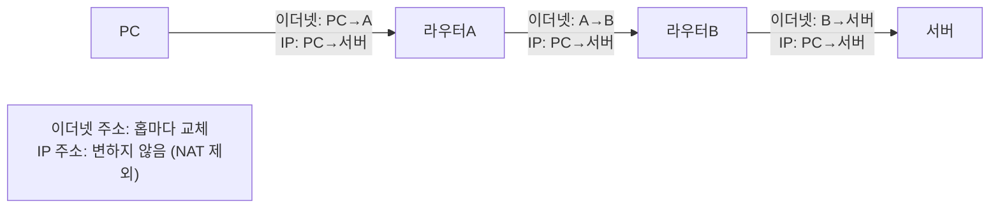
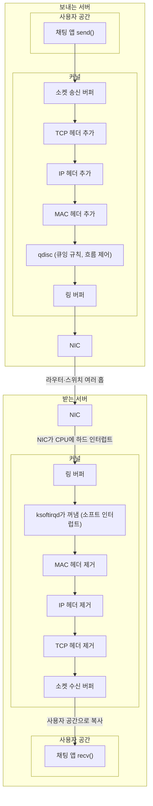

> 고무오리 CS 스터디의 네트워크 학습 노트(네트워크와 모델, 데이터 통신)를 바탕으로 재구성한 노트다. 네트워크 장비와 스위치·라우터의 프레임 처리 부분은 팔만코딩경(42Seoul 커뮤니티 위키)의 「Network에 대한 정리(1)~(4)」, 「netpractice를 위한 네트워크 통신 기초 - 1. LAN 통신」을 바탕으로 보강했다. 네트워크 크기 분류(PAN·MAN)와 애니캐스트는 ByteByteGo의 System Design 101 가이드 「[What are the differences between WAN, LAN, PAN and MAN?](https://bytebytego.com/guides/what-are-the-differences-between-wan-lan-pan-and-man)」, 「[Unicast vs Broadcast vs Multicast vs Anycast](https://bytebytego.com/guides/unicast-vs-broadcast-vs-multicast-vs-anycast)」로 보강했다. 커널과 NIC를 지나는 데이터 경로는 「[Data Transmission Between Applications](https://bytebytego.com/guides/how-is-data-transmitted-between-applications)」를 바탕으로 보강했다.
> 커널 네트워크 스택의 자료구조와 수신 처리 부분은 NAVER D2의 「[TCP/IP 네트워크 스택 이해하기](https://d2.naver.com/helloworld/47667)」를, 지연 시간의 구성과 네트워크 에뮬레이션은 「[글로벌 네트워크 에뮬레이터 prism_pacman 소개](https://d2.naver.com/helloworld/7847943)」를 바탕으로 보강했다.
> 표준 기구, 장비 배치, 물리 계층(매체·이중 방식·CSMA/CD), 2계층의 부계층과 회선·흐름·오류 제어, 스위치 에이징은 「[Frontend_TIL: 네트워크 정의 및 역사](https://github.com/AI-Dev-Lex-Kim/Frontend_TIL/blob/master/%EB%84%A4%ED%8A%B8%EC%9B%8C%ED%81%AC/%EB%84%A4%ED%8A%B8%EC%9B%8C%ED%81%AC%20%EC%A0%95%EC%9D%98%20%EB%B0%8F%20%EC%97%AD%EC%82%AC.md)」, 「[네트워크 구조](https://github.com/AI-Dev-Lex-Kim/Frontend_TIL/blob/master/%EB%84%A4%ED%8A%B8%EC%9B%8C%ED%81%AC/%EB%84%A4%ED%8A%B8%EC%9B%8C%ED%81%AC%20%EA%B5%AC%EC%A1%B0.md)」, 「[물리계층 역활과 기능](https://github.com/AI-Dev-Lex-Kim/Frontend_TIL/blob/master/%EB%84%A4%ED%8A%B8%EC%9B%8C%ED%81%AC/%EB%AC%BC%EB%A6%AC%EA%B3%84%EC%B8%B5%20%EC%97%AD%ED%99%9C%EA%B3%BC%20%EA%B8%B0%EB%8A%A5.md)」, 「[물리계층 장비와 케이블](https://github.com/AI-Dev-Lex-Kim/Frontend_TIL/blob/master/%EB%84%A4%ED%8A%B8%EC%9B%8C%ED%81%AC/%EB%AC%BC%EB%A6%AC%EA%B3%84%EC%B8%B5%20%EC%9E%A5%EB%B9%84%EC%99%80%20%EC%BC%80%EC%9D%B4%EB%B8%94.md)」, 「[데이터링크 역활과 기능](https://github.com/AI-Dev-Lex-Kim/Frontend_TIL/blob/master/%EB%84%A4%ED%8A%B8%EC%9B%8C%ED%81%AC/%EB%8D%B0%EC%9D%B4%ED%84%B0%EB%A7%81%ED%81%AC%20%EC%97%AD%ED%99%9C%EA%B3%BC%20%EA%B8%B0%EB%8A%A5.md)」, 「[데이터 링크 스위치와 ARP](https://github.com/AI-Dev-Lex-Kim/Frontend_TIL/blob/master/%EB%84%A4%ED%8A%B8%EC%9B%8C%ED%81%AC/%EB%8D%B0%EC%9D%B4%ED%84%B0%20%EB%A7%81%ED%81%AC%20%EC%8A%A4%EC%9C%84%EC%B9%98%EC%99%80%20ARP.md)」를 바탕으로 보강했다.
> 「전송 방향과 충돌」 절의 지수 백오프 설명은 CrashCourse의 「Crash Course Computer Science」 강의를 바탕으로 보강했다.
> L3 스위치와 라우터의 비교는 「[fru1tworld/cs-basic 모의 면접 질문 목록](https://github.com/fru1tworld/cs-basic/blob/main/interview/cs/network.md)」의 질문을 기준으로 보강했다.
> 토폴로지별 장단점, 계층별 네 가지 주소, 브리지·게이트웨이, 다중 접근 방식 분류, 이더넷 속도 변천, VLAN, 전송 방식·변조·전송 속도 한계·다중화는 고려사이버대학교 「컴퓨터네트워크」(2023-2학기)와 「정보통신개론」(2023 겨울계절학기) 강의 내용으로 보강했다.
> 노드·링크 정의, 점대점·데이지 체인·3계층 트리 토폴로지, 역할에 따른 분류, 전송 손상, 선로·블록 부호화, CDM, 오류 검출·정정(패리티·CRC·해밍 부호), 지연 계산은 GitHub 자료 모음 「[Subjective-studies_OS-CN-DBMS](https://github.com/avgspacelover/Subjective-studies_OS-CN-DBMS)」의 네트워크 면접 정리를 바탕으로 보강했다.

네트워크는 여러 노드(컴퓨터 같은 시스템)가 데이터를 공유할 수 있도록 연결한 디지털 전기 통신망이다. 분산된 컴퓨터를 통신망으로 묶고, 노드 간 연결을 통해 서로 데이터를 주고받는다. 우리가 매일 쓰는 인터넷도 문서·그림·영상 같은 데이터를 공유하게 해 주는 네트워크 통신망 중 하나일 뿐이다. 네트워크를 이루는 기본 용어는 셋이다.

| 용어 | 뜻 |
| --- | --- |
| 노드(node) | 데이터를 보내거나 받거나 중계하는 지점. 컴퓨터·서버·프린터 같은 종단 호스트와 스위치·라우터 같은 중간 장비가 모두 노드다 |
| 링크(link) | 두 노드를 잇는 통신 경로. 케이블 같은 유선 매체일 수도, 전파 같은 무선 매체일 수도 있다. 두 노드만 잇는 점대점(point-to-point) 링크와 여러 노드가 나눠 쓰는 다중 접근(broadcast) 링크가 있다 |
| 대역폭(bandwidth) | 링크가 단위 시간에 실어 나를 수 있는 최대 데이터 양(bps). 아래 「성능을 정하는 두 값」 |

## 네트워크의 분류

### 크기에 따른 분류

| 구분 | 설명 | 예 |
| --- | --- | --- |
| PAN (Personal Area Network) | 한 사람 주변 수 미터(대략 10m) 안의 기기를 잇는 개인 통신망. 주로 블루투스. 블루투스 기기 한 대가 중심(central)이 되어 최대 7대의 활성 기기를 묶은 작은 망을 **피코넷**(piconet)이라 한다 | 스마트폰과 이어폰·워치 연결, 컴퓨터와 휴대폰 동기화 |
| LAN (Local Area Network) | 가까운 지역을 하나로 묶은 근거리 통신망. 한 기관이 관리하고, 주로 사설 IP를 쓰며 라우팅이 거의 없다. 유선은 이더넷(성형), 무선은 Wi-Fi가 표준이고 토큰 링은 사라졌다 | 같은 회사·사무실·집 안의 컴퓨터, 공유 프린터·파일 서버 |
| MAN (Metropolitan Area Network) | LAN보다 넓고 WAN보다 좁은, 도시나 큰 캠퍼스 규모(반경 수~수십 km)의 망. 장거리 백본과 LAN 사이를 잇는다 | 대학 캠퍼스 여러 곳 연결, 도시 단위 초고속망, 시내 관공서 연결 |
| WAN (Wide Area Network) | 국가·대륙처럼 멀리 떨어진 곳들을 묶은 네트워크. 여러 LAN 대역을 서로 연결한 것 | 인터넷, 다국적 기업의 지사 연결 |

떨어진 LAN들을 전용선 대신 인터넷 같은 공중망 위에서 **암호화한 터널로 묶어 하나의 사설망처럼** 쓰는 것이 VPN(Virtual Private Network)이다([[proxy|프록시와 VPN의 차이]]).

### 연결 형태(토폴로지)에 따른 분류

토폴로지는 노드와 링크를 배치한 모양이다. 케이블이 실제로 깔린 **물리 토폴로지**와 데이터가 흐르는 **논리 토폴로지**는 다를 수 있다. 허브에 성형으로 꽂았지만 신호는 버스처럼 모두에게 퍼지는 옛 이더넷, 물리는 버스지만 토큰을 링처럼 돌리는 토큰 버스가 그 예다.

| 형태 | 설명 | 장점 | 약점 | 주 용도 |
| --- | --- | --- | --- | --- |
| 점대점(Point-to-Point) | 두 노드를 링크 하나로 직접 잇는다. 중간에 장비가 여럿 있어도 양 끝이 직접 이어진 것처럼 보이면 논리적 점대점이다 | 가장 단순하고 매체를 독점한다 | 두 노드만 잇는다 | 전용선, 라우터 간 WAN 링크(PPP), VPN 터널 |
| 성형(Star) | 중앙 장비에 모든 노드가 점대점으로 연결 | 고장 난 단말을 찾고 늘리기 쉽다. 단말 하나를 더할 때 케이블 하나면 된다 | **중앙 장비가 죽으면 전체가 멈춘다**(단일 장애점) | LAN (예: 스위치, Wi-Fi 공유기) |
| 트리(Tree, 계층형) | 성형을 여러 단으로 쌓은 모양. 기업 LAN은 단말이 붙는 **액세스 계층**, 액세스 스위치를 모으는 **분배 계층**, 꼭대기의 **코어 계층** 3단으로 짠다 | 성형보다 많은 장비를 더 멀리까지 붙인다 | 위쪽 장비가 고장 나면 그 아래가 모두 끊긴다. 링크 하나하나가 그 아래 구간의 장애점이다 | 건물·층별 스위치 계층 |
| 버스(Bus) | 긴 케이블 하나에 모든 장비가 매달림. 양 끝의 종단 저항(terminator)이 끝에 닿은 신호를 흡수해 반사를 막는다 | 설치가 쉽고 싸다. 장비 하나가 고장 나도 나머지는 그대로 | 장비가 많을수록 충돌이 늘어 느려지고(CSMA/CD로 조정), 중앙 케이블이 끊기면 전체가 멈춘다 | 초기 동축 이더넷(10BASE5) |
| 데이지 체인(Daisy Chain) | 노드를 일렬로 잇는다. 양 끝을 이으면 링이 된다 | 노드 하나를 끝에 더 붙이기 쉽다 | 링크 하나가 끊기면 망이 둘로 갈린다. 중간 노드가 이웃의 데이터를 중계해야 한다 | 장비 간 직렬 연결(옛 SCSI, 썬더볼트 장비 연결) |
| 링(Ring) | 이웃끼리 고리처럼 이어 한 방향으로 전달. 이웃이 아닌 노드에 보내면 중간 노드를 모두 거친다 | 순서대로 돌아 충돌이 없다 | 노드 하나나 링크 하나가 고장 나면 링 전체가 끊긴다. 그래서 반대 방향의 예비 링을 하나 더 두는 **이중 링**(FDDI, SONET)을 쓴다. 장비를 추가하려면 링을 끊어야 한다 | 토큰 링, SONET 링 |
| 망형(Mesh) | 노드끼리 여러 경로로 연결. 모든 노드가 서로 직접 이어진 **완전 망형**은 노드 n개에 링크 **n(n-1)/2**개가 필요하고, 중요한 노드만 여러 경로로 잇는 **부분 망형**도 있다 | 경로가 여럿이라 한 링크가 끊겨도 돌아간다. 가장 안정적이다 | 회선 수가 많아 비싸다(노드 10개면 완전 망형 링크 45개) | WAN 백본, 데이터센터 스파인-리프, 무선 메시 Wi-Fi |
| 혼합형(Hybrid) | 여러 형태를 섞은 구조. 섞은 형태의 장단점을 함께 물려받는다 | - | - | 실제 인터넷: 성형 LAN들이 망형·링 백본에 이어져 결국 WAN을 이룬다 |

### 역할에 따른 분류

| 구조 | 설명 | 예 |
| --- | --- | --- |
| 클라이언트-서버 | 서버가 자원·서비스를 갖고, 클라이언트가 요청한다. 서버를 정하는 것은 기계의 크기가 아니라 **요청을 받아 처리하는 역할**이다. 한 기계에서 두 역할을 함께 할 수도 있다 | 웹, 메일, DNS |
| P2P(peer-to-peer) | 모든 노드가 같은 자격으로 서로 자원을 주고받는다. 중앙 서버 부담이 없고 참여자가 늘수록 전체 용량도 는다 | BitTorrent, WebRTC 통화([[webrtc\|WebRTC]]) |
| 혼합형 | 찾기·인증은 서버가, 실제 데이터 교환은 P2P로 | 메신저의 파일 전송, 화상 회의의 TURN 우회 |

관리 주체로 보면, 한 기관이 관리하고 바깥에서 들어올 수 없는 **사설망**(private network)과 누구나 쓰는 **공중망**(public network)으로 나뉜다. 클라이언트와 서버 프로세스가 실제로 대화하는 창구는 소켓이고([[transport-layer#소켓과 역다중화|소켓과 역다중화]]), 원격 함수를 로컬 함수처럼 부르는 RPC도 그 위에서 동작한다.

## 통신 방식

| 방식 | 대상 | 비고 |
| --- | --- | --- |
| 유니캐스트 | 특정 대상 하나와 1:1 | 가장 많이 사용. HTTP, FTP, SMTP |
| 멀티캐스트 | 가입한 그룹의 다수와 1:N | IPTV, 화상 회의, 시세 전송 |
| 브로드캐스트 | 같은 네트워크 대역의 모든 대상 | ARP 요청, DHCP 탐색. 라우터를 넘지 않는다 |
| 애니캐스트 | 같은 주소를 가진 여러 노드 중 **가장 가까운 하나**와 1:1 | DNS 루트 서버, CDN. 라우팅이 가장 가까운 곳으로 보내 주므로 지연이 줄고 한 곳이 죽어도 다른 곳이 받는다 |

애니캐스트는 여러 지점이 **같은 IP 주소를 동시에 광고**하고, 라우터가 경로상 가장 가까운 지점으로 패킷을 보내는 방식이다. 보내는 쪽은 주소 하나만 알면 된다([[cdn|CDN]]).

## 프로토콜: 누구와 어떻게 통신할까

노드끼리 통신하려면 정해진 양식, 즉 **프로토콜**이 필요하다. 통신 거리와 대상에 따라 쓰는 주소와 프로토콜이 다르다.

| 하고 싶은 일 | 사용하는 주소 | 프로토콜 |
| --- | --- | --- |
| 가까운 곳(같은 LAN)과 연결 | MAC 주소 | Ethernet |
| 멀리 있는 곳(다른 네트워크)과 연결 | IP 주소 | IPv4, ARP, ICMP |
| 특정 프로그램과 연결 | 포트 번호 | TCP, UDP |
| 사람이 기억하는 이름으로 찾기 | 응용 주소(URL, 이메일 주소) | DNS가 이름을 IP로 바꾼다([[dns\|DNS]]) |

네 주소는 쓰이는 범위가 다르다. MAC 주소(물리 주소)는 **한 링크 안에서만** 유일하면 되고 홉마다 바뀐다. IP 주소(논리 주소)는 **인터넷 전체에서** 유일하고 목적지까지 그대로다. 포트는 **한 호스트 안**의 프로세스를 가린다.

예를 들어 친구에게 메시지를 보낼 때, 카카오톡으로 보낼지 디스코드로 보낼지는 **포트 번호**로 구분한다([[transport-layer|전송 계층과 포트]]). 실제로는 프로토콜 하나만 쓰지 않고 여러 개를 함께 사용한다. "어느 프로그램으로(포트), 어느 지역으로(IP), 그 지역의 어느 컴퓨터로(MAC)"를 모두 담아야 데이터가 제대로 도착한다.

프로토콜은 세 요소로 정의된다.

| 요소 | 정하는 것 |
| --- | --- |
| 구문(Syntax) | 데이터 형식, 부호화, 신호 레벨 |
| 의미(Semantics) | 제어 정보, 오류 처리 방법 |
| 타이밍(Timing) | 속도 조절과 순서 관리 |

프로토콜들은 역할별 계층으로 쌓여 있다. OSI 7계층과 TCP/IP 4계층의 비교는 [[osi-7-layer|OSI 7계층]]에 있다.

프로토콜은 표준 기구가 정한다.

| 기구 | 맡는 표준 |
| --- | --- |
| ISO (국제표준화기구) | OSI 참조 모델 |
| IEEE (전기전자공학자협회) | 주로 LAN. 이더넷(802.3), 무선 LAN(802.11) |
| ITU-T (국제전기통신연합 표준화 부문) | 주로 WAN·전화망 |
| IETF (인터넷 엔지니어링 태스크포스) | 인터넷 프로토콜(IP, TCP, HTTP). 결과물이 RFC 문서다([[rfc-requirement-levels\|RFC 요구 수준 표기]]) |

## 패킷과 캡슐화

**패킷**은 네트워크에서 전달되는 데이터를 통칭하는 말로, 여러 제어 정보(누가 누구에게, 무엇을 요청하는지)와 사용자 데이터로 이루어진 하나의 블록이다.

```text
[ 헤더 | 페이로드(실제로 보내려는 데이터) | 푸터 ]
```

프로토콜 정보는 마트료시카 인형처럼 **순서를 지켜** 겹겹이 감싸진다.

- **캡슐화**: 보낼 때 상위 계층에서 하위 계층으로 내려가며 프로토콜 헤더를 붙여 패킷을 만든다. 예: HTTP → TCP → IPv4 → Ethernet
- **디캡슐화**: 받을 때 하위 프로토콜부터 상위 프로토콜 순으로 하나씩 벗겨 내며 데이터를 확인한다.

계층마다 붙는 PDU 이름(세그먼트 → 패킷 → 프레임)은 [[osi-7-layer|OSI 7계층]]의 PDU 표에 있다.

## 네트워크 장비

| 장비 | 동작 계층 | 하는 일 |
| --- | --- | --- |
| 랜카드(NIC) | 1·2계층 | 컴퓨터와 전송 매체를 잇고, 디지털 데이터와 전기·전파 신호를 서로 바꾼다. MAC 주소를 가진다. OS의 장치 드라이버가 제어한다 |
| 리피터·허브 | 1계층 | 신호를 증폭해 다시 내보낸다. 허브는 받은 신호를 **모든 포트로** 뿌린다. 지금은 스위치로 대체되어 거의 쓰지 않는다 |
| 브리지 | 2계층 | 두세 개의 LAN 구간 사이에서 MAC 주소 테이블을 보고 프레임을 건널지 정한다. 구간마다 **충돌 도메인을 나눈다.** 스위치는 포트가 많고, 포트마다 속도가 달라도 되고, 전용 칩으로 빠른 다중 포트 브리지다. 지금은 Wi-Fi와 유선을 잇는 무선 브리지, 리눅스 가상 브리지(`br0`, Docker의 `docker0`) 정도로 이름이 남았다 |
| 스위치 | 2계층 | 여러 기기를 묶어 하나의 LAN을 만들고, MAC 주소를 보고 프레임을 해당 포트로만 보낸다. 라우팅 기능까지 넣은 것을 L3 스위치, 포트 번호까지 보고 서버에 나눠 주는 것을 L4 스위치(로드 밸런서), HTTP 내용(URL·쿠키)까지 보고 나누는 것을 L7 스위치라 부른다 |
| 라우터 | 3계층 | **서로 다른 네트워크를 잇고** IP 주소를 보고 다음 경로를 고른다. 인터페이스(포트)마다 다른 네트워크에 속하고 각각 IP·MAC 주소를 가진다 |
| 무선 AP | 2계층 | 무선 기기를 유선 네트워크에 연결한다 |
| 인터넷 공유기 | 2~3계층 | 스위치 + 라우터 + 무선 AP + NAT·DHCP를 한 기기에 담은 가정용 장비 |
| 게이트웨이 | 여러 계층(필요하면 전 계층) | 프로토콜 체계가 아예 다른 망(예: 인터넷과 전화망)을 잇고 프로토콜을 변환한다. VoIP의 미디어 게이트웨이가 예다. PC 설정의 「기본 게이트웨이」는 이 넓은 뜻을 물려받은 이름일 뿐 실제로는 라우터다 |

기술적으로 "하나의 네트워크"는 **라우터를 거치지 않고 닿는 범위**다. 같은 스위치에 꽂혀 있어도 IP 대역이 다르면 서로 직접 통신하지 못하고 라우터를 거쳐야 한다.

**L3 스위치와 라우터**는 둘 다 IP를 보고 네트워크 사이를 잇지만 놓이는 자리가 다르다.

| 기준 | L3 스위치 | 라우터 |
| --- | --- | --- |
| 주 용도 | 사내 LAN 안에서 VLAN·서브넷 사이를 잇는 **내부 라우팅** | 사내망과 인터넷, 지사와 지사처럼 **서로 다른 망의 경계** 연결 |
| 포워딩 | 전용 칩(ASIC)으로 처리해 포트 수가 많고 속도가 빠르다 | 범용 CPU와 전용 칩을 함께 써 처리량은 낮을 수 있지만 기능이 많다 |
| 인터페이스 | 이더넷 포트 위주 | 이더넷 외에 광·전용선·셀룰러 같은 WAN 회선 |
| 부가 기능 | 라우팅 프로토콜은 내부용(OSPF 등) 위주 | NAT, VPN, 방화벽 정책, BGP 같은 외부 라우팅, QoS |
| 놓이는 곳 | 사내 백본(코어·분배 계층) | 망의 가장자리(엣지) |

경계는 흐려지고 있어서, 고급 L3 스위치도 BGP를 하고 라우터도 스위칭 포트를 단다. 판단 기준은 「LAN 안의 빠른 서브넷 간 전달인가, 망 경계의 기능이 필요한가」다.

### 장비가 놓이는 모양

| 규모 | 경로 | 특징 |
| --- | --- | --- |
| 가정 | 인터넷 → ISP → 모뎀 → 공유기 → PC·휴대폰 | ISP가 공인 IP 하나를 주고, 공유기가 NAT·DHCP로 여러 기기에 사설 IP를 나눠 준다 |
| 기업 | 인터넷 → ISP 전용선 → 라우터 → 방화벽 → ① L3 백본 스위치 → 팀별 L2 스위치 → PC ② L4 로드 밸런서 → **DMZ**의 공개 서버 | 외부에 공개할 서버는 내부망과 분리한 DMZ에 두고, 로드 밸런서로 부하를 나눈다([[load-balancer\|로드 밸런서]]). 요즘 방화벽은 라우팅도 겸한다 |
| 클라우드(AWS) | 인터넷 → Route 53(DNS) → 인터넷 게이트웨이 → VPC → ELB → 보안 그룹 → EC2(Auto Scaling) | 라우터·스위치·방화벽을 VPC, 보안 그룹 같은 논리 자원으로 설정한다. Auto Scaling은 부하에 따라 **서버 수**를 늘리고 줄인다 |

## 1계층: 비트를 신호로 바꾸기

물리 계층은 2계층이 만든 프레임의 비트를 **전기·빛·전파 신호로 바꿔(인코딩) 보내고**, 받은 신호를 다시 비트로 되돌린다. 데이터의 뜻이나 오류는 따지지 않는다. 커넥터, 송수신 회로, NIC의 PHY 칩이 하드웨어로 이 일을 한다.

| 매체 | 신호 | 케이블·규격 | 특징 |
| --- | --- | --- | --- |
| 구리선(전기) | 전압 변화 | UTP·STP 꼬임쌍선(8가닥, 2가닥씩 꼬아 4쌍), 동축 케이블 | 꼬는 이유는 전자기 간섭을 줄여 속도·거리를 늘리기 위해서다. STP는 차폐막을 더한 것이고, 값이 싼 UTP를 주로 쓴다 |
| 광섬유(빛) | 빛의 패턴 | 싱글 모드(장거리, 예: LX), 멀티 모드(단거리, 예: SX) | 전자기 간섭이 없어 장거리·고속이다. 데이터센터·백본·통신사 구간에 쓴다 |
| 무선(전파) | 전파 | Wi-Fi(IEEE 802.11) | 주파수 대역과 규격에 따라 속도·도달 거리가 다르다 |

케이블처럼 신호가 매체를 따라 정해진 길로 가는 것을 **유도 매체**(guided), 공기 중으로 퍼지는 무선을 **비유도 매체**(unguided)라 한다. 비유도 매체는 안테나 범위 안의 누구나 신호를 받을 수 있어 암호화가 필수다. 주파수가 높아질수록 직진성이 강해진다. 낮은 대역의 라디오파는 벽을 통과하고 멀리 가지만, 마이크로파(약 300MHz~300GHz)는 송수신 안테나가 서로 보여야(가시선) 하고 비에 약하며, 적외선과 레이저 같은 빛은 벽을 못 뚫어 리모컨이나 건물 사이 직결처럼 마주 보는 짧은 구간에만 쓴다([[wireless-network|무선 네트워크]]). 이 밖에 전력선에 데이터를 실어 보내는 전력선 통신(PLC)도 1계층 매체다.

케이블 매체를 더 보면 다음과 같다.

- **꼬임쌍선**: UTP 범주(카테고리)마다 지원 속도가 다르다. Cat5e는 1Gbps, Cat6는 55m 안팎까지 10Gbps, Cat6a는 100m에서 10Gbps다. 커넥터는 RJ-45다.
- **동축 케이블**: 가운데 심선을 절연체와 그물 차폐가 감싸 잡음에 강하고 높은 주파수를 싣는다. 케이블 TV와 케이블 모뎀(HFC)에 남아 있다([[access-network-and-wan|가입자망과 광역망]]).
- **광섬유**: 빛이 코어와 클래딩의 경계에서 전반사하며 나아간다. 싱글 모드는 코어가 가늘어 빛 경로가 하나라 수십 km를 가고, 멀티 모드는 코어가 굵어 경로가 여럿이라 퍼짐(모드 분산) 때문에 수백 m에서 그친다.

### 신호가 약해지고 일그러지는 이유: 전송 손상

신호는 매체를 지나며 나빠진다. 받는 쪽이 0과 1을 잘못 읽게 만드는 원인을 **전송 손상**(transmission impairment)이라 한다.

| 손상 | 원인 | 대응 |
| --- | --- | --- |
| 감쇠(attenuation) | 거리가 멀수록 에너지를 잃어 신호가 약해진다 | 중간에 증폭기(아날로그)나 리피터(디지털, 재생 중계)를 둔다. 이더넷 UTP가 100m로 제한되는 이유다 |
| 왜곡(distortion) | 주파수 성분마다 전파 속도가 달라 도착 시각이 어긋난다(지연 왜곡). 펄스가 퍼져 이웃 비트와 겹치기도 한다(분산) | 등화기(equalizer)로 보정하고, 광섬유는 싱글 모드로 분산을 줄인다 |
| 잡음(noise) | 원하지 않는 신호가 섞인다 | 아래 네 가지로 나뉜다 |

| 잡음 | 원인 | 특징 |
| --- | --- | --- |
| 열잡음(thermal) | 도체 속 전자의 열운동 | 모든 주파수에 고르게 깔려 피할 수 없다(백색 잡음). 섀넌 용량의 S/N을 정한다 |
| 상호 변조(intermodulation) | 여러 주파수가 한 매체를 나눠 쓸 때 장비의 비선형성으로 합·차 주파수가 생긴다 | 다른 채널에 끼어든다 |
| 누화(crosstalk) | 옆 선로의 신호가 전자기 결합으로 넘어온다 | 꼬임쌍선을 꼬는 이유다. 전화 통화 중 다른 통화가 희미하게 들리는 현상 |
| 충격 잡음(impulse) | 번개, 전원 개폐, 고장 난 장비의 순간적인 큰 신호 | 짧고 세서 여러 비트를 한꺼번에 깨뜨린다(버스트 오류). 디지털 데이터에 가장 해롭다 |

이더넷은 1970년대 제록스 PARC에서 만들어 IEEE 802.3으로 표준화됐고, 프레임 형식(최소 64·최대 1518바이트)을 그대로 지키면서 속도만 10배씩 올려 왔다. 10Mbps → 고속 이더넷(Fast Ethernet, 100Mbps) → 기가비트(1Gbps) → 10기가비트(2006년 구리선 규격 802.3an까지 나와 LAN·MAN·WAN을 아우름) → 25·40·100Gbps(40·100G는 2010년 802.3ba)다. 10Gbps 이상은 **전이중만** 지원해 CSMA/CD가 아예 없다.

이더넷 규격 이름은 `속도 + 전송 방식 + 매체`로 읽는다. `1000BASE-T`는 1000Mbps, 베이스밴드(BASE) 전송, 꼬임쌍선(T)이다. 마지막이 숫자면 최대 거리(`10BASE5` = 500m), 글자면 케이블·광 종류(`1000BASE-SX`)다.

### 비트를 싣는 방식: 직렬·병렬, 비동기·동기

| 구분 | 직렬 전송 | 병렬 전송 |
| --- | --- | --- |
| 방식 | 선 하나로 비트를 차례로 | n비트를 n개 선으로 동시에 |
| 비용·거리 | 선이 적어 싸고 멀리 간다 | 선이 많아 비싸고 짧은 거리용 |
| 예 | USB, SATA, PCIe, 이더넷 | 옛 프린터 포트, IDE 디스크 |

컴퓨터 내부는 병렬로 다루므로 내보낼 때 병렬 → 직렬, 받을 때 직렬 → 병렬로 바꾼다. 클럭이 높아지면 병렬 선마다 신호 도착 시각이 어긋나는 **스큐(skew)** 와 선 사이 간섭이 커져서, 고속 인터페이스는 오히려 직렬로 옮겨 갔다(IDE → SATA, 병렬 포트 → USB).

직렬로 받는 쪽은 비트 묶음의 경계를 알아야 한다.

| 구분 | 비동기식 | 동기식 |
| --- | --- | --- |
| 단위 | 문자 하나 | 여러 바이트를 묶은 블록(프레임) |
| 경계 표시 | 문자마다 시작 비트·정지 비트 | 약속한 비트 패턴(동기 문자, 플래그)으로 블록 시작을 알린다 |
| 효율 | 8비트에 2비트를 더 붙여 80% 안팎 | 높다. 대신 블록을 모아 둘 버퍼가 필요하다 |
| 어울리는 데이터 | 띄엄띄엄 생기는 입력(키보드, 시리얼 콘솔) | 연속된 대량 데이터 |

이더넷 프레임 앞의 프리앰블이 동기식의 블록 시작 신호에 해당한다.

### 신호 변환과 변조

정보와 신호가 각각 아날로그·디지털일 수 있어 변환은 네 가지다.

| 정보 → 신호 | 변환 | 예 |
| --- | --- | --- |
| 아날로그 → 아날로그 | 반송파에 실어 보낸다(AM·FM) | 라디오, 옛 전화 |
| 디지털 → 아날로그 | **변조**(모뎀) | 전화선 모뎀, Wi-Fi, LTE |
| 아날로그 → 디지털 | **PCM**: 표본화 → 양자화 → 부호화(8kHz·64kbps 계산은 [[voip-sip-rtp\|VoIP 전화망]]) | 디지털 전화, VoIP |
| 디지털 → 디지털 | **선로 부호화**: 비트를 전압 패턴으로 | 이더넷 NIC |

아날로그 신호는 먼 길을 가며 섞인 잡음을 걸러 낼 수 없고, 증폭기는 잡음까지 키운다. 디지털 신호는 중간에서 0과 1만 판정해 깨끗하게 다시 만들 수 있어(재생 중계) 오류가 쌓이지 않는다. 통신망이 거의 다 디지털이 된 이유다.

**선로 부호화**(line coding)는 비트를 전압 패턴으로 바꾸는 규칙이다. 0이나 1이 길게 이어지면 전압이 변하지 않아 받는 쪽이 비트 경계(클럭)를 놓치고, 평균 전압이 한쪽으로 쏠리는 직류 성분이 생긴다. 방식마다 이 두 문제를 다르게 푼다.

| 방식 | 규칙 | 특징·쓰임 |
| --- | --- | --- |
| 단극 NRZ(unipolar) | 1은 양전압, 0은 0V | 가장 단순하지만 직류 성분이 크고 동기를 잃기 쉽다 |
| 극형 NRZ-L | 1과 0을 서로 다른 전압 준위로 | 같은 비트가 이어지면 전압이 그대로라 동기를 잃는다 |
| 극형 NRZ-I | **1이 올 때마다 전압을 뒤집고** 0이면 유지 | 1이 이어지는 것은 해결하지만 0이 이어지면 여전히 문제다. USB가 비트 스터핑과 함께 쓴다 |
| RZ(Return to Zero) | 비트 중간에 0V로 돌아간다(양·음·0 세 준위) | 비트마다 변화가 있어 동기가 쉽지만 대역폭을 두 배로 쓴다 |
| 맨체스터 | **비트 한가운데서 반드시 전압이 바뀐다.** 바뀌는 방향(올라가나 내려가나)이 비트 값이다 | 변화 자체가 클럭이라 자기 동기(self-clocking)가 된다. 10Mbps 이더넷(10BASE-T) |
| 차등 맨체스터 | 비트 중간에 늘 바뀌고, **비트 시작점에서 바뀌면 0, 안 바뀌면 1**(구현에 따라 반대) | 극성을 거꾸로 꽂아도 읽힌다. 토큰 링 |
| 양극형 AMI | 0은 0V, 1은 양·음을 번갈아 | 직류 성분이 없다. 옛 T1 전화 회선 |

**블록 부호화**(block coding)는 선로 부호화 전에 m비트 묶음을 더 긴 n비트 코드로 바꾸는 단계다(`mB/nB`). 같은 비트가 길게 이어지지 않는 코드만 골라 쓰므로 동기를 지키고, 쓰지 않는 코드가 오면 오류로 알아챈다. 나누기 → 바꾸기 → 합치기 순으로 처리하고, 결과를 다시 선로 부호화해 내보낸다.

| 부호 | 오버헤드 | 쓰임 |
| --- | --- | --- |
| 4B/5B | 25% | 100Mbps 고속 이더넷(100BASE-TX), FDDI |
| 8B/10B | 25% | 기가비트 이더넷 광(1000BASE-X), PCIe 1·2세대, SATA |
| 64B/66B | 약 3% | 10기가비트 이상 이더넷. 고속 링크는 오버헤드를 줄이려 긴 블록으로 옮겨 갔다(PCIe 3세대는 128b/130b) |

**bps**는 초당 비트 수, **보오(baud)** 는 초당 신호가 바뀌는 횟수다. 신호 하나가 가질 수 있는 상태가 L가지면 `bps = 보오 × log₂L`이다. 디지털 변조는 반송파의 어느 성질을 바꿔 상태를 만드느냐로 나뉜다.

| 방식 | 바꾸는 것 | 특징 |
| --- | --- | --- |
| ASK (진폭 편이) | 진폭 | 단순하지만 잡음에 약하다 |
| FSK (주파수 편이) | 주파수 | ASK보다 잡음에 강하다. 옛 저속 모뎀 |
| PSK (위상 편이) | 위상 | 잡음에 강하다. 위상 4개면 신호당 2비트(QPSK) |
| QAM (직교 진폭) | 진폭 + 위상 | 16-QAM은 4비트, 64-QAM은 6비트, 256-QAM은 8비트 |

QAM 단계를 올리면 같은 대역에서 빨라지지만 상태끼리 촘촘해져 잡음에 약해진다. 그래서 Wi-Fi와 LTE는 신호 품질을 보고 변조 단계를 수시로 바꾼다. AP 가까이에서 속도가 잘 나오는 이유 중 하나다.

속도의 상한은 선로의 **대역폭** B(Hz)와 **잡음**이 정한다.

| 정리 | 식 | 뜻 |
| --- | --- | --- |
| 나이퀴스트 | 최대 bps = 2B × log₂L | 잡음이 없다면 상태 수를 늘릴수록 빨라진다 |
| 섀넌 | C = B × log₂(1 + S/N) | 잡음이 있으면 상태를 아무리 늘려도 이 용량을 넘지 못한다 |

대역 3kHz 전화선에서 신호 대 잡음비가 30dB(S/N = 1000)면 C ≈ 3000 × log₂1001 ≈ 30kbps다. 다이얼업 모뎀이 수십 kbps에서 멈춘 이유이고, DSL이 4kHz 필터를 걷어내고 MHz급 대역을 쓰면서 Mbps가 된 이유다([[access-network-and-wan|가입자망과 광역망]]).

### 전송 방향과 충돌

| 방식 | 뜻 | 예 |
| --- | --- | --- |
| 단방향(Simplex) | 한쪽으로만 보낸다 | 방송 |
| 반이중(Half Duplex) | 양쪽 다 보내지만 동시에는 못 한다 | 무전기, 허브 |
| 전이중(Full Duplex) | 동시에 주고받는다 | 전화, 스위치 포트 |

허브처럼 매체 하나를 여럿이 나눠 쓰면 동시에 보낼 때 신호가 부딪친다. 유선 이더넷은 이를 **CSMA/CD**로 다뤘다.

1. Carrier Sense: 보내기 전에 누가 보내고 있는지 듣는다.
2. Multiple Access: 조용하면 보낸다.
3. Collision Detection: 보내는 중 충돌을 감지하면 멈추고 충돌 신호를 알린 뒤, 무작위 시간을 기다렸다 다시 시도한다.

기다리는 시간이 모두 같으면 같은 순간에 다시 부딪치므로 **무작위**로 고른다. 또 연달아 충돌한다는 것은 혼잡하다는 뜻이라, 충돌할 때마다 무작위 대기 범위를 두 배로 넓힌다. 이것이 **이진 지수 백오프**(binary exponential backoff)다. 송신자들이 물러설수록 충돌이 줄어 망이 다시 흐른다. 같은 발상이 무선 LAN, TCP 재전송, API 재시도에도 쓰인다([[resiliency-patterns|장애 확산을 막는 복원력 패턴]]).

스위치가 포트마다 전이중 링크를 주면서 충돌 자체가 사라져, 지금 유선 이더넷에서 CSMA/CD는 사실상 쓰이지 않는다. 무선 LAN은 충돌을 감지할 수 없어 미리 피하는 CSMA/CA를 쓴다([[wireless-network|무선 네트워크]]).

CSMA/CD는 공유 매체를 누가 언제 쓸지 정하는 **다중 접근**(multiple access) 방식 중 하나다. 방식은 세 갈래다.

| 갈래 | 원리 | 예 |
| --- | --- | --- |
| 임의 접근(random access) | 정해진 순서 없이 경쟁하고, 충돌하면 물러섰다 다시 시도 | ALOHA, CSMA, CSMA/CD(유선 이더넷), CSMA/CA(무선 LAN) |
| 제어 접근(controlled access) | 보낼 권리를 순서대로 넘겨 충돌이 없다 | 예약, 폴링(주국이 차례로 묻기), **토큰 패싱**: 토큰이라는 짧은 프레임을 가진 노드만 보내고 다 보내면 이웃에게 넘긴다. 토큰 링(물리 링), 토큰 버스(물리는 버스, 논리는 링) |
| 채널화(channelization) | 주파수·시간·코드로 채널을 미리 나눠 각자 자기 몫만 쓴다 | FDMA, TDMA, CDMA, OFDMA. 이동통신 세대를 가르는 기준이다([[wireless-network\|무선 네트워크]]) |

### 다중화: 선로 하나를 나눠 쓰기

**다중화(multiplexing)** 는 한 장비가 여러 신호를 모아 한 선로로 보내고 받는 쪽에서 다시 나누는(역다중화) 기술이다. 위의 채널화가 여러 단말이 **각자** 공유 매체에 접근하는 것이라면, 다중화는 장비 한 대가 모아서 보낸다. [[transport-layer|전송 계층]]이 포트 번호로 여러 프로세스의 데이터를 섞는 것과 발상이 같고, 여기서는 물리 신호 수준에서 한다.

| 방식 | 나누는 기준 | 동작 | 쓰임 |
| --- | --- | --- | --- |
| FDM (주파수 분할) | 주파수 대역 | 신호마다 다른 대역으로 옮겨 합치고, 사이에 보호 대역을 둔다. 받는 쪽은 대역 통과 필터로 골라낸다 | 라디오·TV 채널, DSL의 음성·데이터 분리. 아날로그 신호에 맞다 |
| TDM (시분할) | 시간 슬롯 | 채널마다 돌아가며 슬롯을 준다 | 전화망 디지털 회선. 디지털 신호에 맞다 |
| WDM (파장 분할) | 빛의 파장 | 여러 색의 빛을 광섬유 한 가닥에 함께 싣는다. 원리는 FDM과 같다. 파장마다 다시 TDM을 얹을 수 있다 | 광 백본. CWDM(20nm 간격, 십여 파장, 싸다)은 도시 구간, DWDM(촘촘한 간격, 수십~백 파장)은 장거리 |
| CDM (코드 분할) | 고유 코드 | 모두가 같은 대역을 늘 함께 쓰되, 송신자마다 서로 직교하는 코드(칩 열)를 곱해 퍼뜨린다. 받는 쪽은 같은 코드를 곱해 자기 신호만 골라낸다 | 3G 이동통신(CDMA, WCDMA), GPS([[wireless-network\|무선 네트워크]]) |

TDM은 슬롯을 나누는 방식이 둘이다. **동기식**은 채널마다 슬롯을 고정해 보낼 게 없어도 빈 슬롯이 나가고, **통계적(비동기식)** 은 데이터가 있는 채널에만 슬롯을 주는 대신 슬롯에 주소를 붙인다. 통계적 TDM을 끝까지 밀면 주소 붙은 패킷을 필요할 때만 보내는 패킷 교환이 된다([[network-layer|데이터 교환 방식]]).

동기식 TDM의 대표가 북미 전화망의 **T1**이다. 64kbps 음성 채널 24개를 한 프레임에 1바이트씩 담고 프레임 구분용 1비트를 더한다.

```text
프레임 = 24채널 × 8비트 + 1비트 = 193비트
초당 8,000프레임(음성 표본화 주기) × 193비트 = 1.544Mbps
```

WDM은 새 케이블을 깔지 않고 파장만 늘려 용량을 키울 수 있어 백본망의 기본 기술이다.

### 단위와 성능 지표

- 회선 속도는 **비트**(bps), 데이터 크기는 **바이트**로 센다. 1Gbps 회선으로 1GB 파일을 받으면 이론상 8초다.
- 대역폭(아래 「성능을 정하는 두 값」)이 링크의 최대치라면 **처리량(throughput)** 은 실제로 처리된 양이다. 대역폭이 차선 수라면 처리량은 실제로 지나간 차의 수다.
- **백플레인(backplane)** 은 스위치·방화벽 같은 장비가 내부에서 처리할 수 있는 최대 용량이다. 장비는 패킷마다 검사 비용이 들어서, 같은 대역에서도 **작은 패킷이 많을수록 처리량이 떨어진다.** 장비 사양의 처리량은 패킷 크기(64·512·1518바이트 등)별로 따로 본다.

## 2계층: 같은 LAN 안에서 주고받기

### 2계층이 하는 일

- 하나의 네트워크 대역(LAN) 안에서 **물리적으로 인접한 노드**끼리 데이터를 프레임 단위로 전달한다.
- 비트 묶음의 시작과 끝을 정해 프레임을 만들고(**프레이밍**), **오류 제어**와 **흐름 제어**를 수행한다.
- 2계층 통신은 같은 LAN 안에서만 쓰인다. 다른 네트워크 대역과 통신하려면 반드시 3계층 주소와 프로토콜을 거쳐야 한다([[network-layer|네트워크 계층]]).

2계층은 두 부계층으로 나뉜다. **MAC**(Media Access Control)은 1계층 쪽에서 매체 접근과 MAC 주소를, **LLC**(Logical Link Control)는 3계층 쪽에서 상위 프로토콜과의 연결을 맡는다. NIC와 그 드라이버가 구현한다.

| 기능 | 하는 일 | 방식 |
| --- | --- | --- |
| 프레이밍 | 상위 데이터에 헤더(주소·타입)와 트레일러(오류 검출)를 붙인다 | 아래 이더넷 프레임 |
| 회선 제어 | 누가 언제 보낼지 정해 충돌을 막는다 | 1:1은 ENQ/ACK(보내도 되나 묻고 승인받기), 1:N은 폴링(주국이 차례로 묻기)·셀렉션 |
| 흐름 제어 | 빠른 송신자가 느린 수신자를 넘치게 하지 않는다 | Stop-and-Wait(프레임 하나 보내고 ACK 기다리기, 재전송 중복은 1비트 순서 번호로 구분), 슬라이딩 윈도(ACK 없이 윈도 크기만큼 연속 전송) |
| 오류 제어 | 손상·분실을 감지하고 다시 보낸다(ARQ) | Stop-and-Wait ARQ, Go-Back-N, Selective Repeat. 잘 받으면 ACK, 깨졌거나 중복이면 NAK를 보내고, 송신 측은 타이머가 끝날 때까지 ACK가 없으면 프레임이나 ACK가 사라졌다고 보고 다시 보낸다 |
| 다중 접근 | 여러 노드가 한 매체를 나눠 쓸 때 누가 보낼지 정한다 | CSMA/CD, CSMA/CA, 토큰 패싱(위 「전송 방향과 충돌」) |

흐름·오류 제어의 원리는 TCP도 같다. 슬라이딩 윈도와 Go-Back-N·Selective Repeat의 비교는 [[transport-layer|전송 계층]]에 있다. 이더넷 자체는 FCS로 오류를 **검출해 버리기만** 하고 재전송은 TCP 같은 상위 계층에 맡긴다.

### 오류 검출과 정정

잡음이 깨뜨리는 비트 수에 따라 오류는 **단일 비트 오류**(프레임에서 1비트만 뒤집힘), **다중 비트 오류**, 연속된 여러 비트가 한꺼번에 깨지는 **버스트 오류**로 나뉜다. 실제 선로에서는 충격 잡음 때문에 버스트 오류가 흔하다. 모든 방식은 데이터에 **여분의 비트(중복 비트)** 를 덧붙이고, 받는 쪽이 같은 계산을 해서 맞는지 본다.

| 방식 | 원리 | 잡는 것 | 쓰임 |
| --- | --- | --- | --- |
| 패리티 비트 | 1의 개수가 짝수(짝수 패리티)나 홀수(홀수 패리티)가 되도록 1비트를 붙인다 | 홀수 개 비트 오류. **두 비트가 함께 뒤집히면 못 잡는다** | 시리얼 통신, 메모리 |
| 2차원 패리티 | 데이터를 표로 놓고 행과 열마다 패리티를 붙인다 | 대부분의 다중 비트 오류. 단일 비트 오류는 행·열 교차점으로 위치까지 찾아 고친다 | 옛 저장 장치 |
| 체크섬 | 16비트 단위로 더한 1의 보수 합을 붙인다 | 단순 합이라 서로 상쇄되는 오류를 놓친다. 계산이 싸서 소프트웨어로 처리한다 | IP·TCP·UDP 헤더([[transport-layer#UDP (User Datagram Protocol)\|UDP 체크섬]]) |
| CRC(순환 중복 검사) | 데이터를 다항식으로 보고 미리 정한 생성 다항식으로 **2진 나눗셈(XOR)** 한 나머지를 붙인다. 데이터 + 나머지 = 코드워드. 받는 쪽이 코드워드를 같은 생성 다항식으로 나눠 나머지가 0이면 통과다 | 생성 다항식 차수(r) 이하 길이의 **버스트 오류는 모두** 잡는다. 하드웨어 시프트 레지스터로 빠르게 계산한다 | 이더넷 FCS(CRC-32), Wi-Fi, 저장 장치 |

검출한 뒤 처리하는 길은 둘이다.

| 방식 | 동작 | 어울리는 곳 |
| --- | --- | --- |
| 후진 오류 정정(BEC) | 받는 쪽이 오류를 알리고 **다시 보내 달라고** 한다. 위의 ARQ가 이것이다 | 재전송이 싼 유선·광 링크 |
| 순방향 오류 정정(FEC) | 처음부터 정정 부호를 넉넉히 붙여 보내 **받는 쪽이 스스로 고친다** | 재전송이 비싸거나 늦는 무선·위성·심우주 통신, 실시간 미디어, 저장 장치. 해밍 부호, 리드-솔로몬(QR 코드·CD), LDPC(Wi-Fi·5G), 터보 부호(LTE) |

정정하려면 **어느 비트가 틀렸는지** 알아야 한다. m비트 데이터에 r비트 중복을 붙이면, r비트가 나타낼 수 있는 2^r가지 경우로 「m+r개 위치 중 어디가 틀렸나」와 「오류 없음」을 모두 구분해야 하므로 다음 조건이 필요하다.

```text
2^r ≥ m + r + 1

m = 4  → r = 3  (해밍(7,4): 4비트에 3비트를 붙여 7비트)
m = 7  → r = 4  (7비트 ASCII 문자 하나: 2^4 = 16 ≥ 7 + 4 + 1 = 12)
```

**해밍 부호**(Hamming code)는 중복 비트를 1, 2, 4, 8…번째 자리에 두고, 각 중복 비트가 자기 자리 번호의 해당 비트가 켜진 위치들의 패리티를 맡는다. 받는 쪽이 패리티를 다시 계산해 틀린 것들을 2진수로 읽으면 그 값이 **틀린 비트의 위치**다. 단일 비트 오류를 고치고, 패리티 1비트를 더한 확장 해밍 부호(SECDED)는 2비트 오류까지 검출한다. 서버용 ECC 메모리가 이 방식이다.

### MAC 주소

- 물리적인 네트워크 장비마다 부여된 고유한 **물리 주소**
- 16진수 12자리, 총 **6바이트**(48비트, 16진수 두 자리 = 1바이트). 예: `AA:AA:AA:AA:AA:AA`
- 앞 3바이트는 제조사 식별 번호(**OUI**, IEEE가 할당), 뒤 3바이트는 제조사가 장비마다 붙인다. 요즘 휴대폰·노트북은 사생활 보호를 위해 Wi-Fi 네트워크마다 무작위 MAC을 쓰기도 한다.

### 이더넷 프레임 헤더

| 필드 | 크기 | 설명 |
| --- | --- | --- |
| Destination Address | 6바이트 | 목적지 MAC 주소 |
| Source Address | 6바이트 | 출발지 MAC 주소 |
| Ethernet Type | 2바이트 | 페이로드에 담긴 **상위(3계층) 프로토콜**의 종류 |

데이터는 전기 신호로 흘러오기 때문에, 받는 쪽이 페이로드를 해석하기 전에 그 안에 어떤 프로토콜(IPv4, ARP 등)이 들어 있는지 Ethernet Type으로 미리 알려 준다.

프레임 끝에는 오류 검출용 FCS(Frame Check Sequence, CRC 값) 4바이트가 트레일러로 붙는다. 받는 쪽은 FCS가 맞지 않으면 프레임을 버린다.

페이로드는 **46~1500바이트**다. 46바이트보다 짧으면 뒤를 패딩으로 채워 최소 프레임 크기(64바이트)를 맞춘다. 충돌을 감지할 시간을 확보하려던 CSMA/CD 시절의 규칙이다. 최대 1500바이트가 이더넷의 MTU다.

### 스위치의 MAC 주소 학습

스위치는 포트와 그 포트 너머 MAC 주소의 대응을 **MAC 주소 테이블**에 기록한다. 처음에는 비어 있고, 프레임이 들어올 때마다 배운다.

| 상황 | 스위치의 동작 |
| --- | --- |
| 프레임이 들어옴 | 출발지 MAC과 들어온 포트를 테이블에 기록(학습) |
| 목적지 MAC이 테이블에 있음 | 그 포트로만 보낸다(필터링·포워딩) |
| 목적지 MAC을 모름, 또는 브로드캐스트(`FF:FF:FF:FF:FF:FF`) | 들어온 포트를 뺀 모든 포트로 보낸다(**플러딩**) |
| 목적지가 들어온 포트와 같은 쪽 | 다른 포트로 보내지 않고 버린다(필터링) |
| 일정 시간 그 MAC에서 프레임이 없음 | 테이블 항목을 지운다(**에이징**, 기본 300초가 흔하다). 기기가 다른 포트로 옮겨 가도 따라가고, 테이블 메모리를 아낀다 |

허브는 모든 포트가 한 충돌 도메인이지만, 스위치는 **포트마다 충돌 도메인을 나눈다.** 브로드캐스트는 여전히 모든 포트로 가므로 브로드캐스트 도메인은 라우터(또는 VLAN)로 나눈다.

받은 기기는 목적지 MAC이 자기 것이 아니면 프레임을 버린다. 스위치 자체는 프레임을 중계할 뿐 그 통신의 출발지·목적지가 아니므로 통신용 MAC·IP 주소가 필요 없다(관리용 주소는 따로 있을 수 있다).

### VLAN: 스위치 하나를 여러 LAN으로

**VLAN**(Virtual LAN)은 물리적으로 같은 스위치에 꽂힌 기기를 논리적으로 다른 LAN으로 나눈다. 브로드캐스트는 같은 VLAN 안에서만 퍼지므로 **VLAN 하나가 브로드캐스트 도메인 하나**다.

- **브로드캐스트 줄이기**: 망이 커질수록 ARP·DHCP 같은 브로드캐스트가 늘어 모든 기기를 괴롭힌다. VLAN으로 쪼개면 그 범위가 줄어든다.
- **분리와 보안**: 학생망과 교직원망, 사무망과 서버망처럼 같은 건물 배선 위에서도 서로의 트래픽이 섞이지 않는다. VLAN끼리는 **라우터나 L3 스위치를 거쳐야만** 통신하므로, 그 지점에 ACL·방화벽 정책을 건다.
- **이동이 쉽다**: 자리를 옮긴 기기를 원래 망에 두려면 케이블을 다시 깔 필요 없이 스위치 포트의 VLAN 설정만 바꾼다.

여러 스위치에 걸친 VLAN은 스위치 사이 **트렁크** 링크에서 프레임에 IEEE 802.1Q 태그(4바이트, VLAN ID 12비트라 1~4094)를 끼워 어느 VLAN 프레임인지 구분한다.

### 홉마다 바뀌는 MAC, 그대로인 IP

다른 네트워크로 가는 패킷은 라우터를 여러 번 거친다. 이때 **IP 헤더의 출발지·목적지 주소는 끝까지 그대로**지만, 이더넷 헤더는 홉(hop)마다 새로 쓴다.



라우터는 받은 프레임의 이더넷 헤더를 떼고, 라우팅 테이블로 다음 홉을 정한 뒤, 다음 홉의 MAC 주소를 ARP로 알아내 새 이더넷 헤더를 붙여 보낸다([[network-layer|네트워크 계층 프로토콜]]).

## 데이터가 커널과 NIC를 지나는 길

애플리케이션이 보낸 메시지 하나는 운영체제 커널의 네트워크 스택과 NIC(Network Interface Card)를 지나 상대 애플리케이션까지 간다.



| 구간 | 하는 일 |
| --- | --- |
| 송신 버퍼 | `send()`는 데이터를 커널 버퍼에 복사하고 돌아온다. 실제 전송은 커널이 한다 |
| 캡슐화 | 계층마다 헤더를 붙인다(위의 「패킷과 캡슐화」) |
| qdisc | 리눅스의 큐잉 규칙(queueing discipline). 내보낼 패킷의 순서와 속도를 조절한다 |
| 링 버퍼 | 커널과 NIC가 공유하는 원형 큐. NIC는 DMA로 여기서 직접 읽고 쓴다 |
| 하드 → 소프트 인터럽트 | 수신 NIC가 CPU에 짧은 하드 인터럽트로 알리고, 무거운 처리는 소프트 인터럽트(`ksoftirqd`)로 미룬다. 트래픽이 많으면 인터럽트 대신 폴링(NAPI)으로 바꿔 처리한다 |
| 역캡슐화와 복사 | 계층별로 헤더를 벗기고, 마지막에 사용자 공간으로 복사해 앱이 읽는다 |

커널과 사용자 공간 사이의 복사를 줄이는 제로 카피(zero-copy)가 고성능 서버와 메시지 브로커의 핵심 최적화가 되는 이유가 여기 있다.

### 스택 안을 더 들여다보기 (Linux)

리눅스 네트워크 스택은 별도 스레드 없이 **이벤트(시스템 콜, 타이머, NIC 인터럽트)에 반응해 실행**된다. 송신은 `write()`를 부른 애플리케이션 스레드가 드라이버까지 내려가고, 수신은 인터럽트를 받은 CPU의 소프트 인터럽트가 TCP까지 끌어올린다.

| 요소 | 역할 |
| --- | --- |
| 소켓 = 파일 | POSIX에서 소켓은 파일 디스크립터다. `file` → `socket` → TCP 연결 구조체로 포인터를 따라가면 드라이버까지 필요한 구조체를 모두 찾는다 |
| TCP 제어 블록(TCB) | 연결 상태(LISTEN, ESTABLISHED, TIME_WAIT), 시퀀스 번호, 수신·혼잡 윈도, 재전송 타이머를 담는다. 리눅스에서는 `tcp_sock`이다. 연결 하나가 패킷 데이터를 빼고 수 KB를 쓴다 |
| 연결 조회 해시 테이블 | 수신 패킷의 `<출발지 IP, 출발지 포트, 목적지 IP, 목적지 포트>`를 해시해 해당 TCB를 찾는다 |
| 패킷 구조체 | 리눅스 `sk_buff`, BSD `mbuf`, Windows `NET_BUFFER_LIST`. 헤더 위치를 포인터로 가리켜 **헤더를 붙이고 떼는 일을 포인터 이동으로** 처리한다. 초당 수백만 개를 만들고 버리므로 전용 할당자를 쓴다 |
| 라우팅 캐시 | 연결마다 라우팅 결과(다음 홉, 송신 NIC, 목적지 MAC)를 참조해 두어 패킷마다 다시 라우팅하지 않는다 |

**패킷 캡처 위치**: `tcpdump`·Wireshark는 드라이버 바로 위에서 패킷을 복사한다. 체크섬 오프로드나 TSO를 쓰면 NIC가 그 뒤에 패킷을 고치므로, **캡처한 패킷은 실제로 선에 나가는 패킷과 다를 수 있다.**

**한 CPU만 바쁜 현상**: 기본 동작에서는 인터럽트를 받은 CPU가 수신 패킷을 끝까지 처리한다. 수신이 많은 서버에서 CPU 하나만 소프트 인터럽트로 바쁜 이유다. 멀티 큐 NIC와 RSS(하드웨어가 흐름별로 큐·CPU를 나눔), RPS(소프트웨어로 나눔)로 분산한다.

| 성능 기법 | 내용 |
| --- | --- |
| 체크섬 오프로드 | TCP·IP 체크섬 계산을 NIC가 맡는다 |
| TSO·GSO / LRO·GRO | 송신은 큰 덩어리를 NIC(또는 드라이버 직전)에서 MSS 단위로 자르고, 수신은 작은 패킷을 합쳐 위로 올린다. 패킷당 처리 비용을 줄인다 |
| 수신 버퍼 자동 조절 | 수신 소켓 버퍼 크기가 곧 TCP 수신 윈도다. 최신 커널은 이를 자동으로 키워 처리량을 맞춘다 |
| qdisc와 traffic control | 드라이버 앞의 큐 규칙을 바꿔 지연·손실·속도 제한을 흉내 내거나 트래픽을 조절한다. 커널 기본값은 `pfifo_fast`이고, systemd를 쓰는 배포판은 대개 `fq_codel`을 기본으로 둔다 |
| Netfilter | 처리 흐름 중간의 훅으로 방화벽·NAT를 구현한다(`iptables`, `nftables`) |

## 성능을 정하는 두 값: 지연 시간과 대역폭

| 값 | 뜻 |
| --- | --- |
| 지연 시간(latency) | 패킷 하나가 보낸 쪽에서 받는 쪽까지 가는 데 걸리는 시간 |
| 대역폭(bandwidth) | 통신 채널이 단위 시간에 실어 나를 수 있는 최대 양 |

지연 시간은 네 가지가 더해진 값이다.

| 구성 요소 | 원인 | 줄이는 법 |
| --- | --- | --- |
| 전파 지연(propagation) | 신호가 거리를 이동하는 시간. 광섬유 속 빛은 진공의 약 2/3 속도라 대륙을 건너는 왕복은 이것만으로 수십~백수십 ms다 | 물리 법칙이라 못 줄인다. **서버를 사용자 가까이** 둔다([[cdn\|CDN]]) |
| 전송 지연(transmission) | 패킷의 모든 비트를 링크에 싣는 시간. 링크 속도에 반비례 | 대역폭을 늘리거나 보낼 양을 줄인다 |
| 처리 지연(processing) | 라우터가 헤더를 읽고 경로를 정하는 시간 | 대개 하드웨어가 처리해 작다 |
| 큐잉 지연(queuing) | 라우터 버퍼에서 차례를 기다리는 시간 | 혼잡할수록 커지고 들쭉날쭉하다. 버퍼가 넘치면 패킷이 버려진다(손실) |

전송 지연과 전파 지연은 헷갈리기 쉽다. 전송 지연은 **패킷 크기와 링크 속도**로, 전파 지연은 **거리와 매체 속도**로 정해진다.

```text
전송 지연 = 패킷 크기(L) ÷ 링크 속도(R)
  1500바이트 = 12,000비트를 100Mbps 링크에 싣기: 12,000 ÷ 100,000,000 = 0.12ms

전파 지연 = 거리(d) ÷ 신호 속도(s, 광섬유는 약 2×10⁸ m/s)
  서울-부산 약 400km: 400,000 ÷ 200,000,000 = 2ms

홉 하나의 지연 = 처리 + 큐잉 + 전송 + 전파 (경로 전체는 홉마다 더한다)
```

링크가 빨라지면 전송 지연만 줄고 전파 지연은 그대로다. 그래서 작은 요청을 여러 번 주고받는 일은 대역폭을 늘려도 빨라지지 않고, 왕복 횟수를 줄이거나 거리를 줄여야 한다.

- 지연은 대륙 사이 해저 구간보다 **마지막 몇 km(last mile)**, 즉 사용자 기기에서 ISP 라우터까지에서 크게 생긴다. 무선망과 인프라가 약한 지역일수록 심하다. `traceroute`로 홉별 지연을 볼 수 있다.
- 해외 네트워크의 문제는 평균 품질보다 **품질이 일정하지 않다는 것**이다. 최악 조건에 맞추면 전체 품질이 떨어지므로, 상황을 판단해 적응하는 로직(적응형 비트레이트 스트리밍 등)을 둔다.
- 네트워크 조건은 실제 망에서는 고정할 수 없어 반복 시험이 어렵다. 그래서 측정한 지연·대역폭·손실 패턴을 **에뮬레이터로 재현**해 시험한다. 리눅스 `tc qdisc ... netem`(지연·손실·지터), 브라우저 개발자 도구의 네트워크 스로틀링이 같은 일을 한다.

## 핵심 정리

- LAN은 가까운 곳, WAN은 LAN들을 이은 먼 곳의 네트워크. 실제 인터넷은 혼합형이다.
- MAC 주소로 같은 LAN, IP 주소로 다른 네트워크, 포트 번호로 특정 프로그램을 찾는다.
- 스위치는 MAC 테이블을 학습해 프레임을 필요한 포트로만 보내고, 모르면 플러딩한다. 라우터는 홉마다 이더넷 헤더를 새로 쓴다.
- 보낼 때는 캡슐화(상위 → 하위), 받을 때는 디캡슐화(하위 → 상위). PDU는 세그먼트 → 패킷 → 프레임.
- 비트 오류는 패리티·체크섬·CRC로 검출하고, 재전송(ARQ, BEC)이나 정정 부호(FEC, 해밍 부호)로 복구한다. 이더넷은 CRC-32로 검출만 하고 복구는 상위 계층에 맡긴다.
- 지연은 전파·전송·처리·큐잉의 합이다. 대역폭은 전송 지연만 줄인다.

관련 노트: [[network-layer|네트워크 계층 프로토콜]], [[osi-7-layer|OSI 7계층]], [[linux-network-namespace|리눅스 네트워크 네임스페이스와 ip 명령]], [[wireless-network|무선 네트워크]], [[access-network-and-wan|가입자망과 광역망]]
