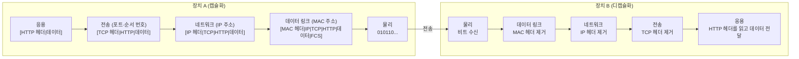

> 고무오리 CS 스터디의 네트워크 학습 노트(네트워크와 모델)를 바탕으로 재구성한 노트다.
> 캡슐화 흐름과 계층을 나누는 이유는 ByteByteGo의 System Design 101 가이드 「[OSI Model Explained](https://bytebytego.com/guides/what-is-osi-model)」를 바탕으로 보강했다.
> 계층별 구현 위치와 세션·표현 계층 설명은 「[Frontend_TIL: OSI 7계층](https://github.com/AI-Dev-Lex-Kim/Frontend_TIL/blob/master/%EB%84%A4%ED%8A%B8%EC%9B%8C%ED%81%AC/OSI%207%EA%B3%84%EC%B8%B5.md)」을 바탕으로 보강했다.

OSI(Open Systems Interconnection) 모델은 네트워크 통신 과정을 일곱 개의 계층으로 나눈 참조 모델이다. 계층마다 맡은 일이 정해져 있어, 문제가 생기면 어느 계층의 문제인지 좁혀 갈 수 있고 각 계층을 독립적으로 바꿀 수 있다.

외우는 순서: **물-데-네-전-세-표-응** (아래에서 위로)

## 계층별 정리

| 계층 | 이름 | 역할 | 대표 프로토콜·장비 |
| --- | --- | --- | --- |
| 7 | 응용 (Application) | 사용자 응용 서비스와 연결, 정보 교환 | HTTP, DNS, SMTP, FTP |
| 6 | 표현 (Presentation) | 데이터 형식 변환, 암호화·복호화, 압축 | JPEG, MPEG, SSL/TLS 일부 |
| 5 | 세션 (Session) | 연결 접속 유지, 동기화 제어 | RPC, NetBIOS |
| 4 | 전송 (Transport) | 프로세스 간 전달, 분할·재조립, 흐름·혼잡·오류 제어 | TCP, UDP |
| 3 | 네트워크 (Network) | 노드 간 전달, 최적 경로 설정(라우팅) | IP, ICMP, ARP, 라우터 |
| 2 | 데이터 링크 (Data Link) | 인접 노드 간 전송, 오류·흐름 제어 | 이더넷, HDLC, 스위치 |
| 1 | 물리 (Physical) | 비트를 전기·광 신호로 변환, 기계적·전기적 특성 정의 | RS-232C, 케이블, 허브 |

> ARP는 IP 주소와 MAC 주소를 잇는 프로토콜이라 2계층과 3계층 사이에 걸쳐 있다고 설명하기도 한다.

### 각 계층은 어디에 구현되나

| 계층 | 구현 위치 |
| --- | --- |
| 1 물리 | NIC의 PHY 칩. 인코더·디코더가 함수가 아니라 회로다 |
| 2 데이터 링크 | NIC(랜카드)와 그 드라이버 |
| 3 네트워크, 4 전송 | 운영체제 커널의 네트워크 스택(소프트웨어) |
| 5~7 | 애플리케이션과 라이브러리(브라우저, TLS 라이브러리 등) |

그래서 4계층 이하는 OS가 소켓 API로 제공하고, 애플리케이션은 그 위에서 HTTP 같은 응용 프로토콜만 다룬다. 커널 안의 흐름은 [[network-basics|네트워크 기초]]의 「데이터가 커널과 NIC를 지나는 길」에 있다.

## 계층별로 기억할 포인트

- **물리 계층**: 데이터의 의미는 모르고 0과 1을 신호로 바꿔 보내기만 한다.
- **데이터 링크 계층**: 물리적으로 **직접 연결된 두 노드** 사이의 신뢰성 있는 전송을 맡는다(MAC 주소 사용).
- **네트워크 계층**: 여러 네트워크를 거쳐 **목적지 호스트까지** 가는 경로를 결정한다(IP 주소 사용).
- **전송 계층**: 호스트 안의 **어느 프로세스**에게 줄지 포트 번호로 구분하고, TCP라면 신뢰성을 보장한다.
- **세션 계층**: 연결의 수립·유지·종료와 대화 방식(전이중·반이중·단방향)을 정하고, 긴 전송 중간에 동기점을 두어 끊기면 그 지점부터 다시 잇는다.
- **표현 계층**: 응용이 이해하도록 데이터 형식을 맞춘다. 문자 인코딩(ASCII·UTF-8), 이미지·영상 형식(JPEG·GIF·MPEG), 압축, 암호화가 여기 속한다.
- **세션·표현·응용 계층**: 실제 인터넷(TCP/IP 모델)에서는 보통 하나의 응용 계층으로 묶어서 다룬다.

계층별 자세한 내용: 2계층과 캡슐화는 [[network-basics|네트워크 기초]], IP·ARP·ICMP는 [[network-layer|네트워크 계층]], 4계층(TCP·UDP)은 [[transport-layer|전송 계층]], 응용 계층은 [[http|HTTP]]

## OSI 모델과 TCP/IP 모델

| 항목 | OSI 7계층 | TCP/IP 4계층 |
| --- | --- | --- |
| 성격 | ISO 표준 참조 모델. 통신 전반을 **역할 기준**으로 논리적으로 나눈다 | 실제 인터넷이 쓰는 프로토콜 묶음. **구현 기준**으로 나눈다 |
| 응용 | 응용 + 표현 + 세션 (7·6·5) | 응용 계층 하나 |
| 전송 | 전송 (4) | 전송 계층 |
| 네트워크 | 네트워크 (3) | 인터넷 계층 |
| 링크 | 데이터 링크 + 물리 (2·1) | 네트워크 접근(인터페이스) 계층 |

둘 다 계층마다 역할을 정하고 아래 계층의 서비스를 위 계층이 쓰는 구조다. 문제를 진단할 때는 OSI 번호로 말하고("L4 로드 밸런서", "L2 스위치"), 구현은 TCP/IP 모델을 따른다.

## 캡슐화와 계층별 PDU

보낼 때 상위 계층에서 하위 계층으로 내려가며 헤더를 붙이고(캡슐화), 받을 때 아래부터 벗긴다(디캡슐화). 계층마다 데이터 단위(PDU, Protocol Data Unit)의 이름이 다르다.

| 계층 | 구성 | PDU |
| --- | --- | --- |
| 응용 | 데이터 | 메시지 |
| 4 전송 | TCP + 데이터 | 세그먼트 (UDP는 데이터그램) |
| 3 네트워크 | IP + TCP + 데이터 | 패킷 |
| 2 데이터 링크 | Ethernet + IP + TCP + 데이터 + FCS | 프레임 |
| 1 물리 | 신호 | 비트 |

HTTP 요청 하나가 장치 A에서 B로 가는 과정은 다음과 같다.

**계층을 나누는 이유**는 각 계층이 자기 헤더만 보고 일하게 하기 위해서다. 라우터는 IP 헤더만 보고 경로를 정하고, 그 안의 TCP 세그먼트나 HTTP 메시지가 무슨 뜻인지 알 필요가 없다. 그래서 한 계층의 기술(예: 유선 이더넷 → 와이파이)을 바꿔도 다른 계층은 그대로 쓴다.

관련 노트: [[network-basics|네트워크 기초]], [[network-layer|네트워크 계층 프로토콜]], [[transport-layer|전송 계층: 포트, TCP, UDP]]
