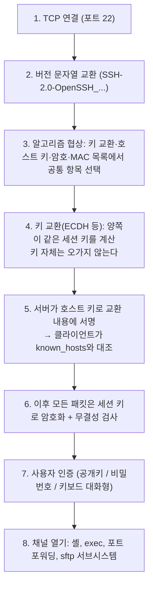

> ByteByteGo의 System Design 101 가이드 「[How does SSH work?](https://bytebytego.com/guides/how-does-ssh-work)」를 바탕으로, SSH 프로토콜 구조(RFC 4251~4254)와 OpenSSH 문서로 확인해 재구성한 노트다.

## SSH란

**SSH(Secure Shell)** 는 안전하지 않은 네트워크에서 원격 기기에 안전하게 접속하는 프로토콜이다. 평문으로 비밀번호를 보내던 Telnet·rlogin을 대체했다. 기본 포트는 TCP 22다.

지금 쓰는 것은 IETF가 표준화한 **SSH-2**다. SSH-1은 설계 결함 때문에 쓰지 않는다. SSH-2는 세 계층으로 나뉜다.

| 계층 | 하는 일 | 결과 |
| --- | --- | --- |
| 전송 계층(Transport) | 알고리즘 협상, 키 교환, 서버 인증(호스트 키), 암호화·무결성·압축 | 암호화된 통로 하나 |
| 인증 계층(User Authentication) | 그 통로 안에서 클라이언트 사용자를 확인 | 로그인된 세션 |
| 연결 계층(Connection) | 통로 하나를 여러 논리 채널로 다중화 | 셸, 명령 실행, 포트 포워딩, SFTP |

## 연결 과정

### 서버 확인: 호스트 키

처음 접속하면 "이 호스트의 지문이 이것인데 계속할까?"를 묻는다. 수락하면 `~/.ssh/known_hosts`에 저장하고, 다음부터 키가 다르면 접속을 막고 경고한다. 처음 한 번을 믿는 이 방식을 **TOFU(Trust On First Use)** 라 한다.

- 경고가 뜨면 서버 재설치일 수도, 중간자 공격일 수도 있다. 이유를 확인하기 전에는 지우고 넘어가지 않는다.
- 서버가 많으면 지문을 미리 배포하거나, DNS에 지문을 두거나(SSHFP), SSH 인증서로 CA가 호스트 키에 서명하게 한다.

TLS는 인증서 체인으로 서버를 믿고, SSH는 기본적으로 직접 기억한 키로 믿는다는 점이 다르다 → [[https|HTTPS와 TLS]].

### 사용자 인증

| 방식 | 동작 | 권장 |
| --- | --- | --- |
| 공개키 | 서버의 `~/.ssh/authorized_keys`에 공개키를 등록하고, 클라이언트가 세션 정보에 개인키로 서명해 증명한다 | **기본**. 키는 Ed25519 |
| 비밀번호 | 암호화된 통로 안에서 비밀번호를 보낸다 | 대입 공격 대상이 된다. 인터넷에 열린 서버에서는 끈다 |
| 키보드 대화형 | 서버가 묻는 질문에 답한다(OTP 등 2단계 인증 연동) | 공개키와 함께 MFA로 |
| SSH 인증서 | CA가 사용자 공개키에 유효 기간과 권한을 담아 서명한다 | 사람·서버가 많은 조직 |

개인키는 암호(passphrase)로 잠그고, 매번 풀지 않도록 `ssh-agent`에 맡긴다. 에이전트 포워딩(`-A`)은 접속한 서버의 관리자가 내 에이전트를 쓸 수 있게 하므로 믿는 서버에만 쓰고, 경유 접속은 `ProxyJump`(`-J`)로 대신한다.

## 연결 계층: 한 통로, 여러 채널

| 채널 | 명령 예 | 쓰임 |
| --- | --- | --- |
| 대화형 셸 | `ssh user@host` | 원격 터미널 |
| 명령 실행 | `ssh host 'df -h'` | 스크립트에서 원격 명령 |
| 로컬 포트 포워딩 | `ssh -L 5432:db.internal:5432 bastion` | 내 PC의 5432로 사설망 DB에 접속 |
| 원격 포트 포워딩 | `ssh -R 8080:localhost:3000 server` | 서버의 8080을 내 PC의 3000으로 |
| 동적 포워딩 | `ssh -D 1080 host` | SOCKS 프록시처럼 쓰기 |
| 파일 전송 | `sftp`, `scp` | 같은 통로 위의 파일 전송 |

배스천 서버를 거쳐 사설망 DB에 붙는 터널 예는 [[aws-cloud-basics|AWS 클라우드 기초]]에 있다. Git의 SSH 원격 저장소도 같은 공개키 인증을 쓴다.

## 운영 체크리스트

- 비밀번호 로그인과 root 직접 로그인을 끈다(`PasswordAuthentication no`, `PermitRootLogin no`).
- 22번 포트를 인터넷 전체에 열지 않는다. 방화벽·보안 그룹으로 출발지를 제한하거나 배스천·VPN 뒤에 둔다 → [[network-security|네트워크 보안: 방화벽, VPN, 계층별 공격]]
- 키는 사람·용도별로 따로 만들고, 퇴사·유출 시 `authorized_keys`에서 지운다. 많아지면 SSH 인증서로 수명을 짧게 만든다.
- 최신 OpenSSH는 양자 내성 하이브리드 키 교환을 기본으로 쓴다. 오래된 서버·클라이언트는 갱신한다.

## 정리

- SSH-2는 전송(암호화·서버 확인) → 인증(사용자 확인) → 연결(채널 다중화)의 세 계층이다.
- 세션 키는 키 교환으로 양쪽이 계산하고, 서버는 호스트 키 서명으로 신원을 증명한다. 처음 본 키를 기억하는 TOFU가 기본이다.
- 사용자 인증은 Ed25519 공개키를 기본으로, 비밀번호 로그인은 끈다.
- 하나의 암호화 통로로 셸·명령·포트 포워딩·파일 전송을 모두 한다.

관련 노트: [[https|HTTPS와 TLS]], [[aws-cloud-basics|AWS 클라우드 기초]], [[network-security|네트워크 보안: 방화벽, VPN, 계층별 공격]], [[encoding-encryption-hashing|인코딩·암호화·해시·토큰화와 디지털 서명]], [[transport-layer|전송 계층]]
