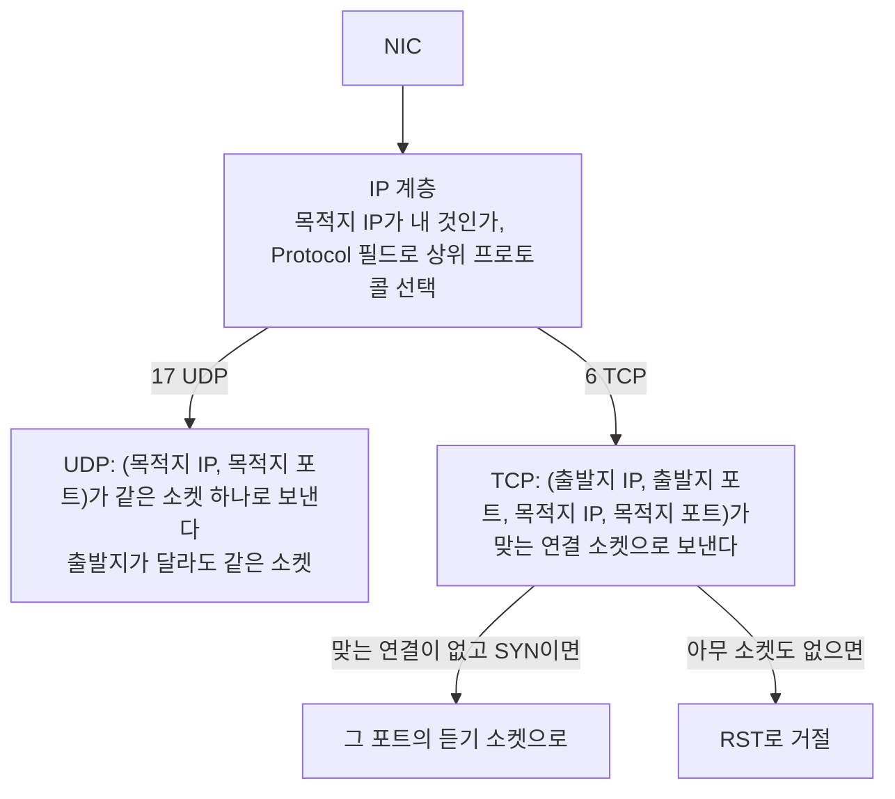
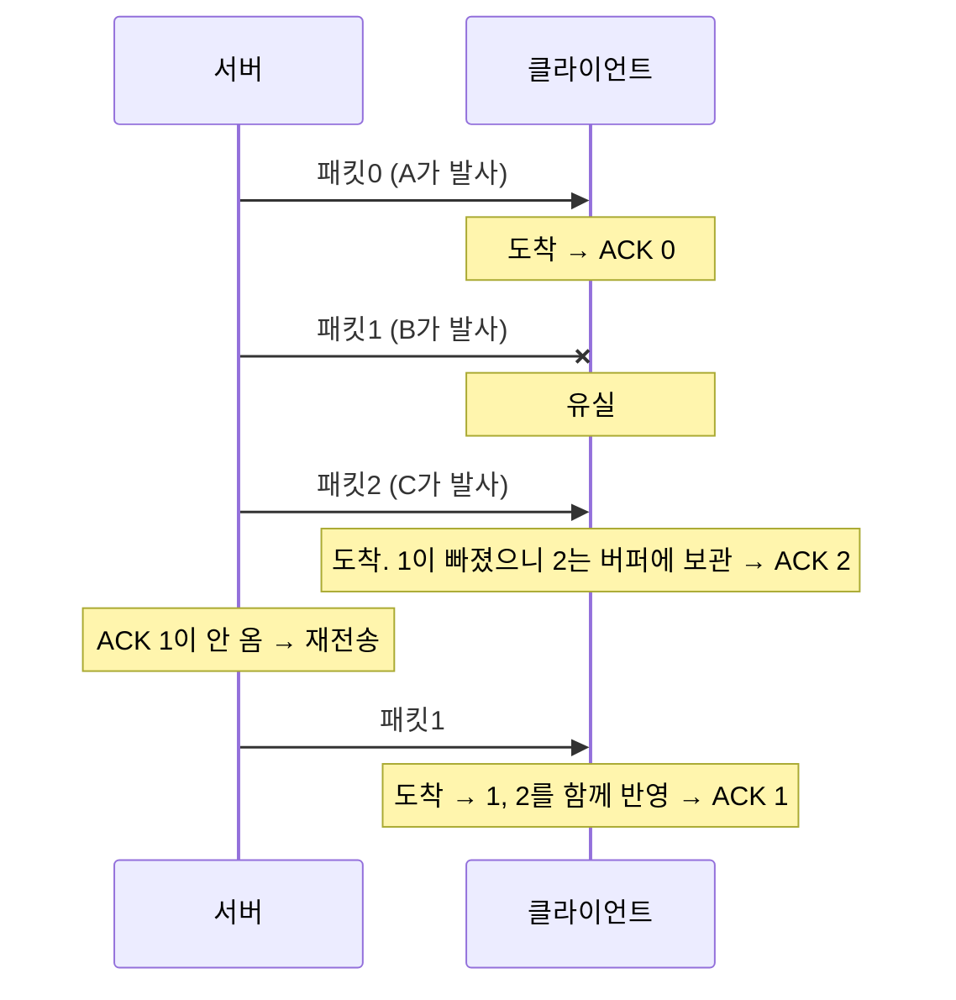

> 고무오리 CS 스터디의 네트워크 학습 노트(전송 계층과 포트, UDP, TCP 장)를 바탕으로 재구성한 노트다.
> UDP의 쓰임, 게임의 신뢰성 UDP, 응용 프로토콜 표는 ByteByteGo의 System Design 101 가이드 「[Top 4 Most Popular Use Cases for UDP](https://bytebytego.com/guides/top-4-most-popular-use-cases-for-udp)」, 「[TCP vs UDP for Online Gaming](https://bytebytego.com/guides/what-protocol-does-online-gaming-use-to-transmit-data)」, 「[Explaining 8 Popular Network Protocols in 1 Diagram](https://bytebytego.com/guides/explaining-8-popular-network-protocols-in-1-diagram)」, 「[18 Common Ports Worth Knowing](https://bytebytego.com/guides/18-common-ports-worth-knowing)」을 바탕으로 보강했다.
> 흐름·오류·혼잡 제어의 세부 동작은 「[TCP의 흐름제어, 오류제어, 혼잡제어 개념에 대한 개요](https://roka88.dev/114)」를 바탕으로 보강했다.
> 임시 포트 고갈과 소켓 옵션은 Cloudflare의 「[How to stop running out of ephemeral ports and start to love long-lived connections](https://blog.cloudflare.com/how-to-stop-running-out-of-ephemeral-ports-and-start-to-love-long-lived-connections/)」를 바탕으로 보강했다.
> 「UDP」 절의 체크섬 계산 설명은 CrashCourse의 「Crash Course Computer Science」 강의를 바탕으로 보강했다.
> 소켓과 역다중화, 3-way handshake의 이유·동시 열기·SYN 쿠키·0-RTT, 강제 종료와 keepalive, 계층별 체크섬 비교는 「[fru1tworld/cs-basic 모의 면접 질문 목록](https://github.com/fru1tworld/cs-basic/blob/main/interview/cs/network.md)」의 질문을 기준으로 빠진 개념을 보강했다.
> TCP 옵션과 윈도 크기에 따른 처리량 상한, 절반 닫기, 어리석은 윈도 증후군, ARQ 방식별 윈도 크기와 회선 효율, Reno 계산 예는 고려사이버대학교 「컴퓨터네트워크」(2023-2학기) 강의 내용으로 보강했다.

네트워크 계층(IP)이 데이터를 **목적지 호스트**까지 보내 준다면, 전송 계층(4계층)은 그 호스트 안의 **어느 프로세스**에게 줄지 결정하고 필요하면 신뢰성을 보장한다. 이때 프로세스를 구분하는 번호가 포트 번호다.

## 전송 계층이 하는 일

- 송신 프로세스와 수신 프로세스를 연결하는 통신 서비스 제공
- 다중화(multiplexing)·역다중화: 여러 프로세스의 데이터를 포트로 구분해 주고받음
- (TCP의 경우) 연결 지향 데이터 스트림, 신뢰성, 흐름 제어, 혼잡 제어

대표 프로토콜은 두 가지다.

| 항목 | TCP | UDP |
| --- | --- | --- |
| 연결 | 연결 지향 (3-way handshake) | 비연결 |
| 신뢰성 | 순서 보장, 재전송, 오류 제어 | 보장하지 않음 (손실·중복·순서 바뀜 가능) |
| 흐름·혼잡 제어 | 있음 (슬라이딩 윈도우) | 없음 |
| 헤더 | 20바이트 이상 | 8바이트 |
| 속도 | 상대적으로 느림 | 빠름 |
| 용도 | 웹(HTTP/1.1·HTTP/2), 이메일, 파일 전송 | DNS, 스트리밍, 실시간 통화, 게임, QUIC(HTTP/3) |

TCP의 헤더, 3-way handshake, 상태 전이는 아래 「TCP」 절에, UDP는 그 뒤 「UDP」 절에 있다.

## 포트 번호

- 특정 프로세스와 특정 프로세스가 통신하기 위해 사용하는 16비트(2바이트) 번호, 0~65535.
- 하나의 포트는 동시에 하나의 프로세스만 점유할 수 있지만, 한 프로세스는 여러 포트를 쓸 수 있다.
- 관례적으로 정해진 번호가 있지만 강제는 아니다. 예를 들어 웹 서버는 보통 80번을 쓰지만 다른 포트로도 열 수 있다.
- TCP와 UDP의 포트 공간은 따로다. TCP 53과 UDP 53은 서로 다른 포트다.
- 연결 하나는 **(프로토콜, 출발지 IP, 출발지 포트, 목적지 IP, 목적지 포트)** 다섯 값으로 구분된다. 그래서 서버의 443 포트 하나로 수많은 클라이언트 연결을 동시에 받을 수 있다.
- "한 포트는 한 프로세스"는 기본 동작이다. Linux의 `SO_REUSEPORT`처럼 여러 소켓이 같은 포트를 나눠 받게 하는 옵션도 있다.

### 소켓과 역다중화

**소켓**(socket)은 OS가 응용 프로그램에 내주는 통신 끝점이다. 프로세스는 소켓에 쓰고 읽기만 하고, 그 아래 TCP·UDP·IP 처리는 커널이 한다. POSIX에서 소켓은 파일 디스크립터 하나다. 포트는 소켓을 찾아가는 **번호**일 뿐이고, 소켓은 그 번호가 붙은 **커널 객체**(버퍼, 연결 상태, 상대 주소)다.

| 구분 | 포트 | 소켓 |
| --- | --- | --- |
| 정체 | 16비트 숫자 | 커널 자료 구조, 프로세스에는 파일 디스크립터 |
| 식별하는 것 | 호스트 안의 서비스(프로세스) | 통신 하나. TCP 연결 소켓은 5-튜플 전체로 구분된다 |
| 개수 관계 | 서버 포트 443 하나 | 그 포트에 붙은 듣기 소켓 1개 + 연결마다 소켓 1개씩 |

TCP 서버의 흐름은 `socket()` → `bind(443)` → `listen()` → `accept()`다. `listen()` 상태의 **듣기 소켓**은 연결 요청만 받고, `accept()`가 연결마다 **새 연결 소켓**을 만들어 돌려준다. 그래서 **연결 소켓들은 모두 같은 로컬 포트(443)를 공유**하고, 상대의 IP·포트로 서로 구분된다. 요청이 늘면 연결 소켓도 연결 수만큼 늘어난다. 상한은 포트 번호가 아니라 열린 파일 수(`ulimit -n`)와 소켓 버퍼 메모리이고, 서버는 커넥션 풀·keep-alive로 연결을 재사용하고 이벤트 루프(epoll)로 많은 소켓을 적은 스레드로 다룬다([[event-loop-server|이벤트 루프 서버]]). 클라이언트 쪽은 연결마다 다른 임시 포트를 받는다.

**다중화(multiplexing)** 는 송신 측이 여러 소켓의 데이터에 포트 번호를 붙여 한 IP 경로로 내보내는 일이고, **역다중화(demultiplexing)** 는 수신 측이 도착한 세그먼트의 헤더를 보고 알맞은 소켓에 넘기는 일이다.



WebSocket은 이름과 달리 이 OS 소켓과 다른 층이다. OS 소켓 위의 TCP 연결에서 도는 **응용 계층 프로토콜**이다([[websocket|WebSocket]]).

### 포트 번호 범위

| 구분 | 범위 | 설명 |
| --- | --- | --- |
| Well-known | 0 ~ 1023 | 널리 알려진 서비스용 |
| Registered | 1024 ~ 49151 | 특정 애플리케이션이 등록해 사용 |
| Dynamic (Private) | 49152 ~ 65535 | 클라이언트가 임시로 사용 |

클라이언트가 연결할 때 OS가 자동으로 고르는 출발지 포트를 **임시 포트**(ephemeral port)라고 한다. 범위는 OS마다 다르다. Windows와 macOS는 IANA 권고대로 49152~65535를 쓰고, Linux는 기본 32768~60999를 쓴다(`sysctl net.ipv4.ip_local_port_range`로 확인). 한 대상에 짧은 연결을 아주 많이 맺으면 이 범위가 바닥날 수 있다.

#### 임시 포트가 바닥날 때

포트가 바닥나면 새 아웃바운드 연결이 `EADDRNOTAVAIL`("Cannot assign requested address")로 실패한다. 프록시·로드 밸런서처럼 **나가는 연결을 많이 맺는 서버**, WebSocket처럼 오래 가는 연결을 많이 쥔 서버에서 생긴다.

- 연결은 4-튜플로 구분되므로, 원래는 **목적지가 다르면 같은 출발지 포트를 다시 써도 된다.** `connect()`만 부르면 커널이 이 공유를 해 준다.
- 문제는 출발지 IP를 고르려고 `connect()` 전에 `bind()`를 부를 때다. `bind()` 시점에는 목적지를 모르므로 커널이 (출발지 IP, 포트) 쌍 자체를 독점하게 하고, 연결 수가 목적지와 상관없이 포트 범위(약 2.8만 개)에 묶인다.
- **해결**: `bind()` 전에 `IP_BIND_ADDRESS_NO_PORT` 소켓 옵션을 켜면 포트 배정을 `connect()` 때로 미뤄 4-튜플 기준으로 공유한다. 출발지 포트까지 직접 정해야 하면 `SO_REUSEADDR`를 쓰되, 같은 4-튜플이 이미 있으면 `connect()`가 실패하므로 다른 포트로 재시도한다.
- UDP는 같은 4-튜플 소켓이 겹쳐도 오류 없이 나중 소켓이 앞 소켓을 가리는 문제가 있어 더 까다롭다.
- 그 밖의 수단: 포트 범위 넓히기(`ip_local_port_range`), 출발지 IP 늘리기, 연결 재사용(keep-alive, 커넥션 풀). TIME_WAIT 소켓을 강제로 없애는 방법은 프로토콜을 어기므로 쓰지 않는다.

### 자주 보는 Well-known 포트

| 포트 | 서비스 | 설명 |
| --- | --- | --- |
| 20, 21/tcp | FTP | 파일 전송 (데이터, 제어) |
| 22/tcp | SSH | 원격 접속 |
| 23/tcp | Telnet | 암호화하지 않는 원격 접속. SSH로 대체됐다 |
| 25/tcp | SMTP | 메일 전송 |
| 53/udp·tcp | DNS | 도메인 → IP 조회 |
| 69/udp | TFTP | 간단한 파일 전송 |
| 80/tcp | HTTP | 웹 |
| 110/tcp | POP3 | 메일 가져오기 |
| 143/tcp | IMAP | 메일 가져오기(서버에 보관) |
| 67, 68/udp | DHCP | IP 주소 자동 할당 (서버 67, 클라이언트 68) |
| 123/udp | NTP | 시간 동기화 |
| 139/tcp | NetBIOS | 윈도 네트워크의 이름·세션 서비스 |
| 161/udp | SNMP | 네트워크 장비 관리 |
| 443/tcp | HTTPS | 암호화된 웹 |
| 445/tcp | SMB | 윈도 파일·프린터 공유 |

Registered 범위에도 자주 보는 포트가 있다. 개발하다 보면 데이터베이스와 원격 접속 포트를 가장 많이 만난다.

| 포트 | 서비스 | 설명 |
| --- | --- | --- |
| 1521/tcp | Oracle DB | 오라클 리스너 |
| 3306/tcp | MySQL | MySQL·MariaDB |
| 3389/tcp | RDP | 윈도 원격 데스크톱 |
| 5432/tcp | PostgreSQL | PostgreSQL |

Telnet(23), FTP(21), SMB(445), RDP(3389)처럼 평문이거나 공격이 잦은 포트는 인터넷에 직접 열지 않는다. DB 포트도 마찬가지로 내부망이나 보안 그룹으로 막아 두고 앱 서버에서만 접근하게 한다.

### 열린 포트와 연결 확인하기

```bash
# Windows
netstat -ano

# macOS / Linux
netstat -an | grep LISTEN       # LISTEN 중인 포트
lsof -i -n -P | grep TCP        # TCP 세션과 프로세스
sudo lsof -i :8080              # 특정 포트를 쓰는 프로세스
lsof -t -i :8080                # PID만 출력
lsof -i 4                       # IPv4 연결만
lsof -i 6                       # IPv6 연결만
```

## TCP (Transmission Control Protocol)

TCP는 서로 다른 호스트의 프로그램이 데이터를 **안정적으로, 순서대로, 오류 없이** 주고받게 하는 연결 지향 프로토콜이다. 그 대가로 연결 수립과 확인 응답 과정이 필요해 UDP보다 느리다.

### 헤더의 주요 필드

| 필드 | 설명 |
| --- | --- |
| 출발지·목적지 포트 | 각 2바이트 |
| 순서 번호(Sequence Number) | 보내는 데이터의 첫 바이트 번호. 첫 번호(ISN)는 연결마다 무작위로 정한다 |
| 확인 번호(Acknowledgment Number) | 다음에 받기를 기대하는 바이트 번호 |
| Offset | 헤더 길이 (4바이트 단위, 5~15 → 20~60바이트) |
| Reserved | 예약 필드 |
| Flags | URG, ACK, PSH, RST, SYN, FIN |
| Window | 수신 측 버퍼에 남은 공간(rwnd), 흐름 제어에 사용. 16비트라 최대 65,535바이트 |
| Checksum | 오류 검출 |
| Urgent Pointer | 긴급 데이터의 위치 |
| Options | 최대 40바이트. 아래 「옵션」 |

TCP는 **바이트 스트림**이다. 전송은 세그먼트 단위지만 순서 번호와 윈도는 바이트 단위로 센다.

### 옵션

옵션은 대부분 **연결 수립 때(SYN) 협상**하고 연결 중에는 바꾸지 않는다.

| 옵션 | 하는 일 |
| --- | --- |
| MSS (최대 세그먼트 크기) | 한 세그먼트에 실을 데이터의 최대 크기. 양쪽이 알리고 작은 값을 쓴다. 옵션이 없으면 기본 536바이트, 이더넷에서는 보통 1460(1500 − IP 20 − TCP 20) |
| 윈도 스케일(Window Scale) | 실제 윈도 = Window 필드 × 2ⁿ(n은 최대 14, 약 1GB). 16비트 Window 필드의 한계를 넘는다 |
| SACK 허용 / SACK | 누적 ACK만으로는 빠진 구간을 알릴 수 없어, 받은 구간을 따로 알려 빠진 것만 다시 받게 한다(아래 「오류 제어」) |
| 타임스탬프(Timestamps) | 세그먼트마다 보낸 시각을 실어 RTT를 정확히 재고, 순서 번호가 한 바퀴 돌았을 때 옛 세그먼트를 가려낸다(PAWS) |

윈도 스케일이 필요한 이유는 **처리량 상한 = 윈도 크기 ÷ RTT**이기 때문이다. 윈도가 65,535바이트에 묶이면 RTT 100ms인 경로에서는 회선이 아무리 빨라도 65,535 × 8 ÷ 0.1 ≈ **5.2Mbps**를 넘지 못한다. 1Gbps를 채우려면 1Gbps × 0.1s = 약 12.5MB의 윈도(대역폭-지연 곱)가 필요하다.

### 플래그

| 플래그 | 이름 | 의미 |
| --- | --- | --- |
| URG | Urgent | 긴급 데이터가 있음. Urgent Pointer가 위치를 알려 줌 |
| **ACK** | Acknowledgment | 확인 번호가 유효함. 상대의 패킷을 잘 받았다는 응답 |
| PSH | Push | 버퍼가 찰 때까지 기다리지 말고 즉시 응용 계층으로 전달 (Telnet처럼 대화형일 때) |
| **RST** | Reset | 비정상적인 상황에서 연결을 즉시 끊음 |
| **SYN** | Synchronize | 연결 요청. 초기 순서 번호를 임의로 정해 보냄 |
| **FIN** | Finish | 더 보낼 데이터가 없음. 정상적인 연결 종료 요청 |

### 3-Way Handshake (연결 수립)

데이터를 보내기 전에 양쪽이 서로의 초기 순서 번호를 확인하는 과정이다.

1. **Client → Server: SYN**
   - SEQ = 100 (클라이언트가 임의로 정한 값), ACK = 0
2. **Server → Client: SYN + ACK**
   - SEQ = 2000 (서버가 임의로 정한 값)
   - ACK = 100 + 1 = **101** (받은 SEQ + 1)
3. **Client → Server: ACK**
   - SEQ = **101** (받은 ACK 값)
   - ACK = 2000 + 1 = **2001**

이후 양쪽 모두 `ESTABLISHED` 상태가 되어 데이터를 주고받는다. SYN과 FIN은 데이터가 없어도 순서 번호를 1 소비하기 때문에 +1이 된다. SYN·ACK 같은 제어 정보는 별도 메시지가 아니라 **TCP 헤더의 플래그 비트**로 실린다. 그래서 2단계처럼 SYN과 ACK를 한 세그먼트에 함께 켤 수 있다.

**왜 2-way가 아니라 3-way인가.** TCP는 양방향이라 **양쪽의 초기 순서 번호(ISN)가 모두 상대에게 확인돼야** 한다. 2단계에서 끝나면 서버의 ISN은 클라이언트가 받았는지 확인되지 않는다. 또 네트워크에 떠돌던 **옛 연결의 지연된 SYN**이 뒤늦게 도착하면, 서버는 그것만 보고 연결을 열어 자원을 잡아 둔다. 3단계에서는 클라이언트가 자기가 보낸 적 없는 SYN에 대한 SYN+ACK를 받으면 RST로 거절하므로 이런 유령 연결이 생기지 않는다.

**동시 열기(simultaneous open).** 두 호스트가 서로의 포트로 거의 동시에 SYN을 보내도 연결은 하나 생긴다. 양쪽이 `SYN_SENT`에서 상대의 SYN을 받아 `SYN_RECEIVED`로 가고, 각자 SYN+ACK를 보낸 뒤 상대의 ACK를 받으면 `ESTABLISHED`가 된다. 세그먼트는 4개가 오간다. 출발지 포트를 임의로 고르는 일반 클라이언트에서는 드물고, 둘 다 NAT 뒤에 있는 P2P 연결을 뚫는 TCP 홀 펀칭이 이 동작을 이용한다.

**SYN 플러딩(SYN flooding).** 서버는 SYN을 받으면 `SYN_RECEIVED` 상태의 반쯤 열린 연결을 대기열(backlog)에 넣고 마지막 ACK를 기다린다. 공격자가 출발지 IP를 위조한 SYN만 대량으로 보내면 대기열이 차서 정상 사용자의 연결을 받지 못한다. 대책인 **SYN 쿠키**는 대기열에 아무것도 저장하지 않고 연결 정보(주소·포트·시각·MSS)를 해시해 서버의 ISN에 담아 보낸다. 정상 클라이언트의 ACK에 돌아온 번호를 검증해 그때 연결을 만든다. Linux는 `net.ipv4.tcp_syncookies=1`이 기본이라 대기열이 넘칠 때 자동으로 SYN 쿠키로 바꾼다. 대규모 공격은 CDN·DDoS 방어 서비스가 앞단에서 흡수한다([[security|정보 시스템 보안]]).

**왕복을 줄이는 0-RTT.** 3-way handshake는 데이터를 보내기 전에 1 RTT를 쓴다. 이를 줄이는 방법은 **처음 만난 상대에 대해서는 어렵고, 이전에 만난 상대의 정보를 재사용**하는 것이다.

| 기법 | 동작 | 한계 |
| --- | --- | --- |
| TCP Fast Open (RFC 7413) | 첫 연결 때 서버가 준 쿠키를 다음 연결의 SYN에 실어 보내고, **SYN에 데이터도 함께 싣는다**. 서버는 쿠키가 맞으면 핸드셰이크가 끝나기 전에 데이터를 처리한다 | SYN에 데이터가 실린 패킷을 버리는 중간 장비가 많아 널리 쓰이지 못했다 |
| TLS 1.3 0-RTT | 이전 세션의 사전 공유 키로 첫 비행에 암호화된 요청을 함께 보낸다 | 재생 공격 위험이 있어 멱등한 요청에만 쓴다 |
| QUIC(HTTP/3) | 전송과 TLS 핸드셰이크를 합쳐 첫 연결 1 RTT, 재연결 0-RTT | UDP가 막힌 망에서는 TCP로 돌아간다([[http\|HTTP]]) |

### 데이터 전송 시 순서·확인 번호 규칙

1. 연달아 보낼 때는 내 SEQ, ACK가 그대로다.
2. 받은 쪽이 응답할 때 **내 SEQ = 받은 ACK**.
3. 받은 쪽이 응답할 때 **내 ACK = 받은 SEQ + 받은 데이터 크기**.

예시: 클라이언트가 100바이트, 서버가 500바이트를 보냄

| 방향 | SEQ | ACK | 데이터 |
| --- | --- | --- | --- |
| Client → Server | 101 | 2001 | 100바이트 |
| Server → Client | 2001 | 201 (101 + 100) | 500바이트 |
| Client → Server | 201 | 2501 (2001 + 500) | - |

ACK를 받지 못하면 송신 측은 해당 데이터를 재전송한다. 이것이 TCP 신뢰성의 기본이다. TCP가 신뢰성을 만드는 장치를 모으면 다음과 같다.

| 장치 | 막는 문제 |
| --- | --- |
| 순서 번호 | 순서 뒤바뀜, 중복 수신 |
| 확인 응답(ACK)과 재전송 타이머 | 손실 |
| 체크섬 | 비트 오류 검출(오류난 세그먼트는 버리고 재전송에 맡긴다) |
| 흐름 제어(수신 윈도) | 받는 쪽 버퍼 넘침 |
| 혼잡 제어(혼잡 윈도) | 네트워크 과부하로 인한 대량 손실 |
| 연결 수립·종료 절차 | 옛 연결의 세그먼트 혼입, 반쯤 닫힌 연결 |

### 연결 상태 전이

| 상태 | 의미 |
| --- | --- |
| LISTEN | 서버가 포트를 열고 연결 요청을 기다림 (passive open) |
| SYN_SENT | 클라이언트가 SYN을 보낸 뒤 응답을 기다림 (active open) |
| SYN_RECEIVED | 서버가 SYN을 받고 SYN+ACK를 보낸 상태 |
| ESTABLISHED | 연결 수립 완료, 데이터 송수신 가능 |
| FIN_WAIT, CLOSE_WAIT, TIME_WAIT 등 | 연결 종료 과정의 상태들 (아래 4-way handshake) |

흐름: 서버는 항상 `LISTEN`이어야 요청을 받을 수 있고, 클라이언트가 SYN을 보내면 `SYN_SENT` → 서버는 `SYN_RECEIVED` → 마지막 ACK 후 양쪽 `ESTABLISHED`.

### 4-Way Handshake (연결 종료)

TCP는 양방향 통신이라 **방향마다 따로 닫는다.** 그래서 종료는 FIN과 ACK가 두 번씩 오가는 4단계다. 먼저 닫는 쪽(active close)은 클라이언트일 수도, 서버일 수도 있다.

| 단계 | 패킷 | 먼저 닫는 쪽 상태 | 나중에 닫는 쪽 상태 |
| --- | --- | --- | --- |
| 1 | A → B: FIN | ESTABLISHED → FIN_WAIT_1 | |
| 2 | B → A: ACK | FIN_WAIT_2 | CLOSE_WAIT (아직 보낼 데이터를 마저 보낼 수 있다) |
| 3 | B → A: FIN | | LAST_ACK |
| 4 | A → B: ACK | TIME_WAIT → (대기 후) CLOSED | CLOSED |

**TIME_WAIT**는 마지막 ACK를 보낸 쪽이 바로 닫지 않고 MSL(세그먼트 최대 수명)의 2배 동안 기다리는 상태다. 이유는 두 가지다.

- 마지막 ACK가 사라지면 상대가 FIN을 다시 보낸다. 그때 다시 ACK를 보내려면 연결 정보가 남아 있어야 한다.
- 늦게 도착한 옛 연결의 세그먼트가 같은 포트 조합으로 새로 맺은 연결에 섞이지 않게 한다.

Linux는 TIME_WAIT를 60초로 고정해 둔다. 짧은 연결이 많은 서버에서 TIME_WAIT 소켓이 쌓이는 것은 정상 동작이다. 연결을 재사용(keep-alive, 커넥션 풀)하면 줄어든다. 반대로 CLOSE_WAIT가 계속 쌓이면 애플리케이션이 소켓을 `close()`하지 않는다는 신호다.

종료용 세그먼트는 헤더의 **FIN 플래그**로 구별한다. 수신 측은 FIN을 받으면 상대가 더 보낼 데이터가 없다는 뜻으로 알고 응용 프로그램에 EOF(`read()`가 0 반환)를 전한다.

- **절반 닫기(half-close)**: 2단계와 3단계 사이에 B는 계속 데이터를 보낼 수 있다. 한 방향만 닫힌 이 상태를 일부러 쓰는 것이 `shutdown(fd, SHUT_WR)`이다. 예를 들어 클라이언트가 입력을 다 보낸 뒤 쓰기 방향만 닫으면, 서버는 EOF로 입력 끝을 알고 결과를 마저 돌려준다.
- **3단계 종료**: B에게 더 보낼 데이터가 없으면 2단계 ACK와 3단계 FIN을 한 세그먼트(FIN+ACK)로 합쳐 세그먼트 3개로 끝나기도 한다. 패킷 캡처에서 흔히 보이는 모양이다.

#### 정상 종료와 강제 종료

| 방식 | 동작 | 결과 |
| --- | --- | --- |
| 정상 종료(graceful close) | FIN을 보내 4-way handshake | 보낸 데이터가 모두 전달된 뒤 닫힌다. 먼저 닫은 쪽은 TIME_WAIT |
| 강제 종료(abortive close) | **RST**를 보낸다. `SO_LINGER`를 켜고 대기 시간을 0으로 둔 뒤 `close()`하면 커널이 FIN 대신 RST를 보낸다 | 양쪽이 즉시 연결을 버린다. 버퍼에 남은 데이터는 버려지고 TIME_WAIT도 없다. 상대는 `ECONNRESET`(connection reset by peer)을 받는다 |

RST는 4-way handshake를 기다릴 수 없을 때(비정상 상태 감지, 과부하 서버가 연결을 털어낼 때) 쓴다. 데이터 유실과 상대의 오류 처리를 감수하는 선택이라 평소 종료에는 쓰지 않는다. 닫힌 포트로 SYN이 오거나, 이미 사라진 연결로 세그먼트가 와도 커널이 RST로 답한다.

#### 연결이 살아 있는지 확인하기

상대가 FIN도 RST도 보내지 못하고 사라지면(전원이 꺼짐, 케이블이 뽑힘, 중간 NAT·방화벽이 연결 기록을 지움) 남은 쪽은 연결이 끊긴 것을 모른 채 `ESTABLISHED`로 남는다. 이런 **반쯤 열린 연결**(half-open)은 다음 중 하나로 드러난다.

| 계기 | 동작 |
| --- | --- |
| 데이터를 보낼 때 | ACK가 오지 않아 재전송을 반복하다 한도(Linux `tcp_retries2` 기본 15회, 약 15분)를 넘으면 오류로 닫는다. 상대가 재부팅됐다면 모르는 연결이라 RST로 답해 바로 끊긴다 |
| TCP keepalive | 유휴 연결에 주기적으로 빈 탐침 세그먼트를 보내고, 응답이 없으면 닫는다 |
| 응용 계층 하트비트 | 응용 프로토콜이 ping 메시지와 타임아웃을 직접 둔다. WebSocket ping/pong, HTTP/2 PING 프레임, DB 드라이버의 연결 검사 |

**TCP keepalive와 HTTP keep-alive는 이름만 같다.**

| 구분 | TCP keepalive | HTTP keep-alive (지속 연결) |
| --- | --- | --- |
| 계층 | 전송 계층(커널) | 응용 계층(HTTP) |
| 목적 | 유휴 연결이 **아직 살아 있는지** 확인 | 응답 뒤에도 연결을 **닫지 않고 다음 요청에 재사용** |
| 켜는 법 | 소켓 옵션 `SO_KEEPALIVE`. Linux 기본값은 유휴 2시간(`tcp_keepalive_time` 7200초) 뒤 75초 간격으로 9번 탐침 | HTTP/1.1은 기본으로 켜져 있고 `Connection: close`로 끈다. `Keep-Alive: timeout=5` 헤더로 유휴 시간을 알린다 |
| 끊는 쪽 | 응답 없는 상대를 감지해 커널이 닫는다 | 유휴 타임아웃이 지나면 서버·클라이언트가 닫는다 |

기본 2시간은 너무 길어서, 장시간 연결을 쓰는 서버는 keepalive 간격을 소켓 옵션(`TCP_KEEPIDLE` 등)으로 줄이거나 응용 계층 하트비트를 따로 둔다. 중간 장비의 유휴 타임아웃(로드 밸런서·NAT는 보통 수십 초~수 분)보다 짧게 잡아야 연결이 몰래 끊기지 않는다.

### 흐름·혼잡·오류 제어

- **흐름 제어**: 수신 측이 처리할 수 있는 만큼만 보내도록 Window 필드로 조절한다(슬라이딩 윈도우).
- **혼잡 제어**: 네트워크가 막히면 전송 속도를 줄인다(슬로 스타트, 혼잡 회피 등). Linux의 기본 알고리즘은 CUBIC이고, 대역폭·RTT를 측정해 속도를 정하는 BBR도 쓴다.
- **오류 제어**: 체크섬으로 오류를 검출하고, 손실된 세그먼트는 재전송한다.

#### 실제로 보낼 수 있는 양

송신 측이 ACK 없이 내보낼 수 있는 양은 **수신 윈도(rwnd)와 혼잡 윈도(cwnd) 중 작은 값**이다. 흐름 제어는 받는 쪽 버퍼를, 혼잡 제어는 중간 네트워크를 보호한다. 흐름 제어는 수신자가 윈도를 알려 주는 협업이고, 혼잡 제어는 송신자가 혼자 추정한다.

```text
보낼 수 있는 양 = min(rwnd, cwnd) − 아직 ACK 못 받은 양
```

수신 윈도는 `rwnd = 수신 버퍼 크기 − 아직 응용이 읽어 가지 않은 바이트 수`다. 데이터가 도착하면 줄고(닫히고), 응용이 `read()`로 읽어 가면 늘어난다(열린다). 예를 들어 버퍼 800바이트에서 200바이트를 받으면 rwnd는 600, 이어서 300바이트를 더 받고 응용이 100바이트를 읽으면 400이 된다. 받는 쪽이 아예 꽉 차면 rwnd 0을 알리고, 송신 측은 윈도 탐침(persist timer)으로 다시 열렸는지 주기적으로 묻는다.

송신 응용이 데이터를 아주 조금씩 만들거나 수신 응용이 아주 조금씩 읽으면, 1바이트를 보내려고 헤더 40바이트를 붙인 41바이트 패킷이 오가는 **어리석은 윈도 증후군**(silly window syndrome)이 생긴다. 송신 측에서는 Nagle 알고리즘이, 수신 측에서는 지연 ACK(작은 윈도를 바로 알리지 않고 기다리기)가 이를 막는다.

- **Nagle 알고리즘**: ACK를 기다리는 데이터가 있으면 작은 세그먼트를 모아 보낸다. 새 ACK가 오거나 MSS를 채울 만큼 모이면 보낸다. 헤더 낭비는 줄지만 지연이 생겨, 지연에 민감한 서비스는 `TCP_NODELAY`로 끈다.
- **지연 ACK**: 다음 세그먼트가 올 때까지(표준 상한 500ms, 보통 수십~200ms) ACK를 미뤄 하나로 합친다. 순서가 어긋난 세그먼트나 빠진 구간을 메우는 세그먼트가 오면 바로 ACK를 보내 빠른 재전송을 돕고, 이미 받은 세그먼트가 또 오면 ACK가 사라진 것으로 보고 버린 뒤 바로 ACK를 다시 보낸다. Nagle과 지연 ACK가 겹치면 작은 요청·응답에서 눈에 띄는 지연이 생긴다.

#### 오류 제어: 무엇을 다시 보내나

| 방식 | ACK | 손실 시 재전송 | 윈도 크기 (순서 번호 m비트) | 타이머·수신 버퍼 |
| --- | --- | --- | --- | --- |
| Stop-and-Wait | 하나 보내고 그 ACK를 기다린다 | 그 하나 | 송신·수신 1 (m = 1이면 충분) | 타이머 1개 |
| Go-Back-N | 누적 ACK(여기까지 다 받았다) | 잃어버린 세그먼트부터 그 뒤 전부 | 송신 **2ᵐ − 1**, 수신 1 | 타이머 1개. 수신 측은 순서대로 온 것만 받고 나머지는 버려 단순하다 |
| Selective Repeat | 세그먼트별 ACK | 잃어버린 세그먼트만 | 송신·수신 모두 **2ᵐ⁻¹** 이하 | 세그먼트마다 타이머. 수신 측이 순서 어긋난 것을 버퍼에 두었다가 재정렬해야 해 복잡하다 |
| 실제 TCP | 누적 ACK + **SACK 옵션** | 기본은 누적 ACK, SACK로 받은 구간을 알려 빠진 것만 보낸다 | 순서 번호 32비트라 제약이 느슨하다 | 재전송 타이머 1개(RTO) |

윈도에 상한이 있는 이유는 **순서 번호가 돌아서 다시 쓰이기 때문**이다. 윈도가 그보다 크면, ACK가 모두 사라져 재전송된 옛 세그먼트를 수신 측이 새 세그먼트로 착각할 수 있다.

Stop-and-Wait는 고속·장거리 회선에서 낭비가 크다. 회선을 꽉 채우려면 한 RTT 동안 **대역폭 × RTT**(대역폭-지연 곱)만큼 보내야 하기 때문이다. 1Mbps, RTT 20ms 회선의 대역폭-지연 곱은 20,000비트다. 1,000비트 패킷을 하나씩 보내면 효율은 1,000 ÷ 20,000 = **5%** 이고, ACK 없이 15개까지 보낼 수 있으면 15,000 ÷ 20,000 = **75%** 가 된다. 슬라이딩 윈도가 필요한 이유다.

손실은 **재전송 타이머(RTO) 만료** 또는 **중복 ACK 3개**로 알아챈다. 중복 ACK는 뒤 세그먼트는 도착했다는 뜻이므로 타이머를 기다리지 않고 바로 보낸다(빠른 재전송).

#### 혼잡 제어: Reno의 세 단계

| 단계 | cwnd 변화 | 넘어가는 조건 |
| --- | --- | --- |
| 슬로 스타트 | RTT마다 대략 두 배(지수 증가) | cwnd가 임계값(ssthresh)에 닿으면 혼잡 회피로 |
| 혼잡 회피 | RTT마다 1 MSS씩(선형 증가) | 손실을 감지할 때까지 |
| 빠른 회복 | 중복 ACK 3개 → ssthresh = cwnd/2, cwnd를 그 근처로 줄이고 계속 전송 | 새 ACK가 오면 혼잡 회피로 |

RTO가 만료되면 더 심한 혼잡으로 보고 ssthresh를 절반으로, cwnd를 1로 되돌려 슬로 스타트부터 다시 한다. 중복 ACK 3개는 뒤 세그먼트가 도착하고 있다는 뜻이라 일시적 손실로 보고 덜 줄이는 것이다. 늘릴 때는 더하고 줄일 때는 반으로 나누는 이 방식을 **AIMD(가산 증가·승산 감소)** 라고 한다. 이전 방식인 **Tahoe**는 빠른 회복이 없어 중복 ACK에도 cwnd를 처음으로 되돌렸고, Reno는 절반만 줄여 처리량이 덜 꺾인다. 지금 리눅스 기본인 CUBIC은 손실 뒤 cwnd를 3차 함수 모양으로 회복하고, BBR은 손실 대신 대역폭과 RTT 측정으로 속도를 정한다.

예: ssthresh 16에서 시작한다(단위 MSS).

```text
cwnd 1 → 2 → 4 → 8 → 16      슬로 스타트 (RTT마다 2배)
cwnd 16 → 17 → … → 20        혼잡 회피 (RTT마다 +1)
cwnd 20에서 RTO 만료          → ssthresh = 10, cwnd = 1, 슬로 스타트부터
cwnd 1 → … → 10 → 11 → 12    다시 슬로 스타트 후 10부터 혼잡 회피
cwnd 12에서 중복 ACK 3개      → ssthresh = 6, cwnd = 6, 혼잡 회피로 계속
```

## UDP (User Datagram Protocol)

UDP는 IP 위에 **포트 번호와 체크섬만 얹은** 아주 단순한 프로토콜이다. 연결 설정도, 재전송도, 순서 보장도 없다. 대신 지연이 적고 가볍다.

### 헤더 구조 (8바이트)

| 필드 | 크기 | 설명 |
| --- | --- | --- |
| 출발지 포트 | 2바이트 | 보내는 프로세스 |
| 목적지 포트 | 2바이트 | 받는 프로세스 |
| 길이 | 2바이트 | 헤더 + 데이터 전체 길이 |
| 체크섬 | 2바이트 | 헤더와 데이터의 오류 검출 |

체크섬은 이름 그대로 **데이터를 더한 값**이다. 송신 측은 의사 헤더(출발지·목적지 IP 등)와 UDP 헤더·데이터를 16비트씩 끊어 더하고, 16비트를 넘는 자리올림은 다시 아래에 더해 접은 뒤(1의 보수 합), 그 값을 뒤집어 넣는다. 수신 측이 같은 계산을 해서 맞지 않으면 전송 중 비트가 깨진 것이다. 단순 합이라 오류를 **검출**만 할 뿐 고칠 수는 없고, 두 비트가 서로 상쇄되게 깨지면 놓치기도 한다. TCP 체크섬도 같은 방식이다.

체크섬은 IPv4에서는 선택이라 0이면 검사하지 않는다는 뜻이고, IPv6에서는 필수다(IPv6 헤더에 체크섬이 없기 때문이다). 오류를 찾으면 UDP는 그 데이터그램을 조용히 버릴 뿐 재전송하지 않는다. TCP는 체크섬이 필수이고, 깨진 세그먼트를 버린 뒤 ACK가 가지 않으니 송신 측 재전송으로 복구된다.

같은 계산법의 체크섬이 계층마다 있지만 지키는 범위가 다르다.

| 구분 | IPv4 헤더 체크섬 | TCP·UDP 체크섬 | 이더넷 FCS |
| --- | --- | --- | --- |
| 범위 | IP 헤더만 | 의사 헤더(IP 주소·프로토콜·길이) + 전송 헤더 + **데이터 전체** | 프레임 전체 |
| 계산하는 곳 | **홉마다**: 라우터가 TTL을 줄이므로 매번 다시 계산 | **끝단에서만**: 송신 호스트가 만들고 수신 호스트가 검사 | 링크마다 |
| 방식 | 16비트 1의 보수 합 | 16비트 1의 보수 합 | CRC-32(합보다 검출력이 높다) |
| 실패 시 | 패킷 폐기 | 세그먼트 폐기(TCP는 재전송으로 복구) | 프레임 폐기 |

세 체크섬 모두 **검출만 하고 정정하지 않는다.** 오류 정정 부호(FEC)는 재전송이 어려운 무선·위성 링크나 실시간 미디어에서 따로 쓴다.

### UDP가 어울리는 경우

- 오류가 조금 있어도 **빠른 응답**이 더 중요한 경우: 실시간 음성·영상, 게임
- 요청·응답이 짧아 연결 수립 비용이 아까운 경우: **DNS** 조회
- 단순한 파일 전송: **TFTP**
- 주기적으로 정보를 뿌리는 경우: **RIP** 라우팅 정보 교환
- 신뢰성이 필요하면 애플리케이션 계층에서 직접 구현한다 (예: QUIC은 UDP 위에서 신뢰성과 암호화를 제공하며, [[http|HTTP/3]]가 QUIC 위에서 동작한다).
- 브라우저 간 실시간 통화([[webrtc|WebRTC]])도 미디어를 UDP로 보낸다.
- 한 번에 여러 수신자에게 보내는 경우: 저지연 트레이딩의 **시세 멀티캐스트**. TCP는 1:1 연결이라 멀티캐스트를 할 수 없다([[backend-latency-optimization|백엔드 지연 시간 줄이기]], [[network-layer#IP 멀티캐스트|IP 멀티캐스트]]).
- 작은 패킷을 자주 보내는 저전력 기기: **IoT** 센서 통신(CoAP 같은 UDP 기반 프로토콜).

DNS도 보통 UDP를 쓰지만, 응답이 커서 잘리거나 영역 전송(zone transfer)을 할 때는 TCP로 넘어간다.

### UDP 위에 신뢰성 얹기: 게임의 RUDP

온라인 게임은 TCP를 그대로 쓰면 곤란하다. 패킷 하나가 사라지면 TCP는 그 뒤에 이미 도착한 패킷까지 붙잡고 재전송을 기다린다(head-of-line blocking). 그래서 흔히 **UDP 위에 필요한 만큼만 신뢰성을 직접 얹는다**(RUDP, Reliable UDP). 순서 번호와 확인(ACK), 재전송을 애플리케이션이 구현한다.



- 상태는 결국 맞춰지고(eventually synchronized), 유실이 없을 때는 TCP보다 지연이 훨씬 작다.
- 위치처럼 **최신 값만 의미 있는 데이터**는 재전송하지 않고 다음 패킷으로 덮는다. 발사·피격처럼 꼭 전달돼야 하는 이벤트만 위처럼 신뢰성 있게 보낸다.
- 같은 발상을 표준으로 만든 것이 QUIC이다. 스트림마다 따로 순서를 맞춰 한 스트림의 유실이 다른 스트림을 막지 않는다.

## 전송 계층 위의 대표 응용 프로토콜

| 프로토콜 | 전송 | 하는 일 |
| --- | --- | --- |
| HTTP/1.1 · HTTP/2 | TCP | 웹 리소스를 요청·응답하는 클라이언트-서버 프로토콜([[http\|HTTP]]) |
| HTTPS | TCP + TLS | HTTP를 암호화한다([[https\|HTTPS]]) |
| HTTP/3 | QUIC(UDP) | 연결 수립이 빠르고 패킷 유실이 다른 스트림을 막지 않는다. 네트워크가 바뀌는 모바일 환경에 유리하다 |
| WebSocket | TCP | 한 연결로 양방향(full-duplex) 실시간 통신. 서버가 먼저 보낼(push) 수 있다([[websocket\|WebSocket]]) |
| DNS | 주로 UDP | 도메인 이름을 IP로 바꾼다([[dns\|DNS]]) |
| SMTP | TCP | 메일 서버끼리 메일을 전달한다 |
| FTP | TCP | 파일 전송. 제어 연결과 데이터 연결을 따로 연다 |
| WebRTC 미디어 | UDP | 브라우저 간 음성·영상([[webrtc\|WebRTC]]) |

## 핵심 정리

- 전송 계층은 포트 번호로 호스트 안의 프로세스를 구분한다. Well-known 0~1023, 동적 49152~65535.
- TCP 연결 수립 = SYN → SYN+ACK → ACK. 응답의 SEQ는 받은 ACK, 응답의 ACK는 받은 SEQ + 데이터 크기.
- TCP의 중요 플래그는 SYN·ACK·FIN·RST, 중요 상태는 LISTEN·ESTABLISHED. 종료는 방향마다 닫는 4-way handshake이고, 먼저 닫은 쪽은 TIME_WAIT로 잠시 기다린다.
- UDP는 포트와 체크섬만 얹은 8바이트 헤더로, 신뢰성이 필요하면 QUIC처럼 위 계층에서 구현한다.

관련 노트: [[network-layer|네트워크 계층 프로토콜]], [[osi-7-layer|OSI 7계층]], [[http|HTTP 프로토콜]], [[security|정보 시스템 보안]], [[dns|DNS]], [[websocket|WebSocket]]
