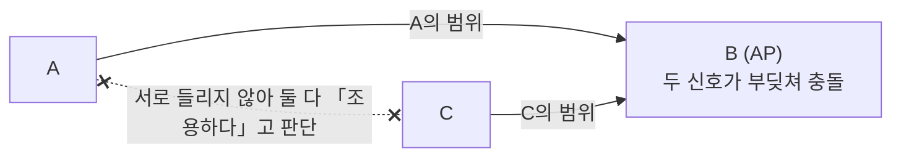
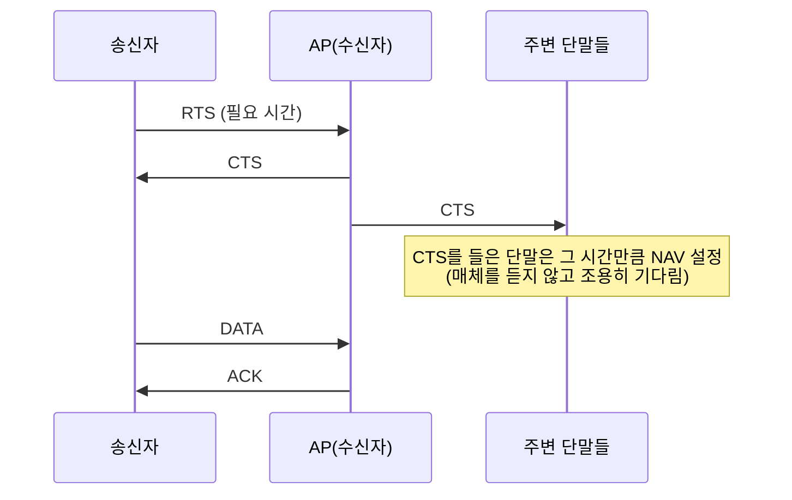
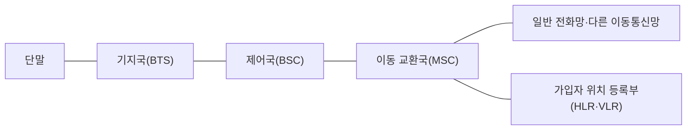

> 고려사이버대학교 「정보통신개론」(2023 겨울계절학기)과 「컴퓨터네트워크」(2023-2학기) 강의 내용을 바탕으로 정리했다.

## 무선망의 분류

| 구분 | 범위 | 대표 기술 |
| --- | --- | --- |
| WPAN (개인 영역) | 수 m ~ 수십 m | 블루투스, 지그비, 적외선(IrDA) |
| WLAN (근거리) | 수십 ~ 수백 m | Wi-Fi(IEEE 802.11) |
| WWAN (광역) | 수 km 이상 | 셀룰러 이동통신(WCDMA, LTE, 5G) |

유선을 포함한 크기별 분류(PAN·LAN·MAN·WAN)는 [[network-basics|네트워크 기초]]에 있다. 무선은 배선 없이 단말을 늘리고 옮기기 쉽지만, 공기라는 매체를 모두가 나눠 쓰므로 유선보다 속도와 품질이 불안정하다.

무선 기술 전체에 걸친 원칙이 두 가지 있다.

- **주파수가 높을수록 넓은 대역을 쓸 수 있어 빠르지만, 멀리 못 가고 장애물을 잘 못 뚫는다.** Wi-Fi의 2.4GHz와 5GHz, 5G의 수십 GHz 대역(mmWave)이 모두 이 균형 위에 있다.
- **면허 없이 쓰는 2.4GHz ISM 대역**은 Wi-Fi, 블루투스, 지그비, 전자레인지까지 함께 쓴다. 허가가 필요 없는 대신 서로 간섭해 붐빈다. 이동통신 대역은 정부가 사업자에게 할당하는 면허 대역이다.

## 근거리 무선(WPAN)

| 기술 | 특징 | 쓰임 |
| --- | --- | --- |
| 블루투스 | 2.4GHz ISM. 기기 몇 대를 짧게 잇는다. 4.0부터 들어간 **저전력 모드(BLE)** 로 배터리가 작은 기기까지 넓어졌다 | 이어폰, 키보드, 스마트워치, 사물 인터넷 센서 |
| 지그비(ZigBee) | 저전력·저비용·저속(수백 kbps 이하). 많은 기기를 그물(mesh)처럼 잇는다 | 센서 네트워크, 스마트홈 |
| 적외선(IrDA) | 빛을 쓰므로 마주 보고 가린 것이 없어야 한다 | 옛 휴대폰, 리모컨 |

## 무선 LAN: IEEE 802.11

802.11은 IEEE의 무선 LAN 표준이고, **Wi-Fi**는 Wi-Fi Alliance가 호환성을 인증한 상표다. 이더넷(802.3)처럼 1계층과 2계층(MAC)을 정의하며, IP부터는 유선과 같다.

### 망 구조

| 구조 | AP | 특징 |
| --- | --- | --- |
| 애드혹(Ad hoc) | 없음 | 단말끼리 직접 통신. 임시 연결용 |
| 인프라스트럭처 | 있음 | 모든 통신이 **AP(Access Point)** 를 거치고, AP가 유선망과 이어 준다 |

AP 하나와 붙은 단말들의 묶음이 **BSS(Basic Service Set)** 다. 여러 AP가 같은 네트워크 이름(SSID)으로 넓은 공간을 덮으면 ESS가 되고, 단말은 AP 사이를 옮겨 다닌다. 단말이 AP에 붙는 과정(비콘 수신, 인증, 연결)은 [[url-to-page|브라우저에 URL을 입력하면 일어나는 일]]의 첫 단계에 있다.

### 규격 변천

| 규격 | 대역 | 최대 속도 | 메모 |
| --- | --- | --- | --- |
| 802.11b (1999) | 2.4GHz | 11Mbps | 처음 널리 퍼진 규격 |
| 802.11a | 5GHz | 54Mbps | 높은 주파수라 장애물 많은 실내에서 약하다 |
| 802.11g | 2.4GHz | 54Mbps | b와 같은 대역에서 a의 속도 |
| 802.11n (Wi-Fi 4) | 2.4/5GHz | 수백 Mbps | 안테나 여러 개로 동시에 주고받는 MIMO 도입 |
| 802.11ac (Wi-Fi 5) | 5GHz | Gbps급 | 더 넓은 채널, 더 높은 QAM |
| 802.11ax (Wi-Fi 6/6E) | 2.4/5(/6)GHz | Gbps급 | 사용자가 많은 환경의 효율 개선(OFDMA) |

속도를 올린 방법은 셋이다. 채널을 넓히고, 변조 단계(QAM)를 높이고([[network-basics|네트워크 기초]]의 「신호 변환과 변조」), 안테나를 늘린다(MIMO). LTE-Advanced와 5G도 같은 수단을 쓴다.

### CSMA/CA: 충돌을 미리 피하기

유선 이더넷은 보내면서 듣다가 충돌을 감지하면 멈추는 **CSMA/CD**를 썼다([[network-basics|네트워크 기초]]). 무선에서는 두 가지 이유로 안 된다.

1. **보내는 동안 들을 수 없다.** 내 송신 신호가 멀리서 오는 약한 신호를 묻어 버린다.
2. **숨은 터미널(hidden terminal)**: A와 C가 AP B의 범위 안에 있지만 서로는 범위 밖이면, A가 보내는 중에도 C에게는 매체가 조용하게 들린다. C가 보내면 B에서 두 신호가 부딪치고, 송신자는 이를 알 수 없다.

그래서 802.11은 충돌을 감지하는 대신 **미리 피한다(Collision Avoidance).** 효율을 조금 내주고 충돌 가능성을 낮게 유지한다.

1. **매체가 조용한지 듣는다.**
2. 조용해도 **IFS(Inter-Frame Space)** 만큼 기다린다. IFS 길이가 곧 우선순위다.
   - **SIFS**(가장 짧다): ACK, CTS처럼 진행 중인 교환에 대한 즉시 응답
   - **PIFS**: AP가 폴링으로 매체를 관리할 때
   - **DIFS**(가장 길다): 일반 데이터 프레임
   짧게 기다리는 프레임이 먼저 매체를 잡으므로 진행 중인 교환이 새 송신에 끊기지 않는다.
3. 이어서 **무작위 백오프**만큼 더 기다려, 동시에 기다리던 단말들이 다른 시점에 시작하게 한다. 실패할수록 범위를 넓히는 것은 이더넷의 이진 지수 백오프와 같다.
4. 프레임을 보낸다.
5. 수신자는 SIFS 뒤에 **ACK**를 돌려준다. 충돌을 감지할 수 없으니 ACK가 없으면 실패로 보고 재전송한다. 유선 이더넷과 달리 2계층에서 확인 응답과 재전송을 한다.

큰 프레임 앞에서는 **RTS/CTS**로 매체를 예약해 숨은 터미널을 줄인다.

- **RTS(Request to Send)**: 송신자가 필요한 시간을 담아 AP에 요청한다.
- **CTS(Clear to Send)**: AP가 범위 안 모두에게 들리게 허락한다. 송신자와 서로 안 들리던 C도 AP의 CTS는 듣는다. 숨은 터미널이 풀리는 지점이다.
- **NAV(Network Allocation Vector)**: RTS·CTS를 들은 단말이 「이 시간 동안 사용 중」이라고 적어 두는 타이머. 매체를 듣지 않고도 기다리므로 가상 반송파 감지라고도 한다.

RTS/CTS 자체도 오버헤드라 보통 일정 크기 이상의 프레임에만 쓴다.

## 셀룰러 이동통신

이동통신은 전파로 움직이는 사용자에게 서비스를 이어 주는 광역 무선망이다. 유선에는 없는 문제가 셋 있다.

1. **주파수는 유한한 공공 자원이다.** 많은 사람이 같은 대역을 나눠 쓰고, 다른 곳에서 다시 써야 한다.
2. **사용자가 움직인다.** 기지국 범위를 벗어나도 통화가 끊기면 안 된다.
3. **상대 위치를 모른다.** 망이 늘 가입자 위치를 추적해야 전화를 연결할 수 있다.

### 셀과 주파수 재사용

넓은 지역을 큰 송신탑 하나로 덮으면 그 지역 전체가 주파수 한 벌을 나눠 써야 한다. **셀룰러** 방식은 지역을 작은 **셀**로 쪼개고 셀마다 출력이 약한 기지국을 둔다. 이웃 셀은 서로 다른 주파수를 쓰고, 몇 칸 떨어진 셀에서는 **같은 주파수를 다시 쓴다.** 셀이 작을수록 재사용 횟수가 늘어 수용 인원이 커지므로, 사람이 몰리는 도심일수록 기지국이 촘촘하다.

2G·3G 음성망 기준으로 기지국은 단말과 전파를 주고받고, 제어국은 여러 기지국의 무선 자원을 관리하며, 이동 교환국은 회선 교환기로서 가입자 위치 추적과 통화 넘기기를 맡는다. 4G부터는 음성도 IP 패킷으로 보내는 **All-IP** 구조라 교환국 대신 패킷 코어망이 이 일을 한다.

### 핸드오프

셀 경계를 넘을 때 통화를 다음 기지국으로 넘기는 것이 **핸드오프(핸드오버)** 다.

| 방식 | 동작 | 쓰인 곳 |
| --- | --- | --- |
| 하드 핸드오프 | 기존 연결을 끊고 새 기지국에 붙는다(break-before-make) | 이웃 셀이 다른 주파수를 쓰는 FDMA·TDMA |
| 소프트 핸드오프 | 새 기지국과 먼저 연결한 뒤 기존 연결을 끊는다(make-before-break) | 이웃 셀이 같은 주파수를 쓰는 CDMA |

## 다중 접속: 같은 대역을 여럿이 쓰기

여러 단말이 한 기지국(또는 AP)의 주파수를 동시에 쓰는 방법이다. [[network-basics|네트워크 기초]]의 다중 접근 분류에서 「채널화」에 해당하고, 원리는 같은 노트의 다중화(FDM·TDM)와 같지만 송신자가 서로 다른 단말이라는 점이 다르다.

| 방식 | 나누는 기준 | 비유 | 세대 |
| --- | --- | --- | --- |
| FDMA | 주파수 | 방을 칸막이로 나눠 각자 다른 칸에서 말하기 | 1G |
| TDMA | 시간 슬롯 | 한 방에서 돌아가며 말하기 | 2G (GSM) |
| CDMA | 코드 | 모두 동시에 말하되 각자 다른 언어로. 듣는 사람은 자기 언어만 알아듣는다 | 2G (IS-95), 3G |
| OFDMA | 잘게 쪼갠 부반송파 × 시간 | 좁은 칸 여러 개를 사용자마다 필요한 만큼 그때그때 배정 | 4G, 5G, Wi-Fi 6 |

**CDMA**는 사용자마다 고유한 코드를 곱해 신호를 넓은 대역에 흩뿌리고(대역 확산), 수신 측은 같은 코드로 자기 신호만 골라낸다. 다른 사용자의 신호는 잡음처럼 남는다. 방해 전파에 강하고 도청이 어려워 원래 군사 기술이었다. 수용량이 크지만 기지국 가까운 단말의 강한 신호가 먼 단말을 묻지 않도록 **전력 제어**가 정교해야 한다.

## 이동통신 세대별 변화

세대를 가르는 기준은 아날로그냐 디지털이냐(1G/2G), 데이터가 얼마나 빠르냐(3G 이후), 그리고 다중 접속 방식이다.

| 세대 | 대표 기술 | 다중 접속 | 바뀐 것 |
| --- | --- | --- | --- |
| 1G | AMPS 등 | FDMA | 아날로그 음성만. 잡음·혼선이 심하고 주파수가 금방 모자랐다 |
| 2G | GSM(유럽), IS-95 CDMA | TDMA, CDMA | 디지털 음성, 문자 메시지, 저속 데이터 |
| 2.5G | GPRS, EDGE, CDMA2000 1x | - | 2G 망에 패킷 교환을 더해 휴대폰 인터넷 시작 |
| 3G | WCDMA(UMTS), CDMA2000 EV-DO | CDMA | 수 Mbps 데이터, 영상 통화, USIM |
| 3.5G | HSDPA, HSUPA, HSPA+ | CDMA | 3G 개량으로 수십 Mbps |
| 4G | LTE, LTE-Advanced | OFDMA | All-IP. 음성도 데이터망 위로(VoLTE). 100Mbps ~ Gbps급 |
| 5G | NR | OFDMA | 초고주파까지 쓰는 초고속, 저지연, 대량 기기 접속 |

### 2G: GSM과 CDMA

- **GSM**: 200kHz 채널을 시간 슬롯 8개로 나누는 TDMA 범유럽 표준이다. 가입자 정보를 **SIM 카드**에 담아 단말을 바꿔도 번호가 따라오고 국가 간 로밍이 쉬워 세계 표준이 됐다.
- **CDMA(IS-95)**: 미국 퀄컴이 개발했고 한국이 1990년대 중반 세계 최초로 상용화했다. 수용량과 통화 품질이 좋았지만 채택국이 적어 로밍에 약했다. 한국 이동통신 산업이 커진 계기였지만 원천 기술 로열티 부담도 컸다.

### 3G: 두 갈래 표준

ITU는 **IMT-2000**이라는 단일 3G 표준을 목표로 했지만 진영이 갈렸다.

| 진영 | 표준 | 기지국 동기 |
| --- | --- | --- |
| 3GPP (유럽·일본) | WCDMA(UMTS), 5MHz 채널 | **비동기식**: 기지국끼리 시간을 맞추지 않고 이웃 기지국을 서로 다른 코드로 구분한다 |
| 3GPP2 (미국·한국) | CDMA2000 (1x, EV-DO) | **동기식**: 모든 기지국이 GPS 시계로 시간을 맞춘다 |

동기식은 GPS가 필수인데 GPS가 미국 소유라는 점을 다른 나라들이 꺼렸고, GSM의 후계인 WCDMA가 세계 주류가 됐다. 3G 단말은 가입자·인증 정보를 **USIM**에 담는다. 한국이 개발한 **와이브로(WiBro, 모바일 WiMAX)** 는 ITU 3G 표준에까지 들었지만, 4G에서 사업자 대부분이 3GPP의 LTE를 택하고 음성 서비스가 허용되지 않은 정책까지 겹쳐 밀려났다.

### 4G: LTE와 LTE-Advanced

**LTE(Long Term Evolution)** 는 3G를 길게 진화시킨다는 뜻의 3GPP 표준으로, 다중 접속을 CDMA에서 **OFDMA**로 바꾸고 망 전체를 IP 기반으로 다시 짰다. ITU의 4G 요건(IMT-Advanced)에는 못 미쳐 3.9G로 불리기도 했고, 요건을 채운 것은 **LTE-Advanced**다. 한국은 2011년 LTE를 상용화했다.

| 기술 | 내용 |
| --- | --- |
| CA (Carrier Aggregation) | 떨어진 주파수 대역 여러 개를 묶어 하나처럼 쓴다. 「광대역 LTE」는 붙은 대역을 넓게 잡은 것, 「3밴드 LTE-A」는 대역 셋을 묶은 것 |
| MIMO | 송수신 양쪽 안테나 여러 개로 동시에 여러 흐름을 보낸다 |
| CoMP | 여러 기지국이 협력해 한 단말에 보낸다 |

### 5G

5G는 쓰임새를 셋으로 나눠 목표를 잡았다: **초고속 대용량(eMBB)**, **초저지연·고신뢰(URLLC)**, **대량 기기 연결(mMTC)**. 수십 GHz의 초고주파(mmWave)는 대역이 넓어 매우 빠르지만 멀리 못 가고 장애물에 약하다. 그래서 안테나 소자 수십 개를 배열해 전파를 특정 방향으로 모아 쏘는 **빔포밍**이 핵심이다. 한국은 2019년 4월 세계 최초로 5G를 상용화했다.

## 핵심 정리

- 무선망은 도달 거리로 WPAN·WLAN·WWAN으로 나누고, 주파수가 높을수록 빠르지만 멀리 못 간다.
- 802.11은 AP를 거치는 인프라스트럭처 구조가 기본이고, 속도는 채널 폭·QAM·MIMO로 올려 왔다.
- 무선은 송신 중에 들을 수 없고 숨은 터미널이 있어 CSMA/CA를 쓴다. IFS로 우선순위를, 무작위 백오프로 동시 시작을 피하고, ACK로 성공을 확인하며, RTS/CTS와 NAV로 주변 단말까지 조용히 시킨다.
- 셀룰러는 셀로 쪼개 주파수를 재사용하고, 셀을 옮길 때 핸드오프로 통화를 넘긴다.
- 다중 접속은 FDMA(1G) → TDMA·CDMA(2G) → CDMA(3G) → OFDMA(4G·5G)로 바뀌었다.
- 2G는 SIM과 로밍의 GSM이 이겼고, 3G는 비동기 WCDMA가 주류가 됐으며, 4G는 All-IP와 OFDMA, 5G는 초고주파와 빔포밍이 핵심이다.

관련 노트: [[network-basics|네트워크 기초]], [[access-network-and-wan|가입자망과 광역망]], [[url-to-page|브라우저에 URL을 입력하면 일어나는 일]], [[network-security|네트워크 보안]], [[computing-history|컴퓨터의 역사]]
