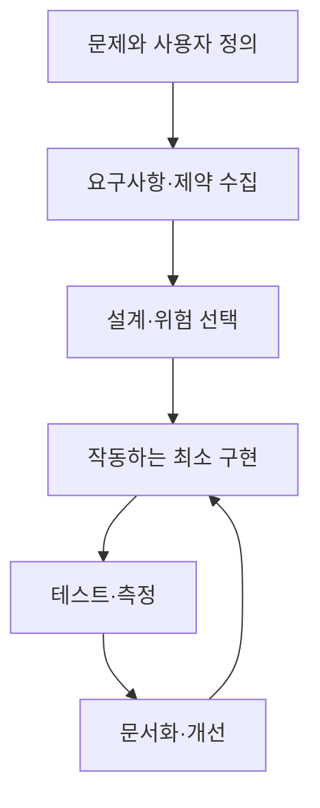

> OSSU의 공개 컴퓨터과학 커리큘럼 README(기준 커밋 `8f8272b1d378`)의 Advanced CS와 Final project 부분을 재구성한 노트다.

## Advanced CS란

Advanced CS는 전공 마지막 해에 해당하는 **선택 과목** 단계다. [[ossu-core-cs|Core CS]]의 필수 강좌를 모두 마친 뒤, 전문으로 삼을 영역 하나(예: 심화 프로그래밍)를 골라 그 아래 강좌를 듣는다. 한 영역의 강좌를 전부 들을 필요는 없지만, 가려는 분야와 관련된 강좌는 빠짐없이 듣는다. 영역을 직접 조합해 만들어도 된다. 심화 시스템은 기초 물리(고교 물리 수준)를 전제로 한다.

| 영역 | 깊게 파는 질문 |
| --- | --- |
| 병렬 프로그래밍 | 독립 계산을 동시에 수행할 때 공유 상태와 경합을 어떻게 통제하나 |
| 컴파일러 | 소스 코드가 파싱, 중간 표현, 최적화, 기계 코드로 어떻게 변환되나 |
| 논리·함수형 언어 | 계산을 값, 규칙, 증명에 가깝게 기술할 수 있나 |
| 테스트·디버깅 | 실패 원인을 체계적으로 격리하고 검증할 수 있나 |
| 컴퓨터 구조 | 회로, 명령어, 캐시, 파이프라인이 성능에 어떤 제약을 만드나 |
| 이론 | 계산 가능한 것의 한계는 어디인가(형식 언어, 오토마타, 계산 기하, 게임 이론) |
| 정보보안 | 웹 취약점, 거버넌스·컴플라이언스, 디지털 포렌식, 안전한 개발 생명주기를 어떻게 다루나 |
| 수학 | 선형대수, 확률, 논리, 수치해석이 AI, 그래픽스, 시뮬레이션의 기반을 어떻게 이루나 |

기간과 주당 학습량은 OSSU가 적어 둔 계획치이고, 표의 `-`는 원문에 값이 없다는 뜻이다. 실제 개설 여부와 수강 조건은 제공처에서 확인한다([[ossu-introduction-and-tools#비용과 접근 조건|비용과 접근 조건]]).

## Advanced programming: 심화 프로그래밍

| 강좌 | 기간 | 주당 학습량 | 선수 과목 |
| --- | --- | --- | --- |
| [Parallel Programming](https://www.coursera.org/learn/scala-parallel-programming) | 4 weeks | 6-8 hours/week | Scala programming |
| [Compilers](https://www.edx.org/learn/computer-science/stanford-university-compilers) | 9 weeks | 6-8 hours/week | none |
| [Introduction to Haskell](https://www.seas.upenn.edu/~cis194/fall16/) | 14 weeks | - | - |
| [Learn Prolog Now!](https://www.let.rug.nl/bos/lpn//lpnpage.php?pageid=online) ([alternative](https://github.com/ossu/computer-science/files/6085884/lpn.pdf)) | 12 weeks | - | - |
| [Software Debugging](https://www.youtube.com/playlist?list=PLAwxTw4SYaPkxK63TiT88oEe-AIBhr96A) | 8 weeks | 6 hours/week | Python, object-oriented programming |
| [Software Testing](https://www.youtube.com/playlist?list=PLAwxTw4SYaPkWVHeC_8aSIbSxE_NXI76g) | 4 weeks | 6 hours/week | Python, programming experience |

Learn Prolog Now!의 alternative는 Blackburn, Bos, Striegnitz의 책을 PDF로 묶은 것이다.

## Advanced systems: 심화 시스템

| 강좌 | 기간 | 주당 학습량 | 선수 과목 |
| --- | --- | --- | --- |
| [Computation Structures 1: Digital Circuits](https://learning.edx.org/course/course-v1:MITx+6.004.1x_3+3T2016) ([alternative 1](https://ocw.mit.edu/courses/6-004-computation-structures-spring-2017/), [alternative 2](https://ocw.mit.edu/courses/6-004-computation-structures-spring-2009/)) | 10 weeks | 6 hours/week | [Nand2Tetris II](https://www.coursera.org/learn/nand2tetris2) |
| [Computation Structures 2: Computer Architecture](https://learning.edx.org/course/course-v1:MITx+6.004.2x+3T2015) | 10 weeks | 6 hours/week | Computation Structures 1 |
| [Computation Structures 3: Computer Organization](https://learning.edx.org/course/course-v1:MITx+6.004.3x_2+1T2017) | 10 weeks | 6 hours/week | Computation Structures 2 |

alternative 링크 하나가 세 강좌의 내용을 모두 담고 있다.

## Advanced theory: 심화 이론

심화 이론 강좌는 Core CS의 이산수학과 알고리즘 강좌에서 배운 개념을 그대로 쓴다.

| 강좌 | 기간 | 주당 학습량 | 선수 과목 |
| --- | --- | --- | --- |
| [Theory of Computation](https://ocw.mit.edu/courses/18-404j-theory-of-computation-fall-2020/) ([alternative](https://www.youtube.com/playlist?list=PLEE7DF8F5E0203A56)) | 13 weeks | 10 hours/week | [Mathematics for Computer Science](https://openlearninglibrary.mit.edu/courses/course-v1:OCW+6.042J+2T2019/about), logic, algorithms |
| [Computational Geometry](https://www.edx.org/learn/geometry/tsinghua-university-ji-suan-ji-he-computational-geometry) | 16 weeks | 8 hours/week | algorithms, C++ |
| [Algorithmic Game Theory](https://timroughgarden.org/f13/f13.html) | 10 weeks | 12 hours/week | Core Theory |

## Advanced information security: 심화 정보보안

| 강좌 | 기간 | 주당 학습량 | 선수 과목 |
| --- | --- | --- | --- |
| [Web Security Fundamentals](https://www.edx.org/learn/computer-security/ku-leuven-web-security-fundamentals) | 5 weeks | 4-6 hours/week | understanding basic web technologies |
| [Security Governance & Compliance](https://www.coursera.org/learn/security-governance-compliance) | 3 weeks | 3 hours/week | - |
| [Digital Forensics Concepts](https://www.coursera.org/learn/digital-forensics-concepts) | 3 weeks | 2-3 hours/week | Core Security |
| [Secure Software Development: Requirements, Design, and Reuse](https://www.edx.org/learn/software-development/the-linux-foundation-secure-software-development-requirements-design-and-reuse) | 7 weeks | 1-2 hours/week | Core Programming and Core Security |
| [Secure Software Development: Implementation](https://www.edx.org/learn/software-development/the-linux-foundation-secure-software-development-implementation) | 7 weeks | 1-2 hours/week | Secure Software Development: Requirements, Design, and Reuse |
| [Secure Software Development: Verification and More Specialized Topics](https://www.edx.org/learn/software-engineering/the-linux-foundation-secure-software-development-verification-and-more-specialized-topics) | 7 weeks | 1-2 hours/week | Secure Software Development: Implementation |

## Advanced math: 심화 수학

| 강좌 | 기간 | 주당 학습량 | 선수 과목 |
| --- | --- | --- | --- |
| [Essence of Linear Algebra](https://www.youtube.com/playlist?list=PLZHQObOWTQDPD3MizzM2xVFitgF8hE_ab) | - | - | [high school math](https://ossu.dev/precollege-math) |
| [Linear Algebra](https://ocw.mit.edu/courses/mathematics/18-06sc-linear-algebra-fall-2011/) | 14 weeks | 12 hours/week | Essence of Linear Algebra와 병행(corequisite) |
| [Introduction to Numerical Methods](https://ocw.mit.edu/courses/mathematics/18-335j-introduction-to-numerical-methods-spring-2019/index.htm) | 14 weeks | 12 hours/week | [Linear Algebra](https://ocw.mit.edu/courses/mathematics/18-06sc-linear-algebra-fall-2011/) |
| [Introduction to Formal Logic](https://forallx.openlogicproject.org/) | 10 weeks | 4-8 hours/week | [Set Theory](https://www.youtube.com/playlist?list=PL5KkMZvBpo5AH_5GpxMiryJT6Dkj32H6N) |
| [Probability](https://stat110.hsites.harvard.edu/) | 15 weeks | 5-10 hours/week | [Differentiation and Integration](https://mitxonline.mit.edu/courses/course-v1:MITxT+18.01.2x/) |

## 최종 프로젝트

강좌의 과제는 단위 기술을 연습하는 데 맞다. 최종 프로젝트는 Core CS와 자기 분야의 Advanced CS를 마친 뒤 **스스로 문제를 정하고, 범위를 조정하고, 설계부터 구현·검증까지 잇는 능력**을 보여 주는 단계다. 완전히 새로운 것을 만들어도 되고, 쓰고 있는 도구나 프로그램을 개선해도 된다.

프로젝트를 혼자 잡기 어려우면 프로젝트 중심 강좌를 길잡이로 쓴다. 아래는 예시이고, 이 단계에서는 자기 분야에 맞는 강좌를 직접 찾을 수 있어야 한다.

| 프로젝트형 강좌 | 기간 | 주당 학습량 | 선수 과목 |
| --- | --- | --- | --- |
| [Fullstack Open](https://fullstackopen.com/en/) | 12 weeks | 15 hours/week | programming |
| [Modern Robotics](https://modernrobotics.northwestern.edu) | 26 weeks | 2-5 hours/week | freshman-level physics, linear algebra, calculus, [linear ordinary differential equations](https://www.khanacademy.org/math/differential-equations) |
| [Data Mining (Specialization)](https://www.coursera.org/specializations/data-mining) | 30 weeks | 2-5 hours/week | machine learning |
| [Big Data (Specialization)](https://www.coursera.org/specializations/big-data) | 30 weeks | 3-5 hours/week | none |
| [Internet of Things (Specialization)](https://www.coursera.org/specializations/internet-of-things) | 30 weeks | 1-5 hours/week | strong programming |
| [Cloud Computing (Specialization)](https://www.coursera.org/specializations/cloud-computing) | 30 weeks | 2-6 hours/week | C++ programming |
| [Data Science (Specialization)](https://www.coursera.org/specializations/jhu-data-science) | 43 weeks | 1-6 hours/week | none |
| [Functional Programming in Scala (Specialization)](https://www.coursera.org/specializations/scala) | 29 weeks | 4-5 hours/week | One year programming experience |
| [Game Design and Development with Unity 2020 (Specialization)](https://www.coursera.org/specializations/game-design-and-development) | 6 months | 5 hours/week | programming, interactive design |

### 완료 기록

- 강좌 수료 여부와 별개로 구현물, 테스트, 설계 근거를 남긴다. 문제 정의, 기술적 결정, 틀렸던 가정, 성능이나 정확도 측정을 문서로 적는다.
- 진도는 저장소를 fork해 완료한 항목에 표시하는 방식으로 관리한다([진도 안내](https://github.com/ossu/computer-science/blob/8f8272b1d378d31494240aa1d667aa6b045c6552/README.md#how-to-show-your-progress)). 과제물을 공개할 때는 각 강좌가 공개를 허용한 파일만 올린다.

관련 노트: [[ossu-core-cs|OSSU Core CS]], [[ossu-extras|OSSU 보충 강좌와 읽을거리]], [[programming-paradigms|프로그래밍 패러다임]], [[java-concurrency|Java 동시성]], [[vector-space|벡터공간]], [[system-design-fundamentals|시스템 설계 기초]]
