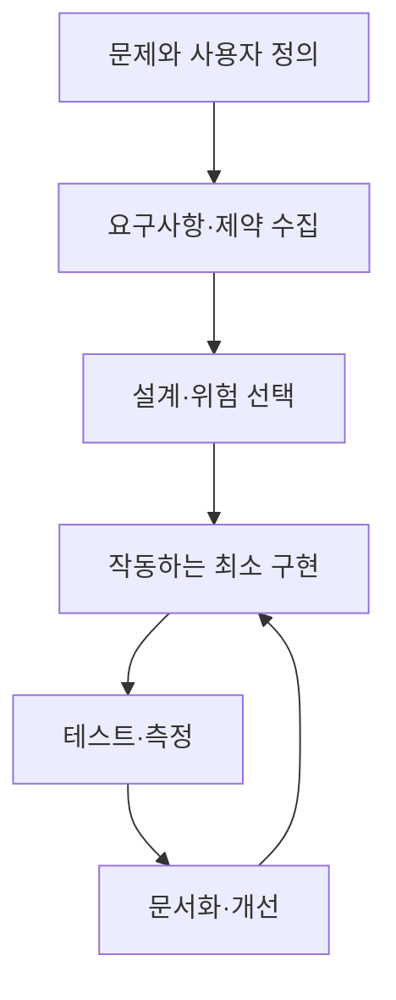

> OSSU의 공개 컴퓨터과학 커리큘럼과 관련 자료를 주제별로 재구성한 노트다.

## 최종 프로젝트가 필요한 이유

강좌의 과제는 단위 기술을 연습하는 데 적합하다. 최종 프로젝트는 스스로 문제를 정하고 범위를 조정하며 설계부터 구현·운영·검증까지 연결하는 능력을 보여 준다.

## 프로젝트 설계 흐름

## 공식 README에 있는 예시 과정

| 프로젝트 지향 코스 | 기간 | 주당 학습량 | 선수 지식 |
| --- | --- | --- | --- |
| [Fullstack Open](https://fullstackopen.com/en/) | 12 weeks | 15 hours/week | programming |
| [Modern Robotics](https://modernrobotics.northwestern.edu) | 26 weeks | 2-5 hours/week | freshman-level physics, linear algebra, calculus, [linear ordinary differential equations](https://www.khanacademy.org/math/differential-equations) |
| [Data Mining (Specialization)](https://www.coursera.org/specializations/data-mining) | 30 weeks | 2-5 hours/week | machine learning |
| [Big Data (Specialization)](https://www.coursera.org/specializations/big-data) | 30 weeks | 3-5 hours/week | none |
| [Internet of Things (Specialization)](https://www.coursera.org/specializations/internet-of-things) | 30 weeks | 1-5 hours/week | strong programming |
| [Cloud Computing (Specialization)](https://www.coursera.org/specializations/cloud-computing) | 30 weeks | 2-6 hours/week | C++ programming |
| [Data Science (Specialization)](https://www.coursera.org/specializations/jhu-data-science) | 43 weeks | 1-6 hours/week | none |
| [Functional Programming in Scala (Specialization)](https://www.coursera.org/specializations/scala) | 29 weeks | 4-5 hours/week | One year programming experience |
| [Game Design and Development with Unity 2020 (Specialization)](https://www.coursera.org/specializations/game-design-and-development) | 6 months | 5 hours/week | programming, interactive design |

## 완료 기록과 포트폴리오

- 강좌를 완료했는지와 별개로 구현물·테스트·설계 근거를 남긴다.
- 문제 정의, 기술적 결정, 실패한 가정, 성능이나 정확도 측정을 문서화한다.
- 원 저장소를 fork한 뒤 체크박스 등으로 진행도를 표시할 수 있다. 공식 [진도 안내](https://github.com/ossu/computer-science/blob/8f8272b1d378d31494240aa1d667aa6b045c6552/README.md#how-to-show-your-progress)를 따른다.

관련 노트: [[ossu-introduction-and-tools|OSSU 입문]], [[system-design-fundamentals|시스템 설계 기초]], [[backend-testing|백엔드 테스트]]
